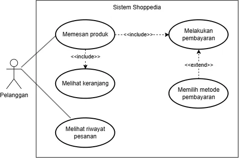

<h1>
IF2150 REKAYASA PERANGKAT LUNAK
 
TUGAS 10
 
HASIL IMPLEMENTASI DAN UJI PERANGKAT LUNAK (HIUPL)
</h1>
 

## Sehati

### Untuk: Aurelia Jennifer Gunawan

Dipersiapkan oleh:

| Informasi | Keterangan |
| --------- | ---------- |
| Kelas     | K01        |
| Kelompok  | G04        |

| NIM      | Nama                         |
| -------- | ---------------------------- |
| 13525052 | Daniel Charisma Christian    |
| 13525061 | Rifqi Irfan Indrawan         |
| 13525082 | Ausa Haadiyaan Mukhtar Yusuf |
| 13525058 | Farish Firstian Erifiawan    |

---

## Daftar Isi

- [BAB 1: Pendahuluan](#bab-1-pendahuluan)
  - [1.1 Tujuan Penulisan Dokumen](#11-tujuan-penulisan-dokumen)
  - [1.2 Lingkup Masalah](#12-lingkup-masalah)
  - [1.3 Definisi, Istilah, dan Singkatan](#13-definisi-istilah-dan-singkatan)
  - [1.4 Aturan Penomoran](#14-aturan-penomoran)
  - [1.5 Referensi](#15-referensi)
  - [1.6 Deskripsi Umum Dokumen (Ikhtisar)](#16-deskripsi-umum-dokumen-ikhtisar)
- [BAB 2: Deskripsi Umum Perangkat Lunak](#bab-2-deskripsi-umum-perangkat-lunak)
- [BAB 3: Implementasi](#bab-3-implementasi)
  - [3.1 Lingkungan Implementasi](#31-lingkungan-implementasi)
  - [3.2 Implementasi Modul](#32-implementasi-modul)
  - [3.3 Implementasi Antarmuka](#33-implementasi-antarmuka)
  - [3.4 File Lain](#34-file-lain)
- [BAB 4: Hasil Pengujian](#bab-4-hasil-pengujian)
  - [4.1 Strategi dan Kedalaman Pengujian Kelas](#41-strategi-dan-kedalaman-pengujian-kelas)
  - [4.2 Pengujian Unit Kelas](#42-pengujian-unit-kelas)
  - [4.3 Pengujian Integrasi](#43-pengujian-integrasi)
  - [4.4 Pengujian Use Case](#44-pengujian-use-case)
  - [4.5 Pengujian Kebutuhan Non-Fungsional (KNF)](#45-pengujian-kebutuhan-non-fungsional-knf)
  - [4.6 Tangkapan Layar dan Bukti Hasil Pengujian](#46-tangkapan-layar-dan-bukti-hasil-pengujian)
- [BAB 5: Traceability](#bab-5-traceability)

---

## Daftar Perubahan

| Revisi | Deskripsi                                                                                                                               |
| ------ | --------------------------------------------------------------------------------------------------------------------------------------- |
| _A_    | _Deskripsikan perubahan yang dilakukan dari dokumen sebelumnya pada dokumen ini. Jika tidak terdapat perubahan, harap kosongkan tabel._ |
| _B_    |                                                                                                                                         |
| _C_    |                                                                                                                                         |
| ...    |                                                                                                                                         |

---

# BAB 1: Pendahuluan

## 1.1 Tujuan Penulisan Dokumen

Tuliskan uraian ringkas mengenai isi dokumen, tujuan pembuatan dokumen HIUPL ini, dan siapa saja target pembacanya.

## 1.2 Lingkup Masalah

Tuliskan lingkup masalah, yaitu membangun perangkat lunak _[nama perangkat lunak]_. Jelaskan dengan singkat dan jelas deskripsi aplikasi serta keterkaitannya dengan perangkat lunak atau sistem lain (jika ada). Bagian ini maksimal berisi satu paragraf, dapat diambil dari SKPL/DPPL.

## 1.3 Definisi, Istilah, dan Singkatan

Semua definisi dan singkatan yang digunakan dalam dokumen ini beserta penjelasannya.

Tabel 1.3. Definisi Istilah dan Singkatan

| Singkatan, Akronim, atau Istilah | Penjelasan                                                                                                                                                            |
| -------------------------------- | --------------------------------------------------------------------------------------------------------------------------------------------------------------------- |
| _P/L_                            | _Singkatan dari Perangkat Lunak, yaitu aplikasi yang memberikan perintah kepada komputer untuk menjalankan tugas tertentu._                                           |
| _SKPL_                           | _Singkatan dari Spesifikasi Kebutuhan Perangkat Lunak, yaitu dokumen yang merangkum kriteria-kriteria yang diperlukan untuk membangun aplikasi menjalankan tugasnya._ |
| _DPPL_                           | _Singkatan dari Deskripsi Perancangan Perangkat Lunak, yaitu dokumen yang menjelaskan rancangan arsitektur, kelas, dan antarmuka P/L._                                |
| _HIUPL_                          | _Singkatan dari Hasil Implementasi dan Uji Perangkat Lunak, yaitu dokumen yang melaporkan hasil implementasi dan pengujian P/L._                                      |
| _KF_                             | _Singkatan dari Kebutuhan Fungsional._                                                                                                                                |
| _KNF_                            | _Singkatan dari Kebutuhan Non-Fungsional._                                                                                                                            |
| _UC_                             | _Singkatan dari Use Case._                                                                                                                                            |
| _TC_                             | _Singkatan dari Test Case, yaitu satu kasus uji untuk skenario tertentu._                                                                                             |
| _UT_                             | _Singkatan dari Unit Test, yaitu test case tingkat kelas/operasi._                                                                                                    |
| _INT_                            | _Singkatan dari Integration Test, yaitu test case yang menguji interaksi antarkomponen._                                                                              |
| _Boundary_                       | _Kasus uji pada nilai batas masukan, misalnya nilai minimum, maksimum, atau tepat di ambang aturan._                                                                  |
| _Coverage_                       | _Persentase baris/cabang kode yang dieksekusi oleh pengujian._                                                                                                        |
| _..._                            | _..._                                                                                                                                                                 |

## 1.4 Aturan Penomoran

Tuliskan aturan penomoran (ID) yang digunakan dalam dokumen ini. Gunakan pola ID yang **sama** dengan yang sudah dipakai pada dokumen-dokumen sebelumnya (SKPL, APL, DPPL), kecuali untuk ID pengujian yang baru diperkenalkan pada dokumen ini.

Tabel 1.4. Aturan Penomoran

| Hal/Bagian                 | Penomoran    | Keterangan                                                                        |
| -------------------------- | ------------ | --------------------------------------------------------------------------------- |
| _Kebutuhan Fungsional_     | _KFXX_       | _Sesuai SKPL_                                                                     |
| _Kebutuhan Non-Fungsional_ | _KNFXX_      | _Sesuai SKPL_                                                                     |
| _Use Case_                 | _UCXX_       | _Sesuai SKPL_                                                                     |
| _Kelas_                    | _CXX_        | _Sesuai DPPL_                                                                     |
| _Antarmuka_                | _I-XX_       | _Sesuai DPPL_                                                                     |
| _Test Case Unit_           | _CXX-UTYY_   | _XX adalah nomor kelas, YY adalah nomor urut test case unit pada kelas tersebut_  |
| _Test Case Integrasi_      | _INT-TCYY_   | _YY adalah nomor urut test case integrasi_                                        |
| _Test Case Use Case_       | _UCXX-TCYY_  | _XX adalah nomor use case, YY adalah nomor urut test case pada use case tersebut_ |
| _Test Case KNF_            | _KNFXX-TCYY_ | _XX adalah nomor KNF, YY adalah nomor urut test case pada KNF tersebut_           |
| _..._                      | _..._        | _..._                                                                             |

## 1.5 Referensi

Cantumkan daftar buku, panduan, atau dokumentasi lain yang dirujuk dalam pembuatan dokumen dan pengembangan P/L, **minimal dokumen SKPL, APL, DPPL, dan Implementasi (Tugas 9)**. Tambahkan dokumentasi _framework_/_library_/_testing tool_ atau referensi lain apabila digunakan.

## 1.6 Deskripsi Umum Dokumen (Ikhtisar)

Tuliskan sistematika pembahasan dokumen ini secara ringkas dan runut bab demi bab, dengan maksimal 1 paragraf.

 

---

# BAB 2: Deskripsi Umum Perangkat Lunak

Bagian ini diisi dengan _System Overview_, dalam bentuk gambar dan narasi yang memberikan gambaran tentang aplikasi dan konteksnya. **Batasan dan keterkaitan** antara sistem yang dibangun dengan sistem lain di luarnya harus jelas. Deskripsi umum sistem perlu dilengkapi dengan pemodelan kasus yang dihadapi, seperti _use case diagram_. Berikan narasi yang jelas untuk setiap gambar yang ditampilkan.

Bagian ini dapat menyalin atau meringkas dari dokumen SKPL atau DPPL.

<i>Gambar 2.1. Use Case Diagram [Nama P/L]</i>

 

---

# BAB 3: Implementasi

Bagian ini diisi dengan informasi tentang elemen P/L yang dikembangkan (_executable files_, _configuration files_, _data files_, dan sebagainya) serta perubahannya terhadap rancangan pada DPPL (jika ada).

## 3.1 Lingkungan Implementasi

Tuliskan _hardware_ dan _software_ yang digunakan untuk implementasi, mencakup _operating system_, bahasa pemrograman beserta versinya, _framework_/_library_, DBMS, _development tools_, dan _version control_. Lingkungan ini harus konsisten dengan **Subbab 2.1 DPPL**; jelaskan jika ada perubahan. Cantumkan juga _framework_ dan alat pengujian yang dipakai.

Tabel 3.1. Lingkungan Implementasi

| Aspek                | Keterangan                                                 |
| -------------------- | ---------------------------------------------------------- |
| _Hardware_           | _[Spesifikasi perangkat keras]_                            |
| _Operating System_   | _[Nama dan versi OS]_                                      |
| _Bahasa Pemrograman_ | _[Bahasa dan versi]_                                       |
| _Framework/Library_  | _[Daftar framework/library beserta versi]_                 |
| _DBMS_               | _[Nama dan versi DBMS]_                                    |
| _Development Tools_  | _[IDE, version control, tools lain]_                       |
| _Testing Tools_      | _[Framework unit test, alat ukur performa, alat coverage]_ |

## 3.2 Implementasi Modul

Daftar modul/kelas yang **TELAH** diimplementasikan. Gunakan nama dan ID kelas yang sama dengan DPPL, dan konsisten dengan Tabel B.5 pada dokumen Implementasi (Tugas 9).

Tabel 3.2. Implementasi Modul

| No  | ID Kelas | Nama Modul/Kelas     | Nama File Fisik  | Nama File Executable                            |
| --- | -------- | -------------------- | ---------------- | ----------------------------------------------- |
| 1   | _[C01]_  | _[Nama modul/kelas]_ | _[path/ke/file]_ | _[Nama file executable, atau - jika tidak ada]_ |
| 2   | _[C02]_  | _[Nama modul/kelas]_ | _[path/ke/file]_ | _[...]_                                         |
| ... | _..._    | _..._                | _..._            | _..._                                           |

## 3.3 Implementasi Antarmuka

Daftar antarmuka yang telah diimplementasikan. Gunakan ID dan nama layar yang sama dengan ID dan nama layar pada tugas DPPL.

Tabel 3.3. Implementasi Antarmuka

| No  | ID Antarmuka | Nama Antarmuka | Nama File Fisik  | Nama File Executable                            |
| --- | ------------ | -------------- | ---------------- | ----------------------------------------------- |
| 1   | _[I-01]_     | _[Nama layar]_ | _[path/ke/file]_ | _[Nama file executable, atau - jika tidak ada]_ |
| 2   | _[I-02]_     | _[Nama layar]_ | _[path/ke/file]_ | _[...]_                                         |
| ... | _..._        | _..._          | _..._            | _..._                                           |

## 3.4 File Lain

Daftar file lain yang dibuat selain file kelas dan antarmuka, misalnya file _utility_, _configuration_, _database schema/seed_, _file test_, atau _data_.

Tabel 3.4. File Lain

| No  | Nama File     | Keterangan      |
| --- | ------------- | --------------- |
| 1   | _[Nama file]_ | _[Fungsi file]_ |
| ... | _..._         | _..._           |

 

---

# BAB 4: Hasil Pengujian

Bab ini melaporkan hasil pengujian P/L pada level unit, integrasi, dan sistem. Pengujian dilakukan pada tag release terakhir Tugas 9. Hasil aktual diisi berdasarkan pengamatan saat pengujian. Kesimpulan diisi `Pass` atau `Fail`, dan untuk `Fail` dilengkapi penyebab serta usulan perbaikan.

## 4.1 Strategi dan Kedalaman Pengujian Kelas

Setiap kelas perancangan pada Tabel 4.1 DPPL diklasifikasikan ke dalam tiga tingkat kedalaman pengujian. Tingkat **Mendalam** diberikan pada kelas yang memuat logika bisnis, perhitungan, validasi, aturan status, algoritma, integrasi eksternal, atau keamanan. Tingkat **Sedang** diberikan pada kelas yang hanya mengoordinasikan atau mendelegasikan proses. Tingkat **Tidak perlu** diberikan pada kelas tanpa logika, seperti _entity/DTO_ dan kelas konfigurasi, yang teruji secara tidak langsung melalui test case use case. Seluruh kelas wajib dicantumkan beserta alasan penentuan tingkatnya.

Tabel 4.1.1. Identifikasi Tingkat Pengujian Kelas

| ID Kelas | Nama Kelas     | Tingkat                         | Alasan                                                  | Test Case Terkait                  |
| -------- | -------------- | ------------------------------- | ------------------------------------------------------- | ---------------------------------- |
| _C02_    | _Pesanan_      | _Mendalam_                      | _Memuat `hitungTotal()` dan transisi status pembayaran_ | _C02-UT01 s.d. C02-UT08_           |
| _C03_    | _Keranjang_    | _Sedang_                        | _Delegasi sederhana ke Produk dan Pesanan_              | _C03-UT01 s.d. C03-UT03, INT-TC02_ |
| _C01_    | _Pelanggan_    | _Tidak perlu_                   | _Hanya menyimpan data akun, tanpa logika_               | _-_                                |
| _[CXX]_  | _[Nama kelas]_ | _[Mendalam/Sedang/Tidak perlu]_ | _[Alasan penentuan tingkat pengujian]_                  | _[ID test case atau -]_            |
| _..._    | _..._          | _..._                           | _..._                                                   | _..._                              |

## 4.2 Pengujian Unit Kelas

Pengujian unit dilakukan pada kelas bertingkat Mendalam dan Sedang. Kelas Mendalam diuji pada seluruh operasi public dengan kasus normal, batas, dan negatif, serta mencapai _coverage_ minimal 70%. Kelas Sedang diuji minimal dengan satu kasus normal dan satu kasus gagal pada operasi public utama.

Cara menjalankan unit test: _[tuliskan perintah, mis. `pytest src/tests/`]_.

Lokasi file test: _[path, mis. `src/tests/`]_.

### 4.2.1 Kelas [Nama Kelas 1]

**ID Kelas:** _[C02]_  
**Nama Kelas:** _[Pesanan]_  
**Tingkat:** _[Mendalam]_

Tabel 4.2.1. Hasil Pengujian Unit Kelas [C02]

| ID Pengujian | Operasi yang Diuji         | Jenis Kasus | Prosedur/Masukan                                  | Hasil yang Diharapkan                                | Hasil Pengujian  | Kesimpulan  |
| ------------ | -------------------------- | ----------- | ------------------------------------------------- | ---------------------------------------------------- | ---------------- | ----------- |
| _C02-UT01_   | _`hitungTotal(): Decimal`_ | _Normal_    | _Pesanan berisi 2 item: 10.000 x 2 dan 5.000 x 1_ | _Total = 25.000_                                     | _[Hasil aktual]_ | _Pass/Fail_ |
| _C02-UT02_   | _`hitungTotal(): Decimal`_ | _Batas_     | _Pesanan berisi tepat 1 item dengan jumlah 1_     | _Total = harga item tersebut_                        | _[...]_          | _Pass/Fail_ |
| _C02-UT03_   | _`hitungTotal(): Decimal`_ | _Negatif_   | _Pesanan tanpa item_                              | _Total = 0 atau melempar kesalahan sesuai rancangan_ | _[...]_          | _Pass/Fail_ |
| _..._        | _..._                      | _..._       | _..._                                             | _..._                                                | _..._            | _..._       |

Khusus kelas **Mendalam**:

Tabel 4.2.1b. Ringkasan Cakupan Kelas [C02]

| Informasi                       | Keterangan                                      |
| ------------------------------- | ----------------------------------------------- |
| Daftar operasi public pada DPPL | _[op1(), op2(), ...]_                           |
| Operasi yang diuji              | _[op1(), op2(), ...]_                           |
| ID Algoritma yang tercakup      | _[Algo-001, ...]_                               |
| Coverage (wajib ≥ 70%)          | _[% baris / % cabang, alat dan bukti pada 4.6]_ |

### 4.2.2 Kelas [Nama Kelas 2]

_[Ulangi pola 4.2.1 untuk setiap kelas bertingkat Mendalam atau Sedang.]_

 

## 4.3 Pengujian Integrasi

Pengujian integrasi memeriksa interaksi antarkomponen yang melewati batas, yaitu _Controller_ ke _Model_, aplikasi ke basis data, dan aplikasi ke sistem eksternal. Daftar antarmuka mengacu pada dokumen DPPL, dengan minimal satu test case untuk setiap antarmuka. Pengujian memakai komponen nyata, bukan _mock_. Apabila ada antarmuka tambahan yang belum didaftarkan pada dokumen DPPL, cantumkan juga.

Tabel 4.3.1. Daftar Antarmuka Antarkomponen

| ID Antarmuka | Komponen Asal           | Komponen Tujuan           | Jenis Batas                   | Test Case            |
| ------------ | ----------------------- | ------------------------- | ----------------------------- | -------------------- |
| _I-01_       | _KeranjangController_   | _Keranjang (Model)_       | _Controller - Model_          | _INT-TC01, INT-TC02_ |
| _I-02_       | _Pesanan (Model)_       | _Database_                | _Aplikasi - Basis data_       | _INT-TC03_           |
| _I-03_       | _PaymentGatewayAdapter_ | _Payment Gateway (dummy)_ | _Aplikasi - Sistem eksternal_ | _INT-TC04, INT-TC05_ |
| _[I-XX]_     | _[Komponen asal]_       | _[Komponen tujuan]_       | _[Jenis batas]_               | _[ID test case]_     |
| _..._        | _..._                   | _..._                     | _..._                         | _..._                |

Tabel 4.3.2. Hasil Pengujian Integrasi

| ID Pengujian | ID Antarmuka | Skenario                                    | Prosedur/Masukan                                                         | Hasil yang Diharapkan                                                              | Hasil Pengujian  | Kesimpulan  |
| ------------ | ------------ | ------------------------------------------- | ------------------------------------------------------------------------ | ---------------------------------------------------------------------------------- | ---------------- | ----------- |
| _INT-TC01_   | _I-01_       | _Normal: tambah item ke keranjang_          | _Panggil `tambahItem()` melalui KeranjangController dengan produk valid_ | _Item tersimpan pada Keranjang dan tampil pada daftar item_                        | _[Hasil aktual]_ | _Pass/Fail_ |
| _INT-TC03_   | _I-02_       | _Normal: simpan pesanan_                    | _Buat pesanan, lalu baca ulang langsung dari basis data_                 | _Baris pesanan ada dengan nilai total dan status yang sama_                        | _[...]_          | _Pass/Fail_ |
| _INT-TC05_   | _I-03_       | _Gagal: gateway mengembalikan status gagal_ | _Kirim otorisasi dengan saldo dummy tidak cukup_                         | _Status pesanan tidak berubah menjadi "Lunas", pesan gagal diteruskan ke pengguna_ | _[...]_          | _Pass/Fail_ |
| _..._        | _..._        | _..._                                       | _..._                                                                    | _..._                                                                              | _..._            | _..._       |

 

## 4.4 Pengujian Use Case

Pengujian use case dilakukan pada seluruh skenario normal dan alternatif sesuai Subbab 4.4 SKPL, dengan minimal satu test case untuk setiap skenario. Kolom ID KF menunjukkan KF yang diverifikasi oleh test case tersebut.

### 4.4.1 Use Case [Nama Use Case 1]

**ID Use Case:** _[UC01 sesuai SKPL]_  
**Nama Use Case:** _[Nama use case sesuai SKPL]_

Tabel 4.4.1. Hasil Pengujian Use Case [UC01]

| ID Pengujian | ID KF  | Skenario                        | Prosedur Pengujian                                                             | Masukan                               | Hasil yang Diharapkan                      | Hasil Pengujian                                                         | Kesimpulan                                      |
| ------------ | ------ | ------------------------------- | ------------------------------------------------------------------------------ | ------------------------------------- | ------------------------------------------ | ----------------------------------------------------------------------- | ----------------------------------------------- |
| _UC01-TC01_  | _KF01_ | _Normal_                        | _1. Buka halaman login. 2. Masukkan kredensial. 3. Klik tombol "Login"._ | _User: rpl@gmail.com Pass: 123456_ | _Pengguna diarahkan ke Halaman Dashboard._ | _Pengguna diarahkan ke Halaman Dashboard sesuai hasil yang diharapkan._ | _Pass_                                          |
| _UC01-TC02_  | _KF01_ | _Alternatif 1: [Nama skenario]_ | _[Langkah-langkah pengujian]_                                                  | _[Data masukan]_                      | _[Hasil yang diharapkan]_                  | _[Hasil aktual]_                                                        | _[Pass/Fail. Jika Fail: penjelasan dan solusi]_ |
| _..._        | _..._  | _..._                           | _..._                                                                          | _..._                                 | _..._                                      | _..._                                                                   | _..._                                           |

### 4.4.2 Use Case [Nama Use Case 2]

_[Lanjutkan untuk seluruh use case dengan pola yang sama, hingga 4.4.N.]_

 

## 4.5 Pengujian Kebutuhan Non-Fungsional (KNF)

Setiap KNF pada Tabel 3.2 SKPL diuji secara terukur berdasarkan parameter yang telah didefinisikan. Setiap pengujian memuat target terukur, metode dan alat yang sesuai dengan parameter (misalnya Chrome DevTools untuk _response time_ dan inspeksi basis data untuk _security_), serta hasil aktual berupa angka atau data. KNF yang belum dipenuhi atau tidak diimplementasikan dicantumkan beserta alasan dan rencana perbaikan.

Tabel 4.5. Hasil Pengujian KNF

| ID Pengujian | ID KNF  | Parameter       | Target Terukur                                                        | Metode dan Alat                                            | Hasil Aktual                            | Kesimpulan  |
| ------------ | ------- | --------------- | --------------------------------------------------------------------- | ---------------------------------------------------------- | --------------------------------------- | ----------- |
| _KNF01-TC01_ | _KNF01_ | _Reliability_   | _Tidak ada data hilang/ganda saat jaringan putus di tengah transaksi_ | _Simulasi putus koneksi saat bayar, lalu cek status di DB_ | _[Hasil aktual]_                        | _Pass/Fail_ |
| _KNF02-TC01_ | _KNF02_ | _Security_      | _Password tersimpan sebagai hash, bukan plain-text_                   | _Inspeksi tabel pengguna di DB_                            | _[...]_                                 | _Pass/Fail_ |
| _KNFXX-TC01_ | _KNFXX_ | _Response time_ | _Halaman tampil ≤ 4 detik_                                            | _Chrome DevTools, 5 kali ukur, ambil rata-rata_            | _[Rata-rata ... detik, maks ... detik]_ | _Pass/Fail_ |
| _..._        | _..._   | _..._           | _..._                                                                 | _..._                                                      | _..._                                   | _..._       |

 

## 4.6 Tangkapan Layar dan Bukti Hasil Pengujian

Bukti pengujian dilampirkan sesuai ID Pengujian pada Subbab 4.2 sampai 4.5, berupa tangkapan layar aplikasi, keluaran _test runner_, laporan _coverage_ untuk setiap kelas Mendalam, atau hasil alat ukur.

Tabel 4.6. Bukti Hasil Pengujian

| ID Pengujian          | Bukti Hasil Pengujian                                            |
| --------------------- | ---------------------------------------------------------------- |
| _C02-UT01 – C02-UT08_ | _[Sisipkan hasil keluaran unit test]_                            |
| _C02 (coverage)_      | _[Sisipkan laporan coverage kelas C02]_                          |
| _INT-TC01_            | _[Sisipkan bukti pengujian integrasi]_                           |
| _UC01-TC01_           | _[Sisipkan tangkapan layar UC01-TC01 sesuai prosedur pengujian]_ |
| _UC01-TC02_           | _[Sisipkan tangkapan layar UC01-TC02 sesuai prosedur pengujian]_ |
| _KNF01-TC01_          | _[Sisipkan bukti pengukuran parameter KNF01-TC01]_               |
| _..._                 | _..._                                                            |

 

---

# BAB 5: Traceability

Petakan setiap KF ke KNF, use case, kelas perancangan, file implementasi, dan test case. Tabel traceability berikut akan menjadi sarana verifikasi KF. Setiap KF memiliki minimal satu test case dan dinyatakan terpenuhi apabila **seluruh** test case terkaitnya berkesimpulan `Pass`. KF yang tidak diimplementasikan tetap dicantumkan beserta alasannya.

Tabel 5.1. Matriks Kerunutan KF terhadap Implementasi dan Pengujian

| KF ID  | KNF Terkait      | Use Case ID     | Kelas Terkait                              | Implementasi File Terkait            | Test Case (UC)                      | Test Case (Unit/Integrasi/KNF)            |
| ------ | ---------------- | --------------- | ------------------------------------------ | ------------------------------------ | ----------------------------------- | ----------------------------------------- |
| _KF05_ | _KNF01_          | _UC03_          | _C02 - Pesanan_                            | _`src/...`_                          | _UC03-TC01_                         | _C02-UT05, INT-TC04, KNF01-TC01_          |
| _KF01_ | _-_              | _UC01 UC02_  | _[C01 - Nama kelas] [C02 - Nama kelas]_ | _[path/ke/file1] [path/ke/file2]_ | _UC01-TC01, UC01-TC02 UC02-TC01_ | _-_                                       |
| _KF02_ | _[KNFXX atau -]_ | _[UCXX]_        | _[CXX - Nama kelas]_                       | _[path/ke/file]_                     | _[UCXX-TCYY]_                       | _[CXX-UTYY, INT-TCYY, KNFXX-TCYY atau -]_ |
| _KFXX_ | _-_              | _[UCXX atau -]_ | _[CXX - Nama kelas atau -]_                | _Tidak diimplementasikan: [alasan]_  | _-_                                 | _-_                                       |
| _..._  | _..._            | _..._           | _..._                                      | _..._                                | _..._                               | _..._                                     |

Tabel 5.2. Matriks Kerunutan KNF terhadap Pengujian

| ID KNF  | Parameter     | KF/UC Terkait          | Test Case      |
| ------- | ------------- | ---------------------- | -------------- |
| _KNF01_ | _Reliability_ | _KF05 / UC03_          | _KNF01-TC01_   |
| _KNFXX_ | _[Parameter]_ | _[KFXX / UCXX atau -]_ | _[KNFXX-TCYY]_ |
| _..._   | _..._         | _..._                  | _..._          |
