# Sequence Diagram Sehati (Salinan Mermaid)

Salinan Mermaid dari seluruh _sequence diagram_ UC-01 sampai UC-12, sudah memakai perbaikan yang diusulkan. Setiap pesan adalah operasi yang ada pada kelas penerimanya di diagram kelas (BAB 3 dan Tabel 4.1 DPPL). Setiap skenario alternatif digambar sebagai diagram sendiri. Setiap diagram dapat diekspor ke PNG lewat mermaid.live.

Pesan balasan (garis putus-putus) berisi nilai kembalian, atau nama operasi tampilan pada `View` saat hasil ditampilkan ke aktor.

## UC-01 Menyetel Daily Affirmations

### Skenario Normal

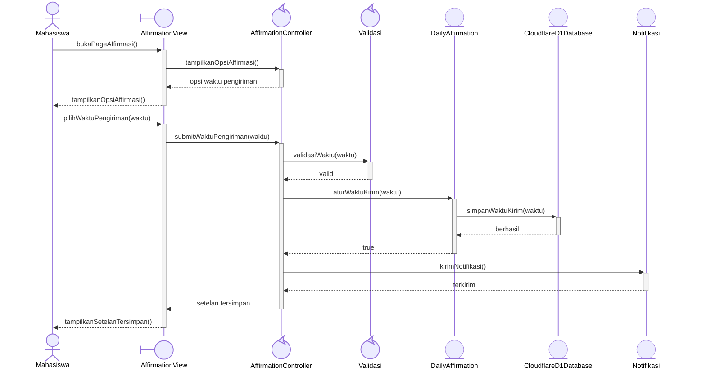

### Skenario Alternatif 1: Sistem tidak mampu menyimpan setelan


### Perbaikan terhadap PNG

- Nama pesan disamakan dengan operasi pada diagram kelas, mis. `bukaPageAffirmasi()` dan `submitWaktuPengiriman(waktu)`.
- Penyimpanan ke D1 dilakukan oleh `DailyAffirmation` lewat `simpanWaktuKirim(waktu)`, sama seperti PNG.
- Fragmen `alt` pada PNG dipisah menjadi diagram skenario alternatif sendiri.

## UC-02 Menyetel Pengingat Kesehatan

### Skenario Normal

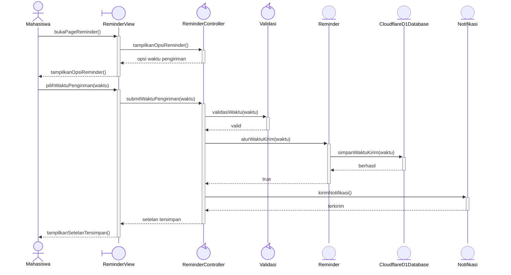

### Skenario Alternatif 1: Sistem tidak mampu menyimpan setelan

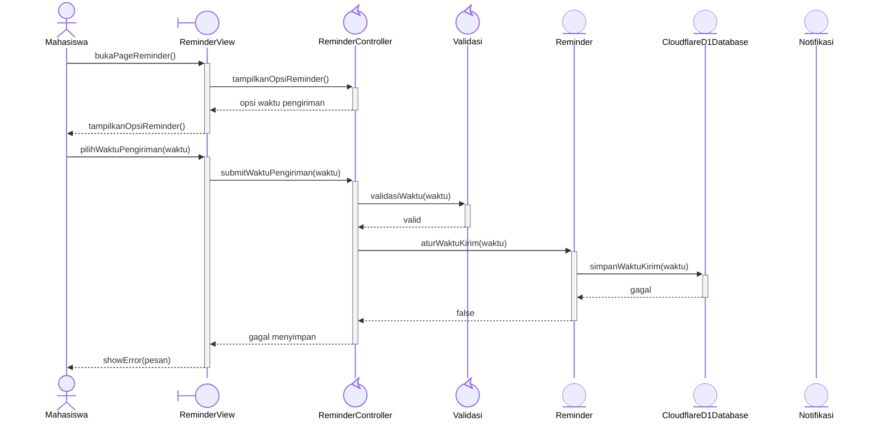

### Perbaikan terhadap PNG

- Sama seperti UC-01, dengan `ReminderView`, `ReminderController`, dan `Reminder`.
- Operasi `aturWaktuKirim(waktu)` dipakai (PNG memakai nama itu juga), bukan `aturWaktuPengingat()` dari M4.

## UC-03 Melihat Kalender Terintegrasi

### Skenario Normal

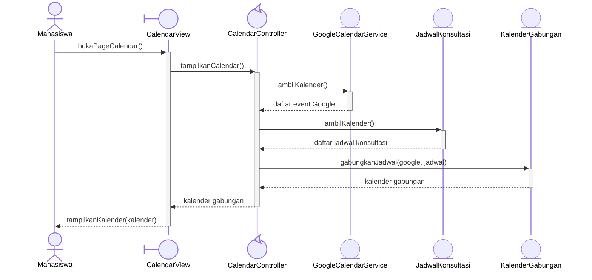

### Skenario Alternatif 1: Sistem tidak mampu mengambil data event

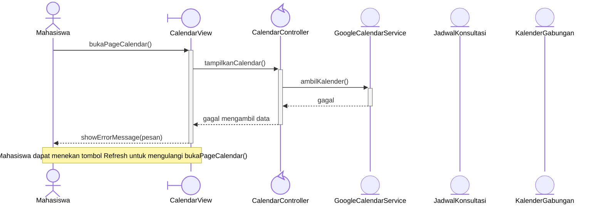

### Perbaikan terhadap PNG

- `ShowErrorMessage()` menjadi `showErrorMessage(pesan)`, dan `Tampilkan Calender()` menjadi `tampilkanCalendar()`.
- `ambilKalender()` pada `JadwalKonsultasi` dipanggil tanpa parameter (overload pada diagram kelas).
- Ditambahkan catatan tombol Refresh dari SKPL pada skenario alternatif.

## UC-04 Memesan Sesi Konsultasi

### Skenario Normal

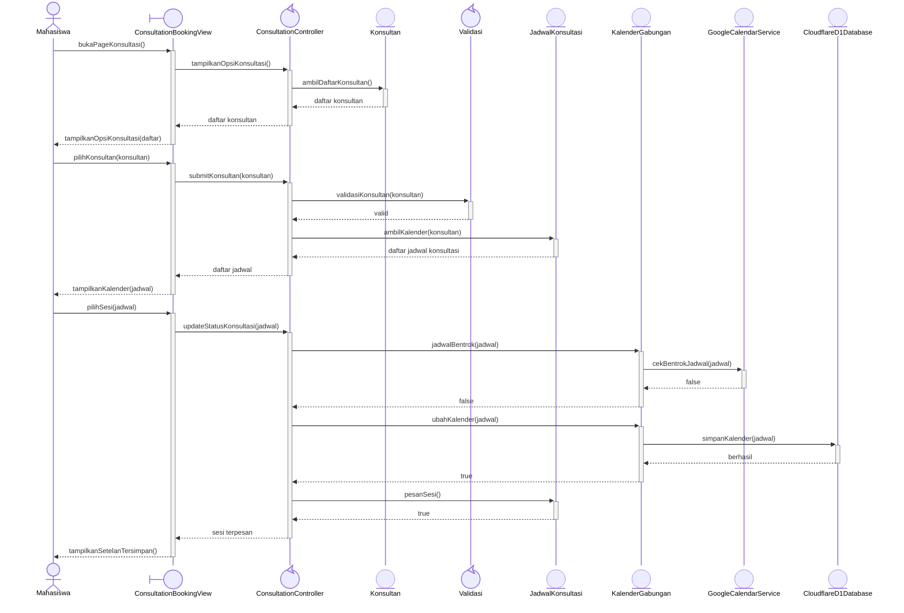

### Skenario Alternatif 1: Sistem tidak mampu mengambil data jadwal konsultasi

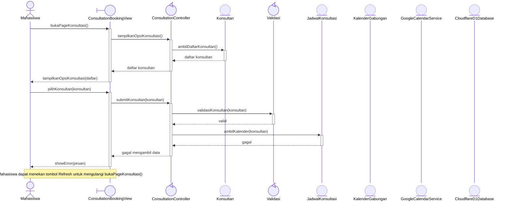

### Skenario Alternatif 2: Sistem tidak mampu menyimpan jadwal konsultasi yang dipesan

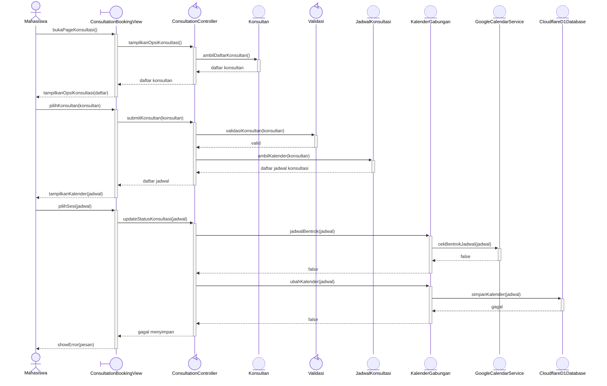

### Perbaikan terhadap PNG

- `GoogleCalendarService` ditambahkan: `KalenderGabungan.jadwalBentrok()` memanggil `cekBentrokJadwal()` (SKPL AB-RLS-D-4). Pada PNG kelas ini tidak ada.
- Urutan diubah: simpan dulu (`ubahKalender()` lalu `simpanKalender()`), baru `pesanSesi()`, agar status jadwal tidak berubah bila penyimpanan gagal.
- File PNG diganti nama dari `UC-04_SQ_diagram(1).png` menjadi `UC-04_SQ_diagram.png`.

## UC-05 Mengelola Jadwal Konsultan

### Skenario Normal

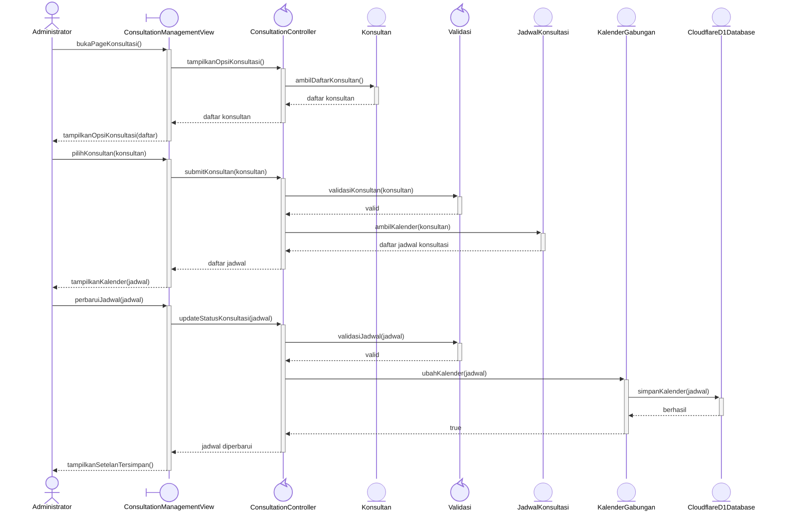

### Skenario Alternatif 1: Sistem tidak mampu mengambil data jadwal konsultasi

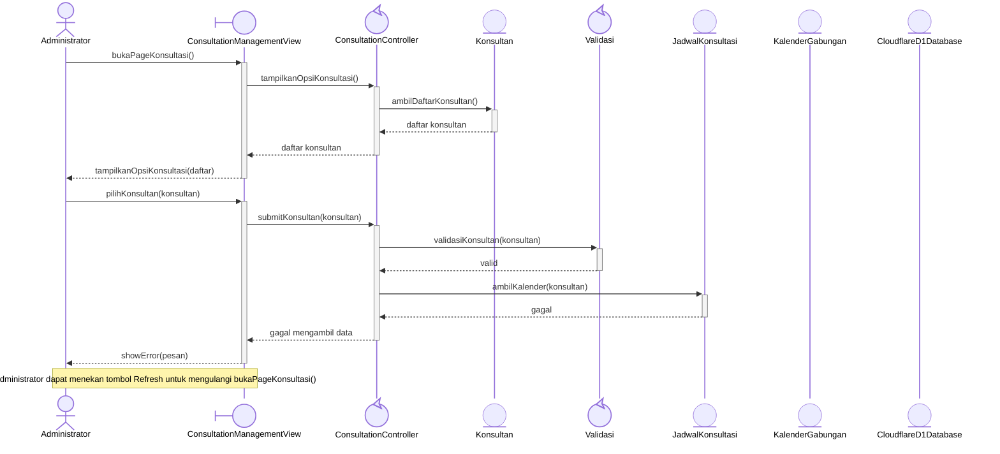

### Skenario Alternatif 2: Sistem tidak mampu mengedit data jadwal konsultasi

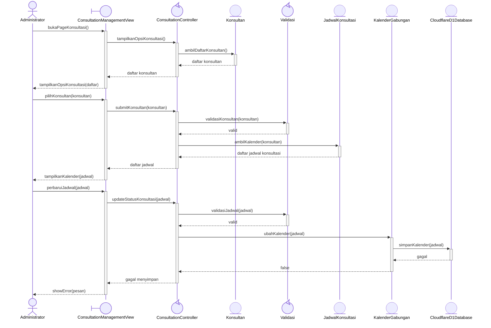

### Perbaikan terhadap PNG

- Alur dipisah dari fragmen `alt` pada PNG menjadi dua skenario alternatif sesuai SKPL.
- Nama pesan disamakan dengan operasi pada diagram kelas, mis. `validasiJadwal(jadwal)` dan `ubahKalender(jadwal)`.

## UC-06 Melihat FAQ

### Skenario Normal

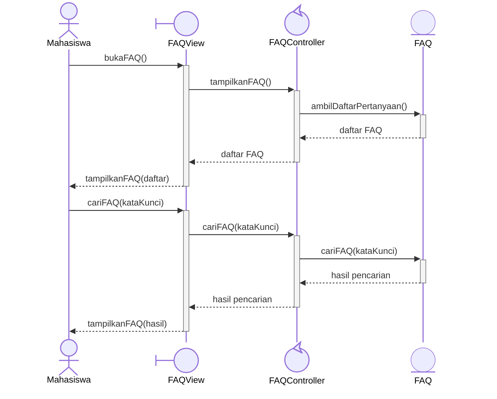

### Skenario Alternatif 1: Tidak ada pertanyaan yang dicari pengguna

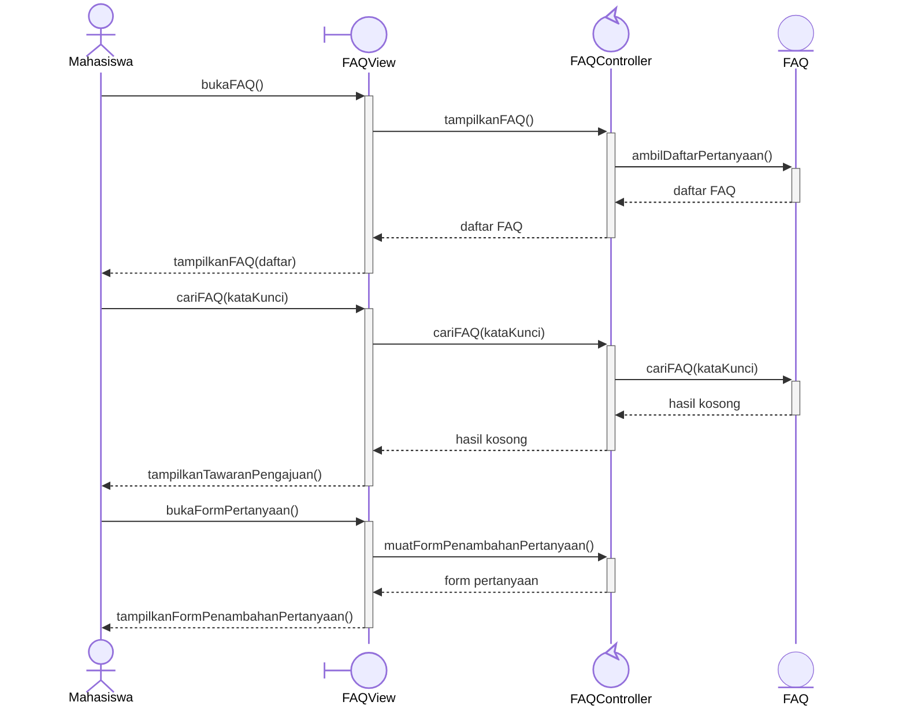

### Perbaikan terhadap PNG

- Ditambahkan pencarian `cariFAQ(kataKunci)` karena SKPL berbunyi "mencari pertanyaan di search bar FAQ". PNG tidak punya pencarian.
- Skenario alternatif ditambahkan (hasil kosong lalu tawaran pengajuan pertanyaan). PNG tidak memilikinya.

## UC-07 Mengelola FAQ

### Skenario Normal

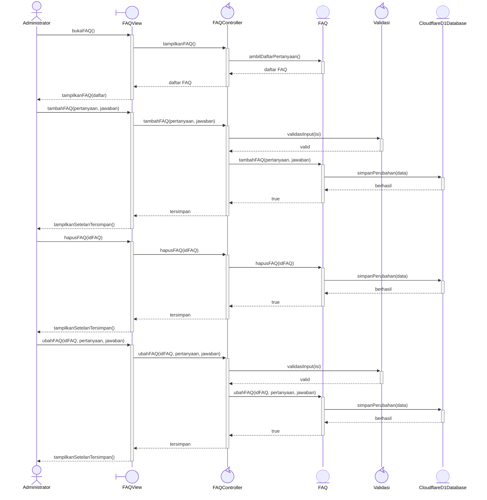

### Skenario Alternatif 1: Tidak ada pertanyaan maupun jawaban yang berhasil disimpan

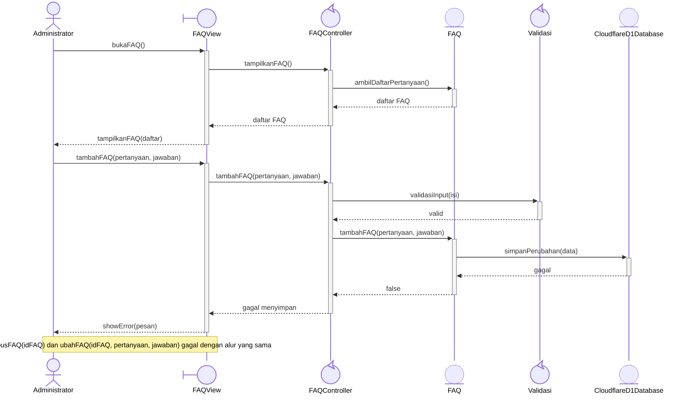

### Perbaikan terhadap PNG

- Controller tidak lagi memanggil D1 langsung. `FAQ` menyimpan lewat `simpanPerubahan(data)`, sesuai MVC.
- Ketiga aksi pada SKPL (tambah, hapus, ubah) digambar. PNG hanya memuat ubah.
- `FAQ` diberi atribut `idFAQ` agar `hapusFAQ` dan `ubahFAQ` dapat menunjuk satu FAQ.

## UC-08 Memberikan Umpan Balik

### Skenario Normal

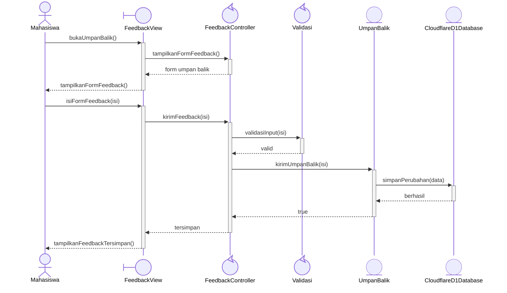

### Skenario Alternatif 1: Umpan balik tidak disimpan pada database

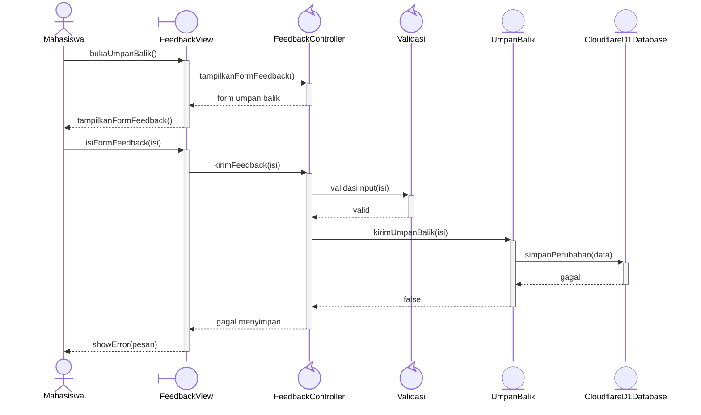

### Perbaikan terhadap PNG

- Participant `Feedback` diganti `UmpanBalik` (nama kelas pada SKPL dan APL).
- D1 dipanggil oleh `UmpanBalik.kirimUmpanBalik()`, bukan langsung oleh controller.

## UC-09 Menanggapi Umpan Balik

### Skenario Normal

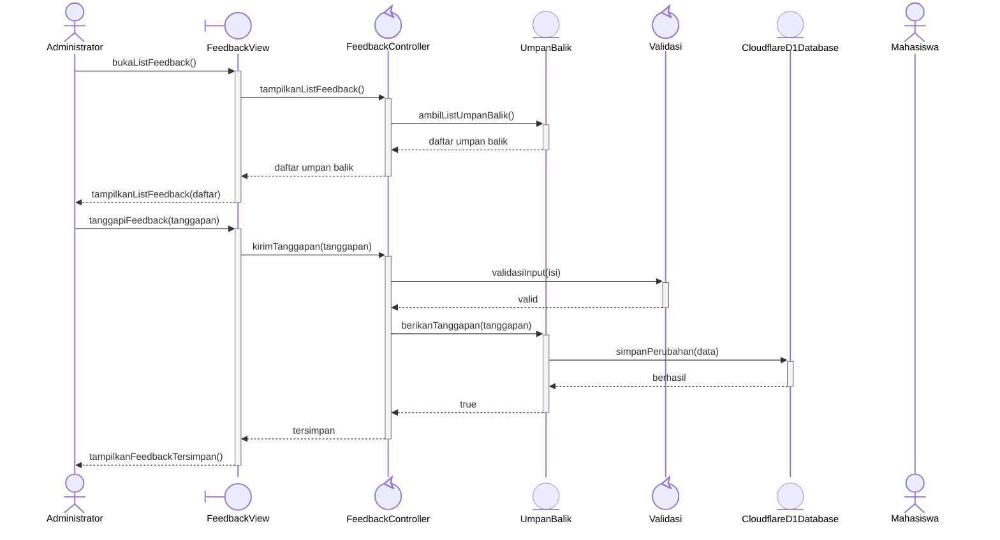

### Skenario Alternatif 1: Tanggapan umpan balik tidak berhasil ditampilkan

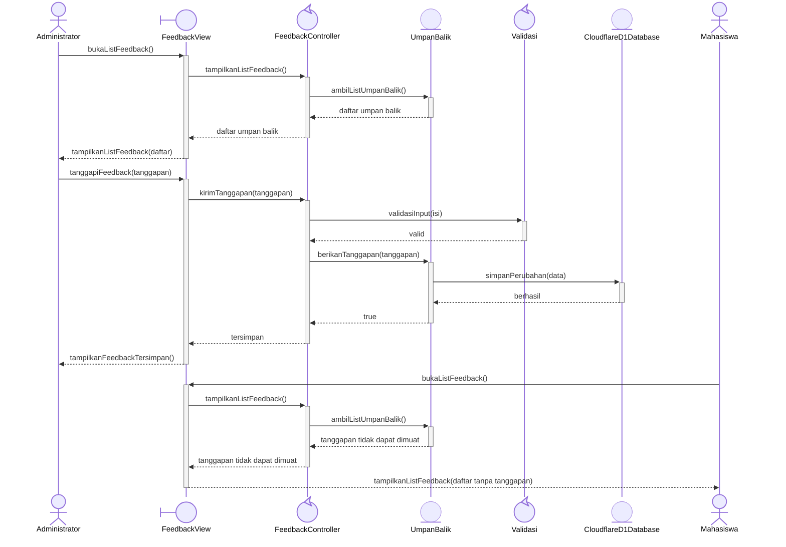

### Perbaikan terhadap PNG

- Participant `Feedback` diganti `UmpanBalik`, dan D1 dipanggil oleh `UmpanBalik.berikanTanggapan()`.
- Skenario alternatif mengikuti SKPL: tanggapan Administrator tersimpan, tetapi tidak ditampilkan pada tampilan Mahasiswa. PNG memodelkannya sebagai kegagalan menyimpan. `Mahasiswa` ditambahkan ke kelas UC-09 karena ikut terlibat.

## UC-10 Memantau Status Server

### Skenario Normal

```mermaid
sequenceDiagram
    actor Administrator
    participant ServerStatusView@{ "type": "boundary" }
    participant ServerStatusController@{ "type": "control" }
    participant StatusServer@{ "type": "entity" }

    Administrator->>+ServerStatusView: cekStatusServer("website")
    ServerStatusView->>+ServerStatusController: tampilkanStatusServer("website")
    ServerStatusController->>+StatusServer: ambilStatusServer("website")
    StatusServer-->>-ServerStatusController: status uptime website
    ServerStatusController-->>-ServerStatusView: status uptime website
    ServerStatusView-->>-Administrator: tampilkanStatusServer(status)
    Administrator->>+ServerStatusView: cekStatusServer("server")
    ServerStatusView->>+ServerStatusController: tampilkanStatusServer("server")
    ServerStatusController->>+StatusServer: ambilStatusServer("server")
    StatusServer-->>-ServerStatusController: status uptime server
    ServerStatusController-->>-ServerStatusView: status uptime server
    ServerStatusView-->>-Administrator: tampilkanStatusServer(status)
```

### Perbaikan terhadap PNG

- Ditambahkan parameter `jenis` ("website" dan "server") karena SKPL meminta kedua status. PNG hanya memuat status server.

## UC-11 Masuk Melalui Akun Google

### Skenario Normal

```mermaid
sequenceDiagram
    actor Pengguna
    participant LoginView@{ "type": "boundary" }
    participant AuthController@{ "type": "control" }
    participant GoogleAuthService@{ "type": "entity" }
    participant SesiAutentikasi@{ "type": "entity" }

    Pengguna->>+LoginView: masukLamanLogin()
    LoginView->>+AuthController: tampilkanLoginPage()
    AuthController-->>-LoginView: halaman login
    LoginView-->>-Pengguna: tampilkanLoginPage()
    Pengguna->>+LoginView: isiLoginPage(kodeOtorisasi)
    LoginView->>+AuthController: kirimData(kodeOtorisasi)
    AuthController->>+GoogleAuthService: validasi(kodeOtorisasi)
    GoogleAuthService-->>-AuthController: valid
    AuthController->>+SesiAutentikasi: autentikasiPengguna(kodeOtorisasi)
    SesiAutentikasi-->>-AuthController: sesi dibuat
    AuthController-->>-LoginView: login berhasil
    LoginView-->>-Pengguna: loadPageUtama()
```

### Skenario Alternatif 1: OAuth Google tidak berfungsi saat log in

```mermaid
sequenceDiagram
    actor Pengguna
    participant LoginView@{ "type": "boundary" }
    participant AuthController@{ "type": "control" }
    participant GoogleAuthService@{ "type": "entity" }
    participant SesiAutentikasi@{ "type": "entity" }

    Pengguna->>+LoginView: masukLamanLogin()
    LoginView->>+AuthController: tampilkanLoginPage()
    AuthController-->>-LoginView: halaman login
    LoginView-->>-Pengguna: tampilkanLoginPage()
    Pengguna->>+LoginView: isiLoginPage(kodeOtorisasi)
    LoginView->>+AuthController: kirimData(kodeOtorisasi)
    AuthController->>+GoogleAuthService: validasi(kodeOtorisasi)
    GoogleAuthService-->>-AuthController: gagal
    AuthController-->>-LoginView: autentikasi gagal
    LoginView-->>-Pengguna: showError(pesan)
```

### Perbaikan terhadap PNG

- Validasi Google dipanggil lewat `GoogleAuthService.validasi(kodeOtorisasi)`, dan `SesiAutentikasi.autentikasiPengguna()` hanya dipanggil bila Google menyatakan valid.
- Fragmen `alt` pada PNG dipisah menjadi skenario alternatif sendiri.

## UC-12 Form Pengajuan Pertanyaan

### Skenario Normal

```mermaid
sequenceDiagram
    actor Mahasiswa
    participant FAQView@{ "type": "boundary" }
    participant FAQController@{ "type": "control" }
    participant Validasi@{ "type": "control" }
    participant PengajuanPertanyaan@{ "type": "entity" }
    participant CloudflareD1Database@{ "type": "entity" }

    Mahasiswa->>+FAQView: bukaFormPertanyaan()
    FAQView->>+FAQController: muatFormPenambahanPertanyaan()
    FAQController-->>-FAQView: form pertanyaan
    FAQView-->>-Mahasiswa: tampilkanFormPenambahanPertanyaan()
    Mahasiswa->>+FAQView: isiFormPertanyaan(isi)
    FAQView->>+FAQController: kirimPertanyaan(isi)
    FAQController->>+Validasi: validasiInput(isi)
    Validasi-->>-FAQController: valid
    FAQController->>+PengajuanPertanyaan: ajukanPertanyaan(isi)
    PengajuanPertanyaan->>+CloudflareD1Database: simpanPerubahan(data)
    CloudflareD1Database-->>-PengajuanPertanyaan: berhasil
    PengajuanPertanyaan-->>-FAQController: true
    FAQController-->>-FAQView: tersimpan
    FAQView-->>-Mahasiswa: tampilkanSetelanTersimpan()
```

### Skenario Alternatif 1: Pertanyaan tidak tersimpan di database

```mermaid
sequenceDiagram
    actor Mahasiswa
    participant FAQView@{ "type": "boundary" }
    participant FAQController@{ "type": "control" }
    participant Validasi@{ "type": "control" }
    participant PengajuanPertanyaan@{ "type": "entity" }
    participant CloudflareD1Database@{ "type": "entity" }

    Mahasiswa->>+FAQView: bukaFormPertanyaan()
    FAQView->>+FAQController: muatFormPenambahanPertanyaan()
    FAQController-->>-FAQView: form pertanyaan
    FAQView-->>-Mahasiswa: tampilkanFormPenambahanPertanyaan()
    Mahasiswa->>+FAQView: isiFormPertanyaan(isi)
    FAQView->>+FAQController: kirimPertanyaan(isi)
    FAQController->>+Validasi: validasiInput(isi)
    Validasi-->>-FAQController: valid
    FAQController->>+PengajuanPertanyaan: ajukanPertanyaan(isi)
    PengajuanPertanyaan->>+CloudflareD1Database: simpanPerubahan(data)
    CloudflareD1Database-->>-PengajuanPertanyaan: gagal
    PengajuanPertanyaan-->>-FAQController: false
    FAQController-->>-FAQView: gagal menyimpan
    FAQView-->>-Mahasiswa: showError(pesan)
```

### Perbaikan terhadap PNG

- PNG UC-12 identik dengan PNG UC-08 (berisi `Feedback`). Diagram ini dibuat ulang untuk `PengajuanPertanyaan`.
- Alur: `FAQView` lalu `FAQController`, `Validasi`, `PengajuanPertanyaan`, dan D1, sesuai deskripsi komponen pada APL.
