<h1>
IF2150 REKAYASA PERANGKAT LUNAK
<br>
TUGAS 8
<br>
DESKRIPSI PERANCANGAN PERANGKAT LUNAK (DPPL)
</h1>
<br>

## Sehati

<p align="center">

</p>

### Untuk: Aurelia Jennifer Gunawan

Dipersiapkan oleh:

| Informasi | Keterangan |
| --------- | ---------- |
| Kelas     | K01        |
| Kelompok  | G04        |

| NIM      | Nama                         |
| -------- | ---------------------------- |
| 13525052 | Daniel Charisma Christian    |
| 13525061 | Rifqi Irfan Indrawan         |
| 13525082 | Ausa Haadiyaan Mukhtar Yusuf |
| 13525058 | Farish Firstian Erifiawan    |

---

## Daftar Perubahan

| Revisi | Deskripsi |
| ------ | --------- |
| ...    | ...       |

---

# BAB 1: Pendahuluan

## 1.1 Tujuan Penulisan Dokumen

Dokumen Deskripsi Perancangan Perangkat Lunak (DPPL) ini bertujuan menjabarkan rancangan perangkat lunak Sehati pada tahap desain sebagai lanjutan dari dokumen Spesifikasi Kebutuhan Perangkat Lunak (SKPL) dan Arsitektur Perangkat Lunak (APL). Dokumen ini menerjemahkan kebutuhan fungsional dan nonfungsional, _use case_, serta struktur kelas analisis pada SKPL menjadi rancangan arsitektur, komponen, kelas perancangan, dan realisasi _use case_ yang siap diimplementasikan.

Dokumen ini ditujukan kepada tim pengembang sebagai acuan implementasi, kepada asisten dan penguji sebagai bukti keterlacakan rancangan terhadap kebutuhan, serta kepada pemangku kepentingan yang perlu memahami bagaimana Sehati dirancang untuk memenuhi tujuannya.

## 1.2 Lingkup Masalah

Sehati adalah aplikasi _mobile_ (Android dan iOS) yang mempromosikan kesejahteraan mahasiswa, sejalan dengan SDG 3. Pengguna utama (Mahasiswa) masuk melalui akun Google, lalu dapat mengatur dan menerima _daily affirmations_, mengatur pengingat makan, tidur, dan olahraga, melihat kalender harian yang terintegrasi dengan Google Calendar, serta memesan sesi konsultasi. Administrator mengelola data konsultan dan jadwal ketersediaannya, FAQ, umpan balik pengguna, serta memantau status _server_. Dokumen ini membatasi pembahasannya pada perancangan perangkat lunak Sehati dan tidak mencakup implementasi kode, pengujian, maupun penyebaran.

## 1.3 Definisi, Istilah, dan Singkatan

Semua definisi dan singkatan yang digunakan dalam dokumen ini beserta penjelasannya.

Tabel 1.3. Definisi Istilah dan Singkatan

Tabel 1.3. Definisi Istilah dan Singkatan

| Singkatan, Akronim, atau Istilah | Penjelasan                                                                                                                                                                                   |
| -------------------------------- | -------------------------------------------------------------------------------------------------------------------------------------------------------------------------------------------- |
| P/L                              | Singkatan dari **Perangkat Lunak**, yaitu aplikasi yang memberikan perintah kepada komputer untuk menjalankan tugas tertentu.                                                                |
| SKPL                             | Singkatan dari **Spesifikasi Kebutuhan Perangkat Lunak**, yaitu dokumen yang merangkum kriteria-kriteria yang diperlukan untuk membangun aplikasi menjalankan tugasnya.                      |
| DPPL                             | Singkatan dari **Deskripsi Perancangan Perangkat Lunak**, yaitu dokumen yang menjabarkan rancangan arsitektur, komponen, dan kelas perancangan sebagai lanjutan SKPL dan APL.                |
| KF                               | Singkatan dari **Kebutuhan Fungsional**, yaitu kebutuhan yang menjelaskan apa yang harus dapat dilakukan oleh sistem.                                                                        |
| KNF                              | Singkatan dari **Kebutuhan Nonfungsional,** yaitu kebutuhan yang menjelaskan kualitas sistem, seperti ketersediaan, keamanan, dan kemudahan penggunaan.                                      |
| UC                               | Singkatan dari **_Use Case_**, yaitu gambaran interaksi antara aktor dan sistem untuk mencapai suatu tujuan.                                                                                 |
| UML                              | Singkatan dari **_Unified Modeling Language_**, yaitu bahasa pemodelan standar yang digunakan untuk membuat _use case diagram_ dan diagram kelas.                                            |
| SDG                              | Singkatan dari **_Sustainable Development Goals_** (Tujuan Pengembangan Berkelanjutan), yaitu 17 tujuan global yang dicanangkan PBB. SDG 3 berfokus pada kehidupan yang sehat dan sejahtera. |
| Sehati                           | **Nama perangkat lunak yang dikembangkan** untuk mendukung kesehatan mental dan kesejahteraan mahasiswa.                                                                                     |
| Mahasiswa                        | **Aktor pengguna utama** Sehati yang menggunakan pengingat, _daily affirmations_, jadwal, dan pemesanan sesi konsultasi.                                                                     |
| Administrator                    | **Aktor yang mengelola** Sehati, termasuk memasukkan jadwal konsultan, mengelola FAQ dan umpan balik, serta memantau status _server_.                                                        |
| Konsultan                        | Tenaga profesional yang menyediakan sesi konsultasi. Konsultan bukan aktor sistem; data dan jadwalnya dikelola oleh Administrator.                                                           |
| _Daily Affirmations_             | Pesan positif yang dikirimkan kepada pengguna pada waktu yang diatur pengguna untuk menjaga suasana hati dan kepercayaan diri.                                                               |
| Pengingat                        | Notifikasi dengan waktu yang diatur pengguna untuk makan, tidur, dan berolahraga.                                                                                                            |
| Notifikasi                       | Pesan yang ditampilkan sistem kepada pengguna, misalnya untuk _daily affirmations_ dan pengingat.                                                                                            |
| Google Calendar                  | Layanan kalender milik Google yang datanya diintegrasikan ke Sehati untuk menampilkan jadwal pengguna.                                                                                       |
| API                              | Singkatan dari **_Application Programming Interface_**, yaitu antarmuka yang memungkinkan satu perangkat lunak berkomunikasi dengan perangkat lunak lain, misalnya Google Calendar API.      |
| OAuth                            | Protokol otorisasi yang memungkinkan aplikasi mendapat akses terbatas ke akun pengguna di layanan lain (misalnya Google) tanpa mengetahui kata sandi pengguna.                               |
| Autentikasi                      | Proses memverifikasi identitas pengguna sebelum diberi akses ke aplikasi. Pada Sehati, autentikasi dilakukan melalui akun Google.                                                            |
| _Free/busy_                      | Informasi rentang waktu pengguna yang sibuk atau kosong pada kalender, tanpa rincian acaranya. Dipakai untuk mendeteksi bentrok jadwal.                                                      |
| Bentrok jadwal                   | Kondisi ketika waktu sesi konsultasi yang dipilih tumpang tindih dengan acara lain di kalender pengguna.                                                                                     |
| _Database_                       | Basis data tempat sistem menyimpan data seperti jadwal konsultasi, FAQ, dan umpan balik.                                                                                                     |
| _Server_                         | Komponen sistem yang menjalankan logika aplikasi dan melayani permintaan dari pengguna.                                                                                                      |
| _Uptime_                         | Persentase waktu sistem dapat diakses dan beroperasi dalam suatu periode.                                                                                                                    |
| FAQ                              | Singkatan dari **_Frequently Asked Questions_**, yaitu daftar pertanyaan yang sering diajukan beserta jawabannya.                                                                            |
| Umpan balik                      | Masukan dari pengguna terhadap aplikasi, yang dapat ditanggapi oleh Administrator.                                                                                                           |
| _Traceability_                   | Keterlacakan hubungan antara kelas, _use case_, dan kebutuhan fungsional.                                                                                                                    |
| Kelas Analisis                   | Kelas konseptual pada tahap analisis (SKPL) yang merepresentasikan entitas domain, misalnya `DailyAffirmation` dan `JadwalKonsultasi`.                                                       |
| Kelas Perancangan                | Kelas pada tahap desain yang merealisasikan kelas analisis, misalnya `AuthController` dan `ReminderView`, dan disusun lengkap pada BAB 4.                                                    |
| _Sequence Diagram_               | Diagram UML yang menggambarkan urutan pertukaran pesan antarobjek untuk merealisasikan satu skenario _use case_.                                                                             |
| MVC                              | Singkatan dari **_Model-View-Controller_**, yaitu pattern arsitektur yang memisahkan penyimpanan data (_model_), tampilan (_view_), dan pemrosesan permintaan (_controller_).                |

## 1.4 Aturan Penomoran

Dokumen ini memakai pola penomoran ID yang sama dengan dokumen SKPL dan APL, sehingga setiap rujukan kebutuhan, _use case_, dan kelas tetap konsisten antardokumen.

Tabel 1.4. Aturan Penomoran

| Hal/Bagian               | Penomoran | Keterangan                                                                                                      |
| ------------------------ | --------- | --------------------------------------------------------------------------------------------------------------- |
| Kebutuhan                | R-XX      | Huruf R, tanda hubung, lalu nomor urut dua digit mulai dari 01 (contoh: R-01). Dipakai pada kolom ID Kebutuhan. |
| Kebutuhan Fungsional     | KF-XX     | Nomor urut dua digit mulai dari 01 (contoh: KF-01).                                                             |
| Kebutuhan Non-Fungsional | KNF-XX    | Nomor urut dua digit mulai dari 01 (contoh: KNF-01).                                                            |
| Aktivitas                | A-XX      | Nomor urut dua digit mulai dari 01 (contoh: A-01), sesuai dokumen _Requirement Gathering_.                      |
| _User Story_             | US-XX     | Nomor urut dua digit mulai dari 01 (contoh: US-01), sesuai dokumen _Requirement Gathering_.                     |
| _Use Case_               | UC-XX     | Nomor urut dua digit mulai dari 01 (contoh: UC-01).                                                             |
| Kelas                    | C-XX      | Nomor urut dua digit mulai dari 01 (contoh: C-01).                                                              |
| Aktor                    | Tidak ada | Aktor tidak diberi ID dan dirujuk dengan namanya (Mahasiswa, Administrator).                                    |

## 1.5 Referensi

Dokumen ini merujuk pada sumber-sumber berikut.

1. Kelompok G04 K01, dokumen _Spesifikasi Kebutuhan Perangkat Lunak (SKPL)_ untuk Sehati, IF2150 Rekayasa Perangkat Lunak.
2. Kelompok G04 K01, dokumen _Arsitektur Perangkat Lunak (APL)_ untuk Sehati, IF2150 Rekayasa Perangkat Lunak.
3. Google, _Google Calendar API Documentation_. https://developers.google.com/calendar
4. Google, _Google Identity: OAuth 2.0_. https://developers.google.com/identity/protocols/oauth2
5. Cloudflare, _Cloudflare Workers Documentation_. https://developers.cloudflare.com/workers/
6. Cloudflare, _Cloudflare D1 Documentation_. https://developers.cloudflare.com/d1/
7. Hono, _Hono Documentation_. https://hono.dev/
8. Expo, _React Native Documentation_. https://docs.expo.dev/
9. Alat pembuatan diagram UML: draw.io (https://www.drawio.com/) dan StarUML (https://staruml.io/).

## 1.6 Deskripsi Umum Dokumen (Ikhtisar)

Dokumen ini disusun dalam tujuh bab. BAB 1 memuat pendahuluan yang mencakup tujuan, lingkup masalah, definisi istilah, aturan penomoran, referensi, dan ikhtisar dokumen. BAB 2 menjelaskan perancangan arsitektur, mulai dari lingkungan implementasi, _style/pattern_ yang menjadi acuan, identifikasi komponen, hingga _logical view_ sistem. BAB 3 menjabarkan realisasi setiap _use case_ melalui identifikasi kelas perancangan, _sequence diagram_ untuk setiap skenario, dan diagram kelas per _use case_. BAB 4 menyajikan diagram kelas perancangan keseluruhan beserta daftar atribut dan operasi seluruh kelas. BAB 5 merinci setiap kelas perancangan, yaitu operasi dan atributnya beserta _visibility_ dan tipe. BAB 6 memuat perancangan antarmuka berupa rancangan layar beserta spesifikasi objeknya. BAB 7 menutup dokumen dengan matriks kerunutan yang memetakan setiap kelas perancangan terhadap _use case_ yang direalisasikannya.

<br>

---

# BAB 2: Perancangan Arsitektur

## 2.1 Rancangan Lingkungan Implementasi

Sehati dirancang untuk berjalan pada lingkungan _cloud_ tanpa _server_ tradisional. Rancangan lingkungan implementasi, mulai dari _platform_, bahasa pemrograman, hingga alat pengembangan, dirangkum pada Tabel 2.1.

Tabel 2.1. Rancangan Lingkungan Implementasi

| Komponen            | Spesifikasi                                                                                              |
| ------------------- | -------------------------------------------------------------------------------------------------------- |
| _Server_            | Cloudflare Workers (runtime V8 isolates) menjalankan Hono sebagai REST API                               |
| _Client_            | Aplikasi _mobile_ React Native (Expo), Android, dan iOS                                                  |
| DBMS                | Cloudflare D1 (SQLite terdistribusi di _edge_)                                                           |
| OS                  | Android 10+ dan iOS 15+ pada _client_; Cloudflare Workers tidak memerlukan OS tradisional di sisi server |
| Integrasi Eksternal | Google OAuth 2.0 (otentikasi) dan Google Calendar API (_event_, _free/busy_)                             |
| Bahasa Pemrograman  | TypeScript untuk _server_ (Hono) dan _client_ (React Native/Expo)                                        |
| Alat Pengembangan   | Git dan GitHub, Wrangler (Cloudflare Workers), Expo CLI, draw.io                                         |
| Penyimpanan Berkas  | Cloudflare D1 untuk data terstruktur; penyimpanan lokal perangkat untuk konfigurasi _client_             |

## 2.2 Style/Pattern Arsitektur Acuan

Sehati memakai gabungan pattern **_Client-Server_** dan **_Model-View-Controller (MVC)_**. Pattern _client-server_ menentukan letak komponen: seluruh _View_ berjalan di aplikasi _mobile_ React Native pada perangkat pengguna, sedangkan _Controller_, _Model_, dan integrasi eksternal berjalan di _server_ Hono pada Cloudflare Workers. Pattern MVC menentukan pembagian tanggung jawab: _View_ hanya menampilkan antarmuka dan meneruskan aksi pengguna, _Controller_ memvalidasi dan memproses permintaan, dan _Model_ menyimpan data serta aturan domain.

Pattern ini dipilih dengan tiga alasan yang diuraikan pada BAB 1 dokumen APL. Pertama, dua aktor (Mahasiswa dan Administrator) memakai _client_ yang sama dan harus melihat data yang sama, sedangkan jadwal konsultasi hanya terjamin konsisten bila dipegang satu _server_ (UC-04, UC-05). Kedua, pemanggilan Google OAuth 2.0 dan Google Calendar API memakai _client secret_ dan _access token_ yang tidak boleh berada di perangkat pengguna (KF-02, KF-05, UC-11). Ketiga, KNF-01 (uptime 90%) dan KNF-02 (keamanan data) lebih mudah ditegakkan bila autentikasi, validasi, dan akses basis data terpusat di _server_.

Karena _View_ dan _Controller_ terpisah oleh batas _client-server_, interaksi MVC berjalan melalui HTTP: aksi pengguna dari _View_ menjadi **HTTP request**, sedangkan pembaruan dari _Controller_ menjadi **HTTP response** berformat JSON, dan _View_ tidak pernah mengakses _Model_ atau basis data secara langsung. Penerapan pattern ini pada komponen Sehati ditunjukkan pada Gambar 2.1.

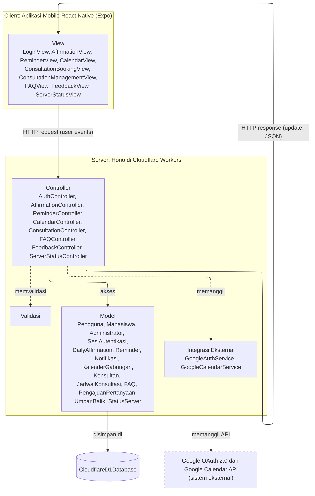

<p align="center">
<i>Gambar 2.1. Penerapan Pattern Client-Server dengan MVC pada P/L Sehati</i>
</p>

## 2.3 Identifikasi Komponen / Modul / Subsistem

Komponen Sehati dikelompokkan berdasarkan lapisan MVC dari _pattern_ pada subbab 2.2. Kolom **Jenis** mengikuti peran komponen pada pattern tersebut, ditambah _Pendukung_, _Integrasi eksternal_, dan _Penyimpanan data_. Setiap komponen mewakili satu tanggung jawab utama yang jelas.

Tabel 2.2. Identifikasi Komponen/Modul/Subsistem

| Nama Komponen                | Jenis               | Penjelasan                                                                                                        |
| ---------------------------- | ------------------- | ----------------------------------------------------------------------------------------------------------------- |
| `LoginView`                  | _View_              | Menampilkan tombol masuk dengan akun Google dan meneruskan hasil otentikasi ke `AuthController`.                  |
| `AffirmationView`            | _View_              | Menampilkan input waktu pengiriman _daily affirmations_ dan meneruskan ke `AffirmationController`.                |
| `ReminderView`               | _View_              | Menampilkan input waktu pengingat makan/tidur/olahraga dan meneruskan ke `ReminderController`.                    |
| `CalendarView`               | _View_              | Menampilkan kalender gabungan dan meneruskan aksi "Lihat Kalender"/"_Refresh_" ke `CalendarController`.           |
| `ConsultationBookingView`    | _View_              | Menampilkan jadwal konsultasi yang tersedia dan meneruskan pemesanan ke `ConsultationController`.                 |
| `ConsultationManagementView` | _View_              | Menampilkan _dashboard_ admin untuk mengelola jadwal konsultan, meneruskan perubahan ke `ConsultationController`. |
| `FAQView`                    | _View_              | Menampilkan daftar FAQ, kolom pencarian, pengelolaan FAQ oleh admin, dan form pengajuan pertanyaan di luar FAQ.   |
| `FeedbackView`               | _View_              | Menampilkan form umpan balik bagi Mahasiswa dan tampilan tanggapan bagi Administrator.                            |
| `ServerStatusView`           | _View_              | Menampilkan status _uptime_ _server_ dan _website_ kepada Administrator.                                          |
| `AuthController`             | _Controller_        | Memproses otentikasi Google, membuat/memverifikasi `SesiAutentikasi`, dan memanggil `GoogleAuthService`.          |
| `AffirmationController`      | _Controller_        | Memproses penyetelan waktu dan pengiriman `DailyAffirmation`, memicu `Notifikasi`.                                |
| `ReminderController`         | _Controller_        | Memproses penyetelan waktu dan pengiriman `Reminder`, memicu `Notifikasi`.                                        |
| `CalendarController`         | _Controller_        | Mengambil data dari `GoogleCalendarService` dan `JadwalKonsultasi`, menggabungkannya lewat `KalenderGabungan`.    |
| `ConsultationController`     | _Controller_        | Memproses pemesanan dan pengelolaan `JadwalKonsultasi`, memanggil `GoogleCalendarService` untuk cek bentrok.      |
| `FAQController`              | _Controller_        | Memproses pencarian, penambahan, perubahan, dan penghapusan FAQ, serta penyimpanan `PengajuanPertanyaan`.         |
| `FeedbackController`         | _Controller_        | Memproses pengiriman `UmpanBalik` dan penyimpanan tanggapan Administrator.                                        |
| `ServerStatusController`     | _Controller_        | Mengambil data `StatusServer` untuk ditampilkan ke Administrator.                                                 |
| `Validasi`                   | Pendukung           | Memvalidasi input (format waktu, _field_ wajib) sebelum diproses _controller_ terkait.                            |
| `Pengguna`                   | _Model_             | Menyimpan atribut umum akun (`id`, `nama`, `email`, `googleId`) yang dipakai bersama Mahasiswa dan Administrator. |
| `Mahasiswa`                  | _Model_             | Merepresentasikan akun mahasiswa sebagai pengguna utama aplikasi.                                                 |
| `Administrator`              | _Model_             | Merepresentasikan akun administrator pengelola aplikasi.                                                          |
| `SesiAutentikasi`            | _Model_             | Menyimpan token sesi aplikasi dan status _login_ setelah otentikasi Google berhasil.                              |
| `DailyAffirmation`           | _Model_             | Menyimpan konten afirmasi dan jadwal pengiriman yang ditentukan pengguna.                                         |
| `Reminder`                   | _Model_             | Menyimpan jenis pengingat (makan/tidur/olahraga) beserta waktu yang ditentukan pengguna.                          |
| `Notifikasi`                 | _Model_             | Merepresentasikan satu notifikasi yang dikirim ke pengguna.                                                       |
| `KalenderGabungan`           | _Model_             | Menggabungkan event dari `GoogleCalendarService` dengan data `JadwalKonsultasi` untuk satu tampilan kalender.     |
| `Konsultan`                  | _Model_             | Menyimpan data konsultan (nama, spesialisasi) yang didaftarkan Administrator.                                     |
| `JadwalKonsultasi`           | _Model_             | Menyimpan slot jadwal konsultasi (konsultan, waktu, status tersedia/terpesan).                                    |
| `FAQ`                        | _Model_             | Menyimpan pasangan pertanyaan dan jawaban yang dikelola Administrator.                                            |
| `PengajuanPertanyaan`        | _Model_             | Menyimpan pertanyaan yang diajukan pengguna di luar FAQ yang tersedia.                                            |
| `UmpanBalik`                 | _Model_             | Menyimpan umpan balik pengguna beserta tanggapan Administrator (jika ada).                                        |
| `StatusServer`               | _Model_             | Merepresentasikan status _uptime_ layanan yang dipantau Administrator.                                            |
| `GoogleAuthService`          | Integrasi eksternal | Menangani pertukaran kode otorisasi dengan Google OAuth 2.0 dan penerimaan _access/refresh token_.                |
| `GoogleCalendarService`      | Integrasi eksternal | Mengambil _event_ pengguna dari Google Calendar API dan melakukan pengecekan bentrok jadwal (_free/busy_).        |
| `CloudflareD1Database`       | Penyimpanan data    | Menyimpan seluruh data _Model_ secara persisten di Cloudflare D1.                                                 |

## 2.4 Model Arsitektur Perangkat Lunak

BAB ini menggambarkan arsitektur Sehati dari satu sudut pandang yang mencakup seluruh sistem, yaitu _Logical View_. Diagram memuat seluruh 35 komponen pada Tabel 2.2 dengan nama yang sama, dan mengikuti _pattern_ _client-server_ dengan MVC pada BAB 2.

### 2.4.1 _Logical View_

_Logical view_ dipilih karena hal terpenting yang perlu dijelaskan pada Sehati adalah pembagian tanggung jawab antar komponen: _view_ di sisi _client_, serta _controller_, _model_, dan layanan pendukung di sisi _server_. Pembagian ini langsung menjawab kebutuhan SKPL, yaitu satu _server_ yang memegang data bersama untuk dua aktor dan satu-satunya yang memanggil Google. _Process view_ tidak dipilih karena sistem ini tidak memiliki alur proses paralel yang rumit, dan _physical view_ tidak dipilih karena lingkungan operasinya sudah dijelaskan pada Tabel 2.1.

Diagram pada Gambar 2.2 adalah _block diagram_ yang memuat seluruh 35 komponen Tabel 2.2:

- 9 _view_,
- 8 _controller_,
- 1 validasi,
- 14 _model_,
- 2 integrasi eksternal, dan
- 1 penyimpanan data.

Komponen dikelompokkan sesuai subbab 2.2. Kotak "_Client_" berisi _view_, dan kotak "_Server_" berisi _controller_, _model_, dan sistem pendukung (validasi). Layanan Google (`GoogleAuthService` dan `GoogleCalendarService`) berada dalam kotak "Sistem Eksternal", dan `CloudflareD1Database` berada di luar kotak "_Server_". Garis putus-putus menandakan pemanggilan atau validasi. Garis penuh menandakan akses ke _model_ atau penyimpanan data.

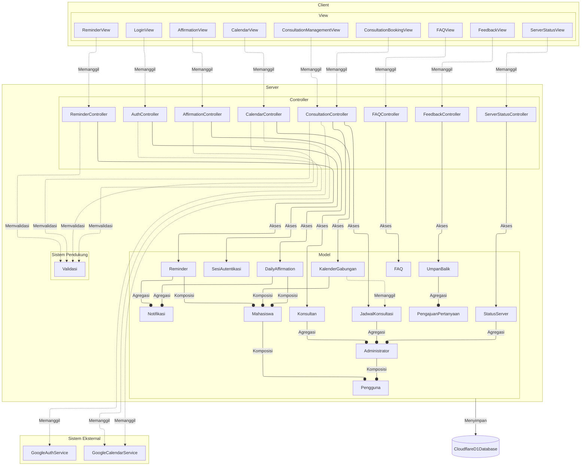

<p align="center">
<i>Gambar 2.2. Logical View pada P/L Sehati</i>
</p>

Relasi antar komponen pada Gambar 2.2:

1. **_View_ → _Controller_** (memanggil)

Setiap _view_ memanggil _controller_ untuk fiturnya. `LoginView` memanggil `AuthController`, dan `ConsultationBookingView` serta `ConsultationManagementView` sama-sama memanggil `ConsultationController`.

2. **_Controller_ → _Model_** (akses)

Setiap _controller_ mengakses _model_ yang dikelolanya, misalnya `FAQController` ke `FAQ` dan `ConsultationController` ke `JadwalKonsultasi` dan `Konsultan`.

3. **_Controller_ → Validasi** (memvalidasi)

_Controller_ yang menerima input waktu atau isian wajib memeriksanya lewat validasi sebelum diproses.

4. **_Controller_ → Sistem Eksternal** (memanggil)

`AuthController` memanggil `GoogleAuthService`, sedangkan `CalendarController` dan `ConsultationController` memanggil `GoogleCalendarService`.

5. **Antar-Model** (agregasi dan komposisi)

`Notifikasi`, `PengajuanPertanyaan`, dan `Administrator` menghimpun _model_ terkait secara agregasi. `DailyAffirmation`, `Reminder`, dan `KalenderGabungan` menjadi bagian dari `Mahasiswa` secara komposisi, begitu pula `Mahasiswa` dan `Administrator` terhadap `Pengguna`.

6. **_Model_ → CloudflareD1Database** (menyimpan)

Seluruh _model_ disimpan secara persisten di D1.

Pada diagram ini, simbol lingkaran di ujung garis antar-_model_ berada di sisi komponen yang menghimpun (agregat atau induk).

---

# BAB 3: Realisasi Use Case

BAB ini menjabarkan realisasi seluruh 12 _use case_ pada SKPL (UC-01 sampai UC-12). Setiap _use case_ dilengkapi identifikasi kelas, _sequence diagram_ untuk setiap skenario pada SKPL, dan diagram kelas.

## 3.1 Use Case Menyetel Daily Affirmations

**ID Use Case:** UC-01  
**Nama Use Case:** Menyetel Daily Affirmations

### 3.1.1 Identifikasi Kelas

Tabel 3.1. Identifikasi Kelas Use Case UC-01

| No  | Nama Kelas Perancangan  | Nama Kelas Analisis Terkait |
| --- | ----------------------- | --------------------------- |
| 1   | `Mahasiswa`             | `Mahasiswa` (C-02)          |
| 2   | `AffirmationView`       | -                           |
| 3   | `AffirmationController` | -                           |
| 4   | `Validasi`              | -                           |
| 5   | `DailyAffirmation`      | `DailyAffirmation` (C-05)   |
| 6   | `CloudflareD1Database`  | -                           |
| 7   | `Notifikasi`            | `Notifikasi` (C-07)         |

### 3.1.2 Sequence Diagram

- **Skenario Normal**

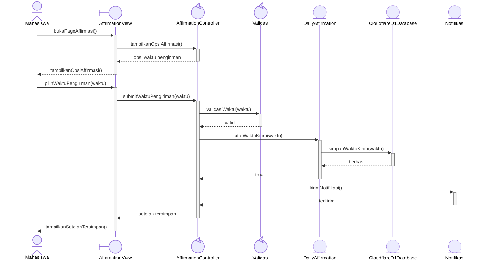

<p align="center">
<i>Gambar 3.1.1. Sequence Diagram UC-01 - Skenario Normal</i>
</p>

- **Skenario Alternatif 1: Sistem tidak mampu menyimpan setelan**


<p align="center">
<i>Gambar 3.1.2. Sequence Diagram UC-01 - Skenario Alternatif 1</i>
</p>

### 3.1.3 Diagram Kelas

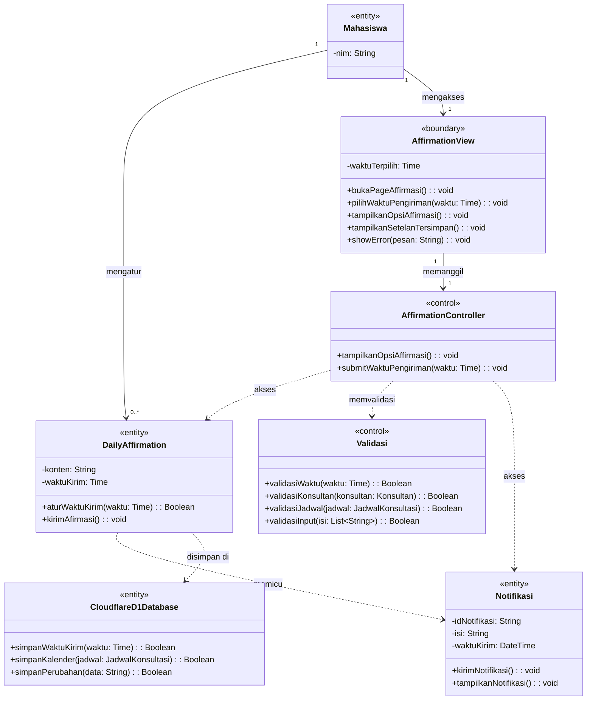

<p align="center">
<i>Gambar 3.1.3. Diagram Kelas Use Case UC-01 - Menyetel Daily Affirmations</i>
</p>

## 3.2 Use Case Menyetel Pengingat Kesehatan

**ID Use Case:** UC-02  
**Nama Use Case:** Menyetel Pengingat Kesehatan

### 3.2.1 Identifikasi Kelas

Tabel 3.2. Identifikasi Kelas Use Case UC-02

| No  | Nama Kelas Perancangan | Nama Kelas Analisis Terkait |
| --- | ---------------------- | --------------------------- |
| 1   | `Mahasiswa`            | `Mahasiswa` (C-02)          |
| 2   | `ReminderView`         | -                           |
| 3   | `ReminderController`   | -                           |
| 4   | `Validasi`             | -                           |
| 5   | `Reminder`             | `Reminder` (C-06)           |
| 6   | `CloudflareD1Database` | -                           |
| 7   | `Notifikasi`           | `Notifikasi` (C-07)         |

### 3.2.2 Sequence Diagram

- **Skenario Normal**

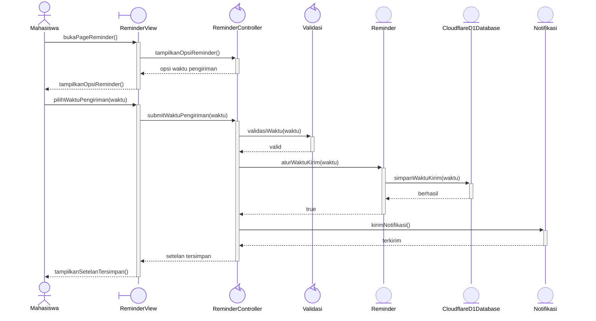

<p align="center">
<i>Gambar 3.2.1. Sequence Diagram UC-02 - Skenario Normal</i>
</p>

- **Skenario Alternatif 1: Sistem tidak mampu menyimpan setelan**

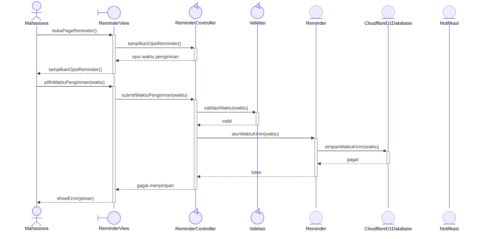

<p align="center">
<i>Gambar 3.2.2. Sequence Diagram UC-02 - Skenario Alternatif 1</i>
</p>

### 3.2.3 Diagram Kelas

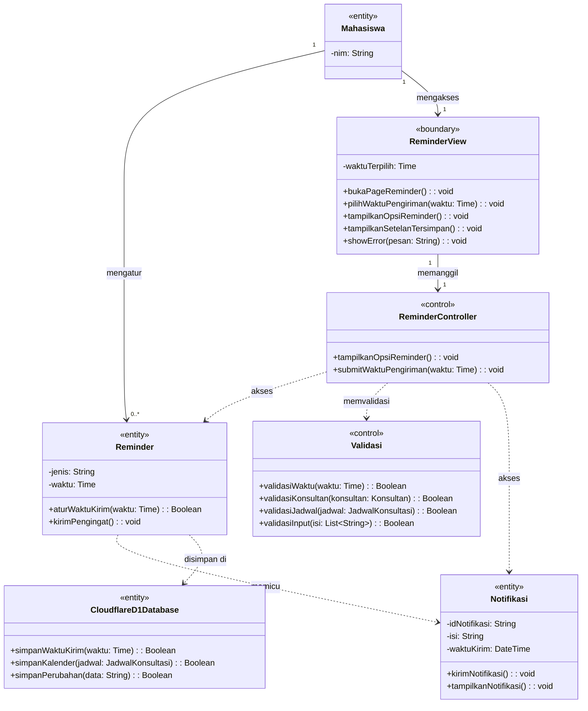

<p align="center">
<i>Gambar 3.2.3. Diagram Kelas Use Case UC-02 - Menyetel Pengingat Kesehatan</i>
</p>

## 3.3 Use Case Melihat Kalender Terintegrasi

**ID Use Case:** UC-03  
**Nama Use Case:** Melihat Kalender Terintegrasi

### 3.3.1 Identifikasi Kelas

Tabel 3.3. Identifikasi Kelas Use Case UC-03

| No  | Nama Kelas Perancangan  | Nama Kelas Analisis Terkait    |
| --- | ----------------------- | ------------------------------ |
| 1   | `Mahasiswa`             | `Mahasiswa` (C-02)             |
| 2   | `CalendarView`          | -                              |
| 3   | `CalendarController`    | -                              |
| 4   | `GoogleCalendarService` | `GoogleCalendarService` (C-08) |
| 5   | `JadwalKonsultasi`      | `JadwalKonsultasi` (C-11)      |
| 6   | `KalenderGabungan`      | `KalenderGabungan` (C-09)      |

### 3.3.2 Sequence Diagram

- **Skenario Normal**

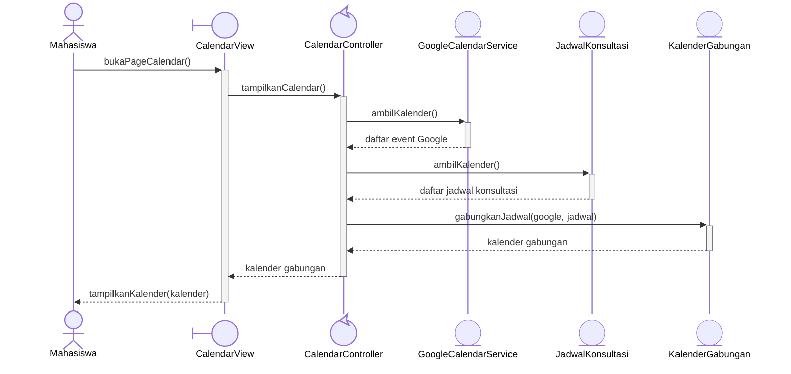

<p align="center">
<i>Gambar 3.3.1. Sequence Diagram UC-03 - Skenario Normal</i>
</p>

- **Skenario Alternatif 1: Sistem tidak mampu mengambil data event**

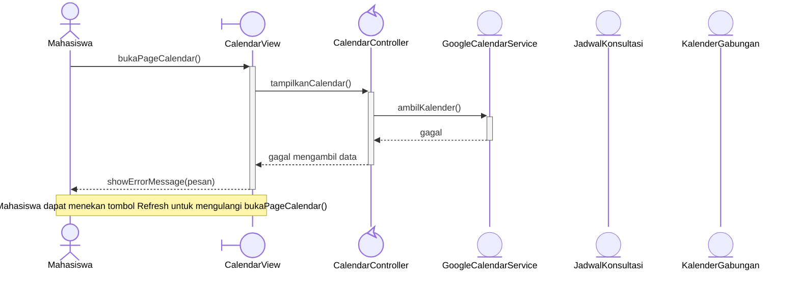

<p align="center">
<i>Gambar 3.3.2. Sequence Diagram UC-03 - Skenario Alternatif 1</i>
</p>

### 3.3.3 Diagram Kelas

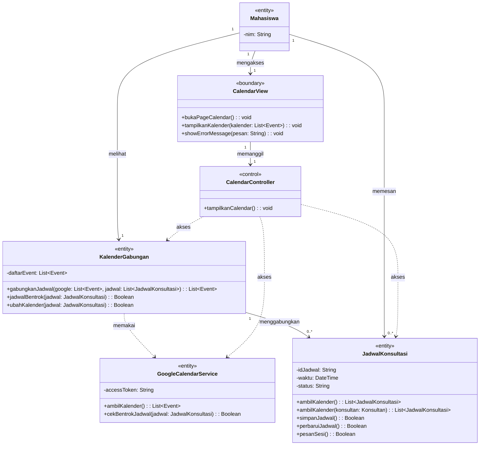

<p align="center">
<i>Gambar 3.3.3. Diagram Kelas Use Case UC-03 - Melihat Kalender Terintegrasi</i>
</p>

## 3.4 Use Case Memesan Sesi Konsultasi

**ID Use Case:** UC-04  
**Nama Use Case:** Memesan Sesi Konsultasi

### 3.4.1 Identifikasi Kelas

Tabel 3.4. Identifikasi Kelas Use Case UC-04

| No  | Nama Kelas Perancangan    | Nama Kelas Analisis Terkait    |
| --- | ------------------------- | ------------------------------ |
| 1   | `Mahasiswa`               | `Mahasiswa` (C-02)             |
| 2   | `ConsultationBookingView` | -                              |
| 3   | `ConsultationController`  | -                              |
| 4   | `Konsultan`               | `Konsultan` (C-10)             |
| 5   | `JadwalKonsultasi`        | `JadwalKonsultasi` (C-11)      |
| 6   | `Validasi`                | -                              |
| 7   | `KalenderGabungan`        | `KalenderGabungan` (C-09)      |
| 8   | `GoogleCalendarService`   | `GoogleCalendarService` (C-08) |
| 9   | `CloudflareD1Database`    | -                              |

### 3.4.2 Sequence Diagram

- **Skenario Normal**

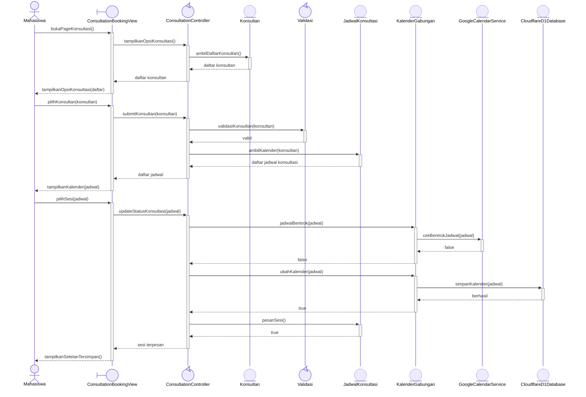

<p align="center">
<i>Gambar 3.4.1. Sequence Diagram UC-04 - Skenario Normal</i>
</p>

- **Skenario Alternatif 1: Sistem tidak mampu mengambil data jadwal konsultasi**

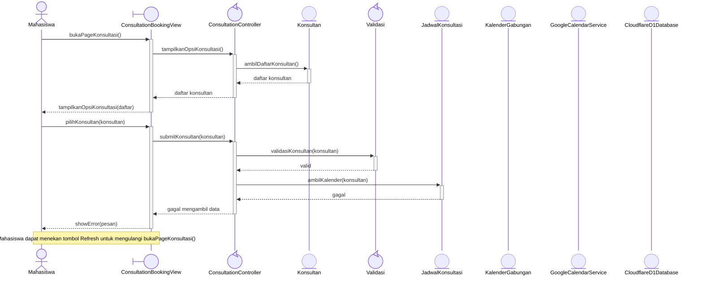

<p align="center">
<i>Gambar 3.4.2. Sequence Diagram UC-04 - Skenario Alternatif 1</i>
</p>

- **Skenario Alternatif 2: Sistem tidak mampu menyimpan jadwal konsultasi yang dipesan**

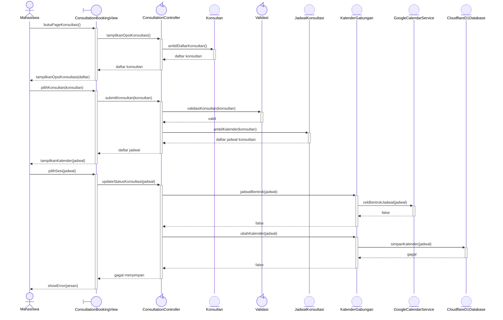

<p align="center">
<i>Gambar 3.4.3. Sequence Diagram UC-04 - Skenario Alternatif 2</i>
</p>

### 3.4.3 Diagram Kelas

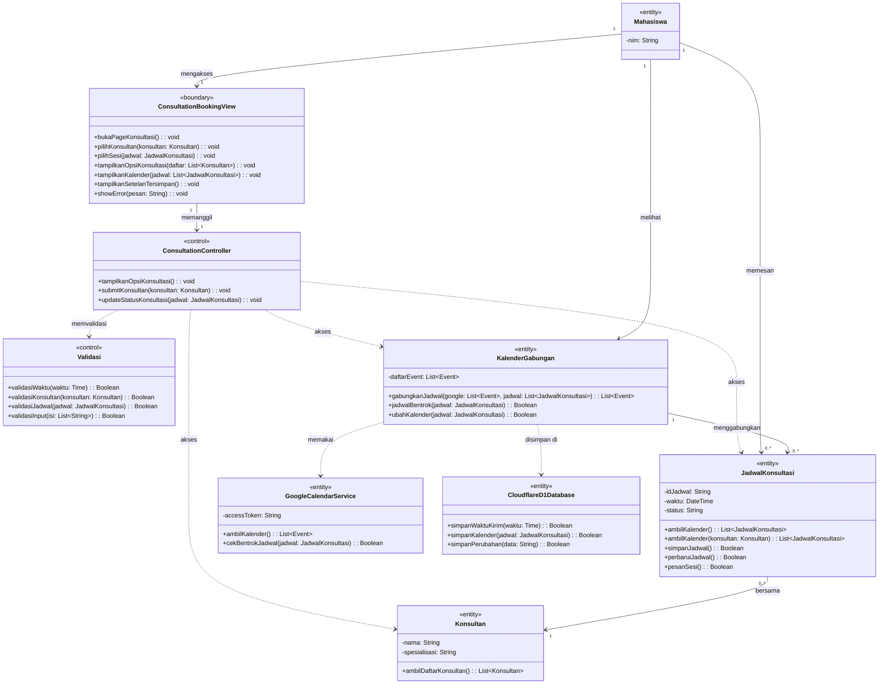

<p align="center">
<i>Gambar 3.4.4. Diagram Kelas Use Case UC-04 - Memesan Sesi Konsultasi</i>
</p>

## 3.5 Use Case Mengelola Jadwal Konsultan

**ID Use Case:** UC-05  
**Nama Use Case:** Mengelola Jadwal Konsultan

### 3.5.1 Identifikasi Kelas

Tabel 3.5. Identifikasi Kelas Use Case UC-05

| No  | Nama Kelas Perancangan       | Nama Kelas Analisis Terkait |
| --- | ---------------------------- | --------------------------- |
| 1   | `Administrator`              | `Administrator` (C-03)      |
| 2   | `ConsultationManagementView` | -                           |
| 3   | `ConsultationController`     | -                           |
| 4   | `Konsultan`                  | `Konsultan` (C-10)          |
| 5   | `JadwalKonsultasi`           | `JadwalKonsultasi` (C-11)   |
| 6   | `Validasi`                   | -                           |
| 7   | `KalenderGabungan`           | `KalenderGabungan` (C-09)   |
| 8   | `CloudflareD1Database`       | -                           |

### 3.5.2 Sequence Diagram

- **Skenario Normal**

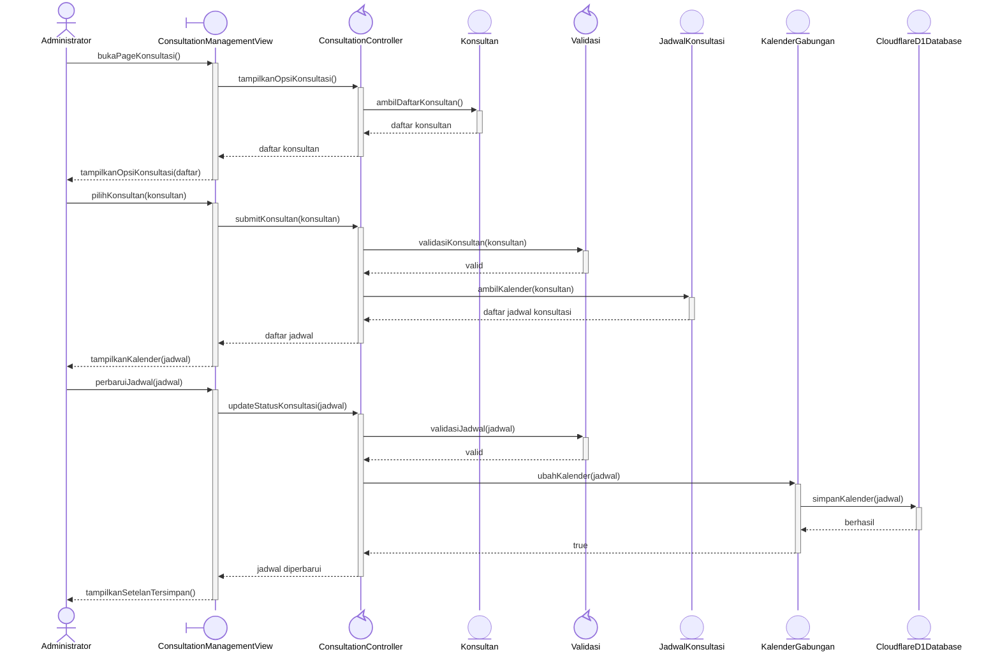

<p align="center">
<i>Gambar 3.5.1. Sequence Diagram UC-05 - Skenario Normal</i>
</p>

- **Skenario Alternatif 1: Sistem tidak mampu mengambil data jadwal konsultasi**

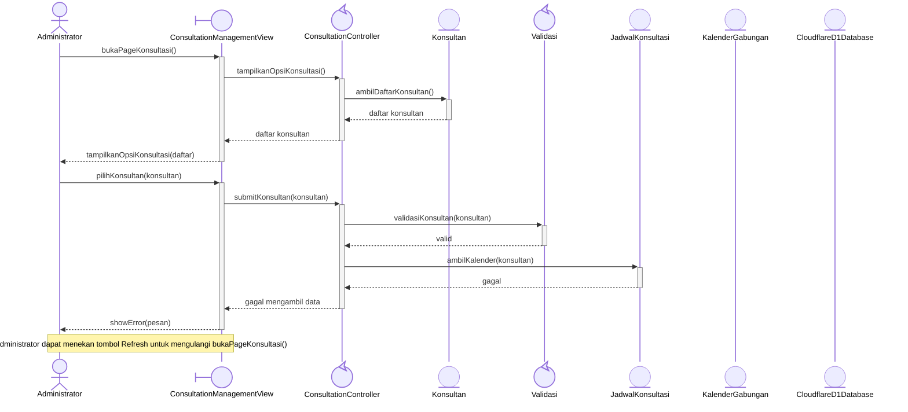

<p align="center">
<i>Gambar 3.5.2. Sequence Diagram UC-05 - Skenario Alternatif 1</i>
</p>

- **Skenario Alternatif 2: Sistem tidak mampu mengedit data jadwal konsultasi**

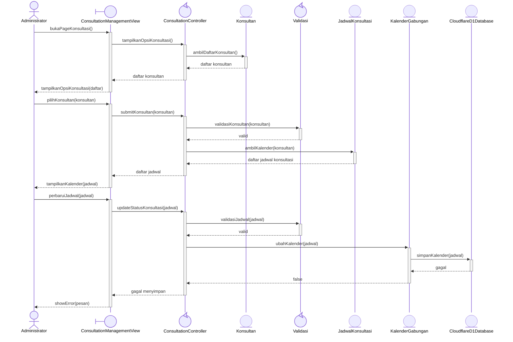

<p align="center">
<i>Gambar 3.5.3. Sequence Diagram UC-05 - Skenario Alternatif 2</i>
</p>

### 3.5.3 Diagram Kelas

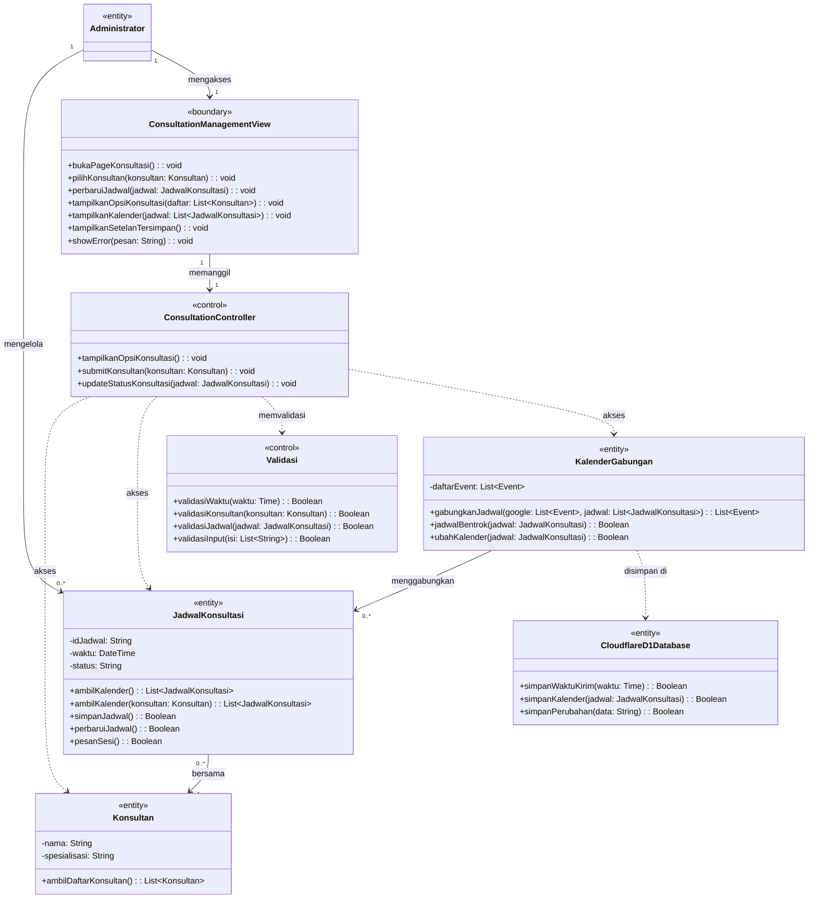

<p align="center">
<i>Gambar 3.5.4. Diagram Kelas Use Case UC-05 - Mengelola Jadwal Konsultan</i>
</p>

## 3.6 Use Case Melihat FAQ

**ID Use Case:** UC-06  
**Nama Use Case:** Melihat FAQ

### 3.6.1 Identifikasi Kelas

Tabel 3.6. Identifikasi Kelas Use Case UC-06

| No  | Nama Kelas Perancangan | Nama Kelas Analisis Terkait |
| --- | ---------------------- | --------------------------- |
| 1   | `Mahasiswa`            | `Mahasiswa` (C-02)          |
| 2   | `FAQView`              | -                           |
| 3   | `FAQController`        | -                           |
| 4   | `FAQ`                  | `FAQ` (C-12)                |

### 3.6.2 Sequence Diagram

- **Skenario Normal**

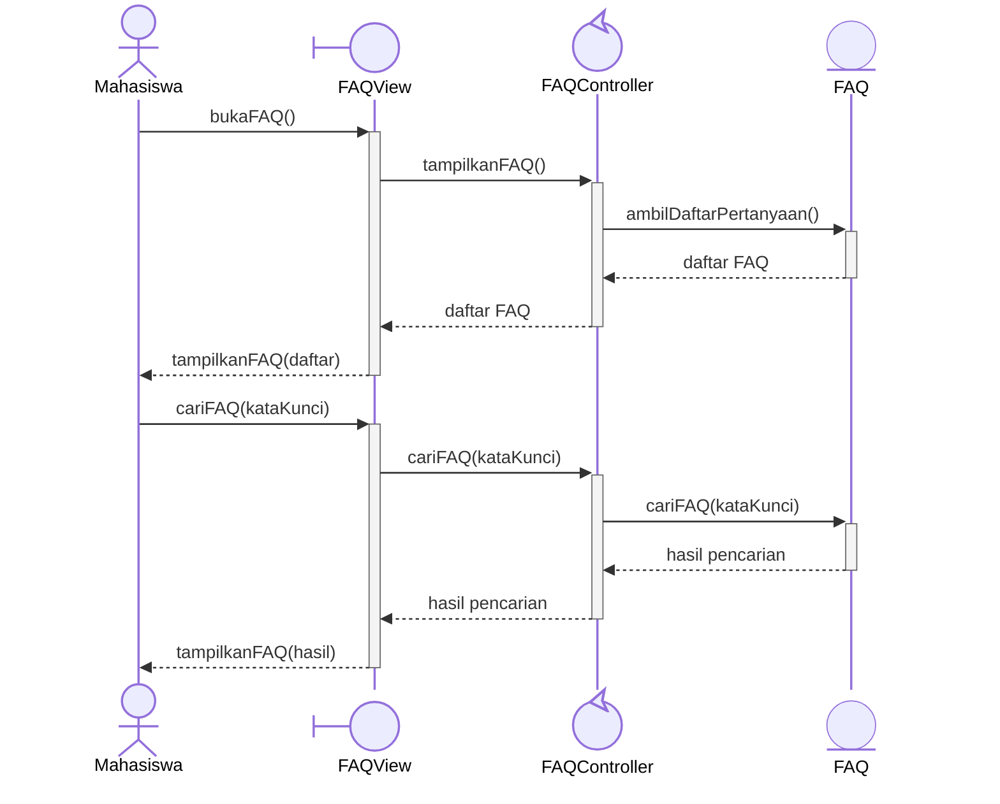

<p align="center">
<i>Gambar 3.6.1. Sequence Diagram UC-06 - Skenario Normal</i>
</p>

- **Skenario Alternatif 1: Tidak ada pertanyaan yang dicari pengguna**

```mermaid
sequenceDiagram
    actor Mahasiswa
    participant FAQView@{ "type": "boundary" }
    participant FAQController@{ "type": "control" }
    participant FAQ@{ "type": "entity" }

    Mahasiswa->>+FAQView: bukaFAQ()
    FAQView->>+FAQController: tampilkanFAQ()
    FAQController->>+FAQ: ambilDaftarPertanyaan()
    FAQ-->>-FAQController: daftar FAQ
    FAQController-->>-FAQView: daftar FAQ
    FAQView-->>-Mahasiswa: tampilkanFAQ(daftar)
    Mahasiswa->>+FAQView: cariFAQ(kataKunci)
    FAQView->>+FAQController: cariFAQ(kataKunci)
    FAQController->>+FAQ: cariFAQ(kataKunci)
    FAQ-->>-FAQController: hasil kosong
    FAQController-->>-FAQView: hasil kosong
    FAQView-->>-Mahasiswa: tampilkanTawaranPengajuan()
    Mahasiswa->>+FAQView: bukaFormPertanyaan()
    FAQView->>+FAQController: muatFormPenambahanPertanyaan()
    FAQController-->>-FAQView: form pertanyaan
    FAQView-->>-Mahasiswa: tampilkanFormPenambahanPertanyaan()
```

<p align="center">
<i>Gambar 3.6.2. Sequence Diagram UC-06 - Skenario Alternatif 1</i>
</p>

### 3.6.3 Diagram Kelas

```mermaid
classDiagram
    class Mahasiswa {
        <<entity>>
        -nim: String
    }
    class FAQView {
        <<boundary>>
        +bukaFAQ(): void
        +cariFAQ(kataKunci: String): void
        +tambahFAQ(pertanyaan: String, jawaban: String): void
        +ubahFAQ(idFAQ: String, pertanyaan: String, jawaban: String): void
        +hapusFAQ(idFAQ: String): void
        +bukaFormPertanyaan(): void
        +isiFormPertanyaan(isi: String): void
        +tampilkanFAQ(daftar: List~FAQ~): void
        +tampilkanTawaranPengajuan(): void
        +tampilkanFormPenambahanPertanyaan(): void
        +tampilkanSetelanTersimpan(): void
        +showError(pesan: String): void
    }
    class FAQController {
        <<control>>
        +tampilkanFAQ(): void
        +cariFAQ(kataKunci: String): void
        +tambahFAQ(pertanyaan: String, jawaban: String): void
        +ubahFAQ(idFAQ: String, pertanyaan: String, jawaban: String): void
        +hapusFAQ(idFAQ: String): void
        +muatFormPenambahanPertanyaan(): void
        +kirimPertanyaan(isi: String): void
    }
    class FAQ {
        <<entity>>
        -idFAQ: String
        -pertanyaan: String
        -jawaban: String
        +ambilDaftarPertanyaan(): List~FAQ~
        +cariFAQ(kataKunci: String): List~FAQ~
        +tambahFAQ(pertanyaan: String, jawaban: String): Boolean
        +ubahFAQ(idFAQ: String, pertanyaan: String, jawaban: String): Boolean
        +hapusFAQ(idFAQ: String): Boolean
    }
    Mahasiswa "1" --> "0..*" FAQ : melihat
    Mahasiswa "1" --> "1" FAQView : mengakses
    FAQView "1" --> "1" FAQController : memanggil
    FAQController ..> FAQ : akses
```

<p align="center">
<i>Gambar 3.6.3. Diagram Kelas Use Case UC-06 - Melihat FAQ</i>
</p>

## 3.7 Use Case Mengelola FAQ

**ID Use Case:** UC-07  
**Nama Use Case:** Mengelola FAQ

### 3.7.1 Identifikasi Kelas

Tabel 3.7. Identifikasi Kelas Use Case UC-07

| No  | Nama Kelas Perancangan | Nama Kelas Analisis Terkait |
| --- | ---------------------- | --------------------------- |
| 1   | `Administrator`        | `Administrator` (C-03)      |
| 2   | `FAQView`              | -                           |
| 3   | `FAQController`        | -                           |
| 4   | `FAQ`                  | `FAQ` (C-12)                |
| 5   | `Validasi`             | -                           |
| 6   | `CloudflareD1Database` | -                           |

### 3.7.2 Sequence Diagram

- **Skenario Normal**

```mermaid
sequenceDiagram
    actor Administrator
    participant FAQView@{ "type": "boundary" }
    participant FAQController@{ "type": "control" }
    participant FAQ@{ "type": "entity" }
    participant Validasi@{ "type": "control" }
    participant CloudflareD1Database@{ "type": "entity" }

    Administrator->>+FAQView: bukaFAQ()
    FAQView->>+FAQController: tampilkanFAQ()
    FAQController->>+FAQ: ambilDaftarPertanyaan()
    FAQ-->>-FAQController: daftar FAQ
    FAQController-->>-FAQView: daftar FAQ
    FAQView-->>-Administrator: tampilkanFAQ(daftar)
    Administrator->>+FAQView: tambahFAQ(pertanyaan, jawaban)
    FAQView->>+FAQController: tambahFAQ(pertanyaan, jawaban)
    FAQController->>+Validasi: validasiInput(isi)
    Validasi-->>-FAQController: valid
    FAQController->>+FAQ: tambahFAQ(pertanyaan, jawaban)
    FAQ->>+CloudflareD1Database: simpanPerubahan(data)
    CloudflareD1Database-->>-FAQ: berhasil
    FAQ-->>-FAQController: true
    FAQController-->>-FAQView: tersimpan
    FAQView-->>-Administrator: tampilkanSetelanTersimpan()
    Administrator->>+FAQView: hapusFAQ(idFAQ)
    FAQView->>+FAQController: hapusFAQ(idFAQ)
    FAQController->>+FAQ: hapusFAQ(idFAQ)
    FAQ->>+CloudflareD1Database: simpanPerubahan(data)
    CloudflareD1Database-->>-FAQ: berhasil
    FAQ-->>-FAQController: true
    FAQController-->>-FAQView: tersimpan
    FAQView-->>-Administrator: tampilkanSetelanTersimpan()
    Administrator->>+FAQView: ubahFAQ(idFAQ, pertanyaan, jawaban)
    FAQView->>+FAQController: ubahFAQ(idFAQ, pertanyaan, jawaban)
    FAQController->>+Validasi: validasiInput(isi)
    Validasi-->>-FAQController: valid
    FAQController->>+FAQ: ubahFAQ(idFAQ, pertanyaan, jawaban)
    FAQ->>+CloudflareD1Database: simpanPerubahan(data)
    CloudflareD1Database-->>-FAQ: berhasil
    FAQ-->>-FAQController: true
    FAQController-->>-FAQView: tersimpan
    FAQView-->>-Administrator: tampilkanSetelanTersimpan()
```

<p align="center">
<i>Gambar 3.7.1. Sequence Diagram UC-07 - Skenario Normal</i>
</p>

- **Skenario Alternatif 1: Tidak ada pertanyaan maupun jawaban yang berhasil disimpan**

```mermaid
sequenceDiagram
    actor Administrator
    participant FAQView@{ "type": "boundary" }
    participant FAQController@{ "type": "control" }
    participant FAQ@{ "type": "entity" }
    participant Validasi@{ "type": "control" }
    participant CloudflareD1Database@{ "type": "entity" }

    Administrator->>+FAQView: bukaFAQ()
    FAQView->>+FAQController: tampilkanFAQ()
    FAQController->>+FAQ: ambilDaftarPertanyaan()
    FAQ-->>-FAQController: daftar FAQ
    FAQController-->>-FAQView: daftar FAQ
    FAQView-->>-Administrator: tampilkanFAQ(daftar)
    Administrator->>+FAQView: tambahFAQ(pertanyaan, jawaban)
    FAQView->>+FAQController: tambahFAQ(pertanyaan, jawaban)
    FAQController->>+Validasi: validasiInput(isi)
    Validasi-->>-FAQController: valid
    FAQController->>+FAQ: tambahFAQ(pertanyaan, jawaban)
    FAQ->>+CloudflareD1Database: simpanPerubahan(data)
    CloudflareD1Database-->>-FAQ: gagal
    FAQ-->>-FAQController: false
    FAQController-->>-FAQView: gagal menyimpan
    FAQView-->>-Administrator: showError(pesan)
    Note over Administrator,FAQView: hapusFAQ(idFAQ) dan ubahFAQ(idFAQ, pertanyaan, jawaban) gagal dengan alur yang sama
```

<p align="center">
<i>Gambar 3.7.2. Sequence Diagram UC-07 - Skenario Alternatif 1</i>
</p>

### 3.7.3 Diagram Kelas

```mermaid
classDiagram
    class Administrator {
        <<entity>>
    }
    class FAQView {
        <<boundary>>
        +bukaFAQ(): void
        +cariFAQ(kataKunci: String): void
        +tambahFAQ(pertanyaan: String, jawaban: String): void
        +ubahFAQ(idFAQ: String, pertanyaan: String, jawaban: String): void
        +hapusFAQ(idFAQ: String): void
        +bukaFormPertanyaan(): void
        +isiFormPertanyaan(isi: String): void
        +tampilkanFAQ(daftar: List~FAQ~): void
        +tampilkanTawaranPengajuan(): void
        +tampilkanFormPenambahanPertanyaan(): void
        +tampilkanSetelanTersimpan(): void
        +showError(pesan: String): void
    }
    class FAQController {
        <<control>>
        +tampilkanFAQ(): void
        +cariFAQ(kataKunci: String): void
        +tambahFAQ(pertanyaan: String, jawaban: String): void
        +ubahFAQ(idFAQ: String, pertanyaan: String, jawaban: String): void
        +hapusFAQ(idFAQ: String): void
        +muatFormPenambahanPertanyaan(): void
        +kirimPertanyaan(isi: String): void
    }
    class FAQ {
        <<entity>>
        -idFAQ: String
        -pertanyaan: String
        -jawaban: String
        +ambilDaftarPertanyaan(): List~FAQ~
        +cariFAQ(kataKunci: String): List~FAQ~
        +tambahFAQ(pertanyaan: String, jawaban: String): Boolean
        +ubahFAQ(idFAQ: String, pertanyaan: String, jawaban: String): Boolean
        +hapusFAQ(idFAQ: String): Boolean
    }
    class Validasi {
        <<control>>
        +validasiWaktu(waktu: Time): Boolean
        +validasiKonsultan(konsultan: Konsultan): Boolean
        +validasiJadwal(jadwal: JadwalKonsultasi): Boolean
        +validasiInput(isi: List~String~): Boolean
    }
    class CloudflareD1Database {
        <<entity>>
        +simpanWaktuKirim(waktu: Time): Boolean
        +simpanKalender(jadwal: JadwalKonsultasi): Boolean
        +simpanPerubahan(data: String): Boolean
    }
    Administrator "1" --> "0..*" FAQ : mengelola
    Administrator "1" --> "1" FAQView : mengakses
    FAQView "1" --> "1" FAQController : memanggil
    FAQController ..> FAQ : akses
    FAQController ..> Validasi : memvalidasi
    FAQ ..> CloudflareD1Database : disimpan di
```

<p align="center">
<i>Gambar 3.7.3. Diagram Kelas Use Case UC-07 - Mengelola FAQ</i>
</p>

## 3.8 Use Case Memberikan Umpan Balik

**ID Use Case:** UC-08  
**Nama Use Case:** Memberikan Umpan Balik

### 3.8.1 Identifikasi Kelas

Tabel 3.8. Identifikasi Kelas Use Case UC-08

| No  | Nama Kelas Perancangan | Nama Kelas Analisis Terkait |
| --- | ---------------------- | --------------------------- |
| 1   | `Mahasiswa`            | `Mahasiswa` (C-02)          |
| 2   | `FeedbackView`         | -                           |
| 3   | `FeedbackController`   | -                           |
| 4   | `UmpanBalik`           | `UmpanBalik` (C-14)         |
| 5   | `Validasi`             | -                           |
| 6   | `CloudflareD1Database` | -                           |

### 3.8.2 Sequence Diagram

- **Skenario Normal**

```mermaid
sequenceDiagram
    actor Mahasiswa
    participant FeedbackView@{ "type": "boundary" }
    participant FeedbackController@{ "type": "control" }
    participant Validasi@{ "type": "control" }
    participant UmpanBalik@{ "type": "entity" }
    participant CloudflareD1Database@{ "type": "entity" }

    Mahasiswa->>+FeedbackView: bukaUmpanBalik()
    FeedbackView->>+FeedbackController: tampilkanFormFeedback()
    FeedbackController-->>-FeedbackView: form umpan balik
    FeedbackView-->>-Mahasiswa: tampilkanFormFeedback()
    Mahasiswa->>+FeedbackView: isiFormFeedback(isi)
    FeedbackView->>+FeedbackController: kirimFeedback(isi)
    FeedbackController->>+Validasi: validasiInput(isi)
    Validasi-->>-FeedbackController: valid
    FeedbackController->>+UmpanBalik: kirimUmpanBalik(isi)
    UmpanBalik->>+CloudflareD1Database: simpanPerubahan(data)
    CloudflareD1Database-->>-UmpanBalik: berhasil
    UmpanBalik-->>-FeedbackController: true
    FeedbackController-->>-FeedbackView: tersimpan
    FeedbackView-->>-Mahasiswa: tampilkanFeedbackTersimpan()
```

<p align="center">
<i>Gambar 3.8.1. Sequence Diagram UC-08 - Skenario Normal</i>
</p>

- **Skenario Alternatif 1: Umpan balik tidak disimpan pada database**

```mermaid
sequenceDiagram
    actor Mahasiswa
    participant FeedbackView@{ "type": "boundary" }
    participant FeedbackController@{ "type": "control" }
    participant Validasi@{ "type": "control" }
    participant UmpanBalik@{ "type": "entity" }
    participant CloudflareD1Database@{ "type": "entity" }

    Mahasiswa->>+FeedbackView: bukaUmpanBalik()
    FeedbackView->>+FeedbackController: tampilkanFormFeedback()
    FeedbackController-->>-FeedbackView: form umpan balik
    FeedbackView-->>-Mahasiswa: tampilkanFormFeedback()
    Mahasiswa->>+FeedbackView: isiFormFeedback(isi)
    FeedbackView->>+FeedbackController: kirimFeedback(isi)
    FeedbackController->>+Validasi: validasiInput(isi)
    Validasi-->>-FeedbackController: valid
    FeedbackController->>+UmpanBalik: kirimUmpanBalik(isi)
    UmpanBalik->>+CloudflareD1Database: simpanPerubahan(data)
    CloudflareD1Database-->>-UmpanBalik: gagal
    UmpanBalik-->>-FeedbackController: false
    FeedbackController-->>-FeedbackView: gagal menyimpan
    FeedbackView-->>-Mahasiswa: showError(pesan)
```

<p align="center">
<i>Gambar 3.8.2. Sequence Diagram UC-08 - Skenario Alternatif 1</i>
</p>

### 3.8.3 Diagram Kelas

```mermaid
classDiagram
    class Mahasiswa {
        <<entity>>
        -nim: String
    }
    class FeedbackView {
        <<boundary>>
        +bukaUmpanBalik(): void
        +isiFormFeedback(isi: String): void
        +bukaListFeedback(): void
        +tanggapiFeedback(tanggapan: String): void
        +tampilkanFormFeedback(): void
        +tampilkanListFeedback(daftar: List~UmpanBalik~): void
        +tampilkanFeedbackTersimpan(): void
        +showError(pesan: String): void
    }
    class FeedbackController {
        <<control>>
        +tampilkanFormFeedback(): void
        +kirimFeedback(isi: String): void
        +tampilkanListFeedback(): void
        +kirimTanggapan(tanggapan: String): void
    }
    class UmpanBalik {
        <<entity>>
        -idUmpanBalik: String
        -isi: String
        -tanggapan: String
        +ambilListUmpanBalik(): List~UmpanBalik~
        +kirimUmpanBalik(isi: String): Boolean
        +berikanTanggapan(tanggapan: String): Boolean
    }
    class Validasi {
        <<control>>
        +validasiWaktu(waktu: Time): Boolean
        +validasiKonsultan(konsultan: Konsultan): Boolean
        +validasiJadwal(jadwal: JadwalKonsultasi): Boolean
        +validasiInput(isi: List~String~): Boolean
    }
    class CloudflareD1Database {
        <<entity>>
        +simpanWaktuKirim(waktu: Time): Boolean
        +simpanKalender(jadwal: JadwalKonsultasi): Boolean
        +simpanPerubahan(data: String): Boolean
    }
    Mahasiswa "1" --> "0..*" UmpanBalik : memberikan
    Mahasiswa "1" --> "1" FeedbackView : mengakses
    FeedbackView "1" --> "1" FeedbackController : memanggil
    FeedbackController ..> UmpanBalik : akses
    FeedbackController ..> Validasi : memvalidasi
    UmpanBalik ..> CloudflareD1Database : disimpan di
```

<p align="center">
<i>Gambar 3.8.3. Diagram Kelas Use Case UC-08 - Memberikan Umpan Balik</i>
</p>

## 3.9 Use Case Menanggapi Umpan Balik

**ID Use Case:** UC-09  
**Nama Use Case:** Menanggapi Umpan Balik

### 3.9.1 Identifikasi Kelas

Tabel 3.9. Identifikasi Kelas Use Case UC-09

| No  | Nama Kelas Perancangan | Nama Kelas Analisis Terkait |
| --- | ---------------------- | --------------------------- |
| 1   | `Administrator`        | `Administrator` (C-03)      |
| 2   | `Mahasiswa`            | `Mahasiswa` (C-02)          |
| 3   | `FeedbackView`         | -                           |
| 4   | `FeedbackController`   | -                           |
| 5   | `UmpanBalik`           | `UmpanBalik` (C-14)         |
| 6   | `Validasi`             | -                           |
| 7   | `CloudflareD1Database` | -                           |

### 3.9.2 Sequence Diagram

- **Skenario Normal**

```mermaid
sequenceDiagram
    actor Administrator
    participant FeedbackView@{ "type": "boundary" }
    participant FeedbackController@{ "type": "control" }
    participant UmpanBalik@{ "type": "entity" }
    participant Validasi@{ "type": "control" }
    participant CloudflareD1Database@{ "type": "entity" }
    actor Mahasiswa

    Administrator->>+FeedbackView: bukaListFeedback()
    FeedbackView->>+FeedbackController: tampilkanListFeedback()
    FeedbackController->>+UmpanBalik: ambilListUmpanBalik()
    UmpanBalik-->>-FeedbackController: daftar umpan balik
    FeedbackController-->>-FeedbackView: daftar umpan balik
    FeedbackView-->>-Administrator: tampilkanListFeedback(daftar)
    Administrator->>+FeedbackView: tanggapiFeedback(tanggapan)
    FeedbackView->>+FeedbackController: kirimTanggapan(tanggapan)
    FeedbackController->>+Validasi: validasiInput(isi)
    Validasi-->>-FeedbackController: valid
    FeedbackController->>+UmpanBalik: berikanTanggapan(tanggapan)
    UmpanBalik->>+CloudflareD1Database: simpanPerubahan(data)
    CloudflareD1Database-->>-UmpanBalik: berhasil
    UmpanBalik-->>-FeedbackController: true
    FeedbackController-->>-FeedbackView: tersimpan
    FeedbackView-->>-Administrator: tampilkanFeedbackTersimpan()
```

<p align="center">
<i>Gambar 3.9.1. Sequence Diagram UC-09 - Skenario Normal</i>
</p>

- **Skenario Alternatif 1: Tanggapan umpan balik tidak berhasil ditampilkan**

```mermaid
sequenceDiagram
    actor Administrator
    participant FeedbackView@{ "type": "boundary" }
    participant FeedbackController@{ "type": "control" }
    participant UmpanBalik@{ "type": "entity" }
    participant Validasi@{ "type": "control" }
    participant CloudflareD1Database@{ "type": "entity" }
    actor Mahasiswa

    Administrator->>+FeedbackView: bukaListFeedback()
    FeedbackView->>+FeedbackController: tampilkanListFeedback()
    FeedbackController->>+UmpanBalik: ambilListUmpanBalik()
    UmpanBalik-->>-FeedbackController: daftar umpan balik
    FeedbackController-->>-FeedbackView: daftar umpan balik
    FeedbackView-->>-Administrator: tampilkanListFeedback(daftar)
    Administrator->>+FeedbackView: tanggapiFeedback(tanggapan)
    FeedbackView->>+FeedbackController: kirimTanggapan(tanggapan)
    FeedbackController->>+Validasi: validasiInput(isi)
    Validasi-->>-FeedbackController: valid
    FeedbackController->>+UmpanBalik: berikanTanggapan(tanggapan)
    UmpanBalik->>+CloudflareD1Database: simpanPerubahan(data)
    CloudflareD1Database-->>-UmpanBalik: berhasil
    UmpanBalik-->>-FeedbackController: true
    FeedbackController-->>-FeedbackView: tersimpan
    FeedbackView-->>-Administrator: tampilkanFeedbackTersimpan()
    Mahasiswa->>+FeedbackView: bukaListFeedback()
    FeedbackView->>+FeedbackController: tampilkanListFeedback()
    FeedbackController->>+UmpanBalik: ambilListUmpanBalik()
    UmpanBalik-->>-FeedbackController: tanggapan tidak dapat dimuat
    FeedbackController-->>-FeedbackView: tanggapan tidak dapat dimuat
    FeedbackView-->>-Mahasiswa: tampilkanListFeedback(daftar tanpa tanggapan)
```

<p align="center">
<i>Gambar 3.9.2. Sequence Diagram UC-09 - Skenario Alternatif 1</i>
</p>

### 3.9.3 Diagram Kelas

```mermaid
classDiagram
    class Administrator {
        <<entity>>
    }
    class Mahasiswa {
        <<entity>>
        -nim: String
    }
    class FeedbackView {
        <<boundary>>
        +bukaUmpanBalik(): void
        +isiFormFeedback(isi: String): void
        +bukaListFeedback(): void
        +tanggapiFeedback(tanggapan: String): void
        +tampilkanFormFeedback(): void
        +tampilkanListFeedback(daftar: List~UmpanBalik~): void
        +tampilkanFeedbackTersimpan(): void
        +showError(pesan: String): void
    }
    class FeedbackController {
        <<control>>
        +tampilkanFormFeedback(): void
        +kirimFeedback(isi: String): void
        +tampilkanListFeedback(): void
        +kirimTanggapan(tanggapan: String): void
    }
    class UmpanBalik {
        <<entity>>
        -idUmpanBalik: String
        -isi: String
        -tanggapan: String
        +ambilListUmpanBalik(): List~UmpanBalik~
        +kirimUmpanBalik(isi: String): Boolean
        +berikanTanggapan(tanggapan: String): Boolean
    }
    class Validasi {
        <<control>>
        +validasiWaktu(waktu: Time): Boolean
        +validasiKonsultan(konsultan: Konsultan): Boolean
        +validasiJadwal(jadwal: JadwalKonsultasi): Boolean
        +validasiInput(isi: List~String~): Boolean
    }
    class CloudflareD1Database {
        <<entity>>
        +simpanWaktuKirim(waktu: Time): Boolean
        +simpanKalender(jadwal: JadwalKonsultasi): Boolean
        +simpanPerubahan(data: String): Boolean
    }
    Mahasiswa "1" --> "0..*" UmpanBalik : memberikan
    Administrator "1" --> "0..*" UmpanBalik : menanggapi
    Mahasiswa "1" --> "1" FeedbackView : mengakses
    Administrator "1" --> "1" FeedbackView : mengakses
    FeedbackView "1" --> "1" FeedbackController : memanggil
    FeedbackController ..> UmpanBalik : akses
    FeedbackController ..> Validasi : memvalidasi
    UmpanBalik ..> CloudflareD1Database : disimpan di
```

<p align="center">
<i>Gambar 3.9.3. Diagram Kelas Use Case UC-09 - Menanggapi Umpan Balik</i>
</p>

## 3.10 Use Case Memantau Status Server

**ID Use Case:** UC-10  
**Nama Use Case:** Memantau Status Server

### 3.10.1 Identifikasi Kelas

Tabel 3.10. Identifikasi Kelas Use Case UC-10

| No  | Nama Kelas Perancangan   | Nama Kelas Analisis Terkait |
| --- | ------------------------ | --------------------------- |
| 1   | `Administrator`          | `Administrator` (C-03)      |
| 2   | `ServerStatusView`       | -                           |
| 3   | `ServerStatusController` | -                           |
| 4   | `StatusServer`           | `StatusServer` (C-15)       |

### 3.10.2 Sequence Diagram

- **Skenario Normal**

```mermaid
sequenceDiagram
    actor Administrator
    participant ServerStatusView@{ "type": "boundary" }
    participant ServerStatusController@{ "type": "control" }
    participant StatusServer@{ "type": "entity" }

    Administrator->>+ServerStatusView: cekStatusServer("website")
    ServerStatusView->>+ServerStatusController: tampilkanStatusServer("website")
    ServerStatusController->>+StatusServer: ambilStatusServer("website")
    StatusServer-->>-ServerStatusController: status uptime website
    ServerStatusController-->>-ServerStatusView: status uptime website
    ServerStatusView-->>-Administrator: tampilkanStatusServer(status)
    Administrator->>+ServerStatusView: cekStatusServer("server")
    ServerStatusView->>+ServerStatusController: tampilkanStatusServer("server")
    ServerStatusController->>+StatusServer: ambilStatusServer("server")
    StatusServer-->>-ServerStatusController: status uptime server
    ServerStatusController-->>-ServerStatusView: status uptime server
    ServerStatusView-->>-Administrator: tampilkanStatusServer(status)
```

<p align="center">
<i>Gambar 3.10.1. Sequence Diagram UC-10 - Skenario Normal</i>
</p>

### 3.10.3 Diagram Kelas

```mermaid
classDiagram
    class Administrator {
        <<entity>>
    }
    class ServerStatusView {
        <<boundary>>
        +cekStatusServer(jenis: String): void
        +tampilkanStatusServer(status: StatusServer): void
    }
    class ServerStatusController {
        <<control>>
        +tampilkanStatusServer(jenis: String): void
    }
    class StatusServer {
        <<entity>>
        -jenis: String
        -statusUptime: Boolean
        -waktuCek: DateTime
        +ambilStatusServer(jenis: String): StatusServer
        +cekStatusServer(): Boolean
    }
    Administrator "1" --> "0..*" StatusServer : memantau
    Administrator "1" --> "1" ServerStatusView : mengakses
    ServerStatusView "1" --> "1" ServerStatusController : memanggil
    ServerStatusController ..> StatusServer : akses
```

<p align="center">
<i>Gambar 3.10.2. Diagram Kelas Use Case UC-10 - Memantau Status Server</i>
</p>

## 3.11 Use Case Masuk Melalui Akun Google

**ID Use Case:** UC-11  
**Nama Use Case:** Masuk Melalui Akun Google

### 3.11.1 Identifikasi Kelas

Tabel 3.11. Identifikasi Kelas Use Case UC-11

| No  | Nama Kelas Perancangan | Nama Kelas Analisis Terkait |
| --- | ---------------------- | --------------------------- |
| 1   | `Pengguna`             | `Pengguna` (C-01)           |
| 2   | `Mahasiswa`            | `Mahasiswa` (C-02)          |
| 3   | `Administrator`        | `Administrator` (C-03)      |
| 4   | `LoginView`            | -                           |
| 5   | `AuthController`       | -                           |
| 6   | `SesiAutentikasi`      | `SesiAutentikasi` (C-04)    |
| 7   | `GoogleAuthService`    | -                           |

### 3.11.2 Sequence Diagram

- **Skenario Normal**

```mermaid
sequenceDiagram
    actor Pengguna
    participant LoginView@{ "type": "boundary" }
    participant AuthController@{ "type": "control" }
    participant GoogleAuthService@{ "type": "entity" }
    participant SesiAutentikasi@{ "type": "entity" }

    Pengguna->>+LoginView: masukLamanLogin()
    LoginView->>+AuthController: tampilkanLoginPage()
    AuthController-->>-LoginView: halaman login
    LoginView-->>-Pengguna: tampilkanLoginPage()
    Pengguna->>+LoginView: isiLoginPage(kodeOtorisasi)
    LoginView->>+AuthController: kirimData(kodeOtorisasi)
    AuthController->>+GoogleAuthService: validasi(kodeOtorisasi)
    GoogleAuthService-->>-AuthController: valid
    AuthController->>+SesiAutentikasi: autentikasiPengguna(kodeOtorisasi)
    SesiAutentikasi-->>-AuthController: sesi dibuat
    AuthController-->>-LoginView: login berhasil
    LoginView-->>-Pengguna: loadPageUtama()
```

<p align="center">
<i>Gambar 3.11.1. Sequence Diagram UC-11 - Skenario Normal</i>
</p>

- **Skenario Alternatif 1: OAuth Google tidak berfungsi saat log in**

```mermaid
sequenceDiagram
    actor Pengguna
    participant LoginView@{ "type": "boundary" }
    participant AuthController@{ "type": "control" }
    participant GoogleAuthService@{ "type": "entity" }
    participant SesiAutentikasi@{ "type": "entity" }

    Pengguna->>+LoginView: masukLamanLogin()
    LoginView->>+AuthController: tampilkanLoginPage()
    AuthController-->>-LoginView: halaman login
    LoginView-->>-Pengguna: tampilkanLoginPage()
    Pengguna->>+LoginView: isiLoginPage(kodeOtorisasi)
    LoginView->>+AuthController: kirimData(kodeOtorisasi)
    AuthController->>+GoogleAuthService: validasi(kodeOtorisasi)
    GoogleAuthService-->>-AuthController: gagal
    AuthController-->>-LoginView: autentikasi gagal
    LoginView-->>-Pengguna: showError(pesan)
```

<p align="center">
<i>Gambar 3.11.2. Sequence Diagram UC-11 - Skenario Alternatif 1</i>
</p>

### 3.11.3 Diagram Kelas

```mermaid
classDiagram
    class Pengguna {
        <<abstract>>
        -id: String
        -nama: String
        -email: String
        -googleId: String
    }
    class Mahasiswa {
        <<entity>>
        -nim: String
    }
    class Administrator {
        <<entity>>
    }
    class LoginView {
        <<boundary>>
        +masukLamanLogin(): void
        +isiLoginPage(kodeOtorisasi: String): void
        +tampilkanLoginPage(): void
        +loadPageUtama(): void
        +showError(pesan: String): void
    }
    class AuthController {
        <<control>>
        +tampilkanLoginPage(): void
        +kirimData(kodeOtorisasi: String): void
    }
    class SesiAutentikasi {
        <<entity>>
        -token: String
        -waktuLogin: DateTime
        -status: String
        +autentikasiPengguna(kodeOtorisasi: String): Boolean
        +verifikasiToken(token: String): Boolean
        +logout(): void
    }
    class GoogleAuthService {
        <<entity>>
        -authCode: String
        -accessToken: String
        -refreshToken: String
        +validasi(kodeOtorisasi: String): Boolean
    }
    Pengguna <|-- Mahasiswa
    Pengguna <|-- Administrator
    Pengguna "1" --> "0..*" SesiAutentikasi : memiliki
    Pengguna "1" --> "1" LoginView : mengakses
    LoginView "1" --> "1" AuthController : memanggil
    AuthController ..> SesiAutentikasi : akses
    AuthController ..> GoogleAuthService : akses
```

<p align="center">
<i>Gambar 3.11.3. Diagram Kelas Use Case UC-11 - Masuk Melalui Akun Google</i>
</p>

## 3.12 Use Case Form Pengajuan Pertanyaan

**ID Use Case:** UC-12  
**Nama Use Case:** Form Pengajuan Pertanyaan

### 3.12.1 Identifikasi Kelas

Tabel 3.12. Identifikasi Kelas Use Case UC-12

| No  | Nama Kelas Perancangan | Nama Kelas Analisis Terkait  |
| --- | ---------------------- | ---------------------------- |
| 1   | `Mahasiswa`            | `Mahasiswa` (C-02)           |
| 2   | `FAQView`              | -                            |
| 3   | `FAQController`        | -                            |
| 4   | `Validasi`             | -                            |
| 5   | `PengajuanPertanyaan`  | `PengajuanPertanyaan` (C-13) |
| 6   | `CloudflareD1Database` | -                            |

### 3.12.2 Sequence Diagram

- **Skenario Normal**

```mermaid
sequenceDiagram
    actor Mahasiswa
    participant FAQView@{ "type": "boundary" }
    participant FAQController@{ "type": "control" }
    participant Validasi@{ "type": "control" }
    participant PengajuanPertanyaan@{ "type": "entity" }
    participant CloudflareD1Database@{ "type": "entity" }

    Mahasiswa->>+FAQView: bukaFormPertanyaan()
    FAQView->>+FAQController: muatFormPenambahanPertanyaan()
    FAQController-->>-FAQView: form pertanyaan
    FAQView-->>-Mahasiswa: tampilkanFormPenambahanPertanyaan()
    Mahasiswa->>+FAQView: isiFormPertanyaan(isi)
    FAQView->>+FAQController: kirimPertanyaan(isi)
    FAQController->>+Validasi: validasiInput(isi)
    Validasi-->>-FAQController: valid
    FAQController->>+PengajuanPertanyaan: ajukanPertanyaan(isi)
    PengajuanPertanyaan->>+CloudflareD1Database: simpanPerubahan(data)
    CloudflareD1Database-->>-PengajuanPertanyaan: berhasil
    PengajuanPertanyaan-->>-FAQController: true
    FAQController-->>-FAQView: tersimpan
    FAQView-->>-Mahasiswa: tampilkanSetelanTersimpan()
```

<p align="center">
<i>Gambar 3.12.1. Sequence Diagram UC-12 - Skenario Normal</i>
</p>

- **Skenario Alternatif 1: Pertanyaan tidak tersimpan di database**

```mermaid
sequenceDiagram
    actor Mahasiswa
    participant FAQView@{ "type": "boundary" }
    participant FAQController@{ "type": "control" }
    participant Validasi@{ "type": "control" }
    participant PengajuanPertanyaan@{ "type": "entity" }
    participant CloudflareD1Database@{ "type": "entity" }

    Mahasiswa->>+FAQView: bukaFormPertanyaan()
    FAQView->>+FAQController: muatFormPenambahanPertanyaan()
    FAQController-->>-FAQView: form pertanyaan
    FAQView-->>-Mahasiswa: tampilkanFormPenambahanPertanyaan()
    Mahasiswa->>+FAQView: isiFormPertanyaan(isi)
    FAQView->>+FAQController: kirimPertanyaan(isi)
    FAQController->>+Validasi: validasiInput(isi)
    Validasi-->>-FAQController: valid
    FAQController->>+PengajuanPertanyaan: ajukanPertanyaan(isi)
    PengajuanPertanyaan->>+CloudflareD1Database: simpanPerubahan(data)
    CloudflareD1Database-->>-PengajuanPertanyaan: gagal
    PengajuanPertanyaan-->>-FAQController: false
    FAQController-->>-FAQView: gagal menyimpan
    FAQView-->>-Mahasiswa: showError(pesan)
```

<p align="center">
<i>Gambar 3.12.2. Sequence Diagram UC-12 - Skenario Alternatif 1</i>
</p>

### 3.12.3 Diagram Kelas

```mermaid
classDiagram
    class Mahasiswa {
        <<entity>>
        -nim: String
    }
    class FAQView {
        <<boundary>>
        +bukaFAQ(): void
        +cariFAQ(kataKunci: String): void
        +tambahFAQ(pertanyaan: String, jawaban: String): void
        +ubahFAQ(idFAQ: String, pertanyaan: String, jawaban: String): void
        +hapusFAQ(idFAQ: String): void
        +bukaFormPertanyaan(): void
        +isiFormPertanyaan(isi: String): void
        +tampilkanFAQ(daftar: List~FAQ~): void
        +tampilkanTawaranPengajuan(): void
        +tampilkanFormPenambahanPertanyaan(): void
        +tampilkanSetelanTersimpan(): void
        +showError(pesan: String): void
    }
    class FAQController {
        <<control>>
        +tampilkanFAQ(): void
        +cariFAQ(kataKunci: String): void
        +tambahFAQ(pertanyaan: String, jawaban: String): void
        +ubahFAQ(idFAQ: String, pertanyaan: String, jawaban: String): void
        +hapusFAQ(idFAQ: String): void
        +muatFormPenambahanPertanyaan(): void
        +kirimPertanyaan(isi: String): void
    }
    class Validasi {
        <<control>>
        +validasiWaktu(waktu: Time): Boolean
        +validasiKonsultan(konsultan: Konsultan): Boolean
        +validasiJadwal(jadwal: JadwalKonsultasi): Boolean
        +validasiInput(isi: List~String~): Boolean
    }
    class PengajuanPertanyaan {
        <<entity>>
        -idPertanyaan: String
        -isiPertanyaan: String
        +ajukanPertanyaan(isi: String): Boolean
    }
    class CloudflareD1Database {
        <<entity>>
        +simpanWaktuKirim(waktu: Time): Boolean
        +simpanKalender(jadwal: JadwalKonsultasi): Boolean
        +simpanPerubahan(data: String): Boolean
    }
    Mahasiswa "1" --> "0..*" PengajuanPertanyaan : mengajukan
    Mahasiswa "1" --> "1" FAQView : mengakses
    FAQView "1" --> "1" FAQController : memanggil
    FAQController ..> Validasi : memvalidasi
    FAQController ..> PengajuanPertanyaan : akses
    PengajuanPertanyaan ..> CloudflareD1Database : disimpan di
```

<p align="center">
<i>Gambar 3.12.3. Diagram Kelas Use Case UC-12 - Form Pengajuan Pertanyaan</i>
</p>

<br>

---

# BAB 4: Diagram Kelas Keseluruhan

## 4.1 Diagram Kelas

```mermaid
classDiagram
    class Pengguna {
        <<abstract>>
        -id: String
        -nama: String
        -email: String
        -googleId: String
    }
    class Mahasiswa {
        <<entity>>
        -nim: String
    }
    class Administrator {
        <<entity>>
    }
    class SesiAutentikasi {
        <<entity>>
        -token: String
        -waktuLogin: DateTime
        -status: String
        +autentikasiPengguna(kodeOtorisasi: String): Boolean
        +verifikasiToken(token: String): Boolean
        +logout(): void
    }
    class DailyAffirmation {
        <<entity>>
        -konten: String
        -waktuKirim: Time
        +aturWaktuKirim(waktu: Time): Boolean
        +kirimAfirmasi(): void
    }
    class Reminder {
        <<entity>>
        -jenis: String
        -waktu: Time
        +aturWaktuKirim(waktu: Time): Boolean
        +kirimPengingat(): void
    }
    class Notifikasi {
        <<entity>>
        -idNotifikasi: String
        -isi: String
        -waktuKirim: DateTime
        +kirimNotifikasi(): void
        +tampilkanNotifikasi(): void
    }
    class GoogleCalendarService {
        <<entity>>
        -accessToken: String
        +ambilKalender(): List~Event~
        +cekBentrokJadwal(jadwal: JadwalKonsultasi): Boolean
    }
    class KalenderGabungan {
        <<entity>>
        -daftarEvent: List~Event~
        +gabungkanJadwal(google: List~Event~, jadwal: List~JadwalKonsultasi~): List~Event~
        +jadwalBentrok(jadwal: JadwalKonsultasi): Boolean
        +ubahKalender(jadwal: JadwalKonsultasi): Boolean
    }
    class Konsultan {
        <<entity>>
        -nama: String
        -spesialisasi: String
        +ambilDaftarKonsultan(): List~Konsultan~
    }
    class JadwalKonsultasi {
        <<entity>>
        -idJadwal: String
        -waktu: DateTime
        -status: String
        +ambilKalender(): List~JadwalKonsultasi~
        +ambilKalender(konsultan: Konsultan): List~JadwalKonsultasi~
        +simpanJadwal(): Boolean
        +perbaruiJadwal(): Boolean
        +pesanSesi(): Boolean
    }
    class FAQ {
        <<entity>>
        -idFAQ: String
        -pertanyaan: String
        -jawaban: String
        +ambilDaftarPertanyaan(): List~FAQ~
        +cariFAQ(kataKunci: String): List~FAQ~
        +tambahFAQ(pertanyaan: String, jawaban: String): Boolean
        +ubahFAQ(idFAQ: String, pertanyaan: String, jawaban: String): Boolean
        +hapusFAQ(idFAQ: String): Boolean
    }
    class PengajuanPertanyaan {
        <<entity>>
        -idPertanyaan: String
        -isiPertanyaan: String
        +ajukanPertanyaan(isi: String): Boolean
    }
    class UmpanBalik {
        <<entity>>
        -idUmpanBalik: String
        -isi: String
        -tanggapan: String
        +ambilListUmpanBalik(): List~UmpanBalik~
        +kirimUmpanBalik(isi: String): Boolean
        +berikanTanggapan(tanggapan: String): Boolean
    }
    class StatusServer {
        <<entity>>
        -jenis: String
        -statusUptime: Boolean
        -waktuCek: DateTime
        +ambilStatusServer(jenis: String): StatusServer
        +cekStatusServer(): Boolean
    }
    class LoginView {
        <<boundary>>
        +masukLamanLogin(): void
        +isiLoginPage(kodeOtorisasi: String): void
        +tampilkanLoginPage(): void
        +loadPageUtama(): void
        +showError(pesan: String): void
    }
    class AffirmationView {
        <<boundary>>
        -waktuTerpilih: Time
        +bukaPageAffirmasi(): void
        +pilihWaktuPengiriman(waktu: Time): void
        +tampilkanOpsiAffirmasi(): void
        +tampilkanSetelanTersimpan(): void
        +showError(pesan: String): void
    }
    class ReminderView {
        <<boundary>>
        -waktuTerpilih: Time
        +bukaPageReminder(): void
        +pilihWaktuPengiriman(waktu: Time): void
        +tampilkanOpsiReminder(): void
        +tampilkanSetelanTersimpan(): void
        +showError(pesan: String): void
    }
    class CalendarView {
        <<boundary>>
        +bukaPageCalendar(): void
        +tampilkanKalender(kalender: List~Event~): void
        +showErrorMessage(pesan: String): void
    }
    class ConsultationBookingView {
        <<boundary>>
        +bukaPageKonsultasi(): void
        +pilihKonsultan(konsultan: Konsultan): void
        +pilihSesi(jadwal: JadwalKonsultasi): void
        +tampilkanOpsiKonsultasi(daftar: List~Konsultan~): void
        +tampilkanKalender(jadwal: List~JadwalKonsultasi~): void
        +tampilkanSetelanTersimpan(): void
        +showError(pesan: String): void
    }
    class ConsultationManagementView {
        <<boundary>>
        +bukaPageKonsultasi(): void
        +pilihKonsultan(konsultan: Konsultan): void
        +perbaruiJadwal(jadwal: JadwalKonsultasi): void
        +tampilkanOpsiKonsultasi(daftar: List~Konsultan~): void
        +tampilkanKalender(jadwal: List~JadwalKonsultasi~): void
        +tampilkanSetelanTersimpan(): void
        +showError(pesan: String): void
    }
    class FAQView {
        <<boundary>>
        +bukaFAQ(): void
        +cariFAQ(kataKunci: String): void
        +tambahFAQ(pertanyaan: String, jawaban: String): void
        +ubahFAQ(idFAQ: String, pertanyaan: String, jawaban: String): void
        +hapusFAQ(idFAQ: String): void
        +bukaFormPertanyaan(): void
        +isiFormPertanyaan(isi: String): void
        +tampilkanFAQ(daftar: List~FAQ~): void
        +tampilkanTawaranPengajuan(): void
        +tampilkanFormPenambahanPertanyaan(): void
        +tampilkanSetelanTersimpan(): void
        +showError(pesan: String): void
    }
    class FeedbackView {
        <<boundary>>
        +bukaUmpanBalik(): void
        +isiFormFeedback(isi: String): void
        +bukaListFeedback(): void
        +tanggapiFeedback(tanggapan: String): void
        +tampilkanFormFeedback(): void
        +tampilkanListFeedback(daftar: List~UmpanBalik~): void
        +tampilkanFeedbackTersimpan(): void
        +showError(pesan: String): void
    }
    class ServerStatusView {
        <<boundary>>
        +cekStatusServer(jenis: String): void
        +tampilkanStatusServer(status: StatusServer): void
    }
    class AuthController {
        <<control>>
        +tampilkanLoginPage(): void
        +kirimData(kodeOtorisasi: String): void
    }
    class AffirmationController {
        <<control>>
        +tampilkanOpsiAffirmasi(): void
        +submitWaktuPengiriman(waktu: Time): void
    }
    class ReminderController {
        <<control>>
        +tampilkanOpsiReminder(): void
        +submitWaktuPengiriman(waktu: Time): void
    }
    class CalendarController {
        <<control>>
        +tampilkanCalendar(): void
    }
    class ConsultationController {
        <<control>>
        +tampilkanOpsiKonsultasi(): void
        +submitKonsultan(konsultan: Konsultan): void
        +updateStatusKonsultasi(jadwal: JadwalKonsultasi): void
    }
    class FAQController {
        <<control>>
        +tampilkanFAQ(): void
        +cariFAQ(kataKunci: String): void
        +tambahFAQ(pertanyaan: String, jawaban: String): void
        +ubahFAQ(idFAQ: String, pertanyaan: String, jawaban: String): void
        +hapusFAQ(idFAQ: String): void
        +muatFormPenambahanPertanyaan(): void
        +kirimPertanyaan(isi: String): void
    }
    class FeedbackController {
        <<control>>
        +tampilkanFormFeedback(): void
        +kirimFeedback(isi: String): void
        +tampilkanListFeedback(): void
        +kirimTanggapan(tanggapan: String): void
    }
    class ServerStatusController {
        <<control>>
        +tampilkanStatusServer(jenis: String): void
    }
    class Validasi {
        <<control>>
        +validasiWaktu(waktu: Time): Boolean
        +validasiKonsultan(konsultan: Konsultan): Boolean
        +validasiJadwal(jadwal: JadwalKonsultasi): Boolean
        +validasiInput(isi: List~String~): Boolean
    }
    class GoogleAuthService {
        <<entity>>
        -authCode: String
        -accessToken: String
        -refreshToken: String
        +validasi(kodeOtorisasi: String): Boolean
    }
    class CloudflareD1Database {
        <<entity>>
        +simpanWaktuKirim(waktu: Time): Boolean
        +simpanKalender(jadwal: JadwalKonsultasi): Boolean
        +simpanPerubahan(data: String): Boolean
    }
    Pengguna <|-- Mahasiswa
    Pengguna <|-- Administrator
    Pengguna "1" --> "0..*" SesiAutentikasi : memiliki
    Mahasiswa "1" --> "0..*" DailyAffirmation : mengatur
    Mahasiswa "1" --> "0..*" Reminder : mengatur
    DailyAffirmation ..> Notifikasi : memicu
    Reminder ..> Notifikasi : memicu
    Mahasiswa "1" --> "1" KalenderGabungan : melihat
    KalenderGabungan ..> GoogleCalendarService : memakai
    KalenderGabungan "1" --> "0..*" JadwalKonsultasi : menggabungkan
    Mahasiswa "1" --> "0..*" JadwalKonsultasi : memesan
    Administrator "1" --> "0..*" JadwalKonsultasi : mengelola
    JadwalKonsultasi "0..*" --> "1" Konsultan : bersama
    Mahasiswa "1" --> "0..*" FAQ : melihat
    Administrator "1" --> "0..*" FAQ : mengelola
    Mahasiswa "1" --> "0..*" PengajuanPertanyaan : mengajukan
    FAQ ..> PengajuanPertanyaan : menawarkan
    Mahasiswa "1" --> "0..*" UmpanBalik : memberikan
    Administrator "1" --> "0..*" UmpanBalik : menanggapi
    Administrator "1" --> "0..*" StatusServer : memantau
    Pengguna "1" --> "1" LoginView : mengakses
    Mahasiswa "1" --> "1" AffirmationView : mengakses
    Mahasiswa "1" --> "1" ReminderView : mengakses
    Mahasiswa "1" --> "1" CalendarView : mengakses
    Mahasiswa "1" --> "1" ConsultationBookingView : mengakses
    Administrator "1" --> "1" ConsultationManagementView : mengakses
    Mahasiswa "1" --> "1" FAQView : mengakses
    Administrator "1" --> "1" FAQView : mengakses
    Mahasiswa "1" --> "1" FeedbackView : mengakses
    Administrator "1" --> "1" FeedbackView : mengakses
    Administrator "1" --> "1" ServerStatusView : mengakses
    LoginView "1" --> "1" AuthController : memanggil
    AffirmationView "1" --> "1" AffirmationController : memanggil
    ReminderView "1" --> "1" ReminderController : memanggil
    CalendarView "1" --> "1" CalendarController : memanggil
    ConsultationBookingView "1" --> "1" ConsultationController : memanggil
    ConsultationManagementView "1" --> "1" ConsultationController : memanggil
    FAQView "1" --> "1" FAQController : memanggil
    FeedbackView "1" --> "1" FeedbackController : memanggil
    ServerStatusView "1" --> "1" ServerStatusController : memanggil
    AuthController ..> SesiAutentikasi : akses
    AuthController ..> GoogleAuthService : akses
    AffirmationController ..> DailyAffirmation : akses
    AffirmationController ..> Validasi : memvalidasi
    AffirmationController ..> Notifikasi : akses
    ReminderController ..> Reminder : akses
    ReminderController ..> Validasi : memvalidasi
    ReminderController ..> Notifikasi : akses
    CalendarController ..> GoogleCalendarService : akses
    CalendarController ..> JadwalKonsultasi : akses
    CalendarController ..> KalenderGabungan : akses
    ConsultationController ..> Konsultan : akses
    ConsultationController ..> JadwalKonsultasi : akses
    ConsultationController ..> Validasi : memvalidasi
    ConsultationController ..> KalenderGabungan : akses
    FAQController ..> FAQ : akses
    FAQController ..> Validasi : memvalidasi
    FAQController ..> PengajuanPertanyaan : akses
    FeedbackController ..> UmpanBalik : akses
    FeedbackController ..> Validasi : memvalidasi
    ServerStatusController ..> StatusServer : akses
    DailyAffirmation ..> CloudflareD1Database : disimpan di
    Reminder ..> CloudflareD1Database : disimpan di
    KalenderGabungan ..> CloudflareD1Database : disimpan di
    FAQ ..> CloudflareD1Database : disimpan di
    UmpanBalik ..> CloudflareD1Database : disimpan di
    PengajuanPertanyaan ..> CloudflareD1Database : disimpan di
```

<p align="center">
<i>Gambar 4.1. Diagram Kelas Perancangan Keseluruhan Sehati</i>
</p>

Tabel 4.1. Daftar Kelas Perancangan Keseluruhan

| ID Kelas | Nama Kelas                   | Atribut                                                                     | Metode/Operasi                                                                                                                                                                                                                                                                                                                                                                                                                                                                                                                |
| -------- | ---------------------------- | --------------------------------------------------------------------------- | ----------------------------------------------------------------------------------------------------------------------------------------------------------------------------------------------------------------------------------------------------------------------------------------------------------------------------------------------------------------------------------------------------------------------------------------------------------------------------------------------------------------------------- |
| C-01     | `Pengguna`                   | `-id: String`<br>`-nama: String`<br>`-email: String`<br>`-googleId: String` | -                                                                                                                                                                                                                                                                                                                                                                                                                                                                                                                             |
| C-02     | `Mahasiswa`                  | `-nim: String`                                                              | -                                                                                                                                                                                                                                                                                                                                                                                                                                                                                                                             |
| C-03     | `Administrator`              | -                                                                           | -                                                                                                                                                                                                                                                                                                                                                                                                                                                                                                                             |
| C-04     | `SesiAutentikasi`            | `-token: String`<br>`-waktuLogin: DateTime`<br>`-status: String`            | `+autentikasiPengguna(kodeOtorisasi: String): Boolean`<br>`+verifikasiToken(token: String): Boolean`<br>`+logout(): void`                                                                                                                                                                                                                                                                                                                                                                                                       |
| C-05     | `DailyAffirmation`           | `-konten: String`<br>`-waktuKirim: Time`                                    | `+aturWaktuKirim(waktu: Time): Boolean`<br>`+kirimAfirmasi(): void`                                                                                                                                                                                                                                                                                                                                                                                                                                                           |
| C-06     | `Reminder`                   | `-jenis: String`<br>`-waktu: Time`                                          | `+aturWaktuKirim(waktu: Time): Boolean`<br>`+kirimPengingat(): void`                                                                                                                                                                                                                                                                                                                                                                                                                                                          |
| C-07     | `Notifikasi`                 | `-idNotifikasi: String`<br>`-isi: String`<br>`-waktuKirim: DateTime`        | `+kirimNotifikasi(): void`<br>`+tampilkanNotifikasi(): void`                                                                                                                                                                                                                                                                                                                                                                                                                                                                  |
| C-08     | `GoogleCalendarService`      | `-accessToken: String`                                                      | `+ambilKalender(): List<Event>`<br>`+cekBentrokJadwal(jadwal: JadwalKonsultasi): Boolean`                                                                                                                                                                                                                                                                                                                                                                                                                                     |
| C-09     | `KalenderGabungan`           | `-daftarEvent: List<Event>`                                                 | `+gabungkanJadwal(google: List<Event>, jadwal: List<JadwalKonsultasi>): List<Event>`<br>`+jadwalBentrok(jadwal: JadwalKonsultasi): Boolean`<br>`+ubahKalender(jadwal: JadwalKonsultasi): Boolean`                                                                                                                                                                                                                                                                                                                             |
| C-10     | `Konsultan`                  | `-nama: String`<br>`-spesialisasi: String`                                  | `+ambilDaftarKonsultan(): List<Konsultan>`                                                                                                                                                                                                                                                                                                                                                                                                                                                                                    |
| C-11     | `JadwalKonsultasi`           | `-idJadwal: String`<br>`-waktu: DateTime`<br>`-status: String`              | `+ambilKalender(): List<JadwalKonsultasi>`<br>`+ambilKalender(konsultan: Konsultan): List<JadwalKonsultasi>`<br>`+simpanJadwal(): Boolean`<br>`+perbaruiJadwal(): Boolean`<br>`+pesanSesi(): Boolean`                                                                                                                                                                                                                                                                                                                         |
| C-12     | `FAQ`                        | `-idFAQ: String`<br>`-pertanyaan: String`<br>`-jawaban: String`             | `+ambilDaftarPertanyaan(): List<FAQ>`<br>`+cariFAQ(kataKunci: String): List<FAQ>`<br>`+tambahFAQ(pertanyaan: String, jawaban: String): Boolean`<br>`+ubahFAQ(idFAQ: String, pertanyaan: String, jawaban: String): Boolean`<br>`+hapusFAQ(idFAQ: String): Boolean`                                                                                                                                                                                                                                                             |
| C-13     | `PengajuanPertanyaan`        | `-idPertanyaan: String`<br>`-isiPertanyaan: String`                         | `+ajukanPertanyaan(isi: String): Boolean`                                                                                                                                                                                                                                                                                                                                                                                                                                                                                     |
| C-14     | `UmpanBalik`                 | `-idUmpanBalik: String`<br>`-isi: String`<br>`-tanggapan: String`           | `+ambilListUmpanBalik(): List<UmpanBalik>`<br>`+kirimUmpanBalik(isi: String): Boolean`<br>`+berikanTanggapan(tanggapan: String): Boolean`                                                                                                                                                                                                                                                                                                                                                                                     |
| C-15     | `StatusServer`               | `-jenis: String`<br>`-statusUptime: Boolean`<br>`-waktuCek: DateTime`       | `+ambilStatusServer(jenis: String): StatusServer`<br>`+cekStatusServer(): Boolean`                                                                                                                                                                                                                                                                                                                                                                                                                                            |
| C-16     | `LoginView`                  | -                                                                           | `+masukLamanLogin(): void`<br>`+isiLoginPage(kodeOtorisasi: String): void`<br>`+tampilkanLoginPage(): void`<br>`+loadPageUtama(): void`<br>`+showError(pesan: String): void`                                                                                                                                                                                                                                                                                                                                                  |
| C-17     | `AffirmationView`            | `-waktuTerpilih: Time`                                                      | `+bukaPageAffirmasi(): void`<br>`+pilihWaktuPengiriman(waktu: Time): void`<br>`+tampilkanOpsiAffirmasi(): void`<br>`+tampilkanSetelanTersimpan(): void`<br>`+showError(pesan: String): void`                                                                                                                                                                                                                                                                                                                                  |
| C-18     | `ReminderView`               | `-waktuTerpilih: Time`                                                      | `+bukaPageReminder(): void`<br>`+pilihWaktuPengiriman(waktu: Time): void`<br>`+tampilkanOpsiReminder(): void`<br>`+tampilkanSetelanTersimpan(): void`<br>`+showError(pesan: String): void`                                                                                                                                                                                                                                                                                                                                    |
| C-19     | `CalendarView`               | -                                                                           | `+bukaPageCalendar(): void`<br>`+tampilkanKalender(kalender: List<Event>): void`<br>`+showErrorMessage(pesan: String): void`                                                                                                                                                                                                                                                                                                                                                                                                  |
| C-20     | `ConsultationBookingView`    | -                                                                           | `+bukaPageKonsultasi(): void`<br>`+pilihKonsultan(konsultan: Konsultan): void`<br>`+pilihSesi(jadwal: JadwalKonsultasi): void`<br>`+tampilkanOpsiKonsultasi(daftar: List<Konsultan>): void`<br>`+tampilkanKalender(jadwal: List<JadwalKonsultasi>): void`<br>`+tampilkanSetelanTersimpan(): void`<br>`+showError(pesan: String): void`                                                                                                                                                                                        |
| C-21     | `ConsultationManagementView` | -                                                                           | `+bukaPageKonsultasi(): void`<br>`+pilihKonsultan(konsultan: Konsultan): void`<br>`+perbaruiJadwal(jadwal: JadwalKonsultasi): void`<br>`+tampilkanOpsiKonsultasi(daftar: List<Konsultan>): void`<br>`+tampilkanKalender(jadwal: List<JadwalKonsultasi>): void`<br>`+tampilkanSetelanTersimpan(): void`<br>`+showError(pesan: String): void`                                                                                                                                                                                   |
| C-22     | `FAQView`                    | -                                                                           | `+bukaFAQ(): void`<br>`+cariFAQ(kataKunci: String): void`<br>`+tambahFAQ(pertanyaan: String, jawaban: String): void`<br>`+ubahFAQ(idFAQ: String, pertanyaan: String, jawaban: String): void`<br>`+hapusFAQ(idFAQ: String): void`<br>`+bukaFormPertanyaan(): void`<br>`+isiFormPertanyaan(isi: String): void`<br>`+tampilkanFAQ(daftar: List<FAQ>): void`<br>`+tampilkanTawaranPengajuan(): void`<br>`+tampilkanFormPenambahanPertanyaan(): void`<br>`+tampilkanSetelanTersimpan(): void`<br>`+showError(pesan: String): void` |
| C-23     | `FeedbackView`               | -                                                                           | `+bukaUmpanBalik(): void`<br>`+isiFormFeedback(isi: String): void`<br>`+bukaListFeedback(): void`<br>`+tanggapiFeedback(tanggapan: String): void`<br>`+tampilkanFormFeedback(): void`<br>`+tampilkanListFeedback(daftar: List<UmpanBalik>): void`<br>`+tampilkanFeedbackTersimpan(): void`<br>`+showError(pesan: String): void`                                                                                                                                                                                               |
| C-24     | `ServerStatusView`           | -                                                                           | `+cekStatusServer(jenis: String): void`<br>`+tampilkanStatusServer(status: StatusServer): void`                                                                                                                                                                                                                                                                                                                                                                                                                               |
| C-25     | `AuthController`             | -                                                                           | `+tampilkanLoginPage(): void`<br>`+kirimData(kodeOtorisasi: String): void`                                                                                                                                                                                                                                                                                                                                                                                                                                                    |
| C-26     | `AffirmationController`      | -                                                                           | `+tampilkanOpsiAffirmasi(): void`<br>`+submitWaktuPengiriman(waktu: Time): void`                                                                                                                                                                                                                                                                                                                                                                                                                                              |
| C-27     | `ReminderController`         | -                                                                           | `+tampilkanOpsiReminder(): void`<br>`+submitWaktuPengiriman(waktu: Time): void`                                                                                                                                                                                                                                                                                                                                                                                                                                               |
| C-28     | `CalendarController`         | -                                                                           | `+tampilkanCalendar(): void`                                                                                                                                                                                                                                                                                                                                                                                                                                                                                                  |
| C-29     | `ConsultationController`     | -                                                                           | `+tampilkanOpsiKonsultasi(): void`<br>`+submitKonsultan(konsultan: Konsultan): void`<br>`+updateStatusKonsultasi(jadwal: JadwalKonsultasi): void`                                                                                                                                                                                                                                                                                                                                                                             |
| C-30     | `FAQController`              | -                                                                           | `+tampilkanFAQ(): void`<br>`+cariFAQ(kataKunci: String): void`<br>`+tambahFAQ(pertanyaan: String, jawaban: String): void`<br>`+ubahFAQ(idFAQ: String, pertanyaan: String, jawaban: String): void`<br>`+hapusFAQ(idFAQ: String): void`<br>`+muatFormPenambahanPertanyaan(): void`<br>`+kirimPertanyaan(isi: String): void`                                                                                                                                                                                                     |
| C-31     | `FeedbackController`         | -                                                                           | `+tampilkanFormFeedback(): void`<br>`+kirimFeedback(isi: String): void`<br>`+tampilkanListFeedback(): void`<br>`+kirimTanggapan(tanggapan: String): void`                                                                                                                                                                                                                                                                                                                                                                     |
| C-32     | `ServerStatusController`     | -                                                                           | `+tampilkanStatusServer(jenis: String): void`                                                                                                                                                                                                                                                                                                                                                                                                                                                                                 |
| C-33     | `Validasi`                   | -                                                                           | `+validasiWaktu(waktu: Time): Boolean`<br>`+validasiKonsultan(konsultan: Konsultan): Boolean`<br>`+validasiJadwal(jadwal: JadwalKonsultasi): Boolean`<br>`+validasiInput(isi: List<String>): Boolean`                                                                                                                                                                                                                                                                                                                         |
| C-34     | `GoogleAuthService`          | `-authCode: String`<br>`-accessToken: String`<br>`-refreshToken: String`    | `+validasi(kodeOtorisasi: String): Boolean`                                                                                                                                                                                                                                                                                                                                                                                                                                                                                   |
| C-35     | `CloudflareD1Database`       | -                                                                           | `+simpanWaktuKirim(waktu: Time): Boolean`<br>`+simpanKalender(jadwal: JadwalKonsultasi): Boolean`<br>`+simpanPerubahan(data: String): Boolean`                                                                                                                                                                                                                                                                                                                                                                                |

<br>

---

# BAB 5: Perancangan Rinci Kelas

Bab ini merinci seluruh 35 kelas perancangan dari BAB 4. Tabel 5.1 memetakan setiap kelas perancangan ke kelas analisis pada SKPL. Setiap kelas kemudian dijabarkan pada subbab tersendiri berisi operasi dan atributnya, lengkap dengan _visibility_ dan tipe.

Tabel 5.1. Daftar Kelas Perancangan dan Kelas Analisis Terkait

| No  | Nama Kelas Perancangan | Nama Kelas Analisis Terkait |
| --- | ---------------------- | --------------------------- |
| 1 | `Pengguna` | `Pengguna` (C-01) |
| 2 | `Mahasiswa` | `Mahasiswa` (C-02) |
| 3 | `Administrator` | `Administrator` (C-03) |
| 4 | `SesiAutentikasi` | `SesiAutentikasi` (C-04) |
| 5 | `DailyAffirmation` | `DailyAffirmation` (C-05) |
| 6 | `Reminder` | `Reminder` (C-06) |
| 7 | `Notifikasi` | `Notifikasi` (C-07) |
| 8 | `GoogleCalendarService` | `GoogleCalendarService` (C-08) |
| 9 | `KalenderGabungan` | `KalenderGabungan` (C-09) |
| 10 | `Konsultan` | `Konsultan` (C-10) |
| 11 | `JadwalKonsultasi` | `JadwalKonsultasi` (C-11) |
| 12 | `FAQ` | `FAQ` (C-12) |
| 13 | `PengajuanPertanyaan` | `PengajuanPertanyaan` (C-13) |
| 14 | `UmpanBalik` | `UmpanBalik` (C-14) |
| 15 | `StatusServer` | `StatusServer` (C-15) |
| 16 | `LoginView` | - |
| 17 | `AffirmationView` | - |
| 18 | `ReminderView` | - |
| 19 | `CalendarView` | - |
| 20 | `ConsultationBookingView` | - |
| 21 | `ConsultationManagementView` | - |
| 22 | `FAQView` | - |
| 23 | `FeedbackView` | - |
| 24 | `ServerStatusView` | - |
| 25 | `AuthController` | - |
| 26 | `AffirmationController` | - |
| 27 | `ReminderController` | - |
| 28 | `CalendarController` | - |
| 29 | `ConsultationController` | - |
| 30 | `FAQController` | - |
| 31 | `FeedbackController` | - |
| 32 | `ServerStatusController` | - |
| 33 | `Validasi` | - |
| 34 | `GoogleAuthService` | - |
| 35 | `CloudflareD1Database` | - |

## 5.1 Kelas Pengguna

**Nama Kelas:** `Pengguna`  
**ID Kelas:** C-01

Tabel 5.1.1. Operasi Kelas Pengguna

| Nama Operasi | Visibility (private, public) | Keterangan |
| ------------ | ---------------------------- | ---------- |
| - | - | - |

Tabel 5.1.2. Atribut Kelas Pengguna

| Nama Atribut | Visibility (private, public) | Tipe |
| ------------ | ---------------------------- | ---- |
| `id` | private | `String` |
| `nama` | private | `String` |
| `email` | private | `String` |
| `googleId` | private | `String` |

## 5.2 Kelas Mahasiswa

**Nama Kelas:** `Mahasiswa`  
**ID Kelas:** C-02

Tabel 5.2.1. Operasi Kelas Mahasiswa

| Nama Operasi | Visibility (private, public) | Keterangan |
| ------------ | ---------------------------- | ---------- |
| - | - | - |

Tabel 5.2.2. Atribut Kelas Mahasiswa

| Nama Atribut | Visibility (private, public) | Tipe |
| ------------ | ---------------------------- | ---- |
| `nim` | private | `String` |

## 5.3 Kelas Administrator

**Nama Kelas:** `Administrator`  
**ID Kelas:** C-03

Tabel 5.3.1. Operasi Kelas Administrator

| Nama Operasi | Visibility (private, public) | Keterangan |
| ------------ | ---------------------------- | ---------- |
| - | - | - |

Tabel 5.3.2. Atribut Kelas Administrator

| Nama Atribut | Visibility (private, public) | Tipe |
| ------------ | ---------------------------- | ---- |
| - | - | - |

## 5.4 Kelas SesiAutentikasi

**Nama Kelas:** `SesiAutentikasi`  
**ID Kelas:** C-04

Tabel 5.4.1. Operasi Kelas SesiAutentikasi

| Nama Operasi | Visibility (private, public) | Keterangan |
| ------------ | ---------------------------- | ---------- |
| `autentikasiPengguna(kodeOtorisasi: String): Boolean` | public | Membuat sesi login setelah kode otorisasi Google dinyatakan valid. Mengembalikan true bila sesi berhasil dibuat. |
| `verifikasiToken(token: String): Boolean` | public | Memeriksa bahwa token sesi aplikasi masih valid untuk permintaan berikutnya. |
| `logout(): void` | public | Mengakhiri sesi dan menghapus token sesi. |

Tabel 5.4.2. Atribut Kelas SesiAutentikasi

| Nama Atribut | Visibility (private, public) | Tipe |
| ------------ | ---------------------------- | ---- |
| `token` | private | `String` |
| `waktuLogin` | private | `DateTime` |
| `status` | private | `String` |

## 5.5 Kelas DailyAffirmation

**Nama Kelas:** `DailyAffirmation`  
**ID Kelas:** C-05

Tabel 5.5.1. Operasi Kelas DailyAffirmation

| Nama Operasi | Visibility (private, public) | Keterangan |
| ------------ | ---------------------------- | ---------- |
| `aturWaktuKirim(waktu: Time): Boolean` | public | Menetapkan waktu pengiriman daily affirmation dan meminta penyimpanannya ke database. Mengembalikan true bila berhasil. |
| `kirimAfirmasi(): void` | public | Mengirim konten afirmasi pada waktu yang ditetapkan dengan memicu Notifikasi. |

Tabel 5.5.2. Atribut Kelas DailyAffirmation

| Nama Atribut | Visibility (private, public) | Tipe |
| ------------ | ---------------------------- | ---- |
| `konten` | private | `String` |
| `waktuKirim` | private | `Time` |

## 5.6 Kelas Reminder

**Nama Kelas:** `Reminder`  
**ID Kelas:** C-06

Tabel 5.6.1. Operasi Kelas Reminder

| Nama Operasi | Visibility (private, public) | Keterangan |
| ------------ | ---------------------------- | ---------- |
| `aturWaktuKirim(waktu: Time): Boolean` | public | Menetapkan waktu pengingat dan meminta penyimpanannya ke database. Mengembalikan true bila berhasil. |
| `kirimPengingat(): void` | public | Mengirim pengingat sesuai jenis (makan, tidur, olahraga) pada waktu yang ditetapkan. |

Tabel 5.6.2. Atribut Kelas Reminder

| Nama Atribut | Visibility (private, public) | Tipe |
| ------------ | ---------------------------- | ---- |
| `jenis` | private | `String` |
| `waktu` | private | `Time` |

## 5.7 Kelas Notifikasi

**Nama Kelas:** `Notifikasi`  
**ID Kelas:** C-07

Tabel 5.7.1. Operasi Kelas Notifikasi

| Nama Operasi | Visibility (private, public) | Keterangan |
| ------------ | ---------------------------- | ---------- |
| `kirimNotifikasi(): void` | public | Mengirim satu notifikasi ke pengguna, dipicu oleh DailyAffirmation atau Reminder. |
| `tampilkanNotifikasi(): void` | public | Menampilkan notifikasi pada aplikasi di mana pun pengguna berada. |

Tabel 5.7.2. Atribut Kelas Notifikasi

| Nama Atribut | Visibility (private, public) | Tipe |
| ------------ | ---------------------------- | ---- |
| `idNotifikasi` | private | `String` |
| `isi` | private | `String` |
| `waktuKirim` | private | `DateTime` |

## 5.8 Kelas GoogleCalendarService

**Nama Kelas:** `GoogleCalendarService`  
**ID Kelas:** C-08

Tabel 5.8.1. Operasi Kelas GoogleCalendarService

| Nama Operasi | Visibility (private, public) | Keterangan |
| ------------ | ---------------------------- | ---------- |
| `ambilKalender(): List<Event>` | public | Mengambil event pengguna dari Google Calendar API memakai access token. |
| `cekBentrokJadwal(jadwal: JadwalKonsultasi): Boolean` | public | Memeriksa informasi free/busy pengguna. Mengembalikan true bila jadwal yang dipilih bentrok dengan event di kalender. |

Tabel 5.8.2. Atribut Kelas GoogleCalendarService

| Nama Atribut | Visibility (private, public) | Tipe |
| ------------ | ---------------------------- | ---- |
| `accessToken` | private | `String` |

## 5.9 Kelas KalenderGabungan

**Nama Kelas:** `KalenderGabungan`  
**ID Kelas:** C-09

Tabel 5.9.1. Operasi Kelas KalenderGabungan

| Nama Operasi | Visibility (private, public) | Keterangan |
| ------------ | ---------------------------- | ---------- |
| `gabungkanJadwal(google: List<Event>, jadwal: List<JadwalKonsultasi>): List<Event>` | public | Menggabungkan event Google Calendar dan jadwal konsultasi menjadi satu daftar event untuk satu tampilan kalender. |
| `jadwalBentrok(jadwal: JadwalKonsultasi): Boolean` | public | Memeriksa bentrok jadwal yang dipilih lewat GoogleCalendarService. Mengembalikan true bila bentrok. |
| `ubahKalender(jadwal: JadwalKonsultasi): Boolean` | public | Memperbarui kalender dengan jadwal konsultasi dan menyimpannya ke database. Mengembalikan true bila berhasil. |

Tabel 5.9.2. Atribut Kelas KalenderGabungan

| Nama Atribut | Visibility (private, public) | Tipe |
| ------------ | ---------------------------- | ---- |
| `daftarEvent` | private | `List<Event>` |

## 5.10 Kelas Konsultan

**Nama Kelas:** `Konsultan`  
**ID Kelas:** C-10

Tabel 5.10.1. Operasi Kelas Konsultan

| Nama Operasi | Visibility (private, public) | Keterangan |
| ------------ | ---------------------------- | ---------- |
| `ambilDaftarKonsultan(): List<Konsultan>` | public | Mengambil daftar konsultan yang terdaftar. |

Tabel 5.10.2. Atribut Kelas Konsultan

| Nama Atribut | Visibility (private, public) | Tipe |
| ------------ | ---------------------------- | ---- |
| `nama` | private | `String` |
| `spesialisasi` | private | `String` |

## 5.11 Kelas JadwalKonsultasi

**Nama Kelas:** `JadwalKonsultasi`  
**ID Kelas:** C-11

Tabel 5.11.1. Operasi Kelas JadwalKonsultasi

| Nama Operasi | Visibility (private, public) | Keterangan |
| ------------ | ---------------------------- | ---------- |
| `ambilKalender(): List<JadwalKonsultasi>` | public | Mengambil seluruh jadwal konsultasi dari database. |
| `ambilKalender(konsultan: Konsultan): List<JadwalKonsultasi>` | public | Mengambil jadwal konsultasi milik satu konsultan dari database. |
| `simpanJadwal(): Boolean` | public | Menyimpan slot jadwal konsultasi baru. Mengembalikan true bila berhasil. |
| `perbaruiJadwal(): Boolean` | public | Memperbarui data slot jadwal konsultasi. Mengembalikan true bila berhasil. |
| `pesanSesi(): Boolean` | public | Menandai slot jadwal sebagai terpesan. Mengembalikan true bila berhasil. |

Tabel 5.11.2. Atribut Kelas JadwalKonsultasi

| Nama Atribut | Visibility (private, public) | Tipe |
| ------------ | ---------------------------- | ---- |
| `idJadwal` | private | `String` |
| `waktu` | private | `DateTime` |
| `status` | private | `String` |

## 5.12 Kelas FAQ

**Nama Kelas:** `FAQ`  
**ID Kelas:** C-12

Tabel 5.12.1. Operasi Kelas FAQ

| Nama Operasi | Visibility (private, public) | Keterangan |
| ------------ | ---------------------------- | ---------- |
| `ambilDaftarPertanyaan(): List<FAQ>` | public | Mengambil seluruh pasangan pertanyaan dan jawaban FAQ. |
| `cariFAQ(kataKunci: String): List<FAQ>` | public | Mencari FAQ berdasarkan kata kunci. Mengembalikan daftar kosong bila tidak ada yang cocok. |
| `tambahFAQ(pertanyaan: String, jawaban: String): Boolean` | public | Menambahkan pasangan pertanyaan dan jawaban baru ke database. Mengembalikan true bila berhasil. |
| `ubahFAQ(idFAQ: String, pertanyaan: String, jawaban: String): Boolean` | public | Mengubah pertanyaan dan/atau jawaban suatu FAQ di database. Mengembalikan true bila berhasil. |
| `hapusFAQ(idFAQ: String): Boolean` | public | Menghapus suatu FAQ beserta jawabannya dari database. Mengembalikan true bila berhasil. |

Tabel 5.12.2. Atribut Kelas FAQ

| Nama Atribut | Visibility (private, public) | Tipe |
| ------------ | ---------------------------- | ---- |
| `idFAQ` | private | `String` |
| `pertanyaan` | private | `String` |
| `jawaban` | private | `String` |

## 5.13 Kelas PengajuanPertanyaan

**Nama Kelas:** `PengajuanPertanyaan`  
**ID Kelas:** C-13

Tabel 5.13.1. Operasi Kelas PengajuanPertanyaan

| Nama Operasi | Visibility (private, public) | Keterangan |
| ------------ | ---------------------------- | ---------- |
| `ajukanPertanyaan(isi: String): Boolean` | public | Menyimpan pertanyaan pengguna di luar FAQ ke database. Mengembalikan true bila berhasil. |

Tabel 5.13.2. Atribut Kelas PengajuanPertanyaan

| Nama Atribut | Visibility (private, public) | Tipe |
| ------------ | ---------------------------- | ---- |
| `idPertanyaan` | private | `String` |
| `isiPertanyaan` | private | `String` |

## 5.14 Kelas UmpanBalik

**Nama Kelas:** `UmpanBalik`  
**ID Kelas:** C-14

Tabel 5.14.1. Operasi Kelas UmpanBalik

| Nama Operasi | Visibility (private, public) | Keterangan |
| ------------ | ---------------------------- | ---------- |
| `ambilListUmpanBalik(): List<UmpanBalik>` | public | Mengambil daftar umpan balik beserta tanggapannya. |
| `kirimUmpanBalik(isi: String): Boolean` | public | Menyimpan umpan balik dari Mahasiswa ke database. Mengembalikan true bila berhasil. |
| `berikanTanggapan(tanggapan: String): Boolean` | public | Menyimpan tanggapan Administrator pada suatu umpan balik. Mengembalikan true bila berhasil. |

Tabel 5.14.2. Atribut Kelas UmpanBalik

| Nama Atribut | Visibility (private, public) | Tipe |
| ------------ | ---------------------------- | ---- |
| `idUmpanBalik` | private | `String` |
| `isi` | private | `String` |
| `tanggapan` | private | `String` |

## 5.15 Kelas StatusServer

**Nama Kelas:** `StatusServer`  
**ID Kelas:** C-15

Tabel 5.15.1. Operasi Kelas StatusServer

| Nama Operasi | Visibility (private, public) | Keterangan |
| ------------ | ---------------------------- | ---------- |
| `ambilStatusServer(jenis: String): StatusServer` | public | Mengambil status uptime untuk jenis yang diminta ("website" atau "server"). |
| `cekStatusServer(): Boolean` | public | Memeriksa apakah layanan up atau down, lalu memperbarui statusUptime dan waktuCek. |

Tabel 5.15.2. Atribut Kelas StatusServer

| Nama Atribut | Visibility (private, public) | Tipe |
| ------------ | ---------------------------- | ---- |
| `jenis` | private | `String` |
| `statusUptime` | private | `Boolean` |
| `waktuCek` | private | `DateTime` |

## 5.16 Kelas LoginView

**Nama Kelas:** `LoginView`  
**ID Kelas:** C-16

Tabel 5.16.1. Operasi Kelas LoginView

| Nama Operasi | Visibility (private, public) | Keterangan |
| ------------ | ---------------------------- | ---------- |
| `masukLamanLogin(): void` | public | Aksi pengguna membuka laman masuk. |
| `isiLoginPage(kodeOtorisasi: String): void` | public | Menerima hasil autentikasi Google dari pengguna dan meneruskannya ke AuthController. |
| `tampilkanLoginPage(): void` | public | Menampilkan laman masuk dengan tombol masuk akun Google. |
| `loadPageUtama(): void` | public | Menampilkan halaman utama setelah login berhasil. |
| `showError(pesan: String): void` | public | Menampilkan pesan kesalahan ketika login gagal. |

Tabel 5.16.2. Atribut Kelas LoginView

| Nama Atribut | Visibility (private, public) | Tipe |
| ------------ | ---------------------------- | ---- |
| - | - | - |

## 5.17 Kelas AffirmationView

**Nama Kelas:** `AffirmationView`  
**ID Kelas:** C-17

Tabel 5.17.1. Operasi Kelas AffirmationView

| Nama Operasi | Visibility (private, public) | Keterangan |
| ------------ | ---------------------------- | ---------- |
| `bukaPageAffirmasi(): void` | public | Aksi pengguna membuka halaman pengaturan daily affirmations dan meminta opsi waktu dari controller. |
| `pilihWaktuPengiriman(waktu: Time): void` | public | Menerima waktu pengiriman yang dipilih pengguna dan mengirimkannya ke controller. |
| `tampilkanOpsiAffirmasi(): void` | public | Menampilkan opsi waktu pengiriman daily affirmations. |
| `tampilkanSetelanTersimpan(): void` | public | Menampilkan konfirmasi bahwa setelan tersimpan. |
| `showError(pesan: String): void` | public | Menampilkan pesan kesalahan ketika setelan gagal disimpan. |

Tabel 5.17.2. Atribut Kelas AffirmationView

| Nama Atribut | Visibility (private, public) | Tipe |
| ------------ | ---------------------------- | ---- |
| `waktuTerpilih` | private | `Time` |

## 5.18 Kelas ReminderView

**Nama Kelas:** `ReminderView`  
**ID Kelas:** C-18

Tabel 5.18.1. Operasi Kelas ReminderView

| Nama Operasi | Visibility (private, public) | Keterangan |
| ------------ | ---------------------------- | ---------- |
| `bukaPageReminder(): void` | public | Aksi pengguna membuka halaman pengaturan pengingat dan meminta opsi waktu dari controller. |
| `pilihWaktuPengiriman(waktu: Time): void` | public | Menerima waktu pengingat yang dipilih pengguna dan mengirimkannya ke controller. |
| `tampilkanOpsiReminder(): void` | public | Menampilkan opsi waktu pengingat makan, tidur, dan olahraga. |
| `tampilkanSetelanTersimpan(): void` | public | Menampilkan konfirmasi bahwa setelan tersimpan. |
| `showError(pesan: String): void` | public | Menampilkan pesan kesalahan ketika setelan gagal disimpan. |

Tabel 5.18.2. Atribut Kelas ReminderView

| Nama Atribut | Visibility (private, public) | Tipe |
| ------------ | ---------------------------- | ---- |
| `waktuTerpilih` | private | `Time` |

## 5.19 Kelas CalendarView

**Nama Kelas:** `CalendarView`  
**ID Kelas:** C-19

Tabel 5.19.1. Operasi Kelas CalendarView

| Nama Operasi | Visibility (private, public) | Keterangan |
| ------------ | ---------------------------- | ---------- |
| `bukaPageCalendar(): void` | public | Aksi pengguna membuka kalender dan meminta kalender gabungan dari controller. |
| `tampilkanKalender(kalender: List<Event>): void` | public | Menampilkan kalender gabungan berisi event Google Calendar dan jadwal konsultasi. |
| `showErrorMessage(pesan: String): void` | public | Menampilkan pesan kesalahan dan tombol Refresh ketika data event gagal diambil. |

Tabel 5.19.2. Atribut Kelas CalendarView

| Nama Atribut | Visibility (private, public) | Tipe |
| ------------ | ---------------------------- | ---- |
| - | - | - |

## 5.20 Kelas ConsultationBookingView

**Nama Kelas:** `ConsultationBookingView`  
**ID Kelas:** C-20

Tabel 5.20.1. Operasi Kelas ConsultationBookingView

| Nama Operasi | Visibility (private, public) | Keterangan |
| ------------ | ---------------------------- | ---------- |
| `bukaPageKonsultasi(): void` | public | Aksi Mahasiswa membuka halaman pemesanan dan meminta daftar konsultan dari controller. |
| `pilihKonsultan(konsultan: Konsultan): void` | public | Menerima konsultan yang dipilih dan mengirimkannya ke controller. |
| `pilihSesi(jadwal: JadwalKonsultasi): void` | public | Menerima slot jadwal yang dipilih dan meminta controller memperbarui status konsultasi. |
| `tampilkanOpsiKonsultasi(daftar: List<Konsultan>): void` | public | Menampilkan daftar konsultan yang dapat dipilih. |
| `tampilkanKalender(jadwal: List<JadwalKonsultasi>): void` | public | Menampilkan jadwal konsultasi yang tersedia untuk konsultan terpilih. |
| `tampilkanSetelanTersimpan(): void` | public | Menampilkan konfirmasi bahwa sesi berhasil dipesan. |
| `showError(pesan: String): void` | public | Menampilkan pesan kesalahan ketika data gagal diambil atau pesanan gagal disimpan. |

Tabel 5.20.2. Atribut Kelas ConsultationBookingView

| Nama Atribut | Visibility (private, public) | Tipe |
| ------------ | ---------------------------- | ---- |
| - | - | - |

## 5.21 Kelas ConsultationManagementView

**Nama Kelas:** `ConsultationManagementView`  
**ID Kelas:** C-21

Tabel 5.21.1. Operasi Kelas ConsultationManagementView

| Nama Operasi | Visibility (private, public) | Keterangan |
| ------------ | ---------------------------- | ---------- |
| `bukaPageKonsultasi(): void` | public | Aksi Administrator membuka dashboard jadwal konsultasi dan meminta daftar konsultan dari controller. |
| `pilihKonsultan(konsultan: Konsultan): void` | public | Menerima konsultan yang dipilih dan mengirimkannya ke controller. |
| `perbaruiJadwal(jadwal: JadwalKonsultasi): void` | public | Menerima perubahan jadwal dari Administrator dan mengirimkannya ke controller. |
| `tampilkanOpsiKonsultasi(daftar: List<Konsultan>): void` | public | Menampilkan daftar konsultan yang dapat dipilih. |
| `tampilkanKalender(jadwal: List<JadwalKonsultasi>): void` | public | Menampilkan jadwal konsultasi konsultan terpilih. |
| `tampilkanSetelanTersimpan(): void` | public | Menampilkan konfirmasi bahwa perubahan jadwal tersimpan. |
| `showError(pesan: String): void` | public | Menampilkan pesan kesalahan ketika data gagal diambil atau perubahan gagal disimpan. |

Tabel 5.21.2. Atribut Kelas ConsultationManagementView

| Nama Atribut | Visibility (private, public) | Tipe |
| ------------ | ---------------------------- | ---- |
| - | - | - |

## 5.22 Kelas FAQView

**Nama Kelas:** `FAQView`  
**ID Kelas:** C-22

Tabel 5.22.1. Operasi Kelas FAQView

| Nama Operasi | Visibility (private, public) | Keterangan |
| ------------ | ---------------------------- | ---------- |
| `bukaFAQ(): void` | public | Aksi pengguna membuka halaman FAQ dan meminta daftar FAQ dari controller. |
| `cariFAQ(kataKunci: String): void` | public | Menerima kata kunci pencarian dan mengirimkannya ke controller. |
| `tambahFAQ(pertanyaan: String, jawaban: String): void` | public | Menerima pertanyaan dan jawaban baru dari Administrator dan mengirimkannya ke controller. |
| `ubahFAQ(idFAQ: String, pertanyaan: String, jawaban: String): void` | public | Menerima perubahan pertanyaan atau jawaban dari Administrator dan mengirimkannya ke controller. |
| `hapusFAQ(idFAQ: String): void` | public | Menerima permintaan Administrator menghapus suatu FAQ dan mengirimkannya ke controller. |
| `bukaFormPertanyaan(): void` | public | Aksi Mahasiswa membuka form pengajuan pertanyaan di luar FAQ. |
| `isiFormPertanyaan(isi: String): void` | public | Menerima isi pertanyaan yang diajukan Mahasiswa dan mengirimkannya ke controller. |
| `tampilkanFAQ(daftar: List<FAQ>): void` | public | Menampilkan daftar FAQ atau hasil pencarian. |
| `tampilkanTawaranPengajuan(): void` | public | Menampilkan tawaran mengajukan pertanyaan ketika pencarian tidak menemukan hasil. |
| `tampilkanFormPenambahanPertanyaan(): void` | public | Menampilkan form pengajuan pertanyaan. |
| `tampilkanSetelanTersimpan(): void` | public | Menampilkan konfirmasi bahwa perubahan atau pertanyaan tersimpan. |
| `showError(pesan: String): void` | public | Menampilkan pesan kesalahan ketika data gagal disimpan. |

Tabel 5.22.2. Atribut Kelas FAQView

| Nama Atribut | Visibility (private, public) | Tipe |
| ------------ | ---------------------------- | ---- |
| - | - | - |

## 5.23 Kelas FeedbackView

**Nama Kelas:** `FeedbackView`  
**ID Kelas:** C-23

Tabel 5.23.1. Operasi Kelas FeedbackView

| Nama Operasi | Visibility (private, public) | Keterangan |
| ------------ | ---------------------------- | ---------- |
| `bukaUmpanBalik(): void` | public | Aksi Mahasiswa membuka form umpan balik dan meminta form dari controller. |
| `isiFormFeedback(isi: String): void` | public | Menerima isi umpan balik dari Mahasiswa dan mengirimkannya ke controller. |
| `bukaListFeedback(): void` | public | Aksi pengguna membuka daftar umpan balik dan meminta daftarnya dari controller. |
| `tanggapiFeedback(tanggapan: String): void` | public | Menerima tanggapan Administrator dan mengirimkannya ke controller. |
| `tampilkanFormFeedback(): void` | public | Menampilkan form umpan balik. |
| `tampilkanListFeedback(daftar: List<UmpanBalik>): void` | public | Menampilkan daftar umpan balik beserta tanggapannya. |
| `tampilkanFeedbackTersimpan(): void` | public | Menampilkan konfirmasi bahwa umpan balik atau tanggapan tersimpan. |
| `showError(pesan: String): void` | public | Menampilkan pesan kesalahan ketika data gagal disimpan. |

Tabel 5.23.2. Atribut Kelas FeedbackView

| Nama Atribut | Visibility (private, public) | Tipe |
| ------------ | ---------------------------- | ---- |
| - | - | - |

## 5.24 Kelas ServerStatusView

**Nama Kelas:** `ServerStatusView`  
**ID Kelas:** C-24

Tabel 5.24.1. Operasi Kelas ServerStatusView

| Nama Operasi | Visibility (private, public) | Keterangan |
| ------------ | ---------------------------- | ---------- |
| `cekStatusServer(jenis: String): void` | public | Aksi Administrator meminta status uptime untuk jenis tertentu ("website" atau "server"). |
| `tampilkanStatusServer(status: StatusServer): void` | public | Menampilkan status uptime kepada Administrator. |

Tabel 5.24.2. Atribut Kelas ServerStatusView

| Nama Atribut | Visibility (private, public) | Tipe |
| ------------ | ---------------------------- | ---- |
| - | - | - |

## 5.25 Kelas AuthController

**Nama Kelas:** `AuthController`  
**ID Kelas:** C-25

Tabel 5.25.1. Operasi Kelas AuthController

| Nama Operasi | Visibility (private, public) | Keterangan |
| ------------ | ---------------------------- | ---------- |
| `tampilkanLoginPage(): void` | public | Mengembalikan data laman masuk ke LoginView. |
| `kirimData(kodeOtorisasi: String): void` | public | Meminta GoogleAuthService memvalidasi kode otorisasi, lalu membuat sesi lewat SesiAutentikasi bila valid. |

Tabel 5.25.2. Atribut Kelas AuthController

| Nama Atribut | Visibility (private, public) | Tipe |
| ------------ | ---------------------------- | ---- |
| - | - | - |

## 5.26 Kelas AffirmationController

**Nama Kelas:** `AffirmationController`  
**ID Kelas:** C-26

Tabel 5.26.1. Operasi Kelas AffirmationController

| Nama Operasi | Visibility (private, public) | Keterangan |
| ------------ | ---------------------------- | ---------- |
| `tampilkanOpsiAffirmasi(): void` | public | Mengembalikan opsi waktu pengiriman ke AffirmationView. |
| `submitWaktuPengiriman(waktu: Time): void` | public | Memvalidasi waktu lewat Validasi, mengatur waktu pada DailyAffirmation, lalu memicu Notifikasi bila berhasil. |

Tabel 5.26.2. Atribut Kelas AffirmationController

| Nama Atribut | Visibility (private, public) | Tipe |
| ------------ | ---------------------------- | ---- |
| - | - | - |

## 5.27 Kelas ReminderController

**Nama Kelas:** `ReminderController`  
**ID Kelas:** C-27

Tabel 5.27.1. Operasi Kelas ReminderController

| Nama Operasi | Visibility (private, public) | Keterangan |
| ------------ | ---------------------------- | ---------- |
| `tampilkanOpsiReminder(): void` | public | Mengembalikan opsi waktu pengingat ke ReminderView. |
| `submitWaktuPengiriman(waktu: Time): void` | public | Memvalidasi waktu lewat Validasi, mengatur waktu pada Reminder, lalu memicu Notifikasi bila berhasil. |

Tabel 5.27.2. Atribut Kelas ReminderController

| Nama Atribut | Visibility (private, public) | Tipe |
| ------------ | ---------------------------- | ---- |
| - | - | - |

## 5.28 Kelas CalendarController

**Nama Kelas:** `CalendarController`  
**ID Kelas:** C-28

Tabel 5.28.1. Operasi Kelas CalendarController

| Nama Operasi | Visibility (private, public) | Keterangan |
| ------------ | ---------------------------- | ---------- |
| `tampilkanCalendar(): void` | public | Mengambil event dari GoogleCalendarService dan jadwal dari JadwalKonsultasi, menggabungkannya lewat KalenderGabungan, lalu mengembalikannya ke CalendarView. |

Tabel 5.28.2. Atribut Kelas CalendarController

| Nama Atribut | Visibility (private, public) | Tipe |
| ------------ | ---------------------------- | ---- |
| - | - | - |

## 5.29 Kelas ConsultationController

**Nama Kelas:** `ConsultationController`  
**ID Kelas:** C-29

Tabel 5.29.1. Operasi Kelas ConsultationController

| Nama Operasi | Visibility (private, public) | Keterangan |
| ------------ | ---------------------------- | ---------- |
| `tampilkanOpsiKonsultasi(): void` | public | Mengambil daftar konsultan dari Konsultan dan mengembalikannya ke view. |
| `submitKonsultan(konsultan: Konsultan): void` | public | Memvalidasi konsultan lewat Validasi, mengambil jadwal konsultan dari JadwalKonsultasi, lalu mengembalikannya ke view. |
| `updateStatusKonsultasi(jadwal: JadwalKonsultasi): void` | public | Memvalidasi jadwal (untuk Administrator) atau memeriksa bentrok (untuk Mahasiswa), lalu memperbarui kalender dan status jadwal. |

Tabel 5.29.2. Atribut Kelas ConsultationController

| Nama Atribut | Visibility (private, public) | Tipe |
| ------------ | ---------------------------- | ---- |
| - | - | - |

## 5.30 Kelas FAQController

**Nama Kelas:** `FAQController`  
**ID Kelas:** C-30

Tabel 5.30.1. Operasi Kelas FAQController

| Nama Operasi | Visibility (private, public) | Keterangan |
| ------------ | ---------------------------- | ---------- |
| `tampilkanFAQ(): void` | public | Mengambil daftar FAQ dari FAQ dan mengembalikannya ke FAQView. |
| `cariFAQ(kataKunci: String): void` | public | Mencari FAQ lewat FAQ dan mengembalikan hasilnya ke FAQView. |
| `tambahFAQ(pertanyaan: String, jawaban: String): void` | public | Memvalidasi input lewat Validasi, lalu meminta FAQ menambahkan data. |
| `ubahFAQ(idFAQ: String, pertanyaan: String, jawaban: String): void` | public | Memvalidasi input lewat Validasi, lalu meminta FAQ mengubah data. |
| `hapusFAQ(idFAQ: String): void` | public | Meminta FAQ menghapus data. |
| `muatFormPenambahanPertanyaan(): void` | public | Mengembalikan form pengajuan pertanyaan ke FAQView. |
| `kirimPertanyaan(isi: String): void` | public | Memvalidasi input lewat Validasi, lalu meminta PengajuanPertanyaan menyimpan pertanyaan. |

Tabel 5.30.2. Atribut Kelas FAQController

| Nama Atribut | Visibility (private, public) | Tipe |
| ------------ | ---------------------------- | ---- |
| - | - | - |

## 5.31 Kelas FeedbackController

**Nama Kelas:** `FeedbackController`  
**ID Kelas:** C-31

Tabel 5.31.1. Operasi Kelas FeedbackController

| Nama Operasi | Visibility (private, public) | Keterangan |
| ------------ | ---------------------------- | ---------- |
| `tampilkanFormFeedback(): void` | public | Mengembalikan form umpan balik ke FeedbackView. |
| `kirimFeedback(isi: String): void` | public | Memvalidasi input lewat Validasi, lalu meminta UmpanBalik menyimpan umpan balik. |
| `tampilkanListFeedback(): void` | public | Mengambil daftar umpan balik dari UmpanBalik dan mengembalikannya ke FeedbackView. |
| `kirimTanggapan(tanggapan: String): void` | public | Memvalidasi input lewat Validasi, lalu meminta UmpanBalik menyimpan tanggapan. |

Tabel 5.31.2. Atribut Kelas FeedbackController

| Nama Atribut | Visibility (private, public) | Tipe |
| ------------ | ---------------------------- | ---- |
| - | - | - |

## 5.32 Kelas ServerStatusController

**Nama Kelas:** `ServerStatusController`  
**ID Kelas:** C-32

Tabel 5.32.1. Operasi Kelas ServerStatusController

| Nama Operasi | Visibility (private, public) | Keterangan |
| ------------ | ---------------------------- | ---------- |
| `tampilkanStatusServer(jenis: String): void` | public | Mengambil status uptime dari StatusServer dan mengembalikannya ke ServerStatusView. |

Tabel 5.32.2. Atribut Kelas ServerStatusController

| Nama Atribut | Visibility (private, public) | Tipe |
| ------------ | ---------------------------- | ---- |
| - | - | - |

## 5.33 Kelas Validasi

**Nama Kelas:** `Validasi`  
**ID Kelas:** C-33

Tabel 5.33.1. Operasi Kelas Validasi

| Nama Operasi | Visibility (private, public) | Keterangan |
| ------------ | ---------------------------- | ---------- |
| `validasiWaktu(waktu: Time): Boolean` | public | Memeriksa format dan rentang waktu. Mengembalikan true bila valid. |
| `validasiKonsultan(konsultan: Konsultan): Boolean` | public | Memeriksa bahwa konsultan yang dipilih terdaftar. Mengembalikan true bila valid. |
| `validasiJadwal(jadwal: JadwalKonsultasi): Boolean` | public | Memeriksa kelengkapan dan kewajaran data jadwal konsultasi. Mengembalikan true bila valid. |
| `validasiInput(isi: List<String>): Boolean` | public | Memeriksa bahwa isian wajib terisi. Mengembalikan true bila valid. |

Tabel 5.33.2. Atribut Kelas Validasi

| Nama Atribut | Visibility (private, public) | Tipe |
| ------------ | ---------------------------- | ---- |
| - | - | - |

## 5.34 Kelas GoogleAuthService

**Nama Kelas:** `GoogleAuthService`  
**ID Kelas:** C-34

Tabel 5.34.1. Operasi Kelas GoogleAuthService

| Nama Operasi | Visibility (private, public) | Keterangan |
| ------------ | ---------------------------- | ---------- |
| `validasi(kodeOtorisasi: String): Boolean` | public | Menukar kode otorisasi dengan access token dan refresh token Google. Mengembalikan true bila kode valid. |

Tabel 5.34.2. Atribut Kelas GoogleAuthService

| Nama Atribut | Visibility (private, public) | Tipe |
| ------------ | ---------------------------- | ---- |
| `authCode` | private | `String` |
| `accessToken` | private | `String` |
| `refreshToken` | private | `String` |

## 5.35 Kelas CloudflareD1Database

**Nama Kelas:** `CloudflareD1Database`  
**ID Kelas:** C-35

Tabel 5.35.1. Operasi Kelas CloudflareD1Database

| Nama Operasi | Visibility (private, public) | Keterangan |
| ------------ | ---------------------------- | ---------- |
| `simpanWaktuKirim(waktu: Time): Boolean` | public | Menyimpan waktu pengiriman DailyAffirmation atau Reminder ke D1. |
| `simpanKalender(jadwal: JadwalKonsultasi): Boolean` | public | Menyimpan perubahan kalender atau jadwal konsultasi ke D1. |
| `simpanPerubahan(data: String): Boolean` | public | Menyimpan perubahan data umum (FAQ, UmpanBalik, PengajuanPertanyaan) ke D1. |

Tabel 5.35.2. Atribut Kelas CloudflareD1Database

| Nama Atribut | Visibility (private, public) | Tipe |
| ------------ | ---------------------------- | ---- |
| - | - | - |

<br>

---

# BAB 6: Perancangan Antarmuka

## 6.1 Rancangan Antarmuka [ID Layar 1]

Masukkan versi awal prototipe antarmuka, dimana untuk setiap antarmuka/layar, tuliskan spesifikasi rinci objek yang ditampilkan dan reaksi sistem terhadap interaksi pengguna.

**Antarmuka:** _[ID layar]_  
**Nama Layar:** _[Nama layar]_

<p align="center">

</p>
<p align="center">
<i>Gambar 6.1. Rancangan Antarmuka [ID Layar] - [Nama Layar]</i>
</p>

Tabel 6.1. Spesifikasi Objek Antarmuka [ID Layar]

| Id_Objek     | Jenis                                          | Konten                            | Keterangan                                                                 |
| ------------ | ---------------------------------------------- | --------------------------------- | -------------------------------------------------------------------------- |
| _[ID objek]_ | _[Jenis objek, misalnya Button, RTF Box, dll]_ | _[String yang tampil pada layar]_ | _[Reaksi sistem, layar tujuan, tautan, atau ID algoritma yang dijalankan]_ |
| _[ID objek]_ | _[Jenis objek]_                                | _[Konten yang ditampilkan]_       | _[Reaksi sistem atau nama file terkait beserta deskripsi ringkasnya]_      |
| _..._        | _..._                                          | _..._                             | _..._                                                                      |

## 6.X Rancangan Antarmuka [ID Layar X]

_[Ulangi pola 6.1 untuk layar berikutnya sampai semua layar teridentifikasi]_

## 6.Y Rancangan Antarmuka Keseluruhan

Tuliskan daftar gambar seluruh antarmuka. Berikan ID unik untuk setiap tampilan dan gunakan ID yang sama pada subbab perancangan antarmuka masing-masing.

Tabel 6.Y. Rancangan Antarmuka Keseluruhan

| No       | Tampilan Antarmuka                                                             |
| -------- | ------------------------------------------------------------------------------ |
| _[I-01]_ |  |
| _[I-02]_ | _[Sisipkan gambar antarmuka I-02]_                                             |
| _[I-XX]_ | _[Sisipkan gambar antarmuka berikutnya]_                                       |

<br>

---

# BAB 7: Matriks Kerunutan

Matriks ini memetakan setiap kelas perancangan terhadap _use case_ yang direalisasikannya, mengacu pada BAB 6 _Traceability_ dokumen SKPL dan disesuaikan dengan realisasi _use case_ pada BAB 3.

Tabel 7.1. Matriks Kerunutan Kelas terhadap Use Case

| Kelas                               | Use Case Terkait                                                                                                                                                                                                                                                                                             |
| ----------------------------------- | ------------------------------------------------------------------------------------------------------------------------------------------------------------------------------------------------------------------------------------------------------------------------------------------------------------ |
| C-01 - `Pengguna`                   | UC-11 - Masuk Melalui Akun Google                                                                                                                                                                                                                                                                            |
| C-02 - `Mahasiswa`                  | UC-01 - Menyetel Daily Affirmations, UC-02 - Menyetel Pengingat Kesehatan, UC-03 - Melihat Kalender Terintegrasi, UC-04 - Memesan Sesi Konsultasi, UC-06 - Melihat FAQ, UC-08 - Memberikan Umpan Balik, UC-09 - Menanggapi Umpan Balik, UC-11 - Masuk Melalui Akun Google, UC-12 - Form Pengajuan Pertanyaan |
| C-03 - `Administrator`              | UC-05 - Mengelola Jadwal Konsultan, UC-07 - Mengelola FAQ, UC-09 - Menanggapi Umpan Balik, UC-10 - Memantau Status Server, UC-11 - Masuk Melalui Akun Google                                                                                                                                                 |
| C-04 - `SesiAutentikasi`            | UC-11 - Masuk Melalui Akun Google                                                                                                                                                                                                                                                                            |
| C-05 - `DailyAffirmation`           | UC-01 - Menyetel Daily Affirmations                                                                                                                                                                                                                                                                          |
| C-06 - `Reminder`                   | UC-02 - Menyetel Pengingat Kesehatan                                                                                                                                                                                                                                                                         |
| C-07 - `Notifikasi`                 | UC-01 - Menyetel Daily Affirmations, UC-02 - Menyetel Pengingat Kesehatan                                                                                                                                                                                                                                    |
| C-08 - `GoogleCalendarService`      | UC-03 - Melihat Kalender Terintegrasi, UC-04 - Memesan Sesi Konsultasi                                                                                                                                                                                                                                       |
| C-09 - `KalenderGabungan`           | UC-03 - Melihat Kalender Terintegrasi, UC-04 - Memesan Sesi Konsultasi, UC-05 - Mengelola Jadwal Konsultan                                                                                                                                                                                                   |
| C-10 - `Konsultan`                  | UC-04 - Memesan Sesi Konsultasi, UC-05 - Mengelola Jadwal Konsultan                                                                                                                                                                                                                                          |
| C-11 - `JadwalKonsultasi`           | UC-03 - Melihat Kalender Terintegrasi, UC-04 - Memesan Sesi Konsultasi, UC-05 - Mengelola Jadwal Konsultan                                                                                                                                                                                                   |
| C-12 - `FAQ`                        | UC-06 - Melihat FAQ, UC-07 - Mengelola FAQ                                                                                                                                                                                                                                                                   |
| C-13 - `PengajuanPertanyaan`        | UC-12 - Form Pengajuan Pertanyaan                                                                                                                                                                                                                                                                            |
| C-14 - `UmpanBalik`                 | UC-08 - Memberikan Umpan Balik, UC-09 - Menanggapi Umpan Balik                                                                                                                                                                                                                                               |
| C-15 - `StatusServer`               | UC-10 - Memantau Status Server                                                                                                                                                                                                                                                                               |
| C-16 - `LoginView`                  | UC-11 - Masuk Melalui Akun Google                                                                                                                                                                                                                                                                            |
| C-17 - `AffirmationView`            | UC-01 - Menyetel Daily Affirmations                                                                                                                                                                                                                                                                          |
| C-18 - `ReminderView`               | UC-02 - Menyetel Pengingat Kesehatan                                                                                                                                                                                                                                                                         |
| C-19 - `CalendarView`               | UC-03 - Melihat Kalender Terintegrasi                                                                                                                                                                                                                                                                        |
| C-20 - `ConsultationBookingView`    | UC-04 - Memesan Sesi Konsultasi                                                                                                                                                                                                                                                                              |
| C-21 - `ConsultationManagementView` | UC-05 - Mengelola Jadwal Konsultan                                                                                                                                                                                                                                                                           |
| C-22 - `FAQView`                    | UC-06 - Melihat FAQ, UC-07 - Mengelola FAQ, UC-12 - Form Pengajuan Pertanyaan                                                                                                                                                                                                                                |
| C-23 - `FeedbackView`               | UC-08 - Memberikan Umpan Balik, UC-09 - Menanggapi Umpan Balik                                                                                                                                                                                                                                               |
| C-24 - `ServerStatusView`           | UC-10 - Memantau Status Server                                                                                                                                                                                                                                                                               |
| C-25 - `AuthController`             | UC-11 - Masuk Melalui Akun Google                                                                                                                                                                                                                                                                            |
| C-26 - `AffirmationController`      | UC-01 - Menyetel Daily Affirmations                                                                                                                                                                                                                                                                          |
| C-27 - `ReminderController`         | UC-02 - Menyetel Pengingat Kesehatan                                                                                                                                                                                                                                                                         |
| C-28 - `CalendarController`         | UC-03 - Melihat Kalender Terintegrasi                                                                                                                                                                                                                                                                        |
| C-29 - `ConsultationController`     | UC-04 - Memesan Sesi Konsultasi, UC-05 - Mengelola Jadwal Konsultan                                                                                                                                                                                                                                          |
| C-30 - `FAQController`              | UC-06 - Melihat FAQ, UC-07 - Mengelola FAQ, UC-12 - Form Pengajuan Pertanyaan                                                                                                                                                                                                                                |
| C-31 - `FeedbackController`         | UC-08 - Memberikan Umpan Balik, UC-09 - Menanggapi Umpan Balik                                                                                                                                                                                                                                               |
| C-32 - `ServerStatusController`     | UC-10 - Memantau Status Server                                                                                                                                                                                                                                                                               |
| C-33 - `Validasi`                   | UC-01 - Menyetel Daily Affirmations, UC-02 - Menyetel Pengingat Kesehatan, UC-04 - Memesan Sesi Konsultasi, UC-05 - Mengelola Jadwal Konsultan, UC-07 - Mengelola FAQ, UC-08 - Memberikan Umpan Balik, UC-09 - Menanggapi Umpan Balik, UC-12 - Form Pengajuan Pertanyaan                                     |
| C-34 - `GoogleAuthService`          | UC-11 - Masuk Melalui Akun Google                                                                                                                                                                                                                                                                            |
| C-35 - `CloudflareD1Database`       | UC-01 - Menyetel Daily Affirmations, UC-02 - Menyetel Pengingat Kesehatan, UC-04 - Memesan Sesi Konsultasi, UC-05 - Mengelola Jadwal Konsultan, UC-07 - Mengelola FAQ, UC-08 - Memberikan Umpan Balik, UC-09 - Menanggapi Umpan Balik, UC-12 - Form Pengajuan Pertanyaan                                     |
