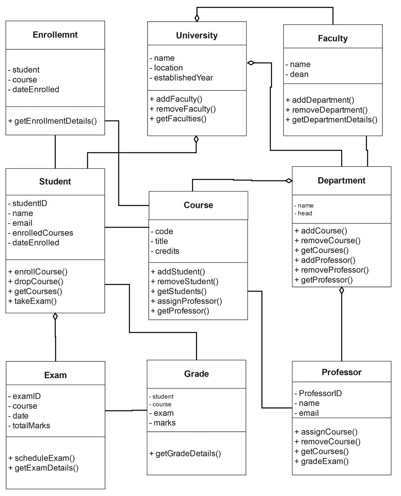

<h1>
IF2150 REKAYASA PERANGKAT LUNAK
<br>
TUGAS 5
<br>
DESKRIPSI PERANCANGAN PERANGKAT LUNAK (DPPL)
</h1>
<br>

## Sehati

<p align="center">

</p>

### Untuk: Aurelia Jennifer Gunawan

Dipersiapkan oleh:

| Informasi | Keterangan |
| --------- | ---------- |
| Kelas     | K01        |
| Kelompok  | G04        |

| NIM      | Nama                         |
| -------- | ---------------------------- |
| 13525052 | Daniel Charisma Christian    |
| 13525061 | Rifqi Irfan Indrawan         |
| 13525082 | Ausa Haadiyaan Mukhtar Yusuf |
| 13525058 | Farish Firstian Erifiawan    |

---

## Daftar Perubahan

| Revisi | Deskripsi |
| ------ | --------- |
| ...    | ...       |

---

<br>

> **Petunjuk pengerjaan:** _[Silahkan hapus bagian ini setelah selesai mengerjakan]_
>
> Dokumen ini melanjutkan **Deskripsi Perancangan Perangkat Lunak**. Gunakan nama, ID, kebutuhan, dan use case yang konsisten dengan kedua dokumen tersebut. Contoh pola ID baru di bawah dapat disesuaikan dengan kesepakatan kelompok, ID yang sudah ada tetap dipertahankan.

<br>

---

# BAB 1: Pendahuluan

## 1.1 Tujuan Penulisan Dokumen

Tuliskan dengan ringkas tujuan dokumen DPPL ini dibuat dan siapa saja yang akan menggunakan dokumen ini.

## 1.2 Lingkup Masalah

Tuliskan dengan ringkas nama aplikasi dan deskripsi singkatnya. Bagian ini maksimal berisi satu paragraf, dapat diambil dari SKPL.

## 1.3 Definisi, Istilah, dan Singkatan

Semua definisi dan singkatan yang digunakan dalam dokumen ini beserta penjelasannya.

Tabel 1.3. Definisi Istilah dan Singkatan

| Singkatan, Akronim, atau Istilah | Penjelasan                                                                                                                                                            |
| :------------------------------- | :-------------------------------------------------------------------------------------------------------------------------------------------------------------------- |
| _P/L_                            | _Singkatan dari Perangkat Lunak, yaitu aplikasi yang memberikan perintah kepada komputer untuk menjalankan tugas tertentu._                                           |
| _DPPL_                           | _Singkatan dari Spesifikasi Kebutuhan Perangkat Lunak, yaitu dokumen yang merangkum kriteria-kriteria yang diperlukan untuk membangun aplikasi menjalankan tugasnya._ |
| _UC_                             | _Singkatan dari Use Case._                                                                                                                                            |
| _..._                            | _..._                                                                                                                                                                 |

## 1.4 Aturan Penomoran

Tuliskan aturan penomoran (ID) yang digunakan dalam dokumen ini. Gunakan pola ID yang **sama** dengan yang sudah dipakai pada dokumen-dokumen sebelumnya, jangan membuat pola baru di dokumen ini.

Tabel 1.4. Aturan Penomoran

| Hal/Bagian | Penomoran | Keterangan |
| :--------- | :-------- | :--------- |
| _Uce Case_ | _UCXX_    |            |
| _Kelas_    | _CXX_     |            |
| _..._      | _..._     |

## 1.5 Referensi

Cantumkan dokumentasi P/L yang dirujuk oleh dokumen ini, **minimal dokumen SKPL dan APL**. Tambahkan buku, panduan, atau dokumentasi lain apabila digunakan.

## 1.6 Deskripsi Umum Dokumen (Ikhtisar)

Tuliskan sistematika pembahasan dokumen ini secara ringkas dan runut, dengan maksimal 1 paragraf.

<br>

---

# BAB 2: Perancangan Arsitektur

## 2.1 Rancangan Lingkungan Implementasi

Sebutkan _operating system_, DBMS, _development tools_, _filing system_, dan bahasa pemrograman yang digunakan.

## 2.2 Style/Pattern Arsitektur Acuan

Tentukan _architectural style_ atau _pattern_ yang menjadi acuan aplikasi, misalnya _layered architecture_, _client-server_, _repository_, _pipe and filter_, atau MVC (_Model-View-Controller_).

Gunakan hasil **BAB 1 Style/Pattern Arsitektur Acuan pada dokumen APL**, termasuk alasan pemilihan dan gambar penerapannya pada P/L kelompok. Gunakan komponen aplikasi sendiri pada gambar, bukan hanya contoh pola umum.

<p align="center">

</p>
<p align="center">
<i>Gambar 1. Contoh Arsitektur MVC</i>
</p>

## 2.3 Identifikasi Komponen / Modul / Subsistem

Identifikasi komponen, modul, atau subsistem penyusun aplikasi berdasarkan _pattern_ yang telah ditetapkan. Jelaskan tanggung jawab masing-masing komponen. Pengelompokan dapat mengikuti lapisan arsitektur atau fungsi/peran komponen dalam sistem.

Dapat menyalin dari dokumen DPPL sebelumnya

Tabel 2.3. Identifikasi Komponen/Modul/Subsistem

| Nama Komponen/Modul/Subsistem     | Jenis     | Penjelasan                  |
| :-------------------------------- | :-------- | :-------------------------- |
| _[Nama komponen/modul/subsistem]_ | _[Jenis]_ | _[Tanggung jawab komponen]_ |
| _[Nama komponen/modul/subsistem]_ | _[Jenis]_ | _[Tanggung jawab komponen]_ |
| _..._                             | _..._     | _..._                       |

## 2.4 Model Arsitektur Perangkat Lunak

Buat model arsitektur dalam bentuk satu atau lebih _view_ yang memperlihatkan interaksi dan kolaborasi komponen, modul, serta subsistem dalam menjalankan fungsi sistem. Pilih notasi yang sesuai. Contoh _view_: _Logical View_, _Process View_, _Development View_, dan _Physical View_.

Gunakan hasil **BAB 3 Model Arsitektur Perangkat Lunak pada dokumen APL**.

### 2.4.1 View [Nama View]

Tuliskan secara singkat model arsitektur yang dipilih dan alasan model tersebut cocok untuk aplikasi.

<p align="center">

</p>
<p align="center">
<i>Gambar 2. Contoh Logical View pada P/L E-Commerce</i>
</p>

### 2.4.X View [Nama View]

_[Lakukan hal yang sama dengan bagian sebelumnya]_

<br>

---

# BAB 3: Realisasi Use Case

## 3.1 Use Case [Nama Use Case 1]

**ID Use Case:** _[UC01 sesuai SKPL]_  
**Nama Use Case:** _[Nama use case sesuai SKPL]_

### 3.1.1 Identifikasi Kelas

Identifikasi kelas yang terkait dengan use case tersebut. Kelas di tahap perancangan dapat berbeda dengan dengan kelas di tahap analisis. Dapat menggunakan tabel di bawah:

Tabel 3.1. Identifikasi Kelas Use Case [UC01]

| No  | Nama Kelas Perancangan     | Nama Kelas Analisis Terkait       |
| :-- | :------------------------- | :-------------------------------- |
| 1   | _[Nama kelas perancangan]_ | _[Nama kelas analisis pada SKPL]_ |
| 2   | _[Nama kelas perancangan]_ | _[Nama kelas analisis pada SKPL]_ |
| ... | _..._                      | _..._                             |

### 3.1.2 Sequence Diagram

Buat _sequence diagram_ untuk **setiap skenario use case**, mencakup skenario normal dan alternatif pada subbab 4.4 SKPL. Diagram melibatkan kelas-kelas yang telah diidentifikasi pada SKPL.

- **Skenario Normal**

<p align="center">

</p>
<p align="center">
<i>Gambar X. Sequence Diagram [UC01]</i>
</p>

- **Skenario Alternatif [Nomor]: [Nama Skenario]**

<p align="center">

</p>
<p align="center">
<i>Gambar X. Sequence Diagram [UC01] - [Nama skenario alternatif]</i>
</p>

### 3.1.3 Diagram Kelas

Buatlah diagram kelas untuk use case ini yang terdiri atas kelas-kelas dari 3.1.1. **Setiap kelas pada diagram wajib menampilkan atribut dan metode/operasi langsung di dalam kotak kelasnya**, sehingga tidak perlu membuat tabel daftar atribut dan metode per kelas pada subbab ini. Daftar lengkap atribut dan metode seluruh kelas disajikan pada Tabel 4.1 (Bab 4).

<p align="center">

</p>
<p align="center">
<i>Gambar X. Diagram Kelas [Nama Uce Case]</i>
</p>

Pada diagram, pastikan:

- Atribut dituliskan beserta visibilitas dan tipe datanya, misalnya `- email: String`.
- Operasi dituliskan beserta visibilitas, parameter, dan tipe kembaliannya, misalnya `+ login(email: String, password: String): Boolean`.
- Relasi antarkelas (asosiasi, agregasi, komposisi, generalisasi, dan dependensi) digambarkan lengkap dengan multiplisitas.
- Semua operasi yang dipanggil pada sequence diagram 3.1.2 (skenario normal dan alternatif) ada pada kelas yang bersangkutan.
- Kelas yang sama dengan kelas di use case lain memakai nama, atribut, dan metode yang konsisten.

## 3.2 Use Case XX

Silahkan lanjutkan untuk _use case_ berikutnya dengan content yang sama dengan 3.1

<br>

---

# BAB 4: Diagram Kelas Keseluruhan

## 4.1 Diagram Kelas

**Bagian ini diisi dengan diagram kelas keseluruhan.**

<p align="center">

</p>
<p align="center">
<i>Gambar 4.1. Diagram Kelas Perancangan Keseluruhan [Nama P/L]</i>
</p>

Tabel 4.1. Daftar Kelas Perancangan Keseluruhan

| ID Kelas | Nama Kelas     | Atribut            | Metode/Operasi            |
| :------- | :------------- | :----------------- | :------------------------ |
| _[C01]_  | _[Nama kelas]_ | _[Daftar atribut]_ | _[Daftar metode/operasi]_ |
| _[C02]_  | _[Nama kelas]_ | _[Daftar atribut]_ | _[Daftar metode/operasi]_ |
| _[C03]_  | _[Nama kelas]_ | _[Daftar atribut]_ | _[Daftar metode/operasi]_ |
| _..._    | _..._          | _..._              | _..._                     |

---

# BAB 5: Perancangan Rinci Kelas

Bagian ini diisi dengan daftar seluruh kelas dalam tabel berikut:

Tabel 5.1. Daftar Kelas Perancangan dan Kelas Analisis Terkait

| No  | Nama Kelas Perancangan     | Nama Kelas Analisis Terkait              |
| :-- | :------------------------- | :--------------------------------------- |
| 1   | _[Nama kelas perancangan]_ | _[Nama kelas analisis pada SKPL atau -]_ |
| 2   | _[Nama kelas perancangan]_ | _[Nama kelas analisis pada SKPL atau -]_ |
| ... | _..._                      | _..._                                    |

Untuk **setiap kelas**, identifikasi operasi berdasarkan tanggung jawab kelas beserta _visibility_-nya, serta atribut beserta _visibility_ dan tipenya. Buat subbab tersendiri untuk setiap kelas.

## 5.1 Kelas [Nama Kelas 1]

**Nama Kelas:** _[Nama kelas]_  
**ID Kelas:** _[ID kelas]_

Tabel 5.1.1. Operasi Kelas [Nama Kelas 1]

| Nama Operasi                                                 | Visibility (private, public) | Keterangan                 |
| :----------------------------------------------------------- | :--------------------------- | :------------------------- |
| _[Signature operasi, termasuk parameter dan tipe kembalian]_ | _[Visibility]_               | _[Tanggung jawab operasi]_ |
| _..._                                                        | _..._                        | _..._                      |

Tabel 5.1.2. Atribut Kelas [Nama Kelas 1]

| Nama Atribut     | Visibility (private, public) | Tipe                                              |
| :--------------- | :--------------------------- | :------------------------------------------------ |
| _[Nama atribut]_ | _[Visibility]_               | _[Tipe sesuai bahasa pemrograman yang digunakan]_ |
| _..._            | _..._                        | _..._                                             |

### 5.1.1 Algoritma/Query

Bagian ini diisi untuk kerangka algoritma proses yang dianggap cukup penting. Algoritma dapat dituliskan sebagai _pseudocode_. Implementasi _skeleton code_ juga dapat digunakan untuk kelas yang sudah terdefinisi pada bahasa pemrograman tertentu.

**Nama Kelas:** _[Nama kelas]_  
**Nama Operasi:** _[Signature operasi]_  
**ID Algoritma:** _[Algo-001]_

```text
[Tuliskan pseudocode algoritma operasi di sini.]
```

Jika operasi mengacu pada query tertentu, lengkapi tabel berikut.

Tabel 5.1.1. Query Operasi [Nama Operasi]

| No Query  | Query              | Keterangan       |
| :-------- | :----------------- | :--------------- |
| _[Q-001]_ | _[Tuliskan query]_ | _[Fungsi query]_ |
| _..._     | _..._              | _..._            |

### 5.1.2 Algoritma/Query

_[Ulangi pola 5.1.1 untuk operasi penting berikutnya pada kelas yang sama, jika ada.]_

## 5.2 Kelas [Nama Kelas Berikutnya]

_[Ulangi pola 5.1: nama dan ID kelas, tabel operasi, tabel atribut, serta subbab algoritma/query untuk operasi penting jika diperlukan.]_

<br>

---

# BAB 6: Perancangan Antarmuka

## 6.1 Rancangan Antarmuka [ID Layar 1]

Masukkan versi awal prototipe antarmuka, dimana untuk setiap antarmuka/layar, tuliskan spesifikasi rinci objek yang ditampilkan dan reaksi sistem terhadap interaksi pengguna.

**Antarmuka:** _[ID layar]_  
**Nama Layar:** _[Nama layar]_

<p align="center">

</p>
<p align="center">
<i>Gambar 6.1. Rancangan Antarmuka [ID Layar] - [Nama Layar]</i>
</p>

Tabel 6.1. Spesifikasi Objek Antarmuka [ID Layar]

| Id_Objek     | Jenis                                          | Konten                            | Keterangan                                                                 |
| :----------- | :--------------------------------------------- | :-------------------------------- | :------------------------------------------------------------------------- |
| _[ID objek]_ | _[Jenis objek, misalnya Button, RTF Box, dll]_ | _[String yang tampil pada layar]_ | _[Reaksi sistem, layar tujuan, tautan, atau ID algoritma yang dijalankan]_ |
| _[ID objek]_ | _[Jenis objek]_                                | _[Konten yang ditampilkan]_       | _[Reaksi sistem atau nama file terkait beserta deskripsi ringkasnya]_      |
| _..._        | _..._                                          | _..._                             | _..._                                                                      |

## 6.X Rancangan Antarmuka [ID Layar X]

_[Ulangi pola 6.1 untuk layar berikutnya sampai semua layar teridentifikasi]_

## 6.Y Rancangan Antarmuka Keseluruhan

Tuliskan daftar gambar seluruh antarmuka. Berikan ID unik untuk setiap tampilan dan gunakan ID yang sama pada subbab perancangan antarmuka masing-masing.

Tabel 6.Y. Rancangan Antarmuka Keseluruhan

| No       | Tampilan Antarmuka                                                             |
| :------- | :----------------------------------------------------------------------------- |
| _[I-01]_ |  |
| _[I-02]_ | _[Sisipkan gambar antarmuka I-02]_                                             |
| _[I-XX]_ | _[Sisipkan gambar antarmuka berikutnya]_                                       |

<br>

---

# BAB 7: Matriks Kerunutan

Petakan kelas perancangan dengan use case yang terkait. Gunakan **BAB 6 Traceability pada dokumen SKPL** sebagai acuan keterkaitan kelas analisis dan use case, lalu sesuaikan dengan realisasi use case dan kelas perancangan pada BAB 3–BAB 5 DPPL.

Tabel 7.1. Matriks Kerunutan Kelas terhadap Use Case

| Kelas                     | Use Case Terkait                                             |
| :------------------------ | :----------------------------------------------------------- |
| _[ID kelas - Nama kelas]_ | _[ID UC - Nama use case; tuliskan seluruh use case terkait]_ |
| _[ID kelas - Nama kelas]_ | _[ID UC - Nama use case]_                                    |
| _..._                     | _..._                                                        |
