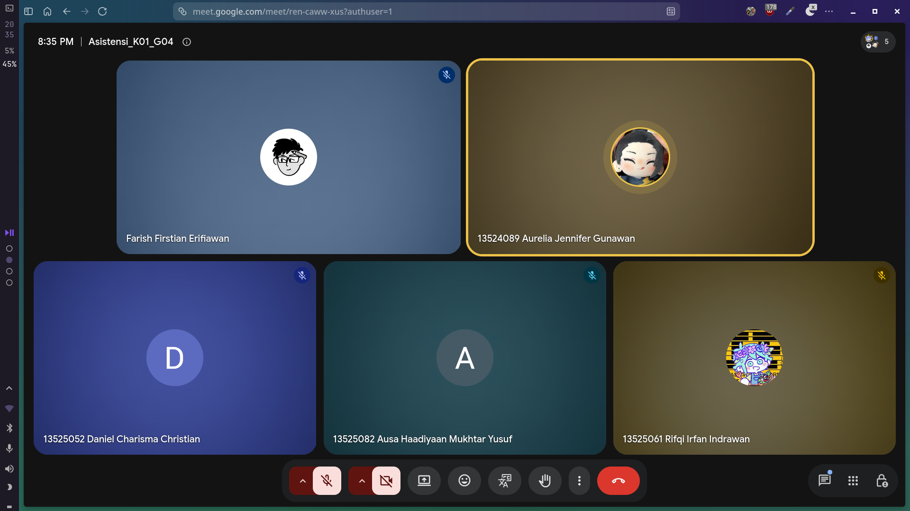

# Form Asistensi

## Tugas Besar IF2150 - Rekayasa Perangkat Lunak

| Informasi                | Keterangan       |
| ------------------------ | ---------------- |
| **Hari**                 | Selasa           |
| **Tanggal**              | 27/10/2026       |
| **Kelas**                | K01              |
| **Nomor Kelompok**       | G04              |
| **Nama Kelompok**        | LompatMulai      |
| **Nama Perangkat Lunak** | Sehati           |
| **Dokumen**              | K01_G04_DPPL2.md |

### Anggota Kelompok

| NIM      | Nama                         |
| -------- | ---------------------------- |
| 13525052 | Daniel Charisma Christian    |
| 13525061 | Rifqi Irfan Indrawan         |
| 13525082 | Ausa Haadiyaan Mukhtar Yusuf |
| 13525058 | Farish Firstian Erifiawan    |

### Catatan

| Catatan                                                                                      |
| -------------------------------------------------------------------------------------------- |
| 1. Untuk bab 6 itu sudah harus pake UI/UX dan gambaran aslinya nanti aplikasinya kaya gimana |
| 2. Aturan penomoran utk id_objek dibebaskan, yang penting nanti ditaro di 1.4                |
| 3. Untuk bab 6 juga nanti ditaro di bab paling bawah tambahin lampiran buat link figmanya    |

## Dokumentasi

  

  <i>Gambar 1. Dokumentasi kegiatan asistensi.</i>

