# Kamus Istilah

Tabel 1. Definisi Istilah dan Singkatan

| Singkatan, Akronim, atau Istilah | Penjelasan |
| --- | --- |
| P/L | Singkatan dari Perangkat Lunak, yaitu aplikasi yang memberikan perintah kepada komputer untuk menjalankan tugas tertentu. |
| SKPL | Singkatan dari Spesifikasi Kebutuhan Perangkat Lunak, yaitu dokumen yang merangkum kriteria-kriteria yang diperlukan untuk membangun aplikasi menjalankan tugasnya. |
| KF | Singkatan dari Kebutuhan Fungsional, yaitu kebutuhan yang menjelaskan apa yang harus dapat dilakukan oleh sistem. |
| KNF | Singkatan dari Kebutuhan Non-Fungsional, yaitu kebutuhan yang menjelaskan kualitas sistem, seperti ketersediaan, keamanan, dan kemudahan penggunaan. |
| UC | Singkatan dari *Use Case*, yaitu gambaran interaksi antara aktor dan sistem untuk mencapai suatu tujuan. |
| UML | Singkatan dari *Unified Modeling Language*, yaitu bahasa pemodelan standar yang digunakan untuk membuat *use case diagram* dan diagram kelas. |
| SDG | Singkatan dari *Sustainable Development Goals* (Tujuan Pengembangan Berkelanjutan), yaitu 17 tujuan global yang dicanangkan PBB. SDG 3 berfokus pada kehidupan yang sehat dan sejahtera. |
| Sehati | Nama perangkat lunak yang dikembangkan untuk mendukung kesehatan mental dan kesejahteraan mahasiswa. |
| Mahasiswa | Aktor pengguna utama Sehati yang menggunakan pengingat, *daily affirmations*, jadwal, dan pemesanan sesi konsultasi. |
| Administrator | Aktor yang mengelola Sehati, termasuk memasukkan jadwal konsultan, mengelola FAQ dan umpan balik, serta memantau status *server*. |
| Konsultan | Tenaga profesional yang menyediakan sesi konsultasi. Konsultan bukan aktor sistem; data dan jadwalnya dikelola oleh Administrator. |
| *Daily Affirmations* | Pesan positif yang dikirimkan kepada pengguna pada waktu yang diatur pengguna untuk menjaga suasana hati dan kepercayaan diri. |
| Pengingat | Notifikasi dengan waktu yang diatur pengguna untuk makan, tidur, dan berolahraga. |
| Notifikasi | Pesan yang ditampilkan sistem kepada pengguna, misalnya untuk *daily affirmations* dan pengingat. |
| Google Calendar | Layanan kalender milik Google yang datanya diintegrasikan ke Sehati untuk menampilkan jadwal pengguna. |
| API | Singkatan dari *Application Programming Interface*, yaitu antarmuka yang memungkinkan satu perangkat lunak berkomunikasi dengan perangkat lunak lain, misalnya Google Calendar API. |
| OAuth | Protokol otorisasi yang memungkinkan aplikasi mendapat akses terbatas ke akun pengguna di layanan lain (misalnya Google) tanpa mengetahui kata sandi pengguna. |
| Autentikasi | Proses memverifikasi identitas pengguna sebelum diberi akses ke aplikasi. Pada Sehati, autentikasi dilakukan melalui akun Google. |
| *Free/busy* | Informasi rentang waktu pengguna yang sibuk atau kosong pada kalender, tanpa rincian acaranya. Dipakai untuk mendeteksi bentrok jadwal. |
| Bentrok jadwal | Kondisi ketika waktu sesi konsultasi yang dipilih tumpang tindih dengan acara lain di kalender pengguna. |
| *Database* | Basis data tempat sistem menyimpan data seperti jadwal konsultasi, FAQ, dan umpan balik. |
| *Server* | Komponen sistem yang menjalankan logika aplikasi dan melayani permintaan dari pengguna. |
| *Uptime* | Persentase waktu sistem dapat diakses dan beroperasi dalam suatu periode. |
| FAQ | Singkatan dari *Frequently Asked Questions*, yaitu daftar pertanyaan yang sering diajukan beserta jawabannya. |
| Umpan balik | Masukan dari pengguna terhadap aplikasi, yang dapat ditanggapi oleh Administrator. |
| *Traceability* | Keterlacakan hubungan antara kelas, *use case*, dan kebutuhan fungsional. |
| DPPL | Singkatan dari Deskripsi Perancangan Perangkat Lunak, yaitu dokumen yang menjabarkan rancangan arsitektur, komponen, dan kelas perancangan sebagai lanjutan SKPL dan APL. |
| Kelas Analisis | Kelas konseptual pada tahap analisis (SKPL) yang merepresentasikan entitas domain, misalnya `DailyAffirmation` dan `JadwalKonsultasi`. |
| Kelas Perancangan | Kelas pada tahap desain yang merealisasikan kelas analisis, misalnya `AuthController` dan `ReminderView`, dan disusun lengkap pada bagian Diagram Kelas Perancangan. |
| _Sequence Diagram_ | Diagram UML yang menggambarkan urutan pertukaran pesan antarobjek untuk merealisasikan satu skenario _use case_. |
| MVC | Singkatan dari _Model-View-Controller_, yaitu pattern arsitektur yang memisahkan penyimpanan data (_model_), tampilan (_view_), dan pemrosesan permintaan (_controller_). |

# Latar Belakang

Kesehatan mental itu penting.
Namun, masyarakat Indonesia cenderung untuk mengabaikan hal ini.
Buktinya, pergi ke psikolog untuk terapi seringkali dipandang sebagai hal yang tabu dan dianggap melemahkan diri.

Selain itu, jumlah kasus bunuh diri di Indonesia cukup tinggi, terutama yang terjadi pada remaja dan mahasiswa.
Estimasi IHME dan Global Burden of Disease menyatakan, pada tahun 2023 untuk setiap 100.000 orang, terjadi sekitar 2 kematian akibat bunuh diri di Indonesia.

Di samping kasus bunuh diri, kondisi mental yang kurang ideal menurunkan tingkat produktivitas dan kualitas aktivitas sosial.
Kedua faktor ini sangat penting bagi mahasiswa, target utama produk kami, untuk mencapai perkuliahan yang optimal.

Kami ingin mengaitkan latar belakang ini dengan poin ketiga Tujuan Pengembangan Bersama (_Sustainable Development Goals_ [SDGs]), yaitu kehidupan yang sehat dan sejahtera.
Perserikatan Bangsa-Bangsa telah mencanangkan sejumlah SDG yang perlu pemerintah dan masyarakat dunia capai sebelum tahun 2030.
Namun, pada tahun 2024, terlaporkan bahwa hanya 17% target SDG telah tercapai.

Dari latar belakang ini, diharapkan solusi perangkat lunak ini dapat menjadi sarana untuk menggiatkan kesadaran akan kesehatan mental yang baik dan ketercapaian bersama dalam SDGs di lingkungan kami sebagai mahasiswa, serta memperkaya alternatif solusi yang telah ada.

# Analisis Kondisi Saat Ini

[Riliv](https://riliv.co/), [bicarakan.id](http://Bicarakan.id), KALM, 7 Cups, [Headspace](https://www.headspace.com/), BetterHelp, dan Woebot menawarkan beberapa solusi perangkat lunak yang telah dikembangkan sebelumnya. Ada pun _hotline_ yang disediakan oleh pemerintah (SEJIWA, yang dapat diakses via nomor telepon 119 _extension_ 8\) dan lembaga lainnya, seperti LISA Suicide Prevention Helpline, yang diprakarsai oleh 11 LSM dalam kolektif Bali Bersama Bisa.

Namun, terdapat beberapa keluhan yang diberikan oleh _review online_ yang diberikan pengguna. Beberapa hal seperti:

| ID   | Kekurangan                                                                                                                                                                                                                                                              |
| ---- | ----------------------------------------------------------------------------------------------------------------------------------------------------------------------------------------------------------------------------------------------------------------------- |
| AK-1 | Aplikasi Riliv tergolong sulit dan kurang sesuai dalam pemakaiannya, terdapat fitur pemesanan konsultasi namun harus mengikuti jadwal yang tersedia dan tidak langsung.                                                                                                 |
| AK-2 | Aplikasi Bicarakan.id yang memiliki kekurangan pada bug aplikasi yang dapat terjadi kapan saja, seperti terjadi pemesanan yang tulisannya selesai namun gagal, pembuatan akun yang terus gagal, pendaftaran yang menggunakan nomor baru namun dituliskan sudah dipakai. |
| AK-3 | Sebagian besar layanan konseling memiliki tarif yang dapat tergolong cukup tinggi maka tidak dapat meng-_cover_ keseluruhan demografi.                                                                                                                                  |
| AK-4 | Layanan BetterHelp yang memiliki marketplace konseling memiliki masalah menaruh iklan yang bersangkutan dengan pihak ketiga yang menjual data pribadi pengguna.                                                                                                         |
| AK-5 | Chatbot Woebot yang pada awalnya memiliki basis pengguna yang cukup tinggi namun karena perusahaan beralih ke model enterprise pengguna-pengguna tersebut ditinggalkan begitu saja tanpa adanya pengganti.                                                              |

Tabel 2. Perbandingan Kekurangan Solusi yang Sudah Ada

# Aturan Penomoran

Tabel 3. Aturan Penomoran

| Hal/Bagian | Penomoran | Keterangan |
| --- | --- | --- |
| Kebutuhan | R-XX | Huruf R, tanda hubung, lalu nomor urut dua digit mulai dari 01 (contoh: R-01). Dipakai pada kolom ID Kebutuhan. |
| Kebutuhan Fungsional | KF-XX | Nomor urut dua digit mulai dari 01 (contoh: KF-01). |
| Kebutuhan Non-Fungsional | KNF-XX | Nomor urut dua digit mulai dari 01 (contoh: KNF-01). |
| Aktivitas | A-XX | Nomor urut dua digit mulai dari 01 (contoh: A-01), sesuai dokumen *Requirement Gathering*. |
| *User Story* | US-XX | Nomor urut dua digit mulai dari 01 (contoh: US-01), sesuai dokumen *Requirement Gathering*. |
| *Use Case* | UC-XX | Nomor urut dua digit mulai dari 01 (contoh: UC-01). |
| Kelas | C-XX | Nomor urut dua digit mulai dari 01 (contoh: C-01). |
| Aktor | Tidak ada | Aktor tidak diberi ID dan dirujuk dengan namanya (Mahasiswa, Administrator). |
| Algoritma | Algo-XXX | Nomor urut tiga digit mulai dari 001 (contoh: Algo-001). Dipakai pada subbab algoritma di bagian Perancangan Rinci Kelas. |
| *Query* | Q-XXX | Nomor urut tiga digit mulai dari 001 (contoh: Q-001). Dipakai pada tabel *query* di bagian Perancangan Rinci Kelas. |
| Antarmuka | I-XX | Nomor urut dua digit mulai dari 01 (contoh: I-01). Dipakai pada bagian Perancangan Antarmuka. |
| Objek antarmuka | I-XX-YY | ID antarmuka diikuti nomor urut objek dua digit (contoh: I-04-07). Dipakai pada tabel spesifikasi objek antarmuka. |


# Analisis Solusi

## Deskripsi Perangkat Lunak

Sehati adalah aplikasi mobile (Android dan iOS) yang mempromosikan well-being mahasiswa, sejalan dengan SDG 3 (ensure healthy lives and promote well-being for all at all ages).
Aplikasi menargetkan mahasiswa secara khusus agar operasionalnya terfokus.
Pengguna utama (Mahasiswa) masuk ke aplikasi melalui akun Google, lalu dapat memesan jadwal sesi konsultasi, melihat daily affirmations, dan mengatur pengingat makan, tidur, serta olahraga.
Administrator mengelola data konsultan dan jadwal ketersediaannya, FAQ, umpan balik pengguna, serta memantau status server.

<p align="center">
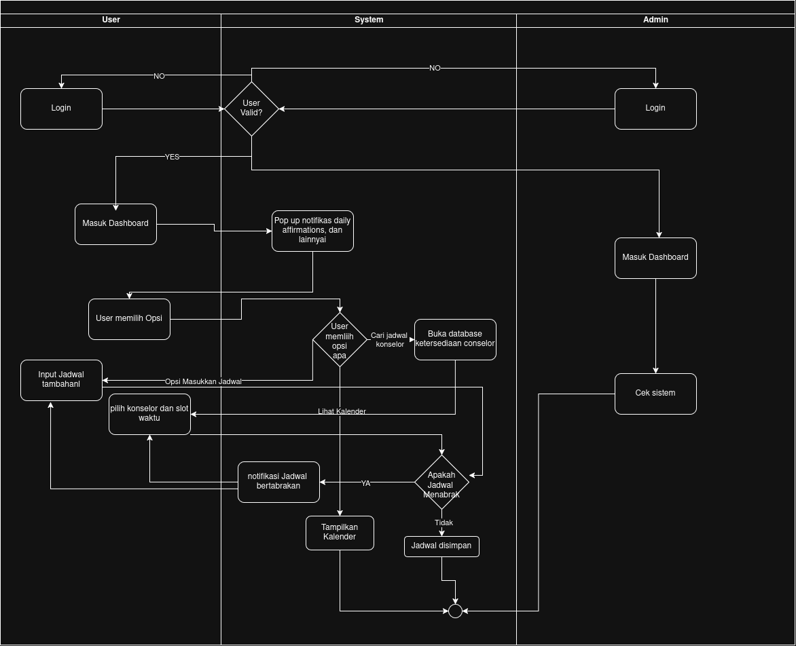
</p>
<p align="center">
<i>Gambar 1. Diagram Aktivitas Proses Bisnis Sehati</i>
</p>

## Asumsi dan Batasan

Tabel 4. Asumsi

| ID | Asumsi |
| --- | --- |
| AB-A-1 | Pengguna (mahasiswa) memiliki akun Google aktif dan bersedia memberikan izin akses ke Google Calendar mereka untuk keperluan integrasi jadwal |
| AB-A-2 | Pengguna memiliki koneksi internet yang stabil selama menggunakan aplikasi, mengingat fitur-fitur utama (sinkronisasi kalender, pemesanan konsultasi) bergantung pada komunikasi *real-time* dengan server |
| AB-A-3 | Data konsultan yang terdaftar diperbarui secara berkala oleh Administrator |
| AB-A-4 | Data jadwal dan preferensi yang dimasukkan pengguna (waktu makan, tidur, olahraga) mencerminkan kondisi dan kebutuhan nyata mereka |
| AB-A-5 | Pengguna memiliki perangkat mobile (Android/iOS) yang memenuhi spesifikasi minimum aplikasi |

Tabel 5. Regulasi

| ID | Regulasi |
| --- | --- |
| AB-R-1 | UUD 1945 pasal 28H ayat (1) |
| AB-R-2 | UU No. 39/1999 tentang HAM |
| AB-R-3 | UU No. 3/1966 tentang Kesehatan Jiwa |
| AB-R-4 | UU No. 18/2014 tentang Kesehatan Jiwa |
| AB-R-5 | UU No. 17/2023 tentang Kesehatan (UU Kesehatan omnibus) |
| AB-R-6 | Permenkes No. 54/2017 |

Tabel 6. Keterbatasan

| ID | Keterbatasan |
| --- | --- |
| AB-K-1 | Aplikasi bukan pengganti layanan intervensi krisis atau *hotline* darurat (seperti SEJIWA 119 ext. 8) — tidak dirancang untuk menangani situasi darurat kesehatan mental |
| AB-K-2 | Fitur integrasi jadwal bergantung pada ketersediaan dan kebijakan API pihak ketiga (Google Calendar API); jika pengguna mencabut izin akses atau layanan API mengalami gangguan, sinkronisasi jadwal tidak akan berfungsi |
| AB-K-3 | Verifikasi kredensial profesional konsultan dilakukan secara manual oleh administrator, bukan otomatis |
| AB-K-4 | Konsultan yang tersedia terbatas pada mitra yang telah terdaftar dan diverifikasi di dalam sistem, bukan direktori terbuka |
| AB-K-5 | Rilis awal hanya mencakup aplikasi mobile (Android dan iOS); belum tersedia versi web atau desktop |
| AB-K-6 | Aplikasi tidak menyediakan rekam medis elektronik atau fitur diagnosis klinis |

Tabel 7. Di Dalam Ruang Lingkup Solusi

| ID | Di dalam ruang lingkup solusi |
| --- | --- |
| AB-RLS-D-1 | Pengaturan dan pengiriman *daily affirmations* sesuai jadwal yang ditentukan pengguna |
| AB-RLS-D-2 | Pengingat (*reminder*) makan, tidur, dan olahraga yang dapat dikustomisasi |
| AB-RLS-D-3 | Tampilan jadwal harian terintegrasi dengan Google Calendar pengguna (*read access*) |
| AB-RLS-D-4 | Pemesanan sesi konsultasi dengan konsultan, termasuk deteksi bentrok (*overlap*) antara slot yang dipilih dengan event yang sudah ada di Google Calendar pengguna |
| AB-RLS-D-5 | Panel administrator untuk mengelola ketersediaan konsultan dan data pengguna |

Tabel 8. Di Luar Ruang Lingkup Solusi

| ID | Di luar ruang lingkup solusi |
| --- | --- |
| AB-RLS-L-1 | Layanan konseling darurat atau intervensi krisis *real-time* |
| AB-RLS-L-2 | Rekam medis elektronik atau riwayat diagnosis klinis pengguna |
| AB-RLS-L-3 | Sistem pembayaran/*billing* (belum disebutkan sebagai fitur utama) |
| AB-RLS-L-4 | Aplikasi versi web atau desktop pada rilis awal |
| AB-RLS-L-5 | Fitur komunitas atau forum antar-pengguna |

## Spesifikasi Kebutuhan

### Identifikasi Aktor

Tabel 9. Identifikasi Aktor

| Aktor         | Deskripsi                                                                                                                                               |
| ------------- | ------------------------------------------------------------------------------------------------------------------------------------------------------- |
| Mahasiswa | Pengguna ini akan menggunakan fitur-fitur pengingat makan, olahraga, dan tidur serta mendapatkan *daily affirmations* dan dapat memesan sesi konsultasi |
| Administrator | Pengguna ini akan menambahkan jadwal konsultasi sesuai jadwal yang terdapat pada informasi konsultan |

### Kebutuhan Pengguna Awal

Tabel 10. Kebutuhan Pengguna Awal

| ID    | Aktor                    | Kebutuhan / Aktivitas                                            | Tujuan / Nilai                                                                               |
| ----- | ------------------------ | ---------------------------------------------------------------- | -------------------------------------------------------------------------------------------- |
| US-01 | Mahasiswa                | Mendapatkan notifikasi pengiriman _daily affirmations_           | Menjaga _mood_ dan mental tetap stabil dan sehat.                                            |
| US-02 | Mahasiswa                | Mendapatkan pengingat makan sesuai jadwal harian                 | Menjaga kesehatan fisik                                                                      |
| US-03 | Mahasiswa                | Mendapatkan pengingat tidur sesuai jadwal harian                 | Menjaga kesehatan fisik                                                                      |
| US-04 | Mahasiswa                | Menginput dan melihat jadwal sehari-hari secara simpel dan mudah | Memudahkan untuk mengetahui kegiatan yang sedang dan akan dilakukan tanpa berpindah aplikasi |
| US-05 | Mahasiswa                | Memesan sesi konsultasi pada jadwal yang diinginkan              | Menjadikan proses pemesanan lebih fleksibel                                                  |
| US-06 | Mahasiswa                | Mendapatkan pengingat olahraga sesuai jadwal harian              | Menjaga kesehatan fisik                                                                      |
| US-07 | Administrator            | Memasukkan jadwal sesi konsultasi pada sistem                    | Menjadikan data jadwal sesi konsultasi tersedia ke sistem dan dapat diakses                  |
| US-08 | Administrator            | Menjaga dan mengelola sistem                                     | Menjaga kestabilan dan keandalan aplikasi dan sistem                                         |
| US-09 | Mahasiswa, Administrator | Masuk ke aplikasi menggunakan akun Google                        | Memudahkan proses login tanpa perlu membuat dan mengingat kredensial baru                    |
| US-10 | Mahasiswa                | Mengajukan pertanyaan yang tidak tercakup di FAQ                 | Mendapatkan jawaban atas hal yang tidak terjawab oleh FAQ yang tersedia                      |

### Deskripsi Aktivitas

Tabel 11. Deskripsi Aktivitas

| ID   | Aktivitas                                              | Penjelasan                                                                                                                                                                        | ID _User_ Story |
| ---- | ------------------------------------------------------ | --------------------------------------------------------------------------------------------------------------------------------------------------------------------------------- | --------------- |
| A-01 | Menyetel jadwal pengiriman *daily affirmations* | Pengguna dapat mengatur kapan mendapatkan *daily affirmations* lewat aplikasi. | US-01 |
| A-02 | Melihat jadwal sehari-hari secara keseluruhan | Pengguna dapat melihat jadwal sehari-hari lewat integrasi Google Calendar termasuk jadwal pengingat dan kegiatan-kegiatan lain yang ada di jadwal Google Calendar pengguna. | US-04 |
| A-03 | Menyetel pengingat makan | Pengguna dapat mengatur kapan diberikan pengingat lewat aplikasi. | US-02 |
| A-04 | Menyetel pengingat tidur | Pengguna dapat mengatur kapan diberikan pengingat lewat aplikasi. | US-03 |
| A-05 | Mengatur pengingat olahraga | Pengguna dapat mengatur kapan diberikan pengingat lewat aplikasi. | US-06 |
| A-06 | Menjadwalkan konsultasi dengan konsultan | Pengguna dapat melihat jadwal konsultasi yang tersedia sekaligus melihat apakah jadwal tersebut bertabrakan dengan jadwal yang sudah ada di kalender pengguna di Google Calendar. | US-05 |
| A-07 | Menginput jadwal konsultan pada *database* | Admin memasukkan jadwal konsultan ke database agar dapat dilihat di kalender pengguna | US-07 |
| A-08 | Membuat FAQ | Admin membantu dalam pembuatan FAQ dari pertanyaan yang sering diajukan | US-08 |
| A-09 | Meng-*update* dan melakukan pengecekan terhadap server | Admin melakukan regulasi melalui pengecekan dan update keadaan server (servis up/down) | US-08 |
| A-10 | Merespons terhadap umpan balik pengguna | Admin membantu pengguna dalam penggunaan aplikasi | US-08 |
| A-11 | Melakukan autentikasi melalui akun Google | Pengguna masuk ke aplikasi dengan akun Google mereka, dan sistem memverifikasi identitas tersebut sebelum memberikan akses ke fitur aplikasi. | US-09 |
| A-12 | Mengajukan pertanyaan di luar FAQ | Pengguna dapat mengisi dan mengirim pertanyaan melalui form ketika jawabannya tidak ditemukan di FAQ. | US-10 |

### Peta Kebutuhan

Tabel 12. Peta Kebutuhan

| ID Kebutuhan | ID Aktivitas     | Jenis Kebutuhan | Deskripsi Kebutuhan                                                                                                                | P/L   |
| ------------ | ---------------- | --------------- | ---------------------------------------------------------------------------------------------------------------------------------- | ----- |
| R-01         | A-01             | _User_          | _User_ dapat mengubah kapan mereka menerima _daily affirmations_ saat diinginkan                                                   | Ya    |
| R-02         | A-01             | *System*        | Sistem dapat menyimpan preferensi waktu pengiriman *daily affirmations* milik pengguna pada *database*                             | Ya    |
| R-03         | A-02             | _User_          | _User_ dapat melihat kalender dari aplikasi                                                                                        | Ya    |
| R-04         | A-02             | _System_        | Sistem dapat menampilkan kalender di aplikasi yang merupakan cerminan dari Google Calendar pengguna                                | Ya    |
| R-05         | A-03             | _User_          | _User_ dapat menyetel kapan saja ia ingin diingatkan untuk makan                                                                   | Ya    |
| R-06         | A-04             | _User_          | _User_ dapat menyetel kapan saja ia ingin diingatkan untuk tidur                                                                   | Ya    |
| R-07         | A-05             | _User_          | _User_ dapat menyetel kapan saja ia ingin diingatkan untuk olahraga                                                                | Ya    |
| R-08         | A-03, A-04, A-05 | _System_        | Sistem dapat menerima reminder dan secara sukses memberikan notifikasi ketika reminder tersebut dilewati                           | Ya    |
| R-09         | A-06             | _User_          | _User_ dapat memesan jadwal sesuai sesi yang telah terdaftar di sistem                                                             | Ya    |
| R-10         | A-06             | _System_        | Sistem dapat mengambil data (melakukan GET _request_) dari _database_ untuk ditampilkan ke pengguna                                | Ya    |
| R-11         | A-07             | _System_        | Sistem dapat menyimpan data jadwal sesi konsultasi pada _database_                                                                 | Ya    |
| R-12         | A-07             | *Business*      | Konsultan harus memberikan jadwalnya kepada administrator untuk mendaftarkannya di sistem                                          | Tidak |
| R-13         | A-08             | _System_        | Sistem harus memiliki sistem/media pemberian umpan balik                                                                           | Ya    |
| R-14         | A-08             | _System_        | Sistem harus menampilkan pertanyaan-pertanyaan yang sering diberikan _User_ pada suatu tempat di aplikasi                          | Ya    |
| R-15         | A-08             | _Business_      | Pengguna harus dapat memberikan umpan balik terhadap aplikasi                                                                      | Ya    |
| R-16         | A-09             | _System_        | Administrator melakukan pengecekan berkala pada aplikasi dan mengecek apakah sistem sedang _down_/tidak                            | Ya    |
| R-17         | A-09             | _Business_      | Administrator melakukan pelaporan jika terdapat kendala pada aplikasi                                                              | Tidak |
| R-18         | A-10             | _System_        | Sistem harus dapat menerima dan Administrator harus dapat memberikan komentar pada umpan balik _User_                              | Ya    |
| R-19         | N/A              | _System_        | Sistem dapat memastikan data pengguna tidak dapat diakses oleh pihak tak berwenang                                                 | Ya    |
| R-20         | N/A              | _System_        | Sistem dapat dinavigasikan dengan Mudah                                                                                            | Ya    |
| R-21         | A-11             | _System_        | Sistem dapat mengautentikasi pengguna (Mahasiswa dan Administrator) melalui akun Google sebelum memberikan akses ke fitur aplikasi | Ya    |
| R-22         | A-12             | *User*          | *User* dapat mengajukan pertanyaan di luar FAQ yang tersedia melalui form                                                          | Ya    |
| R-23         | A-12             | *System*        | Sistem dapat menyimpan pertanyaan yang diajukan pengguna pada *database* dan memberikan konfirmasi penyimpanan                     | Ya    |

## Kebutuhan Fungsional dan Kebutuhan Non-Fungsional

Tabel 13. Kebutuhan Fungsional

| ID KF | ID Kebutuhan     | Penjelasan                                                                                                                                                                                 |
| ----- | ---------------- | ------------------------------------------------------------------------------------------------------------------------------------------------------------------------------------------ |
| KF-01 | R-01, R-02 | Sistem menyediakan opsi untuk menyetel waktu pengiriman *daily affirmations*, menyimpan preferensi tersebut, dan dapat mengirim notifikasi *daily affirmations* di waktu yang disetel |
| KF-02 | R-03, R-04 | Sistem memungkinkan *user* melihat kalender dari aplikasi, dengan mengambil data Google Calendar pengguna melalui API yang tersedia dan menampilkannya di antarmuka |
| KF-03 | R-05, R-06, R-07 | Sistem menyediakan opsi untuk menyetel waktu pengiriman pengingat makan, tidur, olahraga dan dapat mengirim pengingatnya di waktu yang disetel |
| KF-04 | R-08 | Sistem memberikan tampilan notifikasi di mana pun user berada dalam aplikasi, dilengkapi juga dengan konten seperti label yang diberikan pengguna |
| KF-05 | R-04 | Sistem dapat menampilkan kalender yang telah terintegrasi dengan Google Calendar pengguna lalu memberikan kalender gabungan dengan data jadwal sesi konsultasi yang terdapat di *database* |
| KF-06 | R-10 | Sistem dapat mengambil data jadwal dari *database* dan dapat ditampilkan data tersebut ke pengguna |
| KF-07 | R-09, R-11 | Sistem dapat menyimpan data jadwal sesi konsultasi (baik yang dimasukkan administrator maupun yang dipesan mahasiswa) ke dalam *database*, serta memungkinkan mahasiswa memesan sesi sesuai jadwal yang terdaftar |
| KF-08 | R-14 | Sistem dapat menampilkan daftar pertanyaan yang sering diajukan (FAQ) pada aplikasi. |
| KF-09 | R-13, R-15 | Sistem menyediakan fitur bagi pengguna untuk memberikan umpan balik terhadap aplikasi. |
| KF-10 | R-16 | Sistem dapat menampilkan status *server* (*up/down*) kepada administrator. |
| KF-11 | R-18 | Sistem dapat memberikan akses kepada administrator untuk memberikan tanggapan/feedback terhadap umpan balik pengguna. |
| KF-12 | R-21 | Sistem dapat memverifikasi identitas pengguna melalui *log in* akun Google dan memberikan akses ke aplikasi setelah autentikasi berhasil. |
| KF-13 | R-22, R-23 | Sistem menyediakan form bagi pengguna untuk mengajukan pertanyaan di luar FAQ, menyimpannya pada *database*, dan menampilkan konfirmasi bahwa pertanyaan telah tersimpan |

Tabel 14. Kebutuhan Non-Fungsional

| ID KNF | ID Kebutuhan | Parameter    | Deskripsi Kebutuhan                                         |
| ------ | ------------ | ------------ | ----------------------------------------------------------- |
| KNF-01 | R-08         | Availability | P/L dapat tersedia setiap saat dengan minimal uptime 90%    |
| KNF-02 | R-29         | Security     | P/L hdapat mengamankan datanya dari pihak tak berwenang     |
| KNF-03 | R-20         | Ergonomy     | P/L dapat dengan mudah digunakan untuk mahasiswa 8-24 tahum |
| KNF-04 | R-09         | Reliability  | P/L dapat memberikan feedback menuju administrator          |

- [https://www.geeksforgeeks.org/software-engineering/software-engineering-software-maintenance/](https://www.geeksforgeeks.org/software-engineering/software-engineering-software-maintenance/)

## Model Proses Bisnis

<p align="center">

  </p>
<p align="center">
<i>Gambar 2. Model Proses Bisnis Sehati</i>
<br>
www.drawio.com
</p>


# Use Cases

Tabel 15. Daftar Use Case

| ID UC | Nama *Use Case* | Deskripsi Singkat | Aktor Terlibat | ID KF Terkait |
| --- | --- | --- | --- | --- |
| UC-01 | Menyetel *Daily Affirmations* | Mahasiswa mengatur waktu penerimaan *daily affirmations* dan menerima notifikasinya. | Mahasiswa | KF-01, KF-04 |
| UC-02 | Menyetel Pengingat Kesehatan | Mahasiswa mengatur waktu pengingat makan, tidur, dan olahraga, serta menerima notifikasinya. | Mahasiswa | KF-03, KF-04 |
| UC-03 | Melihat Kalender Terintegrasi | Mahasiswa melihat jadwal gabungan antara Google Calendar dan jadwal sesi konsultasi dalam satu tampilan. | Mahasiswa | KF-02, KF-05, KF-06 |
| UC-04 | Memesan Sesi Konsultasi | Mahasiswa memilih dan memesan sesi konsultasi pada jadwal yang tersedia. | Mahasiswa | KF-05, KF-06, KF-07 |
| UC-05 | Mengelola Jadwal Konsultan | Administrator memasukkan dan memperbarui jadwal sesi konsultasi ke dalam sistem tanpa mengubah *source code*. | Administrator | KF-06, KF-07 |
| UC-06 | Melihat FAQ | Mahasiswa membuka dan mencari daftar pertanyaan yang sering diajukan. | Mahasiswa | KF-08 |
| UC-07 | Mengelola FAQ | Administrator menambah, mengubah, atau menghapus daftar FAQ. | Administrator | KF-08 |
| UC-08 | Memberikan Umpan Balik | Mahasiswa mengirimkan umpan balik terhadap aplikasi. | Mahasiswa | KF-09 |
| UC-09 | Menanggapi Umpan Balik | Administrator melihat dan memberikan tanggapan atas umpan balik yang masuk. | Administrator | KF-11 |
| UC-10 | Memantau Status *Server* | Administrator memeriksa status *up/down* server secara berkala. | Administrator | KF-10 |
| UC-11 | Masuk Melalui Akun Google | Pengguna *log in* ke aplikasi menggunakan akun Google sebelum mengakses fitur lainnya. | Mahasiswa, Administrator | KF-12 |
| UC-12 | Form Pengajuan Pertanyaan | Pengguna mengajukan pertanyaan di luar yang ada di FAQ | Mahasiswa | KF-13 |

## Use Case Diagram

<p align="center">
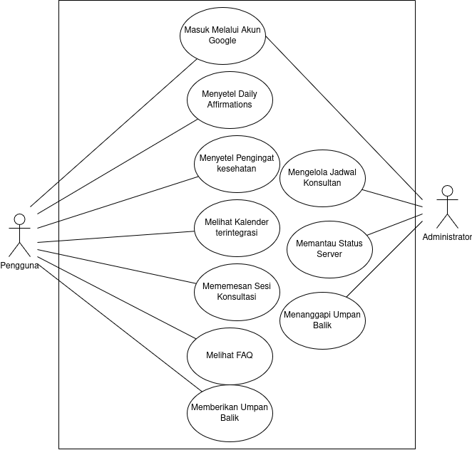
</p>
<p align="center">
<i>Gambar 3. Use Case Diagram Sehati</i>
</p>

## Skenario Use Case

### Skenario UC-01

**Nama _Use Case_:** _Menyetel_ _Daily Affirmations_

**Skenario Normal**

| No  | Aksi Aktor                                                      | Reaksi Perangkat Lunak                                           |
| --- | --------------------------------------------------------------- | ---------------------------------------------------------------- |
| 1   | Mahasiswa memasukkan input waktu pengiriman _daily affirmation_ | Sistem menampilkan input pada _input box_                        |
| 2   | Mahasiswa mengklik tombol konfirmasi                            | Sistem menyimpan preferensi waktu pengiriman _daily affirmation_ |

<br>

**Skenario Alternatif 1: Sistem tidak mampu menyimpan setelan**

| No  | Aksi Aktor                                                      | Reaksi Perangkat Lunak                                                                                     |
| --- | --------------------------------------------------------------- | ---------------------------------------------------------------------------------------------------------- |
| 1   | Mahasiswa memasukkan input waktu pengiriman _daily affirmation_ | Sistem menampilkan input pada _input box_                                                                  |
| 2   | Mahasiswa mengklik tombol konfirmasi                            | Sistem tidak dapat menyimpan preferensi waktu pengiriman _daily affirmation_ dan menampilkan pesan _error_ |

### Skenario UC-02

**Nama _Use Case_:** _Menyetel Pengingat Kesehatan_

**Skenario Normal**

| No  | Aksi Aktor                                                      | Reaksi Perangkat Lunak                                           |
| --- | --------------------------------------------------------------- | ---------------------------------------------------------------- |
| 1   | Mahasiswa memasukkan input waktu pengiriman pengingat kesehatan | Sistem menampilkan input pada _input box_                        |
| 2   | Mahasiswa mengklik tombol konfirmasi                            | Sistem menyimpan preferensi waktu pengiriman pengingat kesehatan |

<br>

**Skenario Alternatif 1: Sistem tidak mampu menyimpan setelan**

| No  | Aksi Aktor                                                      | Reaksi Perangkat Lunak                                                                                     |
| --- | --------------------------------------------------------------- | ---------------------------------------------------------------------------------------------------------- |
| 1   | Mahasiswa memasukkan input waktu pengiriman pengingat kesehatan | Sistem menampilkan input pada _input box_                                                                  |
| 2   | Mahasiswa mengklik tombol konfirmasi                            | Sistem tidak dapat menyimpan preferensi waktu pengiriman pengingat kesehatan dan menampilkan pesan _error_ |

### Skenario UC-03

**Nama _Use Case_:** _Melihat Kalender Terintegrasi_

**Skenario Normal**

| No  | Aksi Aktor                                 | Reaksi Perangkat Lunak                                         |
| --- | ------------------------------------------ | -------------------------------------------------------------- |
| 1   | Mahasiswa mengklik tombol "Lihat Kalender" | Sistem menampilkan kalender dengan data-data _event_ mahasiswa |

<br>

**Skenario Alternatif 1: Sistem tidak mampu mengambil data _event_**

| No  | Aksi Aktor                                 | Reaksi Perangkat Lunak                                                                                                              |
| --- | ------------------------------------------ | ----------------------------------------------------------------------------------------------------------------------------------- |
| 1   | Mahasiswa mengklik tombol "Lihat Kalender" | Sistem tidak menampilkan kalender dengan data-data _event_ mahasiswa dan menyediakan pesan _error_ dan tombol untuk mengulangi aksi |
| 2   | Mahasiswa mengklik tombol "Refresh"        | Jika gagal, sama seperti no. 1. Jika berhasil, sistem bereaksi pada skenario normal                                                 |

### Skenario UC-04

**Nama _Use Case_:** _Memesan Sesi Konsultasi_

| No  | Aksi Aktor                                      | Reaksi Perangkat Lunak                                                                               |
| --- | ----------------------------------------------- | ---------------------------------------------------------------------------------------------------- |
| 1   | Mahasiswa mengklik tombol "Pesan Sesi"          | Sistem menampilkan kalender dengan data-data _event_ mahasiswa dan jadwal konsultasi                 |
| 2   | Mahasiswa mengklik salah satu jadwal konsultasi | Sistem menampilkan informasi mengenai jadwal konsultasi tersebut dan menyediakan tombol "Konfirmasi" |
| 3   | Mahasiswa mengklik tombol "Konfirmasi"          | Sistem mengingat bahwa pengguna tersebut memesan sesi konsultasi yang dikonfirmasi                   |

**Skenario Alternatif 1: Sistem tidak mampu mengambil data jadwal konsultasi**

| No  | Aksi Aktor                             | Reaksi Perangkat Lunak                                                                                                                                         |
| --- | -------------------------------------- | -------------------------------------------------------------------------------------------------------------------------------------------------------------- |
| 1   | Mahasiswa mengklik tombol "Pesan Sesi" | Sistem tidak menampilkan kalender dengan data jadwal konsultasi dan/atau data _event_ mahasiswa dan menyediakan pesan _error_ dan tombol untuk mengulangi aksi |
| 2   | Mahasiswa mengklik tombol "Refresh"    | Jika gagal, sama seperti no. 1. Jika berhasil, sistem bereaksi pada skenario normal                                                                            |

**Skenario Alternatif 2: Sistem tidak mampu menyimpan jadwal konsultasi yang dipesan**

| No  | Aksi Aktor                             | Reaksi Perangkat Lunak                                                                                                                               |
| --- | -------------------------------------- | ---------------------------------------------------------------------------------------------------------------------------------------------------- |
| 1   | Mahasiswa mengklik tombol "Konfirmasi" | Sistem tidak menyimpan pesanan dan menampilkan pesan _error_. Jika ingin mengulangi, mahasiswa hanya perlu mengklik tombol "Konfirmasi" sekali lagi. |

### Skenario UC-05

**Nama _Use Case_:** _Mengelola Jadwal Konsultan_

**Skenario Normal**

| No  | Aksi Aktor                                                                                | Reaksi Perangkat Lunak                                         |
| --- | ----------------------------------------------------------------------------------------- | -------------------------------------------------------------- |
| 1   | Administrator membuka _dashboard_ untuk mengelola jadwal konsultasi                       | Sistem menampilkan kalender dengan data-data jadwal konsultasi |
| 2   | Administrator mengklik salah satu jadwal konsultasi di _dashboard_                        | Sistem menampilkan laman untuk mengedit data jadwal konsultasi |
| 3   | Administrator memasukkan perubahan pada jadwal di laman edit dan mengklik tombol "Simpan" | Sistem menyimpan perubahan jadwal konsultasi                   |

**Skenario Alternatif 1: Sistem tidak mampu mengambil data jadwal konsultasi**

| No  | Aksi Aktor                                                          | Reaksi Perangkat Lunak                                                                                                         |
| --- | ------------------------------------------------------------------- | ------------------------------------------------------------------------------------------------------------------------------ |
| 1   | Administrator membuka _dashboard_ untuk mengelola jadwal konsultasi | Sistem tidak menampilkan kalender dengan data jadwal konsultasi dan menyediakan pesan _error_ dan tombol untuk mengulangi aksi |
| 2   | Administrator mengklik tombol "Refresh"                             | Jika gagal, sama seperti no. 1. Jika berhasil, sistem bereaksi pada skenario normal                                            |

**Skenario Alternatif 2: Sistem tidak mampu mengedit data jadwal konsultasi**

| No  | Aksi Aktor                                                                                | Reaksi Perangkat Lunak                                                                                                                                       |
| --- | ----------------------------------------------------------------------------------------- | ------------------------------------------------------------------------------------------------------------------------------------------------------------ |
| 1   | Administrator memasukkan perubahan pada jadwal di laman edit dan mengklik tombol "Simpan" | Sistem tidak menyimpan pergantian data dan menyediakan pesan _error_. Jika ingin mengulangi, administrator hanya perlu mengklik tombol "Simpan" sekali lagi. |

### Skenario UC-06

**Nama _Use Case_:** Melihat FAQ

**Skenario Normal**

| No  | Aksi Aktor                                     | Reaksi Perangkat Lunak                                    |
| --- | ---------------------------------------------- | --------------------------------------------------------- |
| 1   | Mahasiswa mencari pertanyaan di search bar FAQ | Sistem menunjukkan pertanyaan dan jawaban yang disediakan |

<br>

**Skenario Alternatif 1: Tidak ada pertanyaan yang dicari pengguna**

| No  | Aksi Aktor                                     | Reaksi Perangkat Lunak                                                                                          |
| --- | ---------------------------------------------- | --------------------------------------------------------------------------------------------------------------- |
| 1   | Mahasiswa mencari pertanyaan di search bar FAQ | Sistem tidak menunjukkan pertanyaan yang dicari mahasiswa, lalu menawarkan untuk mengajukan pertanyaan di forum |

### Skenario UC-07

**Nama _Use Case_:** Mengelola FAQ

**Skenario Normal**

| No  | Aksi Aktor                                        | Reaksi Perangkat Lunak                                                          |
| --- | ------------------------------------------------- | ------------------------------------------------------------------------------- |
| 1   | Admin menambahkan pertanyaan dan jawaban di FAQ   | Sistem berhasil menambahkan pertanyaan & jawabannya di _database_               |
| 2   | Admin mengurangi pertanyaan di FAQ                | Sistem berhasil menghapus pertanyaan (dan jawabannya) dari _database_           |
| 3   | Admin mengubah pertanyaan dan/atau jawaban di FAQ | Sistem berhasil menyimpan perubahan pertanyaan dan/atau jawaban pada _database_ |

<br>

**Skenario Alternatif 1: Tidak ada pertanyaan maupun jawaban yang berhasil disimpan**

| No  | Aksi Aktor                                        | Reaksi Perangkat Lunak                                                       |
| --- | ------------------------------------------------- | ---------------------------------------------------------------------------- |
| 1   | Admin menambahkan pertanyaan dan jawaban di FAQ   | Sistem tidak menambahkan pertanyaan maupun jawabannya di _database_          |
| 2   | Admin mengurangi pertanyaan di FAQ                | Sistem tidak menghapus pertanyaan (dan jawabannya) dari _database_           |
| 3   | Admin mengubah pertanyaan dan/atau jawaban di FAQ | Sistem tidak menyimpan perubahan pertanyaan dan/atau jawaban pada _database_ |

### Skenario UC-08

**Nama _Use Case_:** Memberikan Umpan Balik

**Skenario Normal**

| No  | Aksi Aktor                                                      | Reaksi Perangkat Lunak                                    |
| --- | --------------------------------------------------------------- | --------------------------------------------------------- |
| 1   | Mahasiswa memberikan umpan balik di forum pemberian umpan balik | Sistem menerima dan menyimpan umpan balik pada _database_ |

<br>

**Skenario Alternatif 1: Umpan balik tidak disimpan pada _database_**

| No  | Aksi Aktor                                                      | Reaksi Perangkat Lunak                                                |
| --- | --------------------------------------------------------------- | --------------------------------------------------------------------- |
| 1   | Mahasiswa memberikan umpan balik di forum pemberian umpan balik | Sistem tidak menerima dan tidak menyimpan umpan balik pada _database_ |

### Skenario UC-09

**Nama _Use Case_:** Menanggapi Umpan Balik

**Skenario Normal**

| No  | Aksi Aktor                                                               | Reaksi Perangkat Lunak                                         |
| --- | ------------------------------------------------------------------------ | -------------------------------------------------------------- |
| 1   | Admin memberikan tanggapan pada umpan balik yang diterima oleh mahasiswa | Sistem menunjukkan jawaban dari tanggapan yang diberikan admin |

<br>

**Skenario Alternatif 1: Tanggapan umpan balik tidak berhasil ditampilkan**

| No  | Aksi Aktor                                                               | Reaksi Perangkat Lunak                                  |
| --- | ------------------------------------------------------------------------ | ------------------------------------------------------- |
| 1   | Admin memberikan tanggapan pada umpan balik yang diterima oleh mahasiswa | Sistem tidak menunjukkan konten pada tampilan mahasiswa |

### Skenario UC-10

**Nama _Use Case_:** Memantau Status _Server_

**Skenario Normal**

| No  | Aksi Aktor                             | Reaksi Perangkat Lunak                      |
| --- | -------------------------------------- | ------------------------------------------- |
| 1   | Admin melihat status _uptime_ website  | Sistem memberikan status _uptime_ website   |
| 2   | Admin melihat status _uptime_ _server_ | Sistem menunjukkan status _uptime_ _server_ |

<br>

### Skenario UC-11

**Nama _Use Case_:** Masuk Melalui Akun Google

**Skenario Normal**

| No  | Aksi Aktor                                         | Reaksi Perangkat Lunak                                            |
| --- | -------------------------------------------------- | ----------------------------------------------------------------- |
| 1   | Mahasiswa melakukan autentikasi dengan akun Google | Sistem menampilkan tampilan selanjutnya setelah _log in_ berhasil |

<br>

**Skenario Alternatif 1: OAuth Google tidak berfungsi saat _log in_**

| No  | Aksi Aktor                                         | Reaksi Perangkat Lunak                                                                |
| --- | -------------------------------------------------- | ------------------------------------------------------------------------------------- |
| 1   | Mahasiswa melakukan autentikasi dengan akun Google | Sistem tidak melakukan _log in_ untuk mahasiswa, mahasiswa kembali ke _log in_ screen |

### Skenario UC-12

**Nama _Use Case_:** Form Pengajuan pertanyaan

**Skenario Normal**

| No  | Aksi Aktor                                          | Reaksi Perangkat Lunak                                                     |
| --- | --------------------------------------------------- | -------------------------------------------------------------------------- |
| 1   | Mahasiswa melakukan pengajuan pertanyaan pada forms | Sistem memberikan konfirmasi bahwa pertanyaan telah disimpan pada database |

<br>

**Skenario Alternatif 1: Pertanyaan tidak tersimpan di database**

| No  | Aksi Aktor                                          | Reaksi Perangkat Lunak                                                                                            |
| --- | --------------------------------------------------- | ----------------------------------------------------------------------------------------------------------------- |
| 1   | Mahasiswa melakukan pengajuan pertanyaan pada forms | Sistem tidak berhasil menyimpan pertanyaan pada database dan memberikan informasi bahwa pertanyaan tidak disimpan |

# Struktur Kelas

Tabel 16. Struktur Kelas

| ID Kelas | Nama Kelas            | Deskripsi Kelas                                                                                                               | ID _Use Case_                           |
| -------- | --------------------- | ----------------------------------------------------------------------------------------------------------------------------- | --------------------------------------- |
| C-01     | Pengguna              | Kelas abstrak menyimpan atribut umum akun (id, nama, email, googleId) yang dibagikan Mahasiswa dan Administrator.             | UC-11                                   |
| C-02     | Mahasiswa             | Merealisasikan Pengguna; merepresentasikan pengguna utama aplikasi.                                                           | UC-01, UC-02, UC-03, UC-04, UC-06, UC-08, UC-11, UC-12 |
| C-03     | Administrator         | Merealisasikan Pengguna; mengelola jadwal konsultan, FAQ, dan umpan balik.                                                    | UC-05, UC-07, UC-09, UC-10, UC-11       |
| C-04     | SesiAutentikasi       | Menyimpan token sesi aplikasi dan status _log in_ setelah autentikasi Google berhasil.                                        | UC-11                                   |
| C-05     | DailyAffirmation      | Menyimpan konten afirmasi dan jadwal pengiriman yang ditentukan pengguna.                                                     | UC-01                                   |
| C-06     | Reminder              | Menyimpan jenis pengingat (makan/tidur/olahraga) beserta waktu yang ditentukan pengguna.                                      | UC-02                                   |
| C-07     | Notifikasi            | Merepresentasikan satu notifikasi yang dikirim ke pengguna (dari DailyAffirmation atau Reminder).                             | UC-01, UC-02                            |
| C-08     | GoogleCalendarService | Menangani komunikasi ke Google Calendar API — mengambil event pengguna dan melakukan pengecekan bentrok jadwal (_free/busy_). | UC-03, UC-04                            |
| C-09     | KalenderGabungan      | Menggabungkan event dari GoogleCalendarService dengan data JadwalKonsultasi untuk ditampilkan sebagai satu tampilan kalender. | UC-03                                   |
| C-10     | Konsultan             | Menyimpan data konsultan (nama, spesialisasi) yang didaftarkan oleh Administrator.                                            | UC-04, UC-05                            |
| C-11     | JadwalKonsultasi      | Menyimpan slot jadwal konsultasi (konsultan, waktu, status tersedia/terpesan) pada _database_.                                | UC-04, UC-05                            |
| C-12     | FAQ                   | Menyimpan pasangan pertanyaan dan jawaban yang dikelola Administrator.                                                        | UC-06, UC-07                            |
| C-13     | PengajuanPertanyaan   | Menyimpan pertanyaan yang diajukan pengguna di luar FAQ yang tersedia.                                                        | UC-12                                   |
| C-14     | UmpanBalik            | Menyimpan umpan balik pengguna beserta tanggapan Administrator (jika ada).                                                    | UC-08, UC-09                            |
| C-15     | StatusServer          | Merepresentasikan status _uptime_ layanan yang dipantau Administrator.                                                        | UC-10                                   |

## Diagram Kelas per _Use Case_

### Diagram Kelas UC-01

**Nama _Use Case_:** Menyetel _Daily Affirmations_

**Identifikasi Kelas**

| ID Kelas | Nama Kelas       | Deskripsi Kelas                                                                                   |
| -------- | ---------------- | ------------------------------------------------------------------------------------------------- |
| C-02     | Mahasiswa        | Merealisasikan Pengguna; merepresentasikan pengguna utama aplikasi.                               |
| C-05     | DailyAffirmation | Menyimpan konten afirmasi dan jadwal pengiriman yang ditentukan pengguna.                         |
| C-07     | Notifikasi       | Merepresentasikan satu notifikasi yang dikirim ke pengguna (dari DailyAffirmation atau Reminder). |

**Diagram Kelas**

<p align="center">
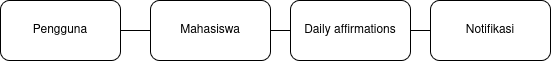
</p>
<p align="center">
<i>Gambar 4. Diagram Kelas _Use Case_ UC-01</i>
</p>
<br>

| ID Kelas | Nama Kelas       | Atribut                       | Metode/Operasi                           |
| -------- | ---------------- | ----------------------------- | ---------------------------------------- |
| C-02     | Mahasiswa        | nim                           | -                                        |
| C-05     | DailyAffirmation | konten, waktuKirim            | aturWaktuKirim(), kirimAfirmasi()        |
| C-07     | Notifikasi       | idNotifikasi, isi, waktuKirim | kirimNotifikasi(), tampilkanNotifikasi() |

### Diagram Kelas UC-02

**Nama _Use Case_:** Menyetel Pengingat Kesehatan

**Identifikasi Kelas**

| ID Kelas | Nama Kelas | Deskripsi Kelas                                                                                   |
| -------- | ---------- | ------------------------------------------------------------------------------------------------- |
| C-02     | Mahasiswa  | Merealisasikan Pengguna; merepresentasikan pengguna utama aplikasi.                               |
| C-06     | Reminder   | Menyimpan jenis pengingat (makan/tidur/olahraga) beserta waktu yang ditentukan pengguna.          |
| C-07     | Notifikasi | Merepresentasikan satu notifikasi yang dikirim ke pengguna (dari DailyAffirmation atau Reminder). |

**Diagram Kelas**

<p align="center">
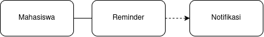
</p>
<p align="center">
<i>Gambar 5. Diagram Kelas _Use Case_ UC-02</i>
</p>
<br>

| ID Kelas | Nama Kelas | Atribut                       | Metode/Operasi                           |
| -------- | ---------- | ----------------------------- | ---------------------------------------- |
| C-02     | Mahasiswa  | nim                           | -                                        |
| C-06     | Reminder   | jenis, waktu                  | aturWaktuPengingat(), kirimPengingat()   |
| C-07     | Notifikasi | idNotifikasi, isi, waktuKirim | kirimNotifikasi(), tampilkanNotifikasi() |

### Diagram Kelas UC-03

**Nama _Use Case_:** Melihat Kalender Terintegrasi

**Identifikasi Kelas**

| ID Kelas | Nama Kelas            | Deskripsi Kelas                                                                                                               |
| -------- | --------------------- | ----------------------------------------------------------------------------------------------------------------------------- |
| C-02     | Mahasiswa             | Merealisasikan Pengguna; merepresentasikan pengguna utama aplikasi.                                                           |
| C-08     | GoogleCalendarService | Menangani komunikasi ke Google Calendar API — mengambil event pengguna dan melakukan pengecekan bentrok jadwal (_free/busy_). |
| C-09     | KalenderGabungan      | Menggabungkan event dari GoogleCalendarService dengan data JadwalKonsultasi untuk ditampilkan sebagai satu tampilan kalender. |

**Diagram Kelas**

<p align="center">
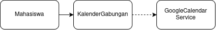
</p>
<p align="center">
<i>Gambar 6. Diagram Kelas _Use Case_ UC-03</i>
</p>
<br>

| ID Kelas | Nama Kelas            | Atribut     | Metode/Operasi                         |
| -------- | --------------------- | ----------- | -------------------------------------- |
| C-02     | Mahasiswa             | nim         | -                                      |
| C-08     | GoogleCalendarService | accessToken | ambilEvent(), cekBentrokJadwal()       |
| C-09     | KalenderGabungan      | daftarEvent | gabungkanJadwal(), tampilkanKalender() |

### Diagram Kelas UC-04

**Nama _Use Case_:** Memesan Sesi Konsultasi

**Identifikasi Kelas**

| ID Kelas | Nama Kelas            | Deskripsi Kelas                                                                                                               |
| -------- | --------------------- | ----------------------------------------------------------------------------------------------------------------------------- |
| C-02     | Mahasiswa             | Merealisasikan Pengguna; merepresentasikan pengguna utama aplikasi.                                                           |
| C-08     | GoogleCalendarService | Menangani komunikasi ke Google Calendar API — mengambil event pengguna dan melakukan pengecekan bentrok jadwal (_free/busy_). |
| C-10     | Konsultan             | Menyimpan data konsultan (nama, spesialisasi) yang didaftarkan oleh Administrator.                                            |
| C-11     | JadwalKonsultasi      | Menyimpan slot jadwal konsultasi (konsultan, waktu, status tersedia/terpesan) pada _database_.                                |

**Diagram Kelas**

<p align="center">
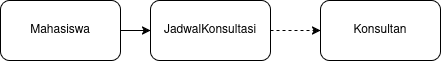
</p>
<p align="center">
<i>Gambar 7. Diagram Kelas _Use Case_ UC-04</i>
</p>
<br>

| ID Kelas | Nama Kelas            | Atribut                 | Metode/Operasi                                |
| -------- | --------------------- | ----------------------- | --------------------------------------------- |
| C-02     | Mahasiswa             | nim                     | -                                             |
| C-08     | GoogleCalendarService | accessToken             | ambilEvent(), cekBentrokJadwal()              |
| C-10     | Konsultan             | nama, spesialisasi      | -                                             |
| C-11     | JadwalKonsultasi      | idJadwal, waktu, status | simpanJadwal(), perbaruiJadwal(), pesanSesi() |

### Diagram Kelas UC-05

**Nama _Use Case_:** Mengelola Jadwal Konsultan

**Identifikasi Kelas**

| ID Kelas | Nama Kelas       | Deskripsi Kelas                                                                                |
| -------- | ---------------- | ---------------------------------------------------------------------------------------------- |
| C-03     | Administrator    | Merealisasikan Pengguna; mengelola jadwal konsultan, FAQ, dan umpan balik.                     |
| C-10     | Konsultan        | Menyimpan data konsultan (nama, spesialisasi) yang didaftarkan oleh Administrator.             |
| C-11     | JadwalKonsultasi | Menyimpan slot jadwal konsultasi (konsultan, waktu, status tersedia/terpesan) pada _database_. |

**Diagram Kelas**

<p align="center">
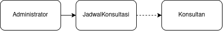
</p>
<p align="center">
<i>Gambar 8. Diagram Kelas _Use Case_ UC-05</i>
</p>
<br>

| ID Kelas | Nama Kelas       | Atribut                 | Metode/Operasi                                |
| -------- | ---------------- | ----------------------- | --------------------------------------------- |
| C-03     | Administrator    | -                       | -                                             |
| C-10     | Konsultan        | nama, spesialisasi      | -                                             |
| C-11     | JadwalKonsultasi | idJadwal, waktu, status | simpanJadwal(), perbaruiJadwal(), pesanSesi() |

### Diagram Kelas UC-06

**Nama _Use Case_:** Melihat FAQ

**Identifikasi Kelas**

| ID Kelas | Nama Kelas | Deskripsi Kelas                                                        |
| -------- | ---------- | ---------------------------------------------------------------------- |
| C-02     | Mahasiswa  | Merealisasikan Pengguna; merepresentasikan pengguna utama aplikasi.    |
| C-12     | FAQ        | Menyimpan pasangan pertanyaan dan jawaban yang dikelola Administrator. |

**Diagram Kelas**

<p align="center">
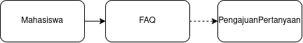
</p>
<p align="center">
<i>Gambar 9. Diagram Kelas _Use Case_ UC-06</i>
</p>
<br>

| ID Kelas | Nama Kelas | Atribut             | Metode/Operasi                     |
| -------- | ---------- | ------------------- | ---------------------------------- |
| C-02     | Mahasiswa  | nim                 | -                                  |
| C-12     | FAQ        | pertanyaan, jawaban | tambahFAQ(), ubahFAQ(), hapusFAQ() |

### Diagram Kelas UC-07

**Nama _Use Case_:** Mengelola FAQ

**Identifikasi Kelas**

| ID Kelas | Nama Kelas    | Deskripsi Kelas                                                            |
| -------- | ------------- | -------------------------------------------------------------------------- |
| C-03     | Administrator | Merealisasikan Pengguna; mengelola jadwal konsultan, FAQ, dan umpan balik. |
| C-12     | FAQ           | Menyimpan pasangan pertanyaan dan jawaban yang dikelola Administrator.     |

**Diagram Kelas**

<p align="center">
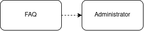
</p>
<p align="center">
<i>Gambar 10. Diagram Kelas _Use Case_ UC-07</i>
</p>
<br>

| ID Kelas | Nama Kelas    | Atribut             | Metode/Operasi                     |
| -------- | ------------- | ------------------- | ---------------------------------- |
| C-03     | Administrator | -                   | -                                  |
| C-12     | FAQ           | pertanyaan, jawaban | tambahFAQ(), ubahFAQ(), hapusFAQ() |

### Diagram Kelas UC-08

**Nama _Use Case_:** Memberikan Umpan Balik

**Identifikasi Kelas**

| ID Kelas | Nama Kelas | Deskripsi Kelas                                                            |
| -------- | ---------- | -------------------------------------------------------------------------- |
| C-02     | Mahasiswa  | Merealisasikan Pengguna; merepresentasikan pengguna utama aplikasi.        |
| C-14     | UmpanBalik | Menyimpan umpan balik pengguna beserta tanggapan Administrator (jika ada). |

**Diagram Kelas**

<p align="center">
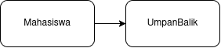
</p>
<p align="center">
<i>Gambar 11. Diagram Kelas _Use Case_ UC-08</i>
</p>
<br>

| ID Kelas | Nama Kelas | Atribut                      | Metode/Operasi                        |
| -------- | ---------- | ---------------------------- | ------------------------------------- |
| C-02     | Mahasiswa  | nim                          | -                                     |
| C-14     | UmpanBalik | idUmpanBalik, isi, tanggapan | kirimUmpanBalik(), berikanTanggapan() |

### Diagram Kelas UC-09

**Nama _Use Case_:** Menanggapi Umpan Balik

**Identifikasi Kelas**

| ID Kelas | Nama Kelas    | Deskripsi Kelas                                                            |
| -------- | ------------- | -------------------------------------------------------------------------- |
| C-03     | Administrator | Merealisasikan Pengguna; mengelola jadwal konsultan, FAQ, dan umpan balik. |
| C-14     | UmpanBalik    | Menyimpan umpan balik pengguna beserta tanggapan Administrator (jika ada). |

**Diagram Kelas**

<p align="center">
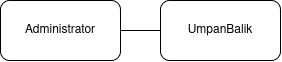
</p>
<p align="center">
<i>Gambar 12. Diagram Kelas _Use Case_ UC-09</i>
</p>
<br>

| ID Kelas | Nama Kelas    | Atribut                      | Metode/Operasi                        |
| -------- | ------------- | ---------------------------- | ------------------------------------- |
| C-03     | Administrator | -                            | -                                     |
| C-14     | UmpanBalik    | idUmpanBalik, isi, tanggapan | kirimUmpanBalik(), berikanTanggapan() |

### Diagram Kelas UC-10

**Nama _Use Case_:** Memantau Status _Server_

**Identifikasi Kelas**

| ID Kelas | Nama Kelas     | Deskripsi Kelas                                                            |
| -------- | -------------- | -------------------------------------------------------------------------- |
| C-03     | Administrator  | Merealisasikan Pengguna; mengelola jadwal konsultan, FAQ, dan umpan balik. |
| C-15     | StatusServer | Merealisasikan Pengguna; merepresentasikan status _uptime_ layanan yang dipantau Administrator. |

**Diagram Kelas**

<p align="center">
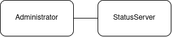
</p>
<p align="center">
<i>Gambar 13. Diagram Kelas _Use Case_ UC-10</i>
</p>
<br>

| ID Kelas | Nama Kelas     | Atribut                | Metode/Operasi                       |
| -------- | -------------- | ---------------------- | ------------------------------------ |
| C-03     | Administrator  | -                      | -                                    |
| C-15     | StatusServer | statusUptime, waktuCek | cekStatusServer(), tampilkanStatus() |

### Diagram Kelas UC-11

**Nama _Use Case_:** Masuk Melalui Akun Google

**Identifikasi Kelas**

| ID Kelas | Nama Kelas      | Deskripsi Kelas                                                                                                   |
| -------- | --------------- | ----------------------------------------------------------------------------------------------------------------- |
| C-01     | Pengguna        | Kelas abstrak menyimpan atribut umum akun (id, nama, email, googleId) yang dibagikan Mahasiswa dan Administrator. |
| C-02     | Mahasiswa       | Merealisasikan Pengguna; merepresentasikan pengguna utama aplikasi.                                               |
| C-03     | Administrator   | Merealisasikan Pengguna; mengelola jadwal konsultan, FAQ, dan umpan balik.                                        |
| C-04     | SesiAutentikasi | Menyimpan token sesi aplikasi dan status _log in_ setelah autentikasi Google berhasil.                            |

**Diagram Kelas**

<p align="center">
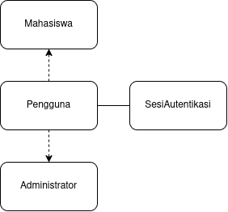
</p>
<p align="center">
<i>Gambar 14. Diagram Kelas _Use Case_ UC-11</i>
</p>
<br>

| ID Kelas | Nama Kelas      | Atribut                   | Metode/Operasi                                   |
| -------- | --------------- | ------------------------- | ------------------------------------------------ |
| C-01     | Pengguna        | id, nama, email, googleId | -                                                |
| C-02     | Mahasiswa       | nim                       | -                                                |
| C-03     | Administrator   | -                         | -                                                |
| C-04     | SesiAutentikasi | token, waktuLogin, status | autentikasiGoogle(), verifikasiToken(), logout() |

### Diagram Kelas UC-12

**Nama _Use Case_:** Form Pengajuan Pertanyaan

**Identifikasi Kelas**

| ID Kelas | Nama Kelas          | Deskripsi Kelas                                                        |
| -------- | ------------------- | ---------------------------------------------------------------------- |
| C-02     | Mahasiswa           | Merealisasikan Pengguna; merepresentasikan pengguna utama aplikasi.    |
| C-13     | PengajuanPertanyaan | Menyimpan pertanyaan yang diajukan pengguna di luar FAQ yang tersedia. |

**Diagram Kelas**

<p align="center">
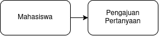
</p>
<p align="center">
<i>Gambar 15. Diagram Kelas _Use Case_ UC-12</i>
</p>
<br>

| ID Kelas | Nama Kelas          | Atribut                     | Metode/Operasi     |
| -------- | ------------------- | --------------------------- | ------------------ |
| C-02     | Mahasiswa           | nim                         | -                  |
| C-13     | PengajuanPertanyaan | idPertanyaan, isiPertanyaan | ajukanPertanyaan() |

## Diagram Kelas Keseluruhan

<p align="center">
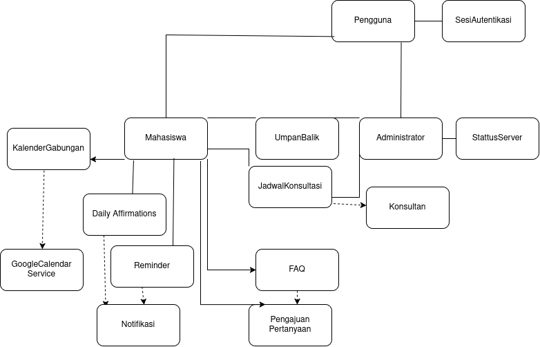
</p>
<p align="center">
<i>Gambar 16. Diagram Kelas Keseluruhan</i>
</p>
<br>

| ID Kelas | Nama Kelas | Atribut | Metode/Operasi |
| --- | --- | --- | --- |
| C-01 | Pengguna | id, nama, email, googleId | - |
| C-02 | Mahasiswa | nim | - |
| C-03 | Administrator | - | - |
| C-04 | SesiAutentikasi | token, waktuLogin, status | autentikasiGoogle(), verifikasiToken(), logout() |
| C-05 | DailyAffirmation | konten, waktuKirim | aturWaktuKirim(), kirimAfirmasi() |
| C-06 | Reminder | jenis, waktu | aturWaktuPengingat(), kirimPengingat() |
| C-07 | Notifikasi | idNotifikasi, isi, waktuKirim | kirimNotifikasi(), tampilkanNotifikasi() |
| C-08 | GoogleCalendarService | accessToken | ambilEvent(), cekBentrokJadwal() |
| C-09 | KalenderGabungan | daftarEvent | gabungkanJadwal(), tampilkanKalender() |
| C-10 | Konsultan | nama, spesialisasi | - |
| C-11 | JadwalKonsultasi | idJadwal, waktu, status | simpanJadwal(), perbaruiJadwal(), pesanSesi() |
| C-12 | FAQ | pertanyaan, jawaban | tambahFAQ(), ubahFAQ(), hapusFAQ() |
| C-13 | PengajuanPertanyaan | idPertanyaan, isiPertanyaan | ajukanPertanyaan() |
| C-14 | UmpanBalik | idUmpanBalik, isi, tanggapan | kirimUmpanBalik(), berikanTanggapan() |
| C-15 | StatusServer | statusUptime, waktuCek | cekStatusServer(), tampilkanStatus() |


## Traceability Struktur Kelas

Tabel 17. Traceability Struktur Kelas

| ID Kelas | ID *Use Case* | ID KF |
| --- | --- | --- |
| C-01 | UC-11 | KF-12 |
| C-02 | UC-01, UC-04, UC-06, UC-08, UC-11, UC-12 | KF-01, KF-04, KF-05, KF-06, KF-07, KF-08, KF-09, KF-12 |
| C-03 | UC-05, UC-07, UC-09, UC-10, UC-11 | KF-06, KF-07, KF-08, KF-10, KF-11, KF-12 |
| C-04 | UC-11 | KF-12 |
| C-05 | UC-01 | KF-01, KF-04 |
| C-06 | UC-02 | KF-03, KF-04 |
| C-07 | UC-01, UC-02 | KF-01, KF-03, KF-04 |
| C-08 | UC-03, UC-04 | KF-02, KF-05, KF-06, KF-07 |
| C-09 | UC-03 | KF-02, KF-05, KF-06 |
| C-10 | UC-04, UC-05 | KF-05, KF-06, KF-07 |
| C-11 | UC-04, UC-05 | KF-05, KF-06, KF-07 |
| C-12 | UC-06, UC-07 | KF-08 |
| C-13 | UC-12 | KF-08 |
| C-14 | UC-08, UC-09 | KF-09, KF-11 |
| C-15 | UC-10 | KF-10 |

# Arsitektur Perangkat Lunak

## Rancangan Lingkungan Implementasi

Sehati dirancang untuk berjalan pada lingkungan _cloud_ tanpa _server_ tradisional. Rancangan lingkungan implementasi, mulai dari _platform_, bahasa pemrograman, hingga alat pengembangan, dirangkum pada Tabel 18.

Tabel 18. Rancangan Lingkungan Implementasi

| Komponen            | Spesifikasi                                                                                              |
| ------------------- | -------------------------------------------------------------------------------------------------------- |
| _Server_            | Cloudflare Workers (runtime V8 isolates) menjalankan Hono sebagai REST API                               |
| _Client_            | Aplikasi _mobile_ React Native (Expo), Android, dan iOS                                                  |
| DBMS                | Cloudflare D1 (SQLite terdistribusi di _edge_)                                                           |
| OS                  | Android 10+ dan iOS 15+ pada _client_; Cloudflare Workers tidak memerlukan OS tradisional di sisi server |
| Integrasi Eksternal | Google OAuth 2.0 (otentikasi) dan Google Calendar API (_event_, _free/busy_)                             |
| Bahasa Pemrograman  | TypeScript untuk _server_ (Hono) dan _client_ (React Native/Expo)                                        |
| Alat Pengembangan   | Git dan GitHub, Wrangler (Cloudflare Workers), Expo CLI, draw.io                                         |
| Penyimpanan Berkas  | Cloudflare D1 untuk data terstruktur; penyimpanan lokal perangkat untuk konfigurasi _client_             |

## Style/Pattern Arsitektur Acuan

Sehati memakai gabungan pattern **_Client-Server_** dan **_Model-View-Controller (MVC)_**. Pattern _client-server_ menentukan letak komponen: seluruh _View_ berjalan di aplikasi _mobile_ React Native pada perangkat pengguna, sedangkan _Controller_, _Model_, dan integrasi eksternal berjalan di _server_ Hono pada Cloudflare Workers. Pattern MVC menentukan pembagian tanggung jawab: _View_ hanya menampilkan antarmuka dan meneruskan aksi pengguna, _Controller_ memvalidasi dan memproses permintaan, dan _Model_ menyimpan data serta aturan domain.

Pattern ini dipilih dengan tiga alasan. Pertama, dua aktor (Mahasiswa dan Administrator) memakai _client_ yang sama dan harus melihat data yang sama, sedangkan jadwal konsultasi hanya terjamin konsisten bila dipegang satu _server_ (UC-04, UC-05). Kedua, pemanggilan Google OAuth 2.0 dan Google Calendar API memakai _client secret_ dan _access token_ yang tidak boleh berada di perangkat pengguna (KF-02, KF-05, UC-11). Ketiga, KNF-01 (uptime 90%) dan KNF-02 (keamanan data) lebih mudah ditegakkan bila autentikasi, validasi, dan akses basis data terpusat di _server_.

Karena _View_ dan _Controller_ terpisah oleh batas _client-server_, interaksi MVC berjalan melalui HTTP: aksi pengguna dari _View_ menjadi **HTTP request**, sedangkan pembaruan dari _Controller_ menjadi **HTTP response** berformat JSON, dan _View_ tidak pernah mengakses _Model_ atau basis data secara langsung. Penerapan pattern ini pada komponen Sehati ditunjukkan pada Gambar 17.

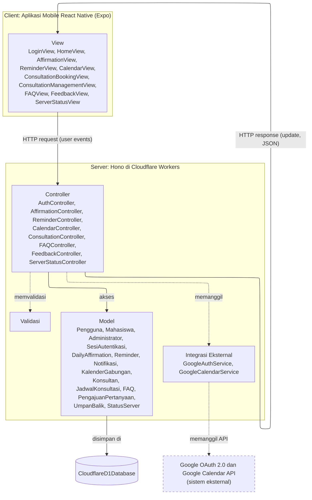

<p align="center">
<i>Gambar 17. Penerapan Pattern Client-Server dengan MVC pada P/L Sehati</i>
</p>

## Identifikasi Komponen

Komponen Sehati dikelompokkan berdasarkan lapisan MVC dari _pattern_ pada subbab Style/Pattern Arsitektur Acuan. Kolom **Jenis** mengikuti peran komponen pada pattern tersebut, ditambah _Pendukung_, _Integrasi eksternal_, dan _Penyimpanan data_. Setiap komponen mewakili satu tanggung jawab utama yang jelas.

Tabel 19. Identifikasi Komponen/Modul/Subsistem

| Nama Komponen                | Jenis               | Penjelasan                                                                                                        |
| ---------------------------- | ------------------- | ----------------------------------------------------------------------------------------------------------------- |
| `LoginView`                  | _View_              | Menampilkan tombol masuk dengan akun Google dan meneruskan hasil otentikasi ke `AuthController`.                  |
| `HomeView`                   | _View_              | Menampilkan beranda sesuai peran pengguna (Mahasiswa atau Administrator), berisi ringkasan dan menu menuju setiap fitur. |
| `AffirmationView`            | _View_              | Menampilkan input waktu pengiriman _daily affirmations_ dan meneruskan ke `AffirmationController`.                |
| `ReminderView`               | _View_              | Menampilkan input waktu pengingat makan/tidur/olahraga dan meneruskan ke `ReminderController`.                    |
| `CalendarView`               | _View_              | Menampilkan kalender gabungan dan meneruskan aksi "Lihat Kalender"/"_Refresh_" ke `CalendarController`.           |
| `ConsultationBookingView`    | _View_              | Menampilkan jadwal konsultasi yang tersedia dan meneruskan pemesanan ke `ConsultationController`.                 |
| `ConsultationManagementView` | _View_              | Menampilkan _dashboard_ admin untuk mengelola jadwal konsultan, meneruskan perubahan ke `ConsultationController`. |
| `FAQView`                    | _View_              | Menampilkan daftar FAQ, kolom pencarian, pengelolaan FAQ oleh admin, dan form pengajuan pertanyaan di luar FAQ.   |
| `FeedbackView`               | _View_              | Menampilkan form umpan balik bagi Mahasiswa dan tampilan tanggapan bagi Administrator.                            |
| `ServerStatusView`           | _View_              | Menampilkan status _uptime_ _server_ dan _website_ kepada Administrator.                                          |
| `AuthController`             | _Controller_        | Memproses otentikasi Google, membuat/memverifikasi `SesiAutentikasi`, dan memanggil `GoogleAuthService`.          |
| `AffirmationController`      | _Controller_        | Memproses penyetelan waktu dan pengiriman `DailyAffirmation`, memicu `Notifikasi`.                                |
| `ReminderController`         | _Controller_        | Memproses penyetelan waktu dan pengiriman `Reminder`, memicu `Notifikasi`.                                        |
| `CalendarController`         | _Controller_        | Mengambil data dari `GoogleCalendarService` dan `JadwalKonsultasi`, menggabungkannya lewat `KalenderGabungan`.    |
| `ConsultationController`     | _Controller_        | Memproses pemesanan dan pengelolaan `JadwalKonsultasi`, memanggil `GoogleCalendarService` untuk cek bentrok.      |
| `FAQController`              | _Controller_        | Memproses pencarian, penambahan, perubahan, dan penghapusan FAQ, serta penyimpanan `PengajuanPertanyaan`.         |
| `FeedbackController`         | _Controller_        | Memproses pengiriman `UmpanBalik` dan penyimpanan tanggapan Administrator.                                        |
| `ServerStatusController`     | _Controller_        | Mengambil data `StatusServer` untuk ditampilkan ke Administrator.                                                 |
| `Validasi`                   | Pendukung           | Memvalidasi input (format waktu, _field_ wajib) sebelum diproses _controller_ terkait.                            |
| `Pengguna`                   | _Model_             | Menyimpan atribut umum akun (`id`, `nama`, `email`, `googleId`) yang dipakai bersama Mahasiswa dan Administrator. |
| `Mahasiswa`                  | _Model_             | Merepresentasikan akun mahasiswa sebagai pengguna utama aplikasi.                                                 |
| `Administrator`              | _Model_             | Merepresentasikan akun administrator pengelola aplikasi.                                                          |
| `SesiAutentikasi`            | _Model_             | Menyimpan token sesi aplikasi dan status _login_ setelah otentikasi Google berhasil.                              |
| `DailyAffirmation`           | _Model_             | Menyimpan konten afirmasi dan jadwal pengiriman yang ditentukan pengguna.                                         |
| `Reminder`                   | _Model_             | Menyimpan jenis pengingat (makan/tidur/olahraga) beserta waktu yang ditentukan pengguna.                          |
| `Notifikasi`                 | _Model_             | Merepresentasikan satu notifikasi yang dikirim ke pengguna.                                                       |
| `KalenderGabungan`           | _Model_             | Menggabungkan event dari `GoogleCalendarService` dengan data `JadwalKonsultasi` untuk satu tampilan kalender.     |
| `Konsultan`                  | _Model_             | Menyimpan data konsultan (nama, spesialisasi) yang didaftarkan Administrator.                                     |
| `JadwalKonsultasi`           | _Model_             | Menyimpan slot jadwal konsultasi (konsultan, waktu, status tersedia/terpesan).                                    |
| `FAQ`                        | _Model_             | Menyimpan pasangan pertanyaan dan jawaban yang dikelola Administrator.                                            |
| `PengajuanPertanyaan`        | _Model_             | Menyimpan pertanyaan yang diajukan pengguna di luar FAQ yang tersedia.                                            |
| `UmpanBalik`                 | _Model_             | Menyimpan umpan balik pengguna beserta tanggapan Administrator (jika ada).                                        |
| `StatusServer`               | _Model_             | Merepresentasikan status _uptime_ layanan yang dipantau Administrator.                                            |
| `GoogleAuthService`          | Integrasi eksternal | Menangani pertukaran kode otorisasi dengan Google OAuth 2.0 dan penerimaan _access/refresh token_.                |
| `GoogleCalendarService`      | Integrasi eksternal | Mengambil _event_ pengguna dari Google Calendar API dan melakukan pengecekan bentrok jadwal (_free/busy_).        |
| `CloudflareD1Database`       | Penyimpanan data    | Menyimpan seluruh data _Model_ secara persisten di Cloudflare D1.                                                 |

## Model Arsitektur Perangkat Lunak

Bagian ini menggambarkan arsitektur Sehati dari satu sudut pandang yang mencakup seluruh sistem, yaitu _Logical View_. Diagram memuat seluruh 36 komponen pada Tabel 19 dengan nama yang sama, dan mengikuti _pattern_ _client-server_ dengan MVC pada subbab Style/Pattern Arsitektur Acuan.

### _Logical View_

_Logical view_ dipilih karena hal terpenting yang perlu dijelaskan pada Sehati adalah pembagian tanggung jawab antar komponen: _view_ di sisi _client_, serta _controller_, _model_, dan layanan pendukung di sisi _server_. Pembagian ini langsung menjawab kebutuhan SKPL, yaitu satu _server_ yang memegang data bersama untuk dua aktor dan satu-satunya yang memanggil Google. _Process view_ tidak dipilih karena sistem ini tidak memiliki alur proses paralel yang rumit, dan _physical view_ tidak dipilih karena lingkungan operasinya sudah dijelaskan pada Tabel 18.

Diagram pada Gambar 18 adalah _block diagram_ yang memuat seluruh 36 komponen Tabel 19:

- 10 _view_,
- 8 _controller_,
- 1 validasi,
- 14 _model_,
- 2 integrasi eksternal, dan
- 1 penyimpanan data.

Komponen dikelompokkan sesuai subbab Style/Pattern Arsitektur Acuan. Kotak "_Client_" berisi _view_, dan kotak "_Server_" berisi _controller_, _model_, dan sistem pendukung (validasi). Layanan Google (`GoogleAuthService` dan `GoogleCalendarService`) berada dalam kotak "Sistem Eksternal", dan `CloudflareD1Database` berada di luar kotak "_Server_". Garis putus-putus menandakan pemanggilan atau validasi. Garis penuh menandakan akses ke _model_ atau penyimpanan data.

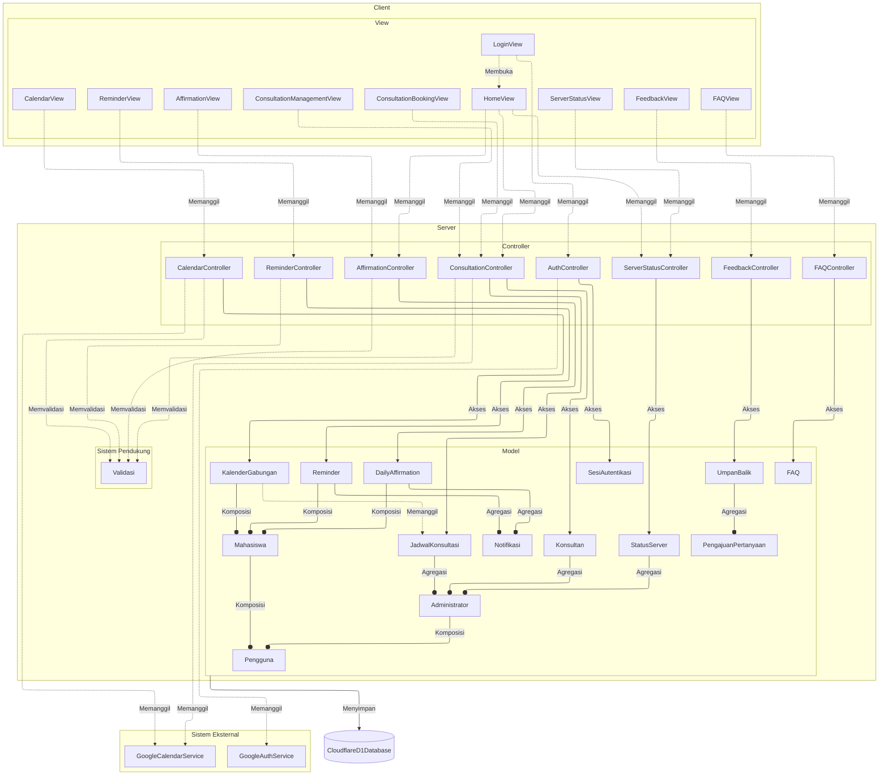

<p align="center">
<i>Gambar 18. Logical View pada P/L Sehati</i>
</p>

Relasi antar komponen pada Gambar 18:

1. **_View_ → _Controller_** (memanggil)

Setiap _view_ memanggil _controller_ untuk fiturnya. `LoginView` memanggil `AuthController`, dan `ConsultationBookingView` serta `ConsultationManagementView` sama-sama memanggil `ConsultationController`. `HomeView` memanggil `AffirmationController`, `ConsultationController`, dan `ServerStatusController` untuk mengisi ringkasan beranda.

2. **_Controller_ → _Model_** (akses)

Setiap _controller_ mengakses _model_ yang dikelolanya, misalnya `FAQController` ke `FAQ` dan `ConsultationController` ke `JadwalKonsultasi` dan `Konsultan`.

3. **_Controller_ → Validasi** (memvalidasi)

_Controller_ yang menerima input waktu atau isian wajib memeriksanya lewat validasi sebelum diproses.

4. **_Controller_ → Sistem Eksternal** (memanggil)

`AuthController` memanggil `GoogleAuthService`, sedangkan `CalendarController` dan `ConsultationController` memanggil `GoogleCalendarService`.

5. **Antar-Model** (agregasi dan komposisi)

`Notifikasi`, `PengajuanPertanyaan`, dan `Administrator` menghimpun _model_ terkait secara agregasi. `DailyAffirmation`, `Reminder`, dan `KalenderGabungan` menjadi bagian dari `Mahasiswa` secara komposisi, begitu pula `Mahasiswa` dan `Administrator` terhadap `Pengguna`.

6. **_Model_ → CloudflareD1Database** (menyimpan)

Seluruh _model_ disimpan secara persisten di D1.

Pada diagram ini, simbol lingkaran di ujung garis antar-_model_ berada di sisi komponen yang menghimpun (agregat atau induk).

# Realisasi Use Case

Bagian ini menjabarkan realisasi seluruh 12 _use case_ pada SKPL (UC-01 sampai UC-12). Setiap _use case_ dilengkapi identifikasi kelas, _sequence diagram_ untuk setiap skenario pada SKPL, dan diagram kelas.

## Realisasi UC-01 Menyetel Daily Affirmations

**ID Use Case:** UC-01  
**Nama Use Case:** Menyetel Daily Affirmations

### Identifikasi Kelas Perancangan UC-01

Tabel 20. Identifikasi Kelas Use Case UC-01

| No  | Nama Kelas Perancangan  | Nama Kelas Analisis Terkait |
| --- | ----------------------- | --------------------------- |
| 1   | `Mahasiswa`             | `Mahasiswa` (C-02)          |
| 2   | `AffirmationView`       | -                           |
| 3   | `AffirmationController` | -                           |
| 4   | `Validasi`              | -                           |
| 5   | `DailyAffirmation`      | `DailyAffirmation` (C-05)   |
| 6   | `CloudflareD1Database`  | -                           |
| 7   | `Notifikasi`            | `Notifikasi` (C-07)         |

### Sequence Diagram UC-01

- **Skenario Normal**

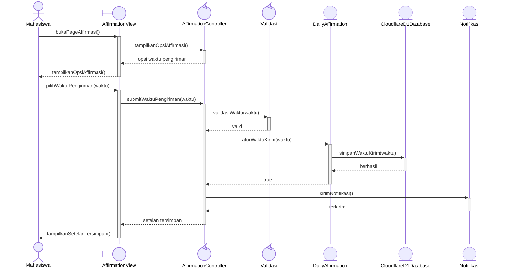

<p align="center">
<i>Gambar 19. Sequence Diagram UC-01 - Skenario Normal</i>
</p>

- **Skenario Alternatif 1: Sistem tidak mampu menyimpan setelan**


<p align="center">
<i>Gambar 20. Sequence Diagram UC-01 - Skenario Alternatif 1</i>
</p>

### Diagram Kelas Perancangan UC-01

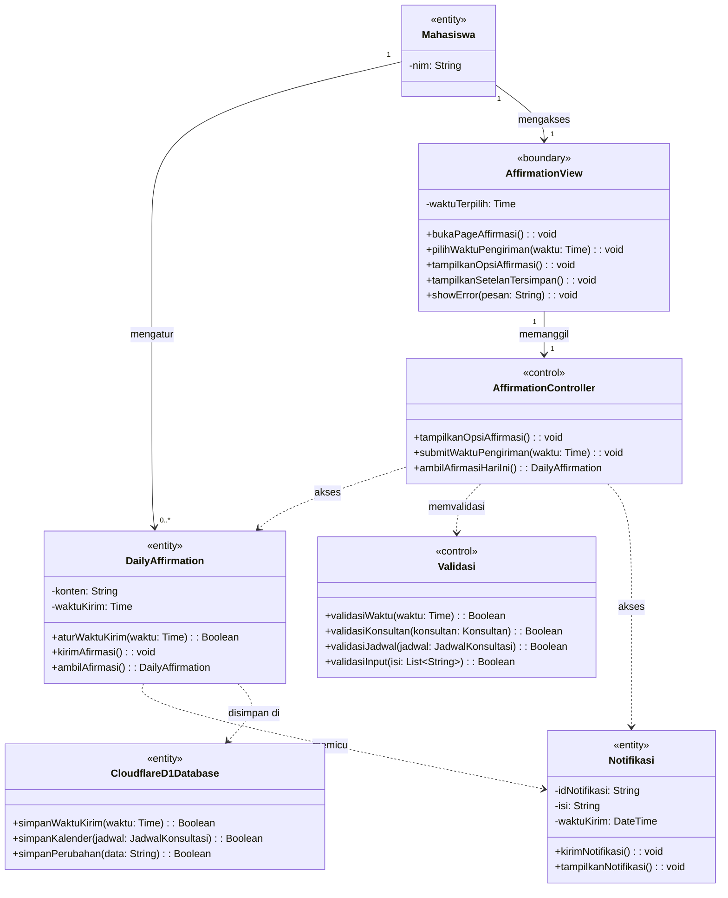

<p align="center">
<i>Gambar 21. Diagram Kelas Use Case UC-01 - Menyetel Daily Affirmations</i>
</p>

## Realisasi UC-02 Menyetel Pengingat Kesehatan

**ID Use Case:** UC-02  
**Nama Use Case:** Menyetel Pengingat Kesehatan

### Identifikasi Kelas Perancangan UC-02

Tabel 21. Identifikasi Kelas Use Case UC-02

| No  | Nama Kelas Perancangan | Nama Kelas Analisis Terkait |
| --- | ---------------------- | --------------------------- |
| 1   | `Mahasiswa`            | `Mahasiswa` (C-02)          |
| 2   | `ReminderView`         | -                           |
| 3   | `ReminderController`   | -                           |
| 4   | `Validasi`             | -                           |
| 5   | `Reminder`             | `Reminder` (C-06)           |
| 6   | `CloudflareD1Database` | -                           |
| 7   | `Notifikasi`           | `Notifikasi` (C-07)         |

### Sequence Diagram UC-02

- **Skenario Normal**

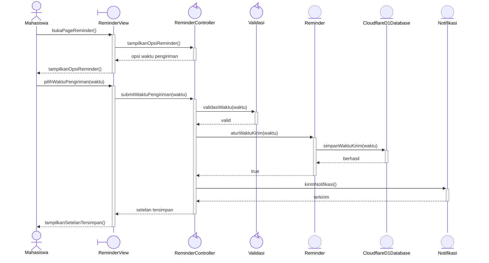

<p align="center">
<i>Gambar 22. Sequence Diagram UC-02 - Skenario Normal</i>
</p>

- **Skenario Alternatif 1: Sistem tidak mampu menyimpan setelan**

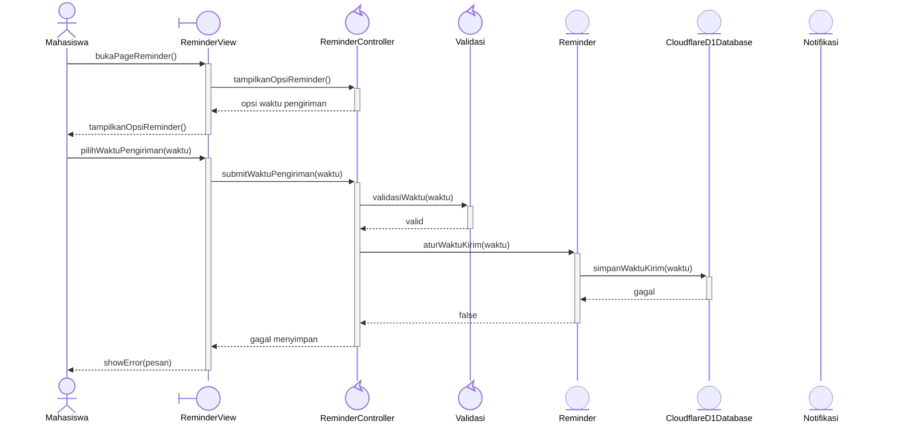

<p align="center">
<i>Gambar 23. Sequence Diagram UC-02 - Skenario Alternatif 1</i>
</p>

### Diagram Kelas Perancangan UC-02

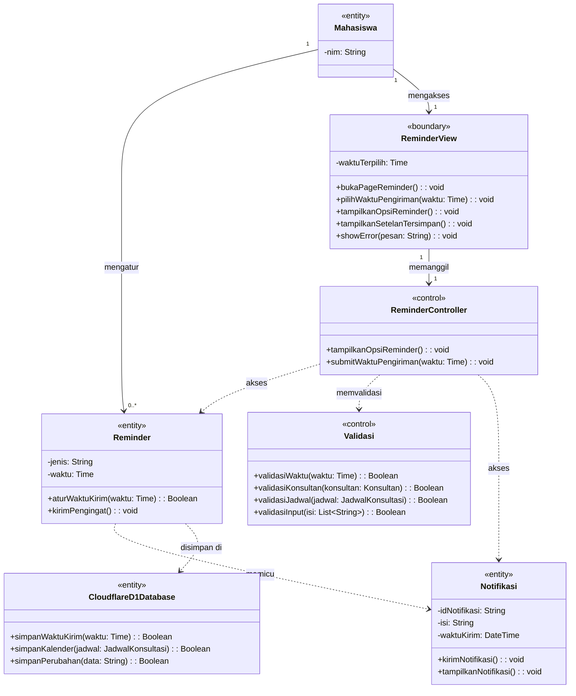

<p align="center">
<i>Gambar 24. Diagram Kelas Use Case UC-02 - Menyetel Pengingat Kesehatan</i>
</p>

## Realisasi UC-03 Melihat Kalender Terintegrasi

**ID Use Case:** UC-03  
**Nama Use Case:** Melihat Kalender Terintegrasi

### Identifikasi Kelas Perancangan UC-03

Tabel 22. Identifikasi Kelas Use Case UC-03

| No  | Nama Kelas Perancangan  | Nama Kelas Analisis Terkait    |
| --- | ----------------------- | ------------------------------ |
| 1   | `Mahasiswa`             | `Mahasiswa` (C-02)             |
| 2   | `CalendarView`          | -                              |
| 3   | `CalendarController`    | -                              |
| 4   | `GoogleCalendarService` | `GoogleCalendarService` (C-08) |
| 5   | `JadwalKonsultasi`      | `JadwalKonsultasi` (C-11)      |
| 6   | `KalenderGabungan`      | `KalenderGabungan` (C-09)      |

### Sequence Diagram UC-03

- **Skenario Normal**

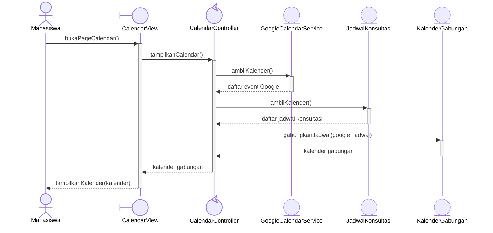

<p align="center">
<i>Gambar 25. Sequence Diagram UC-03 - Skenario Normal</i>
</p>

- **Skenario Alternatif 1: Sistem tidak mampu mengambil data event**

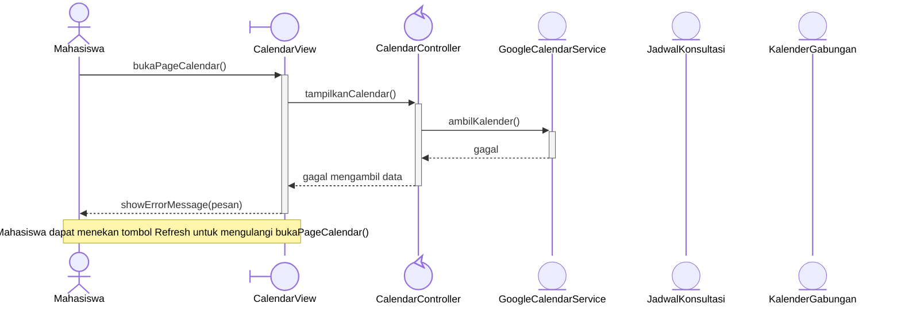

<p align="center">
<i>Gambar 26. Sequence Diagram UC-03 - Skenario Alternatif 1</i>
</p>

### Diagram Kelas Perancangan UC-03

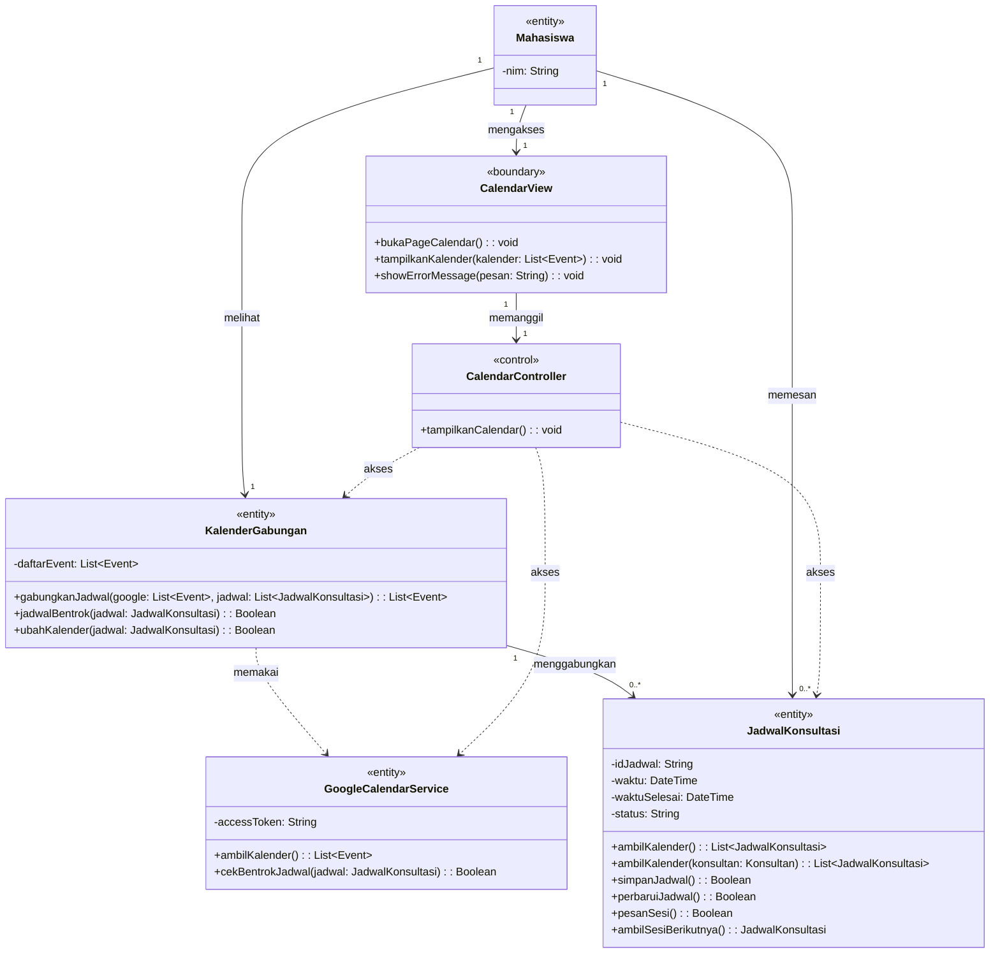

<p align="center">
<i>Gambar 27. Diagram Kelas Use Case UC-03 - Melihat Kalender Terintegrasi</i>
</p>

## Realisasi UC-04 Memesan Sesi Konsultasi

**ID Use Case:** UC-04  
**Nama Use Case:** Memesan Sesi Konsultasi

### Identifikasi Kelas Perancangan UC-04

Tabel 23. Identifikasi Kelas Use Case UC-04

| No  | Nama Kelas Perancangan    | Nama Kelas Analisis Terkait    |
| --- | ------------------------- | ------------------------------ |
| 1   | `Mahasiswa`               | `Mahasiswa` (C-02)             |
| 2   | `ConsultationBookingView` | -                              |
| 3   | `ConsultationController`  | -                              |
| 4   | `Konsultan`               | `Konsultan` (C-10)             |
| 5   | `JadwalKonsultasi`        | `JadwalKonsultasi` (C-11)      |
| 6   | `Validasi`                | -                              |
| 7   | `KalenderGabungan`        | `KalenderGabungan` (C-09)      |
| 8   | `GoogleCalendarService`   | `GoogleCalendarService` (C-08) |
| 9   | `CloudflareD1Database`    | -                              |

### Sequence Diagram UC-04

- **Skenario Normal**

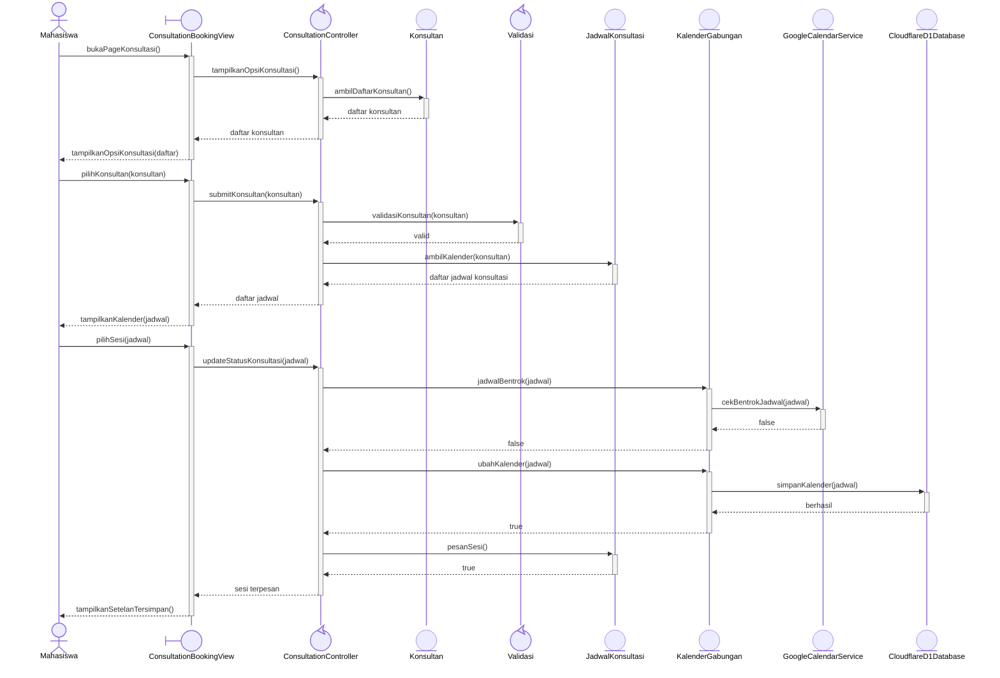

<p align="center">
<i>Gambar 28. Sequence Diagram UC-04 - Skenario Normal</i>
</p>

- **Skenario Alternatif 1: Sistem tidak mampu mengambil data jadwal konsultasi**

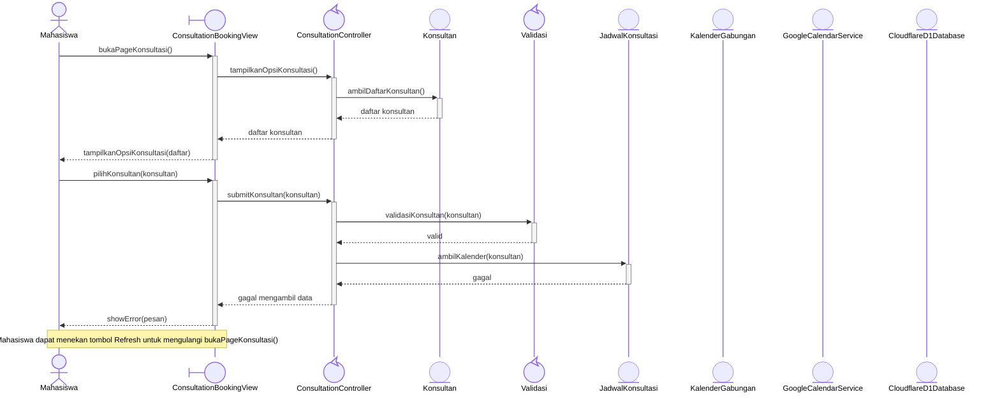

<p align="center">
<i>Gambar 29. Sequence Diagram UC-04 - Skenario Alternatif 1</i>
</p>

- **Skenario Alternatif 2: Sistem tidak mampu menyimpan jadwal konsultasi yang dipesan**

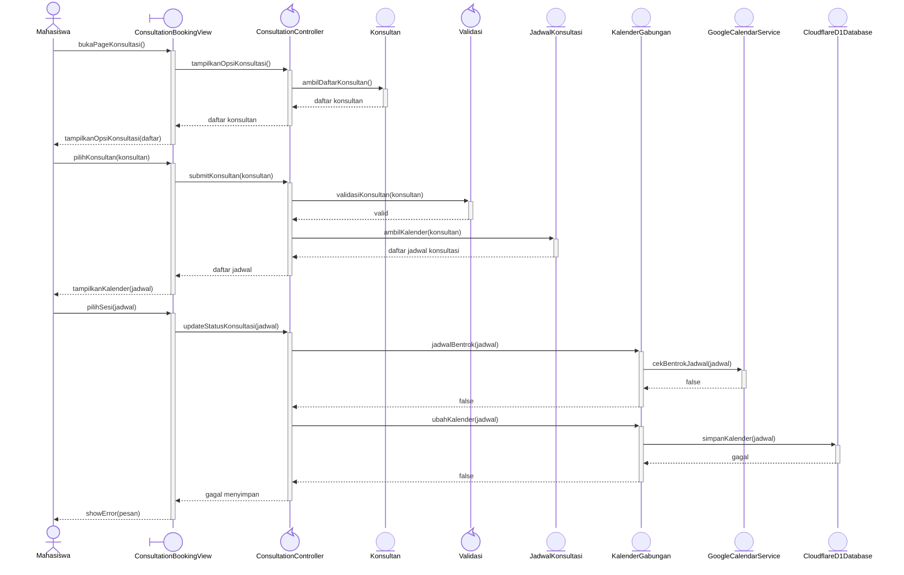

<p align="center">
<i>Gambar 30. Sequence Diagram UC-04 - Skenario Alternatif 2</i>
</p>

### Diagram Kelas Perancangan UC-04

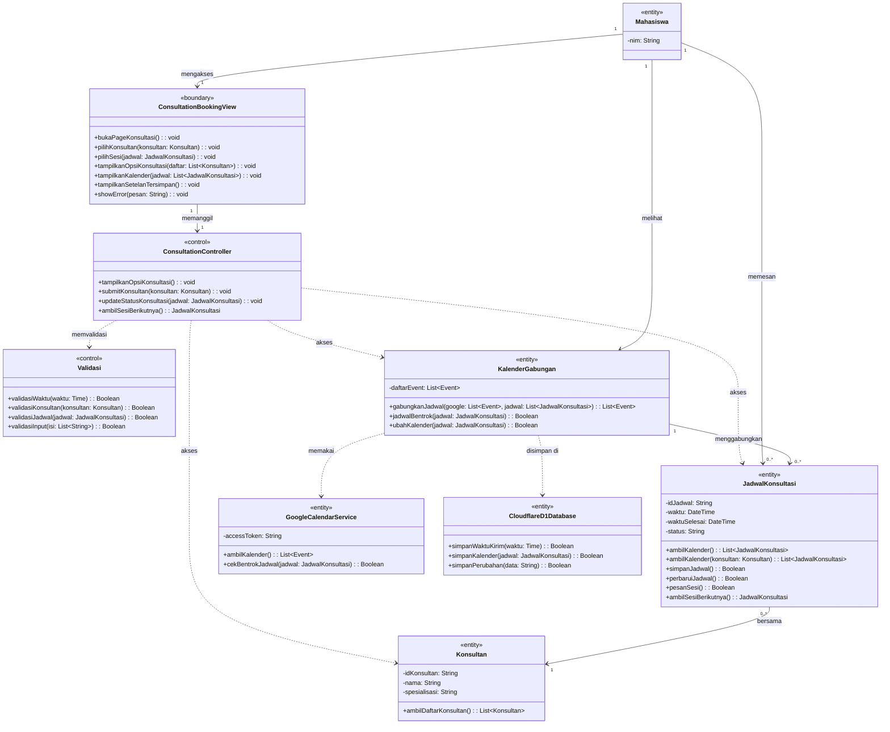

<p align="center">
<i>Gambar 31. Diagram Kelas Use Case UC-04 - Memesan Sesi Konsultasi</i>
</p>

## Realisasi UC-05 Mengelola Jadwal Konsultan

**ID Use Case:** UC-05  
**Nama Use Case:** Mengelola Jadwal Konsultan

### Identifikasi Kelas Perancangan UC-05

Tabel 24. Identifikasi Kelas Use Case UC-05

| No  | Nama Kelas Perancangan       | Nama Kelas Analisis Terkait |
| --- | ---------------------------- | --------------------------- |
| 1   | `Administrator`              | `Administrator` (C-03)      |
| 2   | `ConsultationManagementView` | -                           |
| 3   | `ConsultationController`     | -                           |
| 4   | `Konsultan`                  | `Konsultan` (C-10)          |
| 5   | `JadwalKonsultasi`           | `JadwalKonsultasi` (C-11)   |
| 6   | `Validasi`                   | -                           |
| 7   | `KalenderGabungan`           | `KalenderGabungan` (C-09)   |
| 8   | `CloudflareD1Database`       | -                           |

### Sequence Diagram UC-05

- **Skenario Normal**

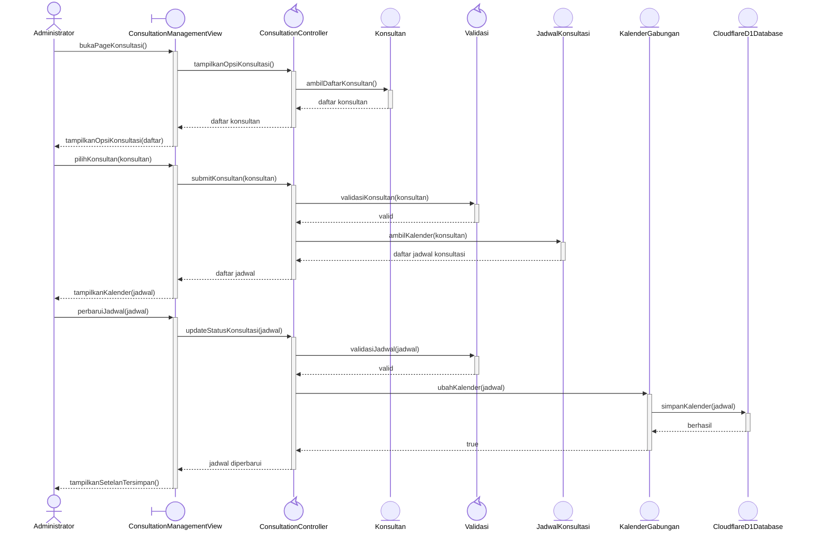

<p align="center">
<i>Gambar 32. Sequence Diagram UC-05 - Skenario Normal</i>
</p>

- **Skenario Alternatif 1: Sistem tidak mampu mengambil data jadwal konsultasi**

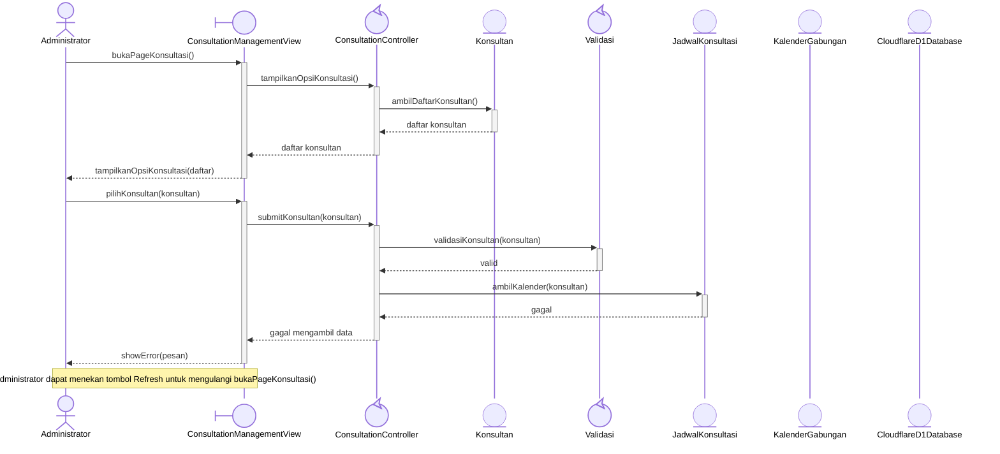

<p align="center">
<i>Gambar 33. Sequence Diagram UC-05 - Skenario Alternatif 1</i>
</p>

- **Skenario Alternatif 2: Sistem tidak mampu mengedit data jadwal konsultasi**

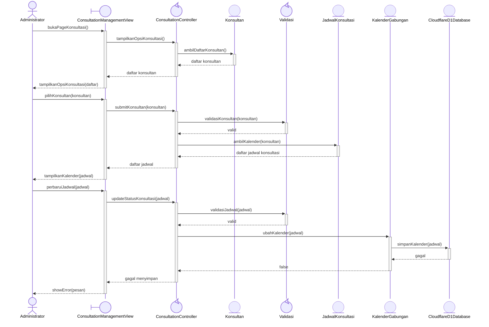

<p align="center">
<i>Gambar 34. Sequence Diagram UC-05 - Skenario Alternatif 2</i>
</p>

### Diagram Kelas Perancangan UC-05

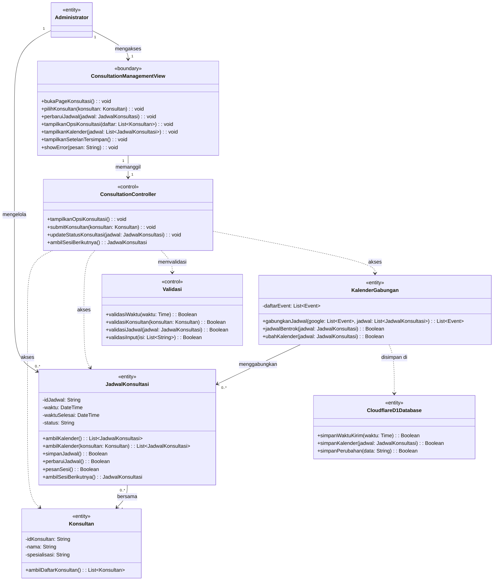

<p align="center">
<i>Gambar 35. Diagram Kelas Use Case UC-05 - Mengelola Jadwal Konsultan</i>
</p>

## Realisasi UC-06 Melihat FAQ

**ID Use Case:** UC-06  
**Nama Use Case:** Melihat FAQ

### Identifikasi Kelas Perancangan UC-06

Tabel 25. Identifikasi Kelas Use Case UC-06

| No  | Nama Kelas Perancangan | Nama Kelas Analisis Terkait |
| --- | ---------------------- | --------------------------- |
| 1   | `Mahasiswa`            | `Mahasiswa` (C-02)          |
| 2   | `FAQView`              | -                           |
| 3   | `FAQController`        | -                           |
| 4   | `FAQ`                  | `FAQ` (C-12)                |

### Sequence Diagram UC-06

- **Skenario Normal**

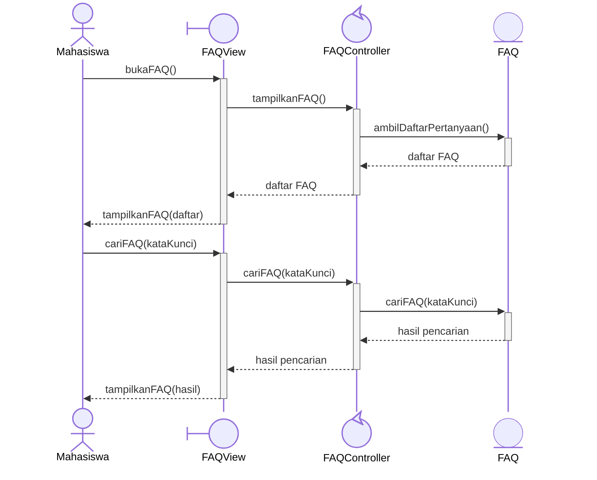

<p align="center">
<i>Gambar 36. Sequence Diagram UC-06 - Skenario Normal</i>
</p>

- **Skenario Alternatif 1: Tidak ada pertanyaan yang dicari pengguna**

```mermaid
sequenceDiagram
    actor Mahasiswa
    participant FAQView@{ "type": "boundary" }
    participant FAQController@{ "type": "control" }
    participant FAQ@{ "type": "entity" }

    Mahasiswa->>+FAQView: bukaFAQ()
    FAQView->>+FAQController: tampilkanFAQ()
    FAQController->>+FAQ: ambilDaftarPertanyaan()
    FAQ-->>-FAQController: daftar FAQ
    FAQController-->>-FAQView: daftar FAQ
    FAQView-->>-Mahasiswa: tampilkanFAQ(daftar)
    Mahasiswa->>+FAQView: cariFAQ(kataKunci)
    FAQView->>+FAQController: cariFAQ(kataKunci)
    FAQController->>+FAQ: cariFAQ(kataKunci)
    FAQ-->>-FAQController: hasil kosong
    FAQController-->>-FAQView: hasil kosong
    FAQView-->>-Mahasiswa: tampilkanTawaranPengajuan()
    Mahasiswa->>+FAQView: bukaFormPertanyaan()
    FAQView->>+FAQController: muatFormPenambahanPertanyaan()
    FAQController-->>-FAQView: form pertanyaan
    FAQView-->>-Mahasiswa: tampilkanFormPenambahanPertanyaan()
```

<p align="center">
<i>Gambar 37. Sequence Diagram UC-06 - Skenario Alternatif 1</i>
</p>

### Diagram Kelas Perancangan UC-06

```mermaid
classDiagram
    class Mahasiswa {
        <<entity>>
        -nim: String
    }
    class FAQView {
        <<boundary>>
        +bukaFAQ(): void
        +cariFAQ(kataKunci: String): void
        +tambahFAQ(pertanyaan: String, jawaban: String): void
        +ubahFAQ(idFAQ: String, pertanyaan: String, jawaban: String): void
        +hapusFAQ(idFAQ: String): void
        +bukaFormPertanyaan(): void
        +isiFormPertanyaan(isi: String): void
        +tampilkanFAQ(daftar: List~FAQ~): void
        +tampilkanTawaranPengajuan(): void
        +tampilkanFormPenambahanPertanyaan(): void
        +tampilkanSetelanTersimpan(): void
        +showError(pesan: String): void
    }
    class FAQController {
        <<control>>
        +tampilkanFAQ(): void
        +cariFAQ(kataKunci: String): void
        +tambahFAQ(pertanyaan: String, jawaban: String): void
        +ubahFAQ(idFAQ: String, pertanyaan: String, jawaban: String): void
        +hapusFAQ(idFAQ: String): void
        +muatFormPenambahanPertanyaan(): void
        +kirimPertanyaan(isi: String): void
    }
    class FAQ {
        <<entity>>
        -idFAQ: String
        -pertanyaan: String
        -jawaban: String
        +ambilDaftarPertanyaan(): List~FAQ~
        +cariFAQ(kataKunci: String): List~FAQ~
        +tambahFAQ(pertanyaan: String, jawaban: String): Boolean
        +ubahFAQ(idFAQ: String, pertanyaan: String, jawaban: String): Boolean
        +hapusFAQ(idFAQ: String): Boolean
    }
    Mahasiswa "1" --> "0..*" FAQ : melihat
    Mahasiswa "1" --> "1" FAQView : mengakses
    FAQView "1" --> "1" FAQController : memanggil
    FAQController ..> FAQ : akses
```

<p align="center">
<i>Gambar 38. Diagram Kelas Use Case UC-06 - Melihat FAQ</i>
</p>

## Realisasi UC-07 Mengelola FAQ

**ID Use Case:** UC-07  
**Nama Use Case:** Mengelola FAQ

### Identifikasi Kelas Perancangan UC-07

Tabel 26. Identifikasi Kelas Use Case UC-07

| No  | Nama Kelas Perancangan | Nama Kelas Analisis Terkait |
| --- | ---------------------- | --------------------------- |
| 1   | `Administrator`        | `Administrator` (C-03)      |
| 2   | `FAQView`              | -                           |
| 3   | `FAQController`        | -                           |
| 4   | `FAQ`                  | `FAQ` (C-12)                |
| 5   | `Validasi`             | -                           |
| 6   | `CloudflareD1Database` | -                           |

### Sequence Diagram UC-07

- **Skenario Normal**

```mermaid
sequenceDiagram
    actor Administrator
    participant FAQView@{ "type": "boundary" }
    participant FAQController@{ "type": "control" }
    participant FAQ@{ "type": "entity" }
    participant Validasi@{ "type": "control" }
    participant CloudflareD1Database@{ "type": "entity" }

    Administrator->>+FAQView: bukaFAQ()
    FAQView->>+FAQController: tampilkanFAQ()
    FAQController->>+FAQ: ambilDaftarPertanyaan()
    FAQ-->>-FAQController: daftar FAQ
    FAQController-->>-FAQView: daftar FAQ
    FAQView-->>-Administrator: tampilkanFAQ(daftar)
    Administrator->>+FAQView: tambahFAQ(pertanyaan, jawaban)
    FAQView->>+FAQController: tambahFAQ(pertanyaan, jawaban)
    FAQController->>+Validasi: validasiInput(isi)
    Validasi-->>-FAQController: valid
    FAQController->>+FAQ: tambahFAQ(pertanyaan, jawaban)
    FAQ->>+CloudflareD1Database: simpanPerubahan(data)
    CloudflareD1Database-->>-FAQ: berhasil
    FAQ-->>-FAQController: true
    FAQController-->>-FAQView: tersimpan
    FAQView-->>-Administrator: tampilkanSetelanTersimpan()
    Administrator->>+FAQView: hapusFAQ(idFAQ)
    FAQView->>+FAQController: hapusFAQ(idFAQ)
    FAQController->>+FAQ: hapusFAQ(idFAQ)
    FAQ->>+CloudflareD1Database: simpanPerubahan(data)
    CloudflareD1Database-->>-FAQ: berhasil
    FAQ-->>-FAQController: true
    FAQController-->>-FAQView: tersimpan
    FAQView-->>-Administrator: tampilkanSetelanTersimpan()
    Administrator->>+FAQView: ubahFAQ(idFAQ, pertanyaan, jawaban)
    FAQView->>+FAQController: ubahFAQ(idFAQ, pertanyaan, jawaban)
    FAQController->>+Validasi: validasiInput(isi)
    Validasi-->>-FAQController: valid
    FAQController->>+FAQ: ubahFAQ(idFAQ, pertanyaan, jawaban)
    FAQ->>+CloudflareD1Database: simpanPerubahan(data)
    CloudflareD1Database-->>-FAQ: berhasil
    FAQ-->>-FAQController: true
    FAQController-->>-FAQView: tersimpan
    FAQView-->>-Administrator: tampilkanSetelanTersimpan()
```

<p align="center">
<i>Gambar 39. Sequence Diagram UC-07 - Skenario Normal</i>
</p>

- **Skenario Alternatif 1: Tidak ada pertanyaan maupun jawaban yang berhasil disimpan**

```mermaid
sequenceDiagram
    actor Administrator
    participant FAQView@{ "type": "boundary" }
    participant FAQController@{ "type": "control" }
    participant FAQ@{ "type": "entity" }
    participant Validasi@{ "type": "control" }
    participant CloudflareD1Database@{ "type": "entity" }

    Administrator->>+FAQView: bukaFAQ()
    FAQView->>+FAQController: tampilkanFAQ()
    FAQController->>+FAQ: ambilDaftarPertanyaan()
    FAQ-->>-FAQController: daftar FAQ
    FAQController-->>-FAQView: daftar FAQ
    FAQView-->>-Administrator: tampilkanFAQ(daftar)
    Administrator->>+FAQView: tambahFAQ(pertanyaan, jawaban)
    FAQView->>+FAQController: tambahFAQ(pertanyaan, jawaban)
    FAQController->>+Validasi: validasiInput(isi)
    Validasi-->>-FAQController: valid
    FAQController->>+FAQ: tambahFAQ(pertanyaan, jawaban)
    FAQ->>+CloudflareD1Database: simpanPerubahan(data)
    CloudflareD1Database-->>-FAQ: gagal
    FAQ-->>-FAQController: false
    FAQController-->>-FAQView: gagal menyimpan
    FAQView-->>-Administrator: showError(pesan)
    Note over Administrator,FAQView: hapusFAQ(idFAQ) dan ubahFAQ(idFAQ, pertanyaan, jawaban) gagal dengan alur yang sama
```

<p align="center">
<i>Gambar 40. Sequence Diagram UC-07 - Skenario Alternatif 1</i>
</p>

### Diagram Kelas Perancangan UC-07

```mermaid
classDiagram
    class Administrator {
        <<entity>>
    }
    class FAQView {
        <<boundary>>
        +bukaFAQ(): void
        +cariFAQ(kataKunci: String): void
        +tambahFAQ(pertanyaan: String, jawaban: String): void
        +ubahFAQ(idFAQ: String, pertanyaan: String, jawaban: String): void
        +hapusFAQ(idFAQ: String): void
        +bukaFormPertanyaan(): void
        +isiFormPertanyaan(isi: String): void
        +tampilkanFAQ(daftar: List~FAQ~): void
        +tampilkanTawaranPengajuan(): void
        +tampilkanFormPenambahanPertanyaan(): void
        +tampilkanSetelanTersimpan(): void
        +showError(pesan: String): void
    }
    class FAQController {
        <<control>>
        +tampilkanFAQ(): void
        +cariFAQ(kataKunci: String): void
        +tambahFAQ(pertanyaan: String, jawaban: String): void
        +ubahFAQ(idFAQ: String, pertanyaan: String, jawaban: String): void
        +hapusFAQ(idFAQ: String): void
        +muatFormPenambahanPertanyaan(): void
        +kirimPertanyaan(isi: String): void
    }
    class FAQ {
        <<entity>>
        -idFAQ: String
        -pertanyaan: String
        -jawaban: String
        +ambilDaftarPertanyaan(): List~FAQ~
        +cariFAQ(kataKunci: String): List~FAQ~
        +tambahFAQ(pertanyaan: String, jawaban: String): Boolean
        +ubahFAQ(idFAQ: String, pertanyaan: String, jawaban: String): Boolean
        +hapusFAQ(idFAQ: String): Boolean
    }
    class Validasi {
        <<control>>
        +validasiWaktu(waktu: Time): Boolean
        +validasiKonsultan(konsultan: Konsultan): Boolean
        +validasiJadwal(jadwal: JadwalKonsultasi): Boolean
        +validasiInput(isi: List~String~): Boolean
    }
    class CloudflareD1Database {
        <<entity>>
        +simpanWaktuKirim(waktu: Time): Boolean
        +simpanKalender(jadwal: JadwalKonsultasi): Boolean
        +simpanPerubahan(data: String): Boolean
    }
    Administrator "1" --> "0..*" FAQ : mengelola
    Administrator "1" --> "1" FAQView : mengakses
    FAQView "1" --> "1" FAQController : memanggil
    FAQController ..> FAQ : akses
    FAQController ..> Validasi : memvalidasi
    FAQ ..> CloudflareD1Database : disimpan di
```

<p align="center">
<i>Gambar 41. Diagram Kelas Use Case UC-07 - Mengelola FAQ</i>
</p>

## Realisasi UC-08 Memberikan Umpan Balik

**ID Use Case:** UC-08  
**Nama Use Case:** Memberikan Umpan Balik

### Identifikasi Kelas Perancangan UC-08

Tabel 27. Identifikasi Kelas Use Case UC-08

| No  | Nama Kelas Perancangan | Nama Kelas Analisis Terkait |
| --- | ---------------------- | --------------------------- |
| 1   | `Mahasiswa`            | `Mahasiswa` (C-02)          |
| 2   | `FeedbackView`         | -                           |
| 3   | `FeedbackController`   | -                           |
| 4   | `UmpanBalik`           | `UmpanBalik` (C-14)         |
| 5   | `Validasi`             | -                           |
| 6   | `CloudflareD1Database` | -                           |

### Sequence Diagram UC-08

- **Skenario Normal**

```mermaid
sequenceDiagram
    actor Mahasiswa
    participant FeedbackView@{ "type": "boundary" }
    participant FeedbackController@{ "type": "control" }
    participant Validasi@{ "type": "control" }
    participant UmpanBalik@{ "type": "entity" }
    participant CloudflareD1Database@{ "type": "entity" }

    Mahasiswa->>+FeedbackView: bukaUmpanBalik()
    FeedbackView->>+FeedbackController: tampilkanFormFeedback()
    FeedbackController-->>-FeedbackView: form umpan balik
    FeedbackView-->>-Mahasiswa: tampilkanFormFeedback()
    Mahasiswa->>+FeedbackView: isiFormFeedback(isi)
    FeedbackView->>+FeedbackController: kirimFeedback(isi)
    FeedbackController->>+Validasi: validasiInput(isi)
    Validasi-->>-FeedbackController: valid
    FeedbackController->>+UmpanBalik: kirimUmpanBalik(isi)
    UmpanBalik->>+CloudflareD1Database: simpanPerubahan(data)
    CloudflareD1Database-->>-UmpanBalik: berhasil
    UmpanBalik-->>-FeedbackController: true
    FeedbackController-->>-FeedbackView: tersimpan
    FeedbackView-->>-Mahasiswa: tampilkanFeedbackTersimpan()
```

<p align="center">
<i>Gambar 42. Sequence Diagram UC-08 - Skenario Normal</i>
</p>

- **Skenario Alternatif 1: Umpan balik tidak disimpan pada database**

```mermaid
sequenceDiagram
    actor Mahasiswa
    participant FeedbackView@{ "type": "boundary" }
    participant FeedbackController@{ "type": "control" }
    participant Validasi@{ "type": "control" }
    participant UmpanBalik@{ "type": "entity" }
    participant CloudflareD1Database@{ "type": "entity" }

    Mahasiswa->>+FeedbackView: bukaUmpanBalik()
    FeedbackView->>+FeedbackController: tampilkanFormFeedback()
    FeedbackController-->>-FeedbackView: form umpan balik
    FeedbackView-->>-Mahasiswa: tampilkanFormFeedback()
    Mahasiswa->>+FeedbackView: isiFormFeedback(isi)
    FeedbackView->>+FeedbackController: kirimFeedback(isi)
    FeedbackController->>+Validasi: validasiInput(isi)
    Validasi-->>-FeedbackController: valid
    FeedbackController->>+UmpanBalik: kirimUmpanBalik(isi)
    UmpanBalik->>+CloudflareD1Database: simpanPerubahan(data)
    CloudflareD1Database-->>-UmpanBalik: gagal
    UmpanBalik-->>-FeedbackController: false
    FeedbackController-->>-FeedbackView: gagal menyimpan
    FeedbackView-->>-Mahasiswa: showError(pesan)
```

<p align="center">
<i>Gambar 43. Sequence Diagram UC-08 - Skenario Alternatif 1</i>
</p>

### Diagram Kelas Perancangan UC-08

```mermaid
classDiagram
    class Mahasiswa {
        <<entity>>
        -nim: String
    }
    class FeedbackView {
        <<boundary>>
        +bukaUmpanBalik(): void
        +isiFormFeedback(isi: String): void
        +bukaListFeedback(): void
        +tanggapiFeedback(tanggapan: String): void
        +tampilkanFormFeedback(): void
        +tampilkanListFeedback(daftar: List~UmpanBalik~): void
        +tampilkanFeedbackTersimpan(): void
        +showError(pesan: String): void
    }
    class FeedbackController {
        <<control>>
        +tampilkanFormFeedback(): void
        +kirimFeedback(isi: String): void
        +tampilkanListFeedback(): void
        +kirimTanggapan(tanggapan: String): void
    }
    class UmpanBalik {
        <<entity>>
        -idUmpanBalik: String
        -isi: String
        -tanggapan: String
        +ambilListUmpanBalik(): List~UmpanBalik~
        +kirimUmpanBalik(isi: String): Boolean
        +berikanTanggapan(tanggapan: String): Boolean
    }
    class Validasi {
        <<control>>
        +validasiWaktu(waktu: Time): Boolean
        +validasiKonsultan(konsultan: Konsultan): Boolean
        +validasiJadwal(jadwal: JadwalKonsultasi): Boolean
        +validasiInput(isi: List~String~): Boolean
    }
    class CloudflareD1Database {
        <<entity>>
        +simpanWaktuKirim(waktu: Time): Boolean
        +simpanKalender(jadwal: JadwalKonsultasi): Boolean
        +simpanPerubahan(data: String): Boolean
    }
    Mahasiswa "1" --> "0..*" UmpanBalik : memberikan
    Mahasiswa "1" --> "1" FeedbackView : mengakses
    FeedbackView "1" --> "1" FeedbackController : memanggil
    FeedbackController ..> UmpanBalik : akses
    FeedbackController ..> Validasi : memvalidasi
    UmpanBalik ..> CloudflareD1Database : disimpan di
```

<p align="center">
<i>Gambar 44. Diagram Kelas Use Case UC-08 - Memberikan Umpan Balik</i>
</p>

## Realisasi UC-09 Menanggapi Umpan Balik

**ID Use Case:** UC-09  
**Nama Use Case:** Menanggapi Umpan Balik

### Identifikasi Kelas Perancangan UC-09

Tabel 28. Identifikasi Kelas Use Case UC-09

| No  | Nama Kelas Perancangan | Nama Kelas Analisis Terkait |
| --- | ---------------------- | --------------------------- |
| 1   | `Administrator`        | `Administrator` (C-03)      |
| 2   | `Mahasiswa`            | `Mahasiswa` (C-02)          |
| 3   | `FeedbackView`         | -                           |
| 4   | `FeedbackController`   | -                           |
| 5   | `UmpanBalik`           | `UmpanBalik` (C-14)         |
| 6   | `Validasi`             | -                           |
| 7   | `CloudflareD1Database` | -                           |

### Sequence Diagram UC-09

- **Skenario Normal**

```mermaid
sequenceDiagram
    actor Administrator
    participant FeedbackView@{ "type": "boundary" }
    participant FeedbackController@{ "type": "control" }
    participant UmpanBalik@{ "type": "entity" }
    participant Validasi@{ "type": "control" }
    participant CloudflareD1Database@{ "type": "entity" }
    actor Mahasiswa

    Administrator->>+FeedbackView: bukaListFeedback()
    FeedbackView->>+FeedbackController: tampilkanListFeedback()
    FeedbackController->>+UmpanBalik: ambilListUmpanBalik()
    UmpanBalik-->>-FeedbackController: daftar umpan balik
    FeedbackController-->>-FeedbackView: daftar umpan balik
    FeedbackView-->>-Administrator: tampilkanListFeedback(daftar)
    Administrator->>+FeedbackView: tanggapiFeedback(tanggapan)
    FeedbackView->>+FeedbackController: kirimTanggapan(tanggapan)
    FeedbackController->>+Validasi: validasiInput(isi)
    Validasi-->>-FeedbackController: valid
    FeedbackController->>+UmpanBalik: berikanTanggapan(tanggapan)
    UmpanBalik->>+CloudflareD1Database: simpanPerubahan(data)
    CloudflareD1Database-->>-UmpanBalik: berhasil
    UmpanBalik-->>-FeedbackController: true
    FeedbackController-->>-FeedbackView: tersimpan
    FeedbackView-->>-Administrator: tampilkanFeedbackTersimpan()
```

<p align="center">
<i>Gambar 45. Sequence Diagram UC-09 - Skenario Normal</i>
</p>

- **Skenario Alternatif 1: Tanggapan umpan balik tidak berhasil ditampilkan**

```mermaid
sequenceDiagram
    actor Administrator
    participant FeedbackView@{ "type": "boundary" }
    participant FeedbackController@{ "type": "control" }
    participant UmpanBalik@{ "type": "entity" }
    participant Validasi@{ "type": "control" }
    participant CloudflareD1Database@{ "type": "entity" }
    actor Mahasiswa

    Administrator->>+FeedbackView: bukaListFeedback()
    FeedbackView->>+FeedbackController: tampilkanListFeedback()
    FeedbackController->>+UmpanBalik: ambilListUmpanBalik()
    UmpanBalik-->>-FeedbackController: daftar umpan balik
    FeedbackController-->>-FeedbackView: daftar umpan balik
    FeedbackView-->>-Administrator: tampilkanListFeedback(daftar)
    Administrator->>+FeedbackView: tanggapiFeedback(tanggapan)
    FeedbackView->>+FeedbackController: kirimTanggapan(tanggapan)
    FeedbackController->>+Validasi: validasiInput(isi)
    Validasi-->>-FeedbackController: valid
    FeedbackController->>+UmpanBalik: berikanTanggapan(tanggapan)
    UmpanBalik->>+CloudflareD1Database: simpanPerubahan(data)
    CloudflareD1Database-->>-UmpanBalik: berhasil
    UmpanBalik-->>-FeedbackController: true
    FeedbackController-->>-FeedbackView: tersimpan
    FeedbackView-->>-Administrator: tampilkanFeedbackTersimpan()
    Mahasiswa->>+FeedbackView: bukaListFeedback()
    FeedbackView->>+FeedbackController: tampilkanListFeedback()
    FeedbackController->>+UmpanBalik: ambilListUmpanBalik()
    UmpanBalik-->>-FeedbackController: tanggapan tidak dapat dimuat
    FeedbackController-->>-FeedbackView: tanggapan tidak dapat dimuat
    FeedbackView-->>-Mahasiswa: tampilkanListFeedback(daftar tanpa tanggapan)
```

<p align="center">
<i>Gambar 46. Sequence Diagram UC-09 - Skenario Alternatif 1</i>
</p>

### Diagram Kelas Perancangan UC-09

```mermaid
classDiagram
    class Administrator {
        <<entity>>
    }
    class Mahasiswa {
        <<entity>>
        -nim: String
    }
    class FeedbackView {
        <<boundary>>
        +bukaUmpanBalik(): void
        +isiFormFeedback(isi: String): void
        +bukaListFeedback(): void
        +tanggapiFeedback(tanggapan: String): void
        +tampilkanFormFeedback(): void
        +tampilkanListFeedback(daftar: List~UmpanBalik~): void
        +tampilkanFeedbackTersimpan(): void
        +showError(pesan: String): void
    }
    class FeedbackController {
        <<control>>
        +tampilkanFormFeedback(): void
        +kirimFeedback(isi: String): void
        +tampilkanListFeedback(): void
        +kirimTanggapan(tanggapan: String): void
    }
    class UmpanBalik {
        <<entity>>
        -idUmpanBalik: String
        -isi: String
        -tanggapan: String
        +ambilListUmpanBalik(): List~UmpanBalik~
        +kirimUmpanBalik(isi: String): Boolean
        +berikanTanggapan(tanggapan: String): Boolean
    }
    class Validasi {
        <<control>>
        +validasiWaktu(waktu: Time): Boolean
        +validasiKonsultan(konsultan: Konsultan): Boolean
        +validasiJadwal(jadwal: JadwalKonsultasi): Boolean
        +validasiInput(isi: List~String~): Boolean
    }
    class CloudflareD1Database {
        <<entity>>
        +simpanWaktuKirim(waktu: Time): Boolean
        +simpanKalender(jadwal: JadwalKonsultasi): Boolean
        +simpanPerubahan(data: String): Boolean
    }
    Mahasiswa "1" --> "0..*" UmpanBalik : memberikan
    Administrator "1" --> "0..*" UmpanBalik : menanggapi
    Mahasiswa "1" --> "1" FeedbackView : mengakses
    Administrator "1" --> "1" FeedbackView : mengakses
    FeedbackView "1" --> "1" FeedbackController : memanggil
    FeedbackController ..> UmpanBalik : akses
    FeedbackController ..> Validasi : memvalidasi
    UmpanBalik ..> CloudflareD1Database : disimpan di
```

<p align="center">
<i>Gambar 47. Diagram Kelas Use Case UC-09 - Menanggapi Umpan Balik</i>
</p>

## Realisasi UC-10 Memantau Status Server

**ID Use Case:** UC-10  
**Nama Use Case:** Memantau Status Server

### Identifikasi Kelas Perancangan UC-10

Tabel 29. Identifikasi Kelas Use Case UC-10

| No  | Nama Kelas Perancangan   | Nama Kelas Analisis Terkait |
| --- | ------------------------ | --------------------------- |
| 1   | `Administrator`          | `Administrator` (C-03)      |
| 2   | `ServerStatusView`       | -                           |
| 3   | `ServerStatusController` | -                           |
| 4   | `StatusServer`           | `StatusServer` (C-15)       |

### Sequence Diagram UC-10

- **Skenario Normal**

```mermaid
sequenceDiagram
    actor Administrator
    participant ServerStatusView@{ "type": "boundary" }
    participant ServerStatusController@{ "type": "control" }
    participant StatusServer@{ "type": "entity" }

    Administrator->>+ServerStatusView: cekStatusServer("website")
    ServerStatusView->>+ServerStatusController: tampilkanStatusServer("website")
    ServerStatusController->>+StatusServer: ambilStatusServer("website")
    StatusServer-->>-ServerStatusController: status uptime website
    ServerStatusController-->>-ServerStatusView: status uptime website
    ServerStatusView-->>-Administrator: tampilkanStatusServer(status)
    Administrator->>+ServerStatusView: cekStatusServer("server")
    ServerStatusView->>+ServerStatusController: tampilkanStatusServer("server")
    ServerStatusController->>+StatusServer: ambilStatusServer("server")
    StatusServer-->>-ServerStatusController: status uptime server
    ServerStatusController-->>-ServerStatusView: status uptime server
    ServerStatusView-->>-Administrator: tampilkanStatusServer(status)
```

<p align="center">
<i>Gambar 48. Sequence Diagram UC-10 - Skenario Normal</i>
</p>

### Diagram Kelas Perancangan UC-10

```mermaid
classDiagram
    class Administrator {
        <<entity>>
    }
    class ServerStatusView {
        <<boundary>>
        +cekStatusServer(jenis: String): void
        +tampilkanStatusServer(status: StatusServer): void
    }
    class ServerStatusController {
        <<control>>
        +tampilkanStatusServer(jenis: String): void
    }
    class StatusServer {
        <<entity>>
        -jenis: String
        -statusUptime: Boolean
        -waktuCek: DateTime
        +ambilStatusServer(jenis: String): StatusServer
        +cekStatusServer(): Boolean
    }
    Administrator "1" --> "0..*" StatusServer : memantau
    Administrator "1" --> "1" ServerStatusView : mengakses
    ServerStatusView "1" --> "1" ServerStatusController : memanggil
    ServerStatusController ..> StatusServer : akses
```

<p align="center">
<i>Gambar 49. Diagram Kelas Use Case UC-10 - Memantau Status Server</i>
</p>

## Realisasi UC-11 Masuk Melalui Akun Google

**ID Use Case:** UC-11  
**Nama Use Case:** Masuk Melalui Akun Google

### Identifikasi Kelas Perancangan UC-11

Tabel 30. Identifikasi Kelas Use Case UC-11

| No  | Nama Kelas Perancangan | Nama Kelas Analisis Terkait |
| --- | ---------------------- | --------------------------- |
| 1   | `Pengguna`             | `Pengguna` (C-01)           |
| 2   | `Mahasiswa`            | `Mahasiswa` (C-02)          |
| 3   | `Administrator`        | `Administrator` (C-03)      |
| 4   | `LoginView`            | -                           |
| 5   | `AuthController`       | -                           |
| 6   | `SesiAutentikasi`      | `SesiAutentikasi` (C-04)    |
| 7   | `GoogleAuthService`    | -                           |
| 8   | `CloudflareD1Database` | -                           |
| 9   | `HomeView`             | -                           |

### Sequence Diagram UC-11

Skenario normal ini dijalankan oleh algoritma Algo-001 untuk login dan pendaftaran akun otomatis pada login pertama, Algo-003 untuk pendaftaran perangkat notifikasi, dan Algo-030 untuk penyimpanan ke basis data.

- **Skenario Normal**

```mermaid
sequenceDiagram
    actor Pengguna
    participant LoginView@{ "type": "boundary" }
    participant HomeView@{ "type": "boundary" }
    participant AuthController@{ "type": "control" }
    participant GoogleAuthService@{ "type": "entity" }
    participant SesiAutentikasi@{ "type": "entity" }
    participant CloudflareD1Database@{ "type": "entity" }

    Pengguna->>+LoginView: masukLamanLogin()
    LoginView->>+AuthController: tampilkanLoginPage()
    AuthController-->>-LoginView: halaman login
    LoginView-->>-Pengguna: tampilkanLoginPage()
    Pengguna->>+LoginView: isiLoginPage(kodeOtorisasi)
    LoginView->>+AuthController: kirimData(kodeOtorisasi)
    AuthController->>+GoogleAuthService: validasi(kodeOtorisasi)
    GoogleAuthService-->>-AuthController: valid
    AuthController->>+SesiAutentikasi: autentikasiPengguna(kodeOtorisasi)
    opt akun belum terdaftar (login pertama)
        SesiAutentikasi->>+CloudflareD1Database: simpanPerubahan("daftar_pengguna")
        CloudflareD1Database-->>-SesiAutentikasi: akun dan NIM tersimpan
    end
    SesiAutentikasi->>+CloudflareD1Database: simpanPerubahan("buat_sesi")
    CloudflareD1Database-->>-SesiAutentikasi: berhasil
    SesiAutentikasi->>+CloudflareD1Database: simpanPerubahan("simpan_token_google")
    CloudflareD1Database-->>-SesiAutentikasi: berhasil
    SesiAutentikasi-->>-AuthController: sesi dibuat
    AuthController-->>-LoginView: login berhasil
    LoginView->>+HomeView: tampilkanBeranda(peran)
    HomeView-->>-LoginView: beranda sesuai peran
    LoginView-->>-Pengguna: loadPageUtama()
    Note over LoginView,AuthController: Setelah login, aplikasi meminta izin notifikasi dan mengambil Expo push token
    LoginView->>+LoginView: daftarkanPerangkat(tokenPush)
    LoginView->>+AuthController: daftarkanPerangkat(tokenPush)
    AuthController->>+SesiAutentikasi: daftarkanPerangkat(tokenPush)
    SesiAutentikasi->>+CloudflareD1Database: simpanPerubahan("daftar_perangkat")
    CloudflareD1Database-->>-SesiAutentikasi: berhasil
    SesiAutentikasi-->>-AuthController: true
    AuthController-->>-LoginView: perangkat terdaftar
    LoginView-->>-LoginView: token push terkirim
```

<p align="center">
<i>Gambar 50. Sequence Diagram UC-11 - Skenario Normal</i>
</p>

- **Skenario Alternatif 1: OAuth Google tidak berfungsi saat log in**

```mermaid
sequenceDiagram
    actor Pengguna
    participant LoginView@{ "type": "boundary" }
    participant AuthController@{ "type": "control" }
    participant GoogleAuthService@{ "type": "entity" }
    participant SesiAutentikasi@{ "type": "entity" }

    Pengguna->>+LoginView: masukLamanLogin()
    LoginView->>+AuthController: tampilkanLoginPage()
    AuthController-->>-LoginView: halaman login
    LoginView-->>-Pengguna: tampilkanLoginPage()
    Pengguna->>+LoginView: isiLoginPage(kodeOtorisasi)
    LoginView->>+AuthController: kirimData(kodeOtorisasi)
    AuthController->>+GoogleAuthService: validasi(kodeOtorisasi)
    GoogleAuthService-->>-AuthController: gagal
    AuthController-->>-LoginView: autentikasi gagal
    LoginView-->>-Pengguna: showError(pesan)
```

<p align="center">
<i>Gambar 51. Sequence Diagram UC-11 - Skenario Alternatif 1</i>
</p>

### Diagram Kelas Perancangan UC-11

```mermaid
classDiagram
    class Pengguna {
        <<abstract>>
        -id: String
        -nama: String
        -email: String
        -googleId: String
    }
    class Mahasiswa {
        <<entity>>
        -nim: String
    }
    class Administrator {
        <<entity>>
    }
    class LoginView {
        <<boundary>>
        +masukLamanLogin(): void
        +isiLoginPage(kodeOtorisasi: String): void
        +tampilkanLoginPage(): void
        +loadPageUtama(): void
        +showError(pesan: String): void
        +daftarkanPerangkat(tokenPush: String): void
    }
    class HomeView {
        <<boundary>>
        -peran: String
        +tampilkanBeranda(peran: String): void
        +bukaMenu(menu: String): void
    }
    class AuthController {
        <<control>>
        +tampilkanLoginPage(): void
        +kirimData(kodeOtorisasi: String): void
        +daftarkanPerangkat(tokenPush: String): void
    }
    class SesiAutentikasi {
        <<entity>>
        -token: String
        -waktuLogin: DateTime
        -status: String
        -tokenPush: String
        +autentikasiPengguna(kodeOtorisasi: String): Boolean
        +verifikasiToken(token: String): Boolean
        +logout(): void
        +daftarkanPerangkat(tokenPush: String): Boolean
    }
    class GoogleAuthService {
        <<entity>>
        -authCode: String
        -accessToken: String
        -refreshToken: String
        +validasi(kodeOtorisasi: String): Boolean
    }
    class CloudflareD1Database {
        <<entity>>
        +simpanWaktuKirim(waktu: Time): Boolean
        +simpanKalender(jadwal: JadwalKonsultasi): Boolean
        +simpanPerubahan(data: String): Boolean
    }
    Pengguna <|-- Mahasiswa
    Pengguna <|-- Administrator
    Pengguna "1" --> "0..*" SesiAutentikasi : memiliki
    Pengguna "1" --> "1" LoginView : mengakses
    LoginView "1" --> "1" AuthController : memanggil
    Pengguna "1" --> "1" HomeView : mengakses
    LoginView ..> HomeView : membuka
    AuthController ..> SesiAutentikasi : akses
    AuthController ..> GoogleAuthService : akses
    SesiAutentikasi ..> CloudflareD1Database : disimpan di
```

<p align="center">
<i>Gambar 52. Diagram Kelas Use Case UC-11 - Masuk Melalui Akun Google</i>
</p>

## Realisasi UC-12 Form Pengajuan Pertanyaan

**ID Use Case:** UC-12  
**Nama Use Case:** Form Pengajuan Pertanyaan

### Identifikasi Kelas Perancangan UC-12

Tabel 31. Identifikasi Kelas Use Case UC-12

| No  | Nama Kelas Perancangan | Nama Kelas Analisis Terkait  |
| --- | ---------------------- | ---------------------------- |
| 1   | `Mahasiswa`            | `Mahasiswa` (C-02)           |
| 2   | `FAQView`              | -                            |
| 3   | `FAQController`        | -                            |
| 4   | `Validasi`             | -                            |
| 5   | `PengajuanPertanyaan`  | `PengajuanPertanyaan` (C-13) |
| 6   | `CloudflareD1Database` | -                            |

### Sequence Diagram UC-12

- **Skenario Normal**

```mermaid
sequenceDiagram
    actor Mahasiswa
    participant FAQView@{ "type": "boundary" }
    participant FAQController@{ "type": "control" }
    participant Validasi@{ "type": "control" }
    participant PengajuanPertanyaan@{ "type": "entity" }
    participant CloudflareD1Database@{ "type": "entity" }

    Mahasiswa->>+FAQView: bukaFormPertanyaan()
    FAQView->>+FAQController: muatFormPenambahanPertanyaan()
    FAQController-->>-FAQView: form pertanyaan
    FAQView-->>-Mahasiswa: tampilkanFormPenambahanPertanyaan()
    Mahasiswa->>+FAQView: isiFormPertanyaan(isi)
    FAQView->>+FAQController: kirimPertanyaan(isi)
    FAQController->>+Validasi: validasiInput(isi)
    Validasi-->>-FAQController: valid
    FAQController->>+PengajuanPertanyaan: ajukanPertanyaan(isi)
    PengajuanPertanyaan->>+CloudflareD1Database: simpanPerubahan(data)
    CloudflareD1Database-->>-PengajuanPertanyaan: berhasil
    PengajuanPertanyaan-->>-FAQController: true
    FAQController-->>-FAQView: tersimpan
    FAQView-->>-Mahasiswa: tampilkanSetelanTersimpan()
```

<p align="center">
<i>Gambar 53. Sequence Diagram UC-12 - Skenario Normal</i>
</p>

- **Skenario Alternatif 1: Pertanyaan tidak tersimpan di database**

```mermaid
sequenceDiagram
    actor Mahasiswa
    participant FAQView@{ "type": "boundary" }
    participant FAQController@{ "type": "control" }
    participant Validasi@{ "type": "control" }
    participant PengajuanPertanyaan@{ "type": "entity" }
    participant CloudflareD1Database@{ "type": "entity" }

    Mahasiswa->>+FAQView: bukaFormPertanyaan()
    FAQView->>+FAQController: muatFormPenambahanPertanyaan()
    FAQController-->>-FAQView: form pertanyaan
    FAQView-->>-Mahasiswa: tampilkanFormPenambahanPertanyaan()
    Mahasiswa->>+FAQView: isiFormPertanyaan(isi)
    FAQView->>+FAQController: kirimPertanyaan(isi)
    FAQController->>+Validasi: validasiInput(isi)
    Validasi-->>-FAQController: valid
    FAQController->>+PengajuanPertanyaan: ajukanPertanyaan(isi)
    PengajuanPertanyaan->>+CloudflareD1Database: simpanPerubahan(data)
    CloudflareD1Database-->>-PengajuanPertanyaan: gagal
    PengajuanPertanyaan-->>-FAQController: false
    FAQController-->>-FAQView: gagal menyimpan
    FAQView-->>-Mahasiswa: showError(pesan)
```

<p align="center">
<i>Gambar 54. Sequence Diagram UC-12 - Skenario Alternatif 1</i>
</p>

### Diagram Kelas Perancangan UC-12

```mermaid
classDiagram
    class Mahasiswa {
        <<entity>>
        -nim: String
    }
    class FAQView {
        <<boundary>>
        +bukaFAQ(): void
        +cariFAQ(kataKunci: String): void
        +tambahFAQ(pertanyaan: String, jawaban: String): void
        +ubahFAQ(idFAQ: String, pertanyaan: String, jawaban: String): void
        +hapusFAQ(idFAQ: String): void
        +bukaFormPertanyaan(): void
        +isiFormPertanyaan(isi: String): void
        +tampilkanFAQ(daftar: List~FAQ~): void
        +tampilkanTawaranPengajuan(): void
        +tampilkanFormPenambahanPertanyaan(): void
        +tampilkanSetelanTersimpan(): void
        +showError(pesan: String): void
    }
    class FAQController {
        <<control>>
        +tampilkanFAQ(): void
        +cariFAQ(kataKunci: String): void
        +tambahFAQ(pertanyaan: String, jawaban: String): void
        +ubahFAQ(idFAQ: String, pertanyaan: String, jawaban: String): void
        +hapusFAQ(idFAQ: String): void
        +muatFormPenambahanPertanyaan(): void
        +kirimPertanyaan(isi: String): void
    }
    class Validasi {
        <<control>>
        +validasiWaktu(waktu: Time): Boolean
        +validasiKonsultan(konsultan: Konsultan): Boolean
        +validasiJadwal(jadwal: JadwalKonsultasi): Boolean
        +validasiInput(isi: List~String~): Boolean
    }
    class PengajuanPertanyaan {
        <<entity>>
        -idPertanyaan: String
        -isiPertanyaan: String
        +ajukanPertanyaan(isi: String): Boolean
    }
    class CloudflareD1Database {
        <<entity>>
        +simpanWaktuKirim(waktu: Time): Boolean
        +simpanKalender(jadwal: JadwalKonsultasi): Boolean
        +simpanPerubahan(data: String): Boolean
    }
    Mahasiswa "1" --> "0..*" PengajuanPertanyaan : mengajukan
    Mahasiswa "1" --> "1" FAQView : mengakses
    FAQView "1" --> "1" FAQController : memanggil
    FAQController ..> Validasi : memvalidasi
    FAQController ..> PengajuanPertanyaan : akses
    PengajuanPertanyaan ..> CloudflareD1Database : disimpan di
```

<p align="center">
<i>Gambar 55. Diagram Kelas Use Case UC-12 - Form Pengajuan Pertanyaan</i>
</p>

# Diagram Kelas Perancangan

## Diagram Kelas Perancangan Keseluruhan

```mermaid
classDiagram
    class Pengguna {
        <<abstract>>
        -id: String
        -nama: String
        -email: String
        -googleId: String
    }
    class Mahasiswa {
        <<entity>>
        -nim: String
    }
    class Administrator {
        <<entity>>
    }
    class SesiAutentikasi {
        <<entity>>
        -token: String
        -waktuLogin: DateTime
        -status: String
        -tokenPush: String
        +autentikasiPengguna(kodeOtorisasi: String): Boolean
        +verifikasiToken(token: String): Boolean
        +logout(): void
        +daftarkanPerangkat(tokenPush: String): Boolean
    }
    class DailyAffirmation {
        <<entity>>
        -konten: String
        -waktuKirim: Time
        +aturWaktuKirim(waktu: Time): Boolean
        +kirimAfirmasi(): void
        +ambilAfirmasi(): DailyAffirmation
    }
    class Reminder {
        <<entity>>
        -jenis: String
        -waktu: Time
        +aturWaktuKirim(waktu: Time): Boolean
        +kirimPengingat(): void
    }
    class Notifikasi {
        <<entity>>
        -idNotifikasi: String
        -isi: String
        -waktuKirim: DateTime
        +kirimNotifikasi(): void
        +tampilkanNotifikasi(): void
    }
    class GoogleCalendarService {
        <<entity>>
        -accessToken: String
        +ambilKalender(): List~Event~
        +cekBentrokJadwal(jadwal: JadwalKonsultasi): Boolean
    }
    class KalenderGabungan {
        <<entity>>
        -daftarEvent: List~Event~
        +gabungkanJadwal(google: List~Event~, jadwal: List~JadwalKonsultasi~): List~Event~
        +jadwalBentrok(jadwal: JadwalKonsultasi): Boolean
        +ubahKalender(jadwal: JadwalKonsultasi): Boolean
    }
    class Konsultan {
        <<entity>>
        -idKonsultan: String
        -nama: String
        -spesialisasi: String
        +ambilDaftarKonsultan(): List~Konsultan~
    }
    class JadwalKonsultasi {
        <<entity>>
        -idJadwal: String
        -waktu: DateTime
        -waktuSelesai: DateTime
        -status: String
        +ambilKalender(): List~JadwalKonsultasi~
        +ambilKalender(konsultan: Konsultan): List~JadwalKonsultasi~
        +simpanJadwal(): Boolean
        +perbaruiJadwal(): Boolean
        +pesanSesi(): Boolean
        +ambilSesiBerikutnya(): JadwalKonsultasi
    }
    class FAQ {
        <<entity>>
        -idFAQ: String
        -pertanyaan: String
        -jawaban: String
        +ambilDaftarPertanyaan(): List~FAQ~
        +cariFAQ(kataKunci: String): List~FAQ~
        +tambahFAQ(pertanyaan: String, jawaban: String): Boolean
        +ubahFAQ(idFAQ: String, pertanyaan: String, jawaban: String): Boolean
        +hapusFAQ(idFAQ: String): Boolean
    }
    class PengajuanPertanyaan {
        <<entity>>
        -idPertanyaan: String
        -isiPertanyaan: String
        +ajukanPertanyaan(isi: String): Boolean
    }
    class UmpanBalik {
        <<entity>>
        -idUmpanBalik: String
        -isi: String
        -tanggapan: String
        +ambilListUmpanBalik(): List~UmpanBalik~
        +kirimUmpanBalik(isi: String): Boolean
        +berikanTanggapan(tanggapan: String): Boolean
    }
    class StatusServer {
        <<entity>>
        -jenis: String
        -statusUptime: Boolean
        -waktuCek: DateTime
        +ambilStatusServer(jenis: String): StatusServer
        +cekStatusServer(): Boolean
    }
    class LoginView {
        <<boundary>>
        +masukLamanLogin(): void
        +isiLoginPage(kodeOtorisasi: String): void
        +tampilkanLoginPage(): void
        +loadPageUtama(): void
        +showError(pesan: String): void
        +daftarkanPerangkat(tokenPush: String): void
    }
    class HomeView {
        <<boundary>>
        -peran: String
        +tampilkanBeranda(peran: String): void
        +bukaMenu(menu: String): void
    }
    class AffirmationView {
        <<boundary>>
        -waktuTerpilih: Time
        +bukaPageAffirmasi(): void
        +pilihWaktuPengiriman(waktu: Time): void
        +tampilkanOpsiAffirmasi(): void
        +tampilkanSetelanTersimpan(): void
        +showError(pesan: String): void
    }
    class ReminderView {
        <<boundary>>
        -waktuTerpilih: Time
        +bukaPageReminder(): void
        +pilihWaktuPengiriman(waktu: Time): void
        +tampilkanOpsiReminder(): void
        +tampilkanSetelanTersimpan(): void
        +showError(pesan: String): void
    }
    class CalendarView {
        <<boundary>>
        +bukaPageCalendar(): void
        +tampilkanKalender(kalender: List~Event~): void
        +showErrorMessage(pesan: String): void
    }
    class ConsultationBookingView {
        <<boundary>>
        +bukaPageKonsultasi(): void
        +pilihKonsultan(konsultan: Konsultan): void
        +pilihSesi(jadwal: JadwalKonsultasi): void
        +tampilkanOpsiKonsultasi(daftar: List~Konsultan~): void
        +tampilkanKalender(jadwal: List~JadwalKonsultasi~): void
        +tampilkanSetelanTersimpan(): void
        +showError(pesan: String): void
    }
    class ConsultationManagementView {
        <<boundary>>
        +bukaPageKonsultasi(): void
        +pilihKonsultan(konsultan: Konsultan): void
        +perbaruiJadwal(jadwal: JadwalKonsultasi): void
        +tampilkanOpsiKonsultasi(daftar: List~Konsultan~): void
        +tampilkanKalender(jadwal: List~JadwalKonsultasi~): void
        +tampilkanSetelanTersimpan(): void
        +showError(pesan: String): void
    }
    class FAQView {
        <<boundary>>
        +bukaFAQ(): void
        +cariFAQ(kataKunci: String): void
        +tambahFAQ(pertanyaan: String, jawaban: String): void
        +ubahFAQ(idFAQ: String, pertanyaan: String, jawaban: String): void
        +hapusFAQ(idFAQ: String): void
        +bukaFormPertanyaan(): void
        +isiFormPertanyaan(isi: String): void
        +tampilkanFAQ(daftar: List~FAQ~): void
        +tampilkanTawaranPengajuan(): void
        +tampilkanFormPenambahanPertanyaan(): void
        +tampilkanSetelanTersimpan(): void
        +showError(pesan: String): void
    }
    class FeedbackView {
        <<boundary>>
        +bukaUmpanBalik(): void
        +isiFormFeedback(isi: String): void
        +bukaListFeedback(): void
        +tanggapiFeedback(tanggapan: String): void
        +tampilkanFormFeedback(): void
        +tampilkanListFeedback(daftar: List~UmpanBalik~): void
        +tampilkanFeedbackTersimpan(): void
        +showError(pesan: String): void
    }
    class ServerStatusView {
        <<boundary>>
        +cekStatusServer(jenis: String): void
        +tampilkanStatusServer(status: StatusServer): void
    }
    class AuthController {
        <<control>>
        +tampilkanLoginPage(): void
        +kirimData(kodeOtorisasi: String): void
        +daftarkanPerangkat(tokenPush: String): void
    }
    class AffirmationController {
        <<control>>
        +tampilkanOpsiAffirmasi(): void
        +submitWaktuPengiriman(waktu: Time): void
        +ambilAfirmasiHariIni(): DailyAffirmation
    }
    class ReminderController {
        <<control>>
        +tampilkanOpsiReminder(): void
        +submitWaktuPengiriman(waktu: Time): void
    }
    class CalendarController {
        <<control>>
        +tampilkanCalendar(): void
    }
    class ConsultationController {
        <<control>>
        +tampilkanOpsiKonsultasi(): void
        +submitKonsultan(konsultan: Konsultan): void
        +updateStatusKonsultasi(jadwal: JadwalKonsultasi): void
        +ambilSesiBerikutnya(): JadwalKonsultasi
    }
    class FAQController {
        <<control>>
        +tampilkanFAQ(): void
        +cariFAQ(kataKunci: String): void
        +tambahFAQ(pertanyaan: String, jawaban: String): void
        +ubahFAQ(idFAQ: String, pertanyaan: String, jawaban: String): void
        +hapusFAQ(idFAQ: String): void
        +muatFormPenambahanPertanyaan(): void
        +kirimPertanyaan(isi: String): void
    }
    class FeedbackController {
        <<control>>
        +tampilkanFormFeedback(): void
        +kirimFeedback(isi: String): void
        +tampilkanListFeedback(): void
        +kirimTanggapan(tanggapan: String): void
    }
    class ServerStatusController {
        <<control>>
        +tampilkanStatusServer(jenis: String): void
    }
    class Validasi {
        <<control>>
        +validasiWaktu(waktu: Time): Boolean
        +validasiKonsultan(konsultan: Konsultan): Boolean
        +validasiJadwal(jadwal: JadwalKonsultasi): Boolean
        +validasiInput(isi: List~String~): Boolean
    }
    class GoogleAuthService {
        <<entity>>
        -authCode: String
        -accessToken: String
        -refreshToken: String
        +validasi(kodeOtorisasi: String): Boolean
    }
    class CloudflareD1Database {
        <<entity>>
        +simpanWaktuKirim(waktu: Time): Boolean
        +simpanKalender(jadwal: JadwalKonsultasi): Boolean
        +simpanPerubahan(data: String): Boolean
    }
    Pengguna <|-- Mahasiswa
    Pengguna <|-- Administrator
    Pengguna "1" --> "0..*" SesiAutentikasi : memiliki
    Mahasiswa "1" --> "0..*" DailyAffirmation : mengatur
    Mahasiswa "1" --> "0..*" Reminder : mengatur
    DailyAffirmation ..> Notifikasi : memicu
    Reminder ..> Notifikasi : memicu
    Mahasiswa "1" --> "1" KalenderGabungan : melihat
    KalenderGabungan ..> GoogleCalendarService : memakai
    KalenderGabungan "1" --> "0..*" JadwalKonsultasi : menggabungkan
    Mahasiswa "1" --> "0..*" JadwalKonsultasi : memesan
    Administrator "1" --> "0..*" JadwalKonsultasi : mengelola
    JadwalKonsultasi "0..*" --> "1" Konsultan : bersama
    Mahasiswa "1" --> "0..*" FAQ : melihat
    Administrator "1" --> "0..*" FAQ : mengelola
    Mahasiswa "1" --> "0..*" PengajuanPertanyaan : mengajukan
    FAQ ..> PengajuanPertanyaan : menawarkan
    Mahasiswa "1" --> "0..*" UmpanBalik : memberikan
    Administrator "1" --> "0..*" UmpanBalik : menanggapi
    Administrator "1" --> "0..*" StatusServer : memantau
    Pengguna "1" --> "1" LoginView : mengakses
    Mahasiswa "1" --> "1" AffirmationView : mengakses
    Mahasiswa "1" --> "1" ReminderView : mengakses
    Mahasiswa "1" --> "1" CalendarView : mengakses
    Mahasiswa "1" --> "1" ConsultationBookingView : mengakses
    Administrator "1" --> "1" ConsultationManagementView : mengakses
    Mahasiswa "1" --> "1" FAQView : mengakses
    Administrator "1" --> "1" FAQView : mengakses
    Mahasiswa "1" --> "1" FeedbackView : mengakses
    Administrator "1" --> "1" FeedbackView : mengakses
    Administrator "1" --> "1" ServerStatusView : mengakses
    LoginView "1" --> "1" AuthController : memanggil
    Pengguna "1" --> "1" HomeView : mengakses
    LoginView ..> HomeView : membuka
    HomeView ..> AffirmationController : memanggil
    HomeView ..> ConsultationController : memanggil
    HomeView ..> ServerStatusController : memanggil
    AffirmationView "1" --> "1" AffirmationController : memanggil
    ReminderView "1" --> "1" ReminderController : memanggil
    CalendarView "1" --> "1" CalendarController : memanggil
    ConsultationBookingView "1" --> "1" ConsultationController : memanggil
    ConsultationManagementView "1" --> "1" ConsultationController : memanggil
    FAQView "1" --> "1" FAQController : memanggil
    FeedbackView "1" --> "1" FeedbackController : memanggil
    ServerStatusView "1" --> "1" ServerStatusController : memanggil
    AuthController ..> SesiAutentikasi : akses
    AuthController ..> GoogleAuthService : akses
    AffirmationController ..> DailyAffirmation : akses
    AffirmationController ..> Validasi : memvalidasi
    AffirmationController ..> Notifikasi : akses
    ReminderController ..> Reminder : akses
    ReminderController ..> Validasi : memvalidasi
    ReminderController ..> Notifikasi : akses
    CalendarController ..> GoogleCalendarService : akses
    CalendarController ..> JadwalKonsultasi : akses
    CalendarController ..> KalenderGabungan : akses
    ConsultationController ..> Konsultan : akses
    ConsultationController ..> JadwalKonsultasi : akses
    ConsultationController ..> Validasi : memvalidasi
    ConsultationController ..> KalenderGabungan : akses
    FAQController ..> FAQ : akses
    FAQController ..> Validasi : memvalidasi
    FAQController ..> PengajuanPertanyaan : akses
    FeedbackController ..> UmpanBalik : akses
    FeedbackController ..> Validasi : memvalidasi
    ServerStatusController ..> StatusServer : akses
    DailyAffirmation ..> CloudflareD1Database : disimpan di
    Reminder ..> CloudflareD1Database : disimpan di
    KalenderGabungan ..> CloudflareD1Database : disimpan di
    FAQ ..> CloudflareD1Database : disimpan di
    UmpanBalik ..> CloudflareD1Database : disimpan di
    PengajuanPertanyaan ..> CloudflareD1Database : disimpan di
    SesiAutentikasi ..> CloudflareD1Database : disimpan di
```

<p align="center">
<i>Gambar 56. Diagram Kelas Perancangan Keseluruhan Sehati</i>
</p>

Tabel 32. Daftar Kelas Perancangan Keseluruhan

| ID Kelas | Nama Kelas                   | Atribut                                                                     | Metode/Operasi                                                                                                                                                                                                                                                                                                                                                                                                                                                                                                                |
| -------- | ---------------------------- | --------------------------------------------------------------------------- | ----------------------------------------------------------------------------------------------------------------------------------------------------------------------------------------------------------------------------------------------------------------------------------------------------------------------------------------------------------------------------------------------------------------------------------------------------------------------------------------------------------------------------- |
| C-01     | `Pengguna`                   | `-id: String`<br>`-nama: String`<br>`-email: String`<br>`-googleId: String` | -                                                                                                                                                                                                                                                                                                                                                                                                                                                                                                                             |
| C-02     | `Mahasiswa`                  | `-nim: String`                                                              | -                                                                                                                                                                                                                                                                                                                                                                                                                                                                                                                             |
| C-03     | `Administrator`              | -                                                                           | -                                                                                                                                                                                                                                                                                                                                                                                                                                                                                                                             |
| C-04 | `SesiAutentikasi` | `-token: String`<br>`-waktuLogin: DateTime`<br>`-status: String`<br>`-tokenPush: String` | `+autentikasiPengguna(kodeOtorisasi: String): Boolean`<br>`+verifikasiToken(token: String): Boolean`<br>`+logout(): void`<br>`+daftarkanPerangkat(tokenPush: String): Boolean` |
| C-05 | `DailyAffirmation` | `-konten: String`<br>`-waktuKirim: Time` | `+aturWaktuKirim(waktu: Time): Boolean`<br>`+kirimAfirmasi(): void`<br>`+ambilAfirmasi(): DailyAffirmation` |
| C-06     | `Reminder`                   | `-jenis: String`<br>`-waktu: Time`                                          | `+aturWaktuKirim(waktu: Time): Boolean`<br>`+kirimPengingat(): void`                                                                                                                                                                                                                                                                                                                                                                                                                                                          |
| C-07     | `Notifikasi`                 | `-idNotifikasi: String`<br>`-isi: String`<br>`-waktuKirim: DateTime`        | `+kirimNotifikasi(): void`<br>`+tampilkanNotifikasi(): void`                                                                                                                                                                                                                                                                                                                                                                                                                                                                  |
| C-08     | `GoogleCalendarService`      | `-accessToken: String`                                                      | `+ambilKalender(): List<Event>`<br>`+cekBentrokJadwal(jadwal: JadwalKonsultasi): Boolean`                                                                                                                                                                                                                                                                                                                                                                                                                                     |
| C-09     | `KalenderGabungan`           | `-daftarEvent: List<Event>`                                                 | `+gabungkanJadwal(google: List<Event>, jadwal: List<JadwalKonsultasi>): List<Event>`<br>`+jadwalBentrok(jadwal: JadwalKonsultasi): Boolean`<br>`+ubahKalender(jadwal: JadwalKonsultasi): Boolean`                                                                                                                                                                                                                                                                                                                             |
| C-10     | `Konsultan`                  | `-idKonsultan: String`<br>`-nama: String`<br>`-spesialisasi: String`                                  | `+ambilDaftarKonsultan(): List<Konsultan>`                                                                                                                                                                                                                                                                                                                                                                                                                                                                                    |
| C-11 | `JadwalKonsultasi` | `-idJadwal: String`<br>`-waktu: DateTime`<br>`-waktuSelesai: DateTime`<br>`-status: String` | `+ambilKalender(): List<JadwalKonsultasi>`<br>`+ambilKalender(konsultan: Konsultan): List<JadwalKonsultasi>`<br>`+simpanJadwal(): Boolean`<br>`+perbaruiJadwal(): Boolean`<br>`+pesanSesi(): Boolean`<br>`+ambilSesiBerikutnya(): JadwalKonsultasi` |
| C-12     | `FAQ`                        | `-idFAQ: String`<br>`-pertanyaan: String`<br>`-jawaban: String`             | `+ambilDaftarPertanyaan(): List<FAQ>`<br>`+cariFAQ(kataKunci: String): List<FAQ>`<br>`+tambahFAQ(pertanyaan: String, jawaban: String): Boolean`<br>`+ubahFAQ(idFAQ: String, pertanyaan: String, jawaban: String): Boolean`<br>`+hapusFAQ(idFAQ: String): Boolean`                                                                                                                                                                                                                                                             |
| C-13     | `PengajuanPertanyaan`        | `-idPertanyaan: String`<br>`-isiPertanyaan: String`                         | `+ajukanPertanyaan(isi: String): Boolean`                                                                                                                                                                                                                                                                                                                                                                                                                                                                                     |
| C-14     | `UmpanBalik`                 | `-idUmpanBalik: String`<br>`-isi: String`<br>`-tanggapan: String`           | `+ambilListUmpanBalik(): List<UmpanBalik>`<br>`+kirimUmpanBalik(isi: String): Boolean`<br>`+berikanTanggapan(tanggapan: String): Boolean`                                                                                                                                                                                                                                                                                                                                                                                     |
| C-15     | `StatusServer`               | `-jenis: String`<br>`-statusUptime: Boolean`<br>`-waktuCek: DateTime`       | `+ambilStatusServer(jenis: String): StatusServer`<br>`+cekStatusServer(): Boolean`                                                                                                                                                                                                                                                                                                                                                                                                                                            |
| C-16 | `LoginView` | - | `+masukLamanLogin(): void`<br>`+isiLoginPage(kodeOtorisasi: String): void`<br>`+tampilkanLoginPage(): void`<br>`+loadPageUtama(): void`<br>`+showError(pesan: String): void`<br>`+daftarkanPerangkat(tokenPush: String): void` |
| C-17     | `AffirmationView`            | `-waktuTerpilih: Time`                                                      | `+bukaPageAffirmasi(): void`<br>`+pilihWaktuPengiriman(waktu: Time): void`<br>`+tampilkanOpsiAffirmasi(): void`<br>`+tampilkanSetelanTersimpan(): void`<br>`+showError(pesan: String): void`                                                                                                                                                                                                                                                                                                                                  |
| C-18     | `ReminderView`               | `-waktuTerpilih: Time`                                                      | `+bukaPageReminder(): void`<br>`+pilihWaktuPengiriman(waktu: Time): void`<br>`+tampilkanOpsiReminder(): void`<br>`+tampilkanSetelanTersimpan(): void`<br>`+showError(pesan: String): void`                                                                                                                                                                                                                                                                                                                                    |
| C-19     | `CalendarView`               | -                                                                           | `+bukaPageCalendar(): void`<br>`+tampilkanKalender(kalender: List<Event>): void`<br>`+showErrorMessage(pesan: String): void`                                                                                                                                                                                                                                                                                                                                                                                                  |
| C-20     | `ConsultationBookingView`    | -                                                                           | `+bukaPageKonsultasi(): void`<br>`+pilihKonsultan(konsultan: Konsultan): void`<br>`+pilihSesi(jadwal: JadwalKonsultasi): void`<br>`+tampilkanOpsiKonsultasi(daftar: List<Konsultan>): void`<br>`+tampilkanKalender(jadwal: List<JadwalKonsultasi>): void`<br>`+tampilkanSetelanTersimpan(): void`<br>`+showError(pesan: String): void`                                                                                                                                                                                        |
| C-21     | `ConsultationManagementView` | -                                                                           | `+bukaPageKonsultasi(): void`<br>`+pilihKonsultan(konsultan: Konsultan): void`<br>`+perbaruiJadwal(jadwal: JadwalKonsultasi): void`<br>`+tampilkanOpsiKonsultasi(daftar: List<Konsultan>): void`<br>`+tampilkanKalender(jadwal: List<JadwalKonsultasi>): void`<br>`+tampilkanSetelanTersimpan(): void`<br>`+showError(pesan: String): void`                                                                                                                                                                                   |
| C-22     | `FAQView`                    | -                                                                           | `+bukaFAQ(): void`<br>`+cariFAQ(kataKunci: String): void`<br>`+tambahFAQ(pertanyaan: String, jawaban: String): void`<br>`+ubahFAQ(idFAQ: String, pertanyaan: String, jawaban: String): void`<br>`+hapusFAQ(idFAQ: String): void`<br>`+bukaFormPertanyaan(): void`<br>`+isiFormPertanyaan(isi: String): void`<br>`+tampilkanFAQ(daftar: List<FAQ>): void`<br>`+tampilkanTawaranPengajuan(): void`<br>`+tampilkanFormPenambahanPertanyaan(): void`<br>`+tampilkanSetelanTersimpan(): void`<br>`+showError(pesan: String): void` |
| C-23     | `FeedbackView`               | -                                                                           | `+bukaUmpanBalik(): void`<br>`+isiFormFeedback(isi: String): void`<br>`+bukaListFeedback(): void`<br>`+tanggapiFeedback(tanggapan: String): void`<br>`+tampilkanFormFeedback(): void`<br>`+tampilkanListFeedback(daftar: List<UmpanBalik>): void`<br>`+tampilkanFeedbackTersimpan(): void`<br>`+showError(pesan: String): void`                                                                                                                                                                                               |
| C-24     | `ServerStatusView`           | -                                                                           | `+cekStatusServer(jenis: String): void`<br>`+tampilkanStatusServer(status: StatusServer): void`                                                                                                                                                                                                                                                                                                                                                                                                                               |
| C-25 | `AuthController` | - | `+tampilkanLoginPage(): void`<br>`+kirimData(kodeOtorisasi: String): void`<br>`+daftarkanPerangkat(tokenPush: String): void` |
| C-26 | `AffirmationController` | - | `+tampilkanOpsiAffirmasi(): void`<br>`+submitWaktuPengiriman(waktu: Time): void`<br>`+ambilAfirmasiHariIni(): DailyAffirmation` |
| C-27     | `ReminderController`         | -                                                                           | `+tampilkanOpsiReminder(): void`<br>`+submitWaktuPengiriman(waktu: Time): void`                                                                                                                                                                                                                                                                                                                                                                                                                                               |
| C-28     | `CalendarController`         | -                                                                           | `+tampilkanCalendar(): void`                                                                                                                                                                                                                                                                                                                                                                                                                                                                                                  |
| C-29 | `ConsultationController` | - | `+tampilkanOpsiKonsultasi(): void`<br>`+submitKonsultan(konsultan: Konsultan): void`<br>`+updateStatusKonsultasi(jadwal: JadwalKonsultasi): void`<br>`+ambilSesiBerikutnya(): JadwalKonsultasi` |
| C-30     | `FAQController`              | -                                                                           | `+tampilkanFAQ(): void`<br>`+cariFAQ(kataKunci: String): void`<br>`+tambahFAQ(pertanyaan: String, jawaban: String): void`<br>`+ubahFAQ(idFAQ: String, pertanyaan: String, jawaban: String): void`<br>`+hapusFAQ(idFAQ: String): void`<br>`+muatFormPenambahanPertanyaan(): void`<br>`+kirimPertanyaan(isi: String): void`                                                                                                                                                                                                     |
| C-31     | `FeedbackController`         | -                                                                           | `+tampilkanFormFeedback(): void`<br>`+kirimFeedback(isi: String): void`<br>`+tampilkanListFeedback(): void`<br>`+kirimTanggapan(tanggapan: String): void`                                                                                                                                                                                                                                                                                                                                                                     |
| C-32     | `ServerStatusController`     | -                                                                           | `+tampilkanStatusServer(jenis: String): void`                                                                                                                                                                                                                                                                                                                                                                                                                                                                                 |
| C-33     | `Validasi`                   | -                                                                           | `+validasiWaktu(waktu: Time): Boolean`<br>`+validasiKonsultan(konsultan: Konsultan): Boolean`<br>`+validasiJadwal(jadwal: JadwalKonsultasi): Boolean`<br>`+validasiInput(isi: List<String>): Boolean`                                                                                                                                                                                                                                                                                                                         |
| C-34     | `GoogleAuthService`          | `-authCode: String`<br>`-accessToken: String`<br>`-refreshToken: String`    | `+validasi(kodeOtorisasi: String): Boolean`                                                                                                                                                                                                                                                                                                                                                                                                                                                                                   |
| C-35     | `CloudflareD1Database`       | -                                                                           | `+simpanWaktuKirim(waktu: Time): Boolean`<br>`+simpanKalender(jadwal: JadwalKonsultasi): Boolean`<br>`+simpanPerubahan(data: String): Boolean`                                                                                                                                                                                                                                                                                                                                                                                |
| C-36 | `HomeView` | `-peran: String` | `+tampilkanBeranda(peran: String): void`<br>`+bukaMenu(menu: String): void` |

# Perancangan Rinci Kelas

Bagian ini merinci seluruh 36 kelas perancangan dari bagian Diagram Kelas Perancangan. Tabel 33 memetakan setiap kelas perancangan ke kelas analisis pada SKPL. Setiap kelas kemudian dijabarkan pada subbab tersendiri berisi operasi dan atributnya, lengkap dengan _visibility_ dan tipe. Skema basis data yang mendasari penyimpanan dan kueri dijabarkan pada subbab Skema Basis Data.

Tabel 33. Daftar Kelas Perancangan dan Kelas Analisis Terkait

| No  | Nama Kelas Perancangan | Nama Kelas Analisis Terkait |
| --- | ---------------------- | --------------------------- |
| 1 | `Pengguna` | `Pengguna` (C-01) |
| 2 | `Mahasiswa` | `Mahasiswa` (C-02) |
| 3 | `Administrator` | `Administrator` (C-03) |
| 4 | `SesiAutentikasi` | `SesiAutentikasi` (C-04) |
| 5 | `DailyAffirmation` | `DailyAffirmation` (C-05) |
| 6 | `Reminder` | `Reminder` (C-06) |
| 7 | `Notifikasi` | `Notifikasi` (C-07) |
| 8 | `GoogleCalendarService` | `GoogleCalendarService` (C-08) |
| 9 | `KalenderGabungan` | `KalenderGabungan` (C-09) |
| 10 | `Konsultan` | `Konsultan` (C-10) |
| 11 | `JadwalKonsultasi` | `JadwalKonsultasi` (C-11) |
| 12 | `FAQ` | `FAQ` (C-12) |
| 13 | `PengajuanPertanyaan` | `PengajuanPertanyaan` (C-13) |
| 14 | `UmpanBalik` | `UmpanBalik` (C-14) |
| 15 | `StatusServer` | `StatusServer` (C-15) |
| 16 | `LoginView` | - |
| 17 | `AffirmationView` | - |
| 18 | `ReminderView` | - |
| 19 | `CalendarView` | - |
| 20 | `ConsultationBookingView` | - |
| 21 | `ConsultationManagementView` | - |
| 22 | `FAQView` | - |
| 23 | `FeedbackView` | - |
| 24 | `ServerStatusView` | - |
| 25 | `AuthController` | - |
| 26 | `AffirmationController` | - |
| 27 | `ReminderController` | - |
| 28 | `CalendarController` | - |
| 29 | `ConsultationController` | - |
| 30 | `FAQController` | - |
| 31 | `FeedbackController` | - |
| 32 | `ServerStatusController` | - |
| 33 | `Validasi` | - |
| 34 | `GoogleAuthService` | - |
| 35 | `CloudflareD1Database` | - |
| 36 | `HomeView` | - |

## Kelas Pengguna

**Nama Kelas:** `Pengguna`  
**ID Kelas:** C-01

Tabel 34. Operasi Kelas Pengguna

| Nama Operasi | Visibility (private, public) | Keterangan |
| ------------ | ---------------------------- | ---------- |
| - | - | - |

Tabel 35. Atribut Kelas Pengguna

| Nama Atribut | Visibility (private, public) | Tipe |
| ------------ | ---------------------------- | ---- |
| `id` | private | `String` |
| `nama` | private | `String` |
| `email` | private | `String` |
| `googleId` | private | `String` |

## Kelas Mahasiswa

**Nama Kelas:** `Mahasiswa`  
**ID Kelas:** C-02

Tabel 36. Operasi Kelas Mahasiswa

| Nama Operasi | Visibility (private, public) | Keterangan |
| ------------ | ---------------------------- | ---------- |
| - | - | - |

Tabel 37. Atribut Kelas Mahasiswa

| Nama Atribut | Visibility (private, public) | Tipe |
| ------------ | ---------------------------- | ---- |
| `nim` | private | `String` |

## Kelas Administrator

**Nama Kelas:** `Administrator`  
**ID Kelas:** C-03

Tabel 38. Operasi Kelas Administrator

| Nama Operasi | Visibility (private, public) | Keterangan |
| ------------ | ---------------------------- | ---------- |
| - | - | - |

Tabel 39. Atribut Kelas Administrator

| Nama Atribut | Visibility (private, public) | Tipe |
| ------------ | ---------------------------- | ---- |
| - | - | - |

## Kelas SesiAutentikasi

**Nama Kelas:** `SesiAutentikasi`  
**ID Kelas:** C-04

Tabel 40. Operasi Kelas SesiAutentikasi

| Nama Operasi | Visibility (private, public) | Keterangan |
| ------------ | ---------------------------- | ---------- |
| `autentikasiPengguna(kodeOtorisasi: String): Boolean` | public | Membuat sesi login setelah kode otorisasi Google dinyatakan valid. Pada login pertama, akun Mahasiswa dibuat otomatis dari profil Google. Mengembalikan true bila sesi berhasil dibuat. |
| `verifikasiToken(token: String): Boolean` | public | Memeriksa bahwa token sesi aplikasi masih valid untuk permintaan berikutnya. |
| `logout(): void` | public | Mengakhiri sesi dan menghapus token sesi. |
| `daftarkanPerangkat(tokenPush: String): Boolean` | public | Menyimpan Expo push token perangkat pada sesi aktif agar server dapat mengirim notifikasi push ke perangkat tersebut. |

Tabel 41. Atribut Kelas SesiAutentikasi

| Nama Atribut | Visibility (private, public) | Tipe |
| ------------ | ---------------------------- | ---- |
| `token` | private | `String` |
| `waktuLogin` | private | `DateTime` |
| `status` | private | `String` |
| `tokenPush` | private | `String` |

### Algo-001: autentikasiPengguna

**Nama Kelas:** `SesiAutentikasi`  
**Nama Operasi:** `autentikasiPengguna(kodeOtorisasi: String): Boolean`  
**ID Algoritma:** Algo-001

```text
FUNCTION autentikasiPengguna(kodeOtorisasi)
  IF NOT GoogleAuthService.validasi(kodeOtorisasi) THEN
    RETURN false
  googleId <- googleId pada id token Google yang telah divalidasi
  pengguna <- jalankan Q-001 dengan googleId
  IF pengguna kosong THEN                 // pendaftaran otomatis pada login pertama
    profil <- nama dan email pada id token Google
    id     <- buat ID unik
    nim    <- bagian sebelum "@" pada profil.email, bila domain email termasuk DOMAIN_KAMPUS; selain itu kosong
           // DOMAIN_KAMPUS = {"std.stei.itb.ac.id", "mahasiswa.itb.ac.id"}
    CloudflareD1Database.simpanPerubahan(data)        // aksi "daftar_pengguna" dengan (id, profil.nama, profil.email, googleId, nim); lihat Algo-030
    pengguna <- jalankan Q-001 dengan googleId     // baca ulang, aman bila ada login bersamaan
  this.token       <- buat token acak 32 byte (heksadesimal)
  this.waktuLogin  <- waktu sekarang
  this.status      <- "aktif"
  CloudflareD1Database.simpanPerubahan(data)          // aksi "buat_sesi" dengan (token, pengguna.id_pengguna, waktuLogin)
  accessEnc  <- enkripsiAES256GCM(GoogleAuthService.accessToken, KUNCI_TOKEN)
  refreshEnc <- enkripsiAES256GCM(GoogleAuthService.refreshToken, KUNCI_TOKEN)   // bisa kosong
  CloudflareD1Database.simpanPerubahan(data)          // aksi "simpan_token_google" dengan (pengguna.id_pengguna, accessEnc, refreshEnc, kedaluwarsa)
  RETURN true
```

Tabel 42. Query Operasi autentikasiPengguna

| No Query | Query | Keterangan |
| -------- | ----- | ---------- |
| Q-001 | `SELECT id_pengguna, peran FROM pengguna WHERE google_id = ?` | Mencari akun terdaftar berdasarkan google_id dari Google. |

### Algo-002: verifikasiToken

**Nama Kelas:** `SesiAutentikasi`  
**Nama Operasi:** `verifikasiToken(token: String): Boolean`  
**ID Algoritma:** Algo-002

```text
FUNCTION verifikasiToken(token)
  sesi <- jalankan Q-002 dengan token
  IF sesi kosong ATAU sesi.status <> "aktif" THEN
    RETURN false
  IF waktu sekarang - sesi.waktu_login > BATAS_SESI THEN
    jalankan Q-003 dengan token
    RETURN false
  RETURN true
```

Tabel 43. Query Operasi verifikasiToken

| No Query | Query | Keterangan |
| -------- | ----- | ---------- |
| Q-002 | `SELECT id_pengguna, waktu_login, status FROM sesi_autentikasi WHERE token = ?` | Membaca sesi berdasarkan token. |
| Q-003 | `UPDATE sesi_autentikasi SET status = 'berakhir' WHERE token = ?` | Mengakhiri sesi. Dipakai juga oleh operasi logout(). |

### Algo-003: daftarkanPerangkat

**Nama Kelas:** `SesiAutentikasi`  
**Nama Operasi:** `daftarkanPerangkat(tokenPush: String): Boolean`  
**ID Algoritma:** Algo-003

```text
FUNCTION daftarkanPerangkat(tokenPush)   // dipanggil aplikasi setelah login berhasil dan izin notifikasi diberikan
  IF tokenPush tidak cocok dengan pola ^Expo(nent)?PushToken\[.+\]$ THEN
    RETURN false
  this.tokenPush <- tokenPush
  RETURN CloudflareD1Database.simpanPerubahan(data)   // aksi "daftar_perangkat" dengan (tokenPush, this.token); lihat Algo-030
```

## Kelas DailyAffirmation

**Nama Kelas:** `DailyAffirmation`  
**ID Kelas:** C-05

Tabel 44. Operasi Kelas DailyAffirmation

| Nama Operasi | Visibility (private, public) | Keterangan |
| ------------ | ---------------------------- | ---------- |
| `aturWaktuKirim(waktu: Time): Boolean` | public | Menetapkan waktu pengiriman daily affirmation dan meminta penyimpanannya ke database. Mengembalikan true bila berhasil. |
| `kirimAfirmasi(): void` | public | Mengirim konten afirmasi pada waktu yang ditetapkan dengan memicu Notifikasi. |
| `ambilAfirmasi(): DailyAffirmation` | public | Membaca konten dan waktu kirim afirmasi milik Mahasiswa (Q-041). |

Tabel 45. Atribut Kelas DailyAffirmation

| Nama Atribut | Visibility (private, public) | Tipe |
| ------------ | ---------------------------- | ---- |
| `konten` | private | `String` |
| `waktuKirim` | private | `Time` |

### Algo-004: aturWaktuKirim

**Nama Kelas:** `DailyAffirmation`  
**Nama Operasi:** `aturWaktuKirim(waktu: Time): Boolean`  
**ID Algoritma:** Algo-004

```text
FUNCTION aturWaktuKirim(waktu)       // dipanggil setelah Validasi.validasiWaktu(waktu) bernilai true
  this.waktuKirim <- waktu
  RETURN CloudflareD1Database.simpanWaktuKirim(waktu)   // lihat Algo-028
```

### Algo-005: kirimAfirmasi

**Nama Kelas:** `DailyAffirmation`  
**Nama Operasi:** `kirimAfirmasi(): void`  
**ID Algoritma:** Algo-005

```text
PROCEDURE kirimAfirmasi()            // dijalankan penjadwal (Cloudflare Cron Trigger) setiap menit
  sekarang <- waktu sekarang berformat "HH:MM" (WIB)
  daftar   <- jalankan Q-004 dengan sekarang
  FOR EACH a IN daftar
    n <- Notifikasi baru(isi = a.konten, id_mahasiswa = a.id_mahasiswa, id_affirmation = a.id_affirmation)
    n.kirimNotifikasi()
```

Tabel 46. Query Operasi kirimAfirmasi

| No Query | Query | Keterangan |
| -------- | ----- | ---------- |
| Q-004 | `SELECT id_affirmation, id_mahasiswa, konten FROM daily_affirmation WHERE waktu_kirim = ?` | Mencari afirmasi yang jatuh tempo pada menit ini. |

## Kelas Reminder

**Nama Kelas:** `Reminder`  
**ID Kelas:** C-06

Tabel 47. Operasi Kelas Reminder

| Nama Operasi | Visibility (private, public) | Keterangan |
| ------------ | ---------------------------- | ---------- |
| `aturWaktuKirim(waktu: Time): Boolean` | public | Menetapkan waktu pengingat dan meminta penyimpanannya ke database. Mengembalikan true bila berhasil. |
| `kirimPengingat(): void` | public | Mengirim pengingat sesuai jenis (makan, tidur, olahraga) pada waktu yang ditetapkan. |

Tabel 48. Atribut Kelas Reminder

| Nama Atribut | Visibility (private, public) | Tipe |
| ------------ | ---------------------------- | ---- |
| `jenis` | private | `String` |
| `waktu` | private | `Time` |

### Algo-006: aturWaktuKirim

**Nama Kelas:** `Reminder`  
**Nama Operasi:** `aturWaktuKirim(waktu: Time): Boolean`  
**ID Algoritma:** Algo-006

```text
FUNCTION aturWaktuKirim(waktu)       // dipanggil setelah Validasi.validasiWaktu(waktu) bernilai true
  this.waktu <- waktu
  RETURN CloudflareD1Database.simpanWaktuKirim(waktu)   // lihat Algo-028
```

### Algo-007: kirimPengingat

**Nama Kelas:** `Reminder`  
**Nama Operasi:** `kirimPengingat(): void`  
**ID Algoritma:** Algo-007

```text
PROCEDURE kirimPengingat()           // dijalankan penjadwal (Cloudflare Cron Trigger) setiap menit
  sekarang <- waktu sekarang berformat "HH:MM" (WIB)
  daftar   <- jalankan Q-005 dengan sekarang
  FOR EACH r IN daftar
    n <- Notifikasi baru(isi = teksPengingat(r.jenis), id_mahasiswa = r.id_mahasiswa, id_reminder = r.id_reminder)
    n.kirimNotifikasi()
```

Tabel 49. Query Operasi kirimPengingat

| No Query | Query | Keterangan |
| -------- | ----- | ---------- |
| Q-005 | `SELECT id_reminder, id_mahasiswa, jenis FROM reminder WHERE waktu = ?` | Mencari pengingat yang jatuh tempo pada menit ini. |

## Kelas Notifikasi

**Nama Kelas:** `Notifikasi`  
**ID Kelas:** C-07

Tabel 50. Operasi Kelas Notifikasi

| Nama Operasi | Visibility (private, public) | Keterangan |
| ------------ | ---------------------------- | ---------- |
| `kirimNotifikasi(): void` | public | Mengirim satu notifikasi ke pengguna, dipicu oleh DailyAffirmation atau Reminder. |
| `tampilkanNotifikasi(): void` | public | Menampilkan notifikasi pada aplikasi di mana pun pengguna berada. |

Tabel 51. Atribut Kelas Notifikasi

| Nama Atribut | Visibility (private, public) | Tipe |
| ------------ | ---------------------------- | ---- |
| `idNotifikasi` | private | `String` |
| `isi` | private | `String` |
| `waktuKirim` | private | `DateTime` |

### Algo-008: kirimNotifikasi

**Nama Kelas:** `Notifikasi`  
**Nama Operasi:** `kirimNotifikasi(): void`  
**ID Algoritma:** Algo-008

```text
PROCEDURE kirimNotifikasi()
  this.idNotifikasi <- buat ID unik
  this.waktuKirim   <- waktu sekarang
  jalankan Q-006 dengan (idNotifikasi, id_mahasiswa, id_affirmation, id_reminder, isi, waktuKirim)
  daftar <- jalankan Q-007 dengan id_mahasiswa
  IF daftar kosong THEN
    RETURN                                // notifikasi tetap tercatat, tetapi belum ada perangkat terdaftar
  pesan <- untuk setiap token t pada daftar: {to: t, title: "Sehati", body: isi, sound: "default"}
  respons <- POST https://exp.host/--/api/v2/push/send dengan pesan (JSON, maksimal 100 pesan per permintaan)
  FOR EACH tiket, p IN respons.data BERSAMA pesan             // urutan tiket sama dengan urutan pesan
    IF tiket.status = "error" DAN tiket.details.error = "DeviceNotRegistered" THEN
      jalankan Q-008 dengan p.to
```

Tabel 52. Query Operasi kirimNotifikasi

| No Query | Query | Keterangan |
| -------- | ----- | ---------- |
| Q-006 | `INSERT INTO notifikasi (id_notifikasi, id_mahasiswa, id_affirmation, id_reminder, isi, waktu_kirim) VALUES (?, ?, ?, ?, ?, ?)` | Mencatat notifikasi. Tepat satu dari id_affirmation atau id_reminder berisi nilai, yang lain NULL. |
| Q-007 | `SELECT DISTINCT token_push FROM sesi_autentikasi WHERE id_pengguna = ? AND status = 'aktif' AND token_push IS NOT NULL` | Mengambil Expo push token dari seluruh sesi aktif milik penerima. |
| Q-008 | `UPDATE sesi_autentikasi SET token_push = NULL WHERE token_push = ?` | Mengosongkan token yang ditolak Expo (DeviceNotRegistered). |

## Kelas GoogleCalendarService

**Nama Kelas:** `GoogleCalendarService`  
**ID Kelas:** C-08

Tabel 53. Operasi Kelas GoogleCalendarService

| Nama Operasi | Visibility (private, public) | Keterangan |
| ------------ | ---------------------------- | ---------- |
| `ambilKalender(): List<Event>` | public | Mengambil event pengguna dari Google Calendar API memakai access token. |
| `cekBentrokJadwal(jadwal: JadwalKonsultasi): Boolean` | public | Memeriksa informasi free/busy pengguna. Mengembalikan true bila jadwal yang dipilih bentrok dengan event di kalender. |

Tabel 54. Atribut Kelas GoogleCalendarService

| Nama Atribut | Visibility (private, public) | Tipe |
| ------------ | ---------------------------- | ---- |
| `accessToken` | private | `String` |

### Algo-009: ambilKalender

**Nama Kelas:** `GoogleCalendarService`  
**Nama Operasi:** `ambilKalender(): List<Event>`  
**ID Algoritma:** Algo-009

```text
FUNCTION ambilKalender()
  accessToken <- ambilTokenValid()
  respons <- GET https://www.googleapis.com/calendar/v3/calendars/primary/events
             (header Authorization: Bearer accessToken, parameter timeMin, timeMax, singleEvents=true)
  IF respons.status <> 200 THEN
    lempar kesalahan "gagal mengambil event"
  RETURN respons.items

FUNCTION ambilTokenValid()            // fungsi bantu
  baris <- jalankan Q-009 dengan id pengguna
  access <- dekripsiAES256GCM(baris.access_token, KUNCI_TOKEN)
  IF waktu sekarang < baris.kedaluwarsa THEN
    RETURN access
  refresh <- dekripsiAES256GCM(baris.refresh_token, KUNCI_TOKEN)
  baru <- POST https://oauth2.googleapis.com/token (grant_type=refresh_token, refresh_token=refresh)
  jalankan Q-010 dengan (enkripsiAES256GCM(baru.access_token, KUNCI_TOKEN), baru.kedaluwarsa, id pengguna)
  RETURN baru.access_token
```

Tabel 55. Query Operasi ambilKalender

| No Query | Query | Keterangan |
| -------- | ----- | ---------- |
| Q-009 | `SELECT access_token, refresh_token, kedaluwarsa FROM token_google WHERE id_pengguna = ?` | Membaca token Google pengguna (terenkripsi). |
| Q-010 | `UPDATE token_google SET access_token = ?, kedaluwarsa = ? WHERE id_pengguna = ?` | Menyimpan access token baru (terenkripsi) setelah diperbarui. |

### Algo-010: cekBentrokJadwal

**Nama Kelas:** `GoogleCalendarService`  
**Nama Operasi:** `cekBentrokJadwal(jadwal: JadwalKonsultasi): Boolean`  
**ID Algoritma:** Algo-010

```text
FUNCTION cekBentrokJadwal(jadwal)
  accessToken <- ambilTokenValid()      // lihat Algo-009
  respons <- POST https://www.googleapis.com/calendar/v3/freeBusy
             (timeMin = jadwal.waktu, timeMax = jadwal.waktuSelesai, items = [{id: "primary"}])
  IF respons.status <> 200 THEN
    lempar kesalahan "gagal memeriksa kalender"
  RETURN panjang(respons.calendars.primary.busy) > 0
```

## Kelas KalenderGabungan

**Nama Kelas:** `KalenderGabungan`  
**ID Kelas:** C-09

Tabel 56. Operasi Kelas KalenderGabungan

| Nama Operasi | Visibility (private, public) | Keterangan |
| ------------ | ---------------------------- | ---------- |
| `gabungkanJadwal(google: List<Event>, jadwal: List<JadwalKonsultasi>): List<Event>` | public | Menggabungkan event Google Calendar dan jadwal konsultasi menjadi satu daftar event untuk satu tampilan kalender. |
| `jadwalBentrok(jadwal: JadwalKonsultasi): Boolean` | public | Memeriksa bentrok jadwal yang dipilih lewat GoogleCalendarService. Mengembalikan true bila bentrok. |
| `ubahKalender(jadwal: JadwalKonsultasi): Boolean` | public | Memperbarui kalender dengan jadwal konsultasi dan menyimpannya ke database. Mengembalikan true bila berhasil. |

Tabel 57. Atribut Kelas KalenderGabungan

| Nama Atribut | Visibility (private, public) | Tipe |
| ------------ | ---------------------------- | ---- |
| `daftarEvent` | private | `List<Event>` |

### Algo-011: gabungkanJadwal

**Nama Kelas:** `KalenderGabungan`  
**Nama Operasi:** `gabungkanJadwal(google: List<Event>, jadwal: List<JadwalKonsultasi>): List<Event>`  
**ID Algoritma:** Algo-011

```text
FUNCTION gabungkanJadwal(google, jadwal)
  hasil <- daftar kosong
  FOR EACH e IN google
    tambahkan {judul: e.summary, mulai: e.start, selesai: e.end, sumber: "google"} ke hasil
  FOR EACH j IN jadwal
    tambahkan {judul: "Sesi konsultasi", mulai: j.waktu, selesai: j.waktuSelesai, sumber: j.status} ke hasil
  urutkan hasil menurut mulai, naik
  this.daftarEvent <- hasil
  RETURN hasil
```

### Algo-012: jadwalBentrok

**Nama Kelas:** `KalenderGabungan`  
**Nama Operasi:** `jadwalBentrok(jadwal: JadwalKonsultasi): Boolean`  
**ID Algoritma:** Algo-012

```text
FUNCTION jadwalBentrok(jadwal)
  IF GoogleCalendarService.cekBentrokJadwal(jadwal) THEN
    RETURN true                         // bentrok dengan event Google Calendar
  baris <- jalankan Q-011 dengan (id Mahasiswa, jadwal.waktuSelesai, jadwal.waktu)
  RETURN baris tidak kosong             // bentrok dengan sesi lain yang sudah dipesan
```

Tabel 58. Query Operasi jadwalBentrok

| No Query | Query | Keterangan |
| -------- | ----- | ---------- |
| Q-011 | `SELECT 1 FROM jadwal_konsultasi WHERE id_mahasiswa = ? AND status = 'terpesan' AND waktu < ? AND waktu_selesai > ? LIMIT 1` | Memeriksa apakah Mahasiswa sudah memesan sesi lain yang waktunya tumpang tindih (waktu < selesai baru DAN selesai > mulai baru). |

### Algo-013: ubahKalender

**Nama Kelas:** `KalenderGabungan`  
**Nama Operasi:** `ubahKalender(jadwal: JadwalKonsultasi): Boolean`  
**ID Algoritma:** Algo-013

```text
FUNCTION ubahKalender(jadwal)
  ok <- CloudflareD1Database.simpanKalender(jadwal)   // lihat Algo-029
  IF ok THEN
    muat ulang this.daftarEvent
  RETURN ok
```

## Kelas Konsultan

**Nama Kelas:** `Konsultan`  
**ID Kelas:** C-10

Tabel 59. Operasi Kelas Konsultan

| Nama Operasi | Visibility (private, public) | Keterangan |
| ------------ | ---------------------------- | ---------- |
| `ambilDaftarKonsultan(): List<Konsultan>` | public | Mengambil daftar konsultan yang terdaftar. |

Tabel 60. Atribut Kelas Konsultan

| Nama Atribut | Visibility (private, public) | Tipe |
| ------------ | ---------------------------- | ---- |
| `idKonsultan` | private | `String` |
| `nama` | private | `String` |
| `spesialisasi` | private | `String` |

### Algo-014: ambilDaftarKonsultan

**Nama Kelas:** `Konsultan`  
**Nama Operasi:** `ambilDaftarKonsultan(): List<Konsultan>`  
**ID Algoritma:** Algo-014

```text
FUNCTION ambilDaftarKonsultan()
  RETURN jalankan Q-012
```

Tabel 61. Query Operasi ambilDaftarKonsultan

| No Query | Query | Keterangan |
| -------- | ----- | ---------- |
| Q-012 | `SELECT id_konsultan, nama, spesialisasi FROM konsultan ORDER BY nama` | Mengambil seluruh konsultan terdaftar. |

## Kelas JadwalKonsultasi

**Nama Kelas:** `JadwalKonsultasi`  
**ID Kelas:** C-11

Tabel 62. Operasi Kelas JadwalKonsultasi

| Nama Operasi | Visibility (private, public) | Keterangan |
| ------------ | ---------------------------- | ---------- |
| `ambilKalender(): List<JadwalKonsultasi>` | public | Mengambil seluruh jadwal konsultasi dari database. |
| `ambilKalender(konsultan: Konsultan): List<JadwalKonsultasi>` | public | Mengambil jadwal konsultasi milik satu konsultan dari database. |
| `simpanJadwal(): Boolean` | public | Menyimpan slot jadwal konsultasi baru. Mengembalikan true bila berhasil. |
| `perbaruiJadwal(): Boolean` | public | Memperbarui data slot jadwal konsultasi. Mengembalikan true bila berhasil. |
| `pesanSesi(): Boolean` | public | Menandai slot jadwal sebagai terpesan. Mengembalikan true bila berhasil. |
| `ambilSesiBerikutnya(): JadwalKonsultasi` | public | Membaca sesi berstatus terpesan milik Mahasiswa yang paling dekat waktunya, beserta konsultannya (Q-042). Mengembalikan kosong bila tidak ada. |

Tabel 63. Atribut Kelas JadwalKonsultasi

| Nama Atribut | Visibility (private, public) | Tipe |
| ------------ | ---------------------------- | ---- |
| `idJadwal` | private | `String` |
| `waktu` | private | `DateTime` |
| `waktuSelesai` | private | `DateTime` |
| `status` | private | `String` |

### Algo-015: ambilKalender

**Nama Kelas:** `JadwalKonsultasi`  
**Nama Operasi:** `ambilKalender(): List<JadwalKonsultasi> dan ambilKalender(konsultan: Konsultan): List<JadwalKonsultasi>`  
**ID Algoritma:** Algo-015

```text
FUNCTION ambilKalender()
  RETURN jalankan Q-013

FUNCTION ambilKalender(konsultan)
  RETURN jalankan Q-014 dengan (konsultan.idKonsultan, waktu sekarang)
```

Tabel 64. Query Operasi ambilKalender

| No Query | Query | Keterangan |
| -------- | ----- | ---------- |
| Q-013 | `SELECT id_jadwal, id_konsultan, waktu, waktu_selesai, status FROM jadwal_konsultasi ORDER BY waktu` | Mengambil seluruh jadwal konsultasi (untuk kalender gabungan). |
| Q-014 | `SELECT id_jadwal, waktu, waktu_selesai, status FROM jadwal_konsultasi WHERE id_konsultan = ? AND waktu >= ? ORDER BY waktu` | Mengambil slot mendatang milik satu konsultan. |

### Algo-016: pesanSesi

**Nama Kelas:** `JadwalKonsultasi`  
**Nama Operasi:** `pesanSesi(): Boolean`  
**ID Algoritma:** Algo-016

```text
FUNCTION pesanSesi()                  // dipanggil setelah KalenderGabungan.ubahKalender(jadwal) bernilai true
  IF this.status <> "tersedia" THEN
    RETURN false
  this.status <- "terpesan"             // penyimpanan sudah dilakukan oleh Algo-029
  RETURN true
```

## Kelas FAQ

**Nama Kelas:** `FAQ`  
**ID Kelas:** C-12

Tabel 65. Operasi Kelas FAQ

| Nama Operasi | Visibility (private, public) | Keterangan |
| ------------ | ---------------------------- | ---------- |
| `ambilDaftarPertanyaan(): List<FAQ>` | public | Mengambil seluruh pasangan pertanyaan dan jawaban FAQ. |
| `cariFAQ(kataKunci: String): List<FAQ>` | public | Mencari FAQ berdasarkan kata kunci. Mengembalikan daftar kosong bila tidak ada yang cocok. |
| `tambahFAQ(pertanyaan: String, jawaban: String): Boolean` | public | Menambahkan pasangan pertanyaan dan jawaban baru ke database. Mengembalikan true bila berhasil. |
| `ubahFAQ(idFAQ: String, pertanyaan: String, jawaban: String): Boolean` | public | Mengubah pertanyaan dan/atau jawaban suatu FAQ di database. Mengembalikan true bila berhasil. |
| `hapusFAQ(idFAQ: String): Boolean` | public | Menghapus suatu FAQ beserta jawabannya dari database. Mengembalikan true bila berhasil. |

Tabel 66. Atribut Kelas FAQ

| Nama Atribut | Visibility (private, public) | Tipe |
| ------------ | ---------------------------- | ---- |
| `idFAQ` | private | `String` |
| `pertanyaan` | private | `String` |
| `jawaban` | private | `String` |

### Algo-017: cariFAQ

**Nama Kelas:** `FAQ`  
**Nama Operasi:** `cariFAQ(kataKunci: String): List<FAQ>`  
**ID Algoritma:** Algo-017

```text
FUNCTION cariFAQ(kataKunci)
  pola <- "%" + escape(kataKunci, '!') + "%"   // % dan _ pada kataKunci di-escape dengan '!'
  RETURN jalankan Q-015 dengan (pola, pola)      // daftar kosong bila tidak ada yang cocok
```

Tabel 67. Query Operasi cariFAQ

| No Query | Query | Keterangan |
| -------- | ----- | ---------- |
| Q-015 | `SELECT id_faq, pertanyaan, jawaban FROM faq WHERE pertanyaan LIKE ? ESCAPE '!' OR jawaban LIKE ? ESCAPE '!' ORDER BY pertanyaan` | Mencari FAQ yang pertanyaan atau jawabannya memuat kata kunci. |

## Kelas PengajuanPertanyaan

**Nama Kelas:** `PengajuanPertanyaan`  
**ID Kelas:** C-13

Tabel 68. Operasi Kelas PengajuanPertanyaan

| Nama Operasi | Visibility (private, public) | Keterangan |
| ------------ | ---------------------------- | ---------- |
| `ajukanPertanyaan(isi: String): Boolean` | public | Menyimpan pertanyaan pengguna di luar FAQ ke database. Mengembalikan true bila berhasil. |

Tabel 69. Atribut Kelas PengajuanPertanyaan

| Nama Atribut | Visibility (private, public) | Tipe |
| ------------ | ---------------------------- | ---- |
| `idPertanyaan` | private | `String` |
| `isiPertanyaan` | private | `String` |

## Kelas UmpanBalik

**Nama Kelas:** `UmpanBalik`  
**ID Kelas:** C-14

Tabel 70. Operasi Kelas UmpanBalik

| Nama Operasi | Visibility (private, public) | Keterangan |
| ------------ | ---------------------------- | ---------- |
| `ambilListUmpanBalik(): List<UmpanBalik>` | public | Mengambil daftar umpan balik beserta tanggapannya. |
| `kirimUmpanBalik(isi: String): Boolean` | public | Menyimpan umpan balik dari Mahasiswa ke database. Mengembalikan true bila berhasil. |
| `berikanTanggapan(tanggapan: String): Boolean` | public | Menyimpan tanggapan Administrator pada suatu umpan balik. Mengembalikan true bila berhasil. |

Tabel 71. Atribut Kelas UmpanBalik

| Nama Atribut | Visibility (private, public) | Tipe |
| ------------ | ---------------------------- | ---- |
| `idUmpanBalik` | private | `String` |
| `isi` | private | `String` |
| `tanggapan` | private | `String` |

### Algo-018: ambilListUmpanBalik

**Nama Kelas:** `UmpanBalik`  
**Nama Operasi:** `ambilListUmpanBalik(): List<UmpanBalik>`  
**ID Algoritma:** Algo-018

```text
FUNCTION ambilListUmpanBalik()
  RETURN jalankan Q-016
```

Tabel 72. Query Operasi ambilListUmpanBalik

| No Query | Query | Keterangan |
| -------- | ----- | ---------- |
| Q-016 | `SELECT u.id_umpan_balik, p.nama AS nama_mahasiswa, u.isi, u.tanggapan FROM umpan_balik u JOIN pengguna p ON p.id_pengguna = u.id_mahasiswa ORDER BY u.rowid DESC` | Mengambil seluruh umpan balik terbaru lebih dulu, beserta nama pengirim dan tanggapan (NULL bila belum ditanggapi). |

### Algo-019: berikanTanggapan

**Nama Kelas:** `UmpanBalik`  
**Nama Operasi:** `berikanTanggapan(tanggapan: String): Boolean`  
**ID Algoritma:** Algo-019

```text
FUNCTION berikanTanggapan(tanggapan)  // dipanggil setelah Validasi.validasiInput bernilai true
  this.tanggapan <- tanggapan
  RETURN CloudflareD1Database.simpanPerubahan(data)   // data = {aksi: "tanggapi_umpan_balik", ...}, lihat Algo-030
```

## Kelas StatusServer

**Nama Kelas:** `StatusServer`  
**ID Kelas:** C-15

Tabel 73. Operasi Kelas StatusServer

| Nama Operasi | Visibility (private, public) | Keterangan |
| ------------ | ---------------------------- | ---------- |
| `ambilStatusServer(jenis: String): StatusServer` | public | Mengambil status uptime untuk jenis yang diminta ("website" atau "server"). |
| `cekStatusServer(): Boolean` | public | Memeriksa apakah layanan up atau down, lalu memperbarui statusUptime dan waktuCek. |

Tabel 74. Atribut Kelas StatusServer

| Nama Atribut | Visibility (private, public) | Tipe |
| ------------ | ---------------------------- | ---- |
| `jenis` | private | `String` |
| `statusUptime` | private | `Boolean` |
| `waktuCek` | private | `DateTime` |

### Algo-020: ambilStatusServer

**Nama Kelas:** `StatusServer`  
**Nama Operasi:** `ambilStatusServer(jenis: String): StatusServer`  
**ID Algoritma:** Algo-020

```text
FUNCTION ambilStatusServer(jenis)    // jenis: "website" atau "server"
  baris <- jalankan Q-017 dengan jenis
  RETURN StatusServer(jenis, baris.status_uptime = 1, baris.waktu_cek)
```

Tabel 75. Query Operasi ambilStatusServer

| No Query | Query | Keterangan |
| -------- | ----- | ---------- |
| Q-017 | `SELECT jenis, status_uptime, waktu_cek FROM status_server WHERE jenis = ? ORDER BY waktu_cek DESC LIMIT 1` | Mengambil hasil pemeriksaan terakhir untuk jenis tertentu. |

### Algo-021: cekStatusServer

**Nama Kelas:** `StatusServer`  
**Nama Operasi:** `cekStatusServer(): Boolean`  
**ID Algoritma:** Algo-021

```text
FUNCTION cekStatusServer()           // dijalankan penjadwal secara berkala
  respons <- HTTP GET ke alamat sesuai this.jenis, batas waktu 5 detik
  this.statusUptime <- (respons ada DAN respons.status antara 200 dan 299)
  this.waktuCek     <- waktu sekarang
  jalankan Q-018 dengan (jenis, statusUptime, waktuCek)
  RETURN this.statusUptime
```

Tabel 76. Query Operasi cekStatusServer

| No Query | Query | Keterangan |
| -------- | ----- | ---------- |
| Q-018 | `INSERT INTO status_server (jenis, status_uptime, waktu_cek) VALUES (?, ?, ?)` | Mencatat hasil satu pemeriksaan status. |

## Kelas LoginView

**Nama Kelas:** `LoginView`  
**ID Kelas:** C-16

Tabel 77. Operasi Kelas LoginView

| Nama Operasi | Visibility (private, public) | Keterangan |
| ------------ | ---------------------------- | ---------- |
| `masukLamanLogin(): void` | public | Aksi pengguna membuka laman masuk. |
| `isiLoginPage(kodeOtorisasi: String): void` | public | Menerima hasil autentikasi Google dari pengguna dan meneruskannya ke AuthController. |
| `tampilkanLoginPage(): void` | public | Menampilkan laman masuk dengan tombol masuk akun Google. |
| `loadPageUtama(): void` | public | Membuka beranda (`HomeView`) sesuai peran pengguna setelah login berhasil. |
| `showError(pesan: String): void` | public | Menampilkan pesan kesalahan ketika login gagal. |
| `daftarkanPerangkat(tokenPush: String): void` | public | Meminta izin notifikasi, mengambil Expo push token perangkat, lalu mengirimkannya ke AuthController setelah login berhasil. |

Tabel 78. Atribut Kelas LoginView

| Nama Atribut | Visibility (private, public) | Tipe |
| ------------ | ---------------------------- | ---- |
| - | - | - |

## Kelas AffirmationView

**Nama Kelas:** `AffirmationView`  
**ID Kelas:** C-17

Tabel 79. Operasi Kelas AffirmationView

| Nama Operasi | Visibility (private, public) | Keterangan |
| ------------ | ---------------------------- | ---------- |
| `bukaPageAffirmasi(): void` | public | Aksi pengguna membuka halaman pengaturan daily affirmations dan meminta opsi waktu dari controller. |
| `pilihWaktuPengiriman(waktu: Time): void` | public | Menerima waktu pengiriman yang dipilih pengguna dan mengirimkannya ke controller. |
| `tampilkanOpsiAffirmasi(): void` | public | Menampilkan opsi waktu pengiriman daily affirmations. |
| `tampilkanSetelanTersimpan(): void` | public | Menampilkan konfirmasi bahwa setelan tersimpan. |
| `showError(pesan: String): void` | public | Menampilkan pesan kesalahan ketika setelan gagal disimpan. |

Tabel 80. Atribut Kelas AffirmationView

| Nama Atribut | Visibility (private, public) | Tipe |
| ------------ | ---------------------------- | ---- |
| `waktuTerpilih` | private | `Time` |

## Kelas ReminderView

**Nama Kelas:** `ReminderView`  
**ID Kelas:** C-18

Tabel 81. Operasi Kelas ReminderView

| Nama Operasi | Visibility (private, public) | Keterangan |
| ------------ | ---------------------------- | ---------- |
| `bukaPageReminder(): void` | public | Aksi pengguna membuka halaman pengaturan pengingat dan meminta opsi waktu dari controller. |
| `pilihWaktuPengiriman(waktu: Time): void` | public | Menerima waktu pengingat yang dipilih pengguna dan mengirimkannya ke controller. |
| `tampilkanOpsiReminder(): void` | public | Menampilkan opsi waktu pengingat makan, tidur, dan olahraga. |
| `tampilkanSetelanTersimpan(): void` | public | Menampilkan konfirmasi bahwa setelan tersimpan. |
| `showError(pesan: String): void` | public | Menampilkan pesan kesalahan ketika setelan gagal disimpan. |

Tabel 82. Atribut Kelas ReminderView

| Nama Atribut | Visibility (private, public) | Tipe |
| ------------ | ---------------------------- | ---- |
| `waktuTerpilih` | private | `Time` |

## Kelas CalendarView

**Nama Kelas:** `CalendarView`  
**ID Kelas:** C-19

Tabel 83. Operasi Kelas CalendarView

| Nama Operasi | Visibility (private, public) | Keterangan |
| ------------ | ---------------------------- | ---------- |
| `bukaPageCalendar(): void` | public | Aksi pengguna membuka kalender dan meminta kalender gabungan dari controller. |
| `tampilkanKalender(kalender: List<Event>): void` | public | Menampilkan kalender gabungan berisi event Google Calendar dan jadwal konsultasi. |
| `showErrorMessage(pesan: String): void` | public | Menampilkan pesan kesalahan dan tombol Refresh ketika data event gagal diambil. |

Tabel 84. Atribut Kelas CalendarView

| Nama Atribut | Visibility (private, public) | Tipe |
| ------------ | ---------------------------- | ---- |
| - | - | - |

## Kelas ConsultationBookingView

**Nama Kelas:** `ConsultationBookingView`  
**ID Kelas:** C-20

Tabel 85. Operasi Kelas ConsultationBookingView

| Nama Operasi | Visibility (private, public) | Keterangan |
| ------------ | ---------------------------- | ---------- |
| `bukaPageKonsultasi(): void` | public | Aksi Mahasiswa membuka halaman pemesanan dan meminta daftar konsultan dari controller. |
| `pilihKonsultan(konsultan: Konsultan): void` | public | Menerima konsultan yang dipilih dan mengirimkannya ke controller. |
| `pilihSesi(jadwal: JadwalKonsultasi): void` | public | Menerima slot jadwal yang dipilih dan meminta controller memperbarui status konsultasi. |
| `tampilkanOpsiKonsultasi(daftar: List<Konsultan>): void` | public | Menampilkan daftar konsultan yang dapat dipilih. |
| `tampilkanKalender(jadwal: List<JadwalKonsultasi>): void` | public | Menampilkan jadwal konsultasi yang tersedia untuk konsultan terpilih. |
| `tampilkanSetelanTersimpan(): void` | public | Menampilkan konfirmasi bahwa sesi berhasil dipesan. |
| `showError(pesan: String): void` | public | Menampilkan pesan kesalahan ketika data gagal diambil atau pesanan gagal disimpan. |

Tabel 86. Atribut Kelas ConsultationBookingView

| Nama Atribut | Visibility (private, public) | Tipe |
| ------------ | ---------------------------- | ---- |
| - | - | - |

## Kelas ConsultationManagementView

**Nama Kelas:** `ConsultationManagementView`  
**ID Kelas:** C-21

Tabel 87. Operasi Kelas ConsultationManagementView

| Nama Operasi | Visibility (private, public) | Keterangan |
| ------------ | ---------------------------- | ---------- |
| `bukaPageKonsultasi(): void` | public | Aksi Administrator membuka dashboard jadwal konsultasi dan meminta daftar konsultan dari controller. |
| `pilihKonsultan(konsultan: Konsultan): void` | public | Menerima konsultan yang dipilih dan mengirimkannya ke controller. |
| `perbaruiJadwal(jadwal: JadwalKonsultasi): void` | public | Menerima perubahan jadwal dari Administrator dan mengirimkannya ke controller. |
| `tampilkanOpsiKonsultasi(daftar: List<Konsultan>): void` | public | Menampilkan daftar konsultan yang dapat dipilih. |
| `tampilkanKalender(jadwal: List<JadwalKonsultasi>): void` | public | Menampilkan jadwal konsultasi konsultan terpilih. |
| `tampilkanSetelanTersimpan(): void` | public | Menampilkan konfirmasi bahwa perubahan jadwal tersimpan. |
| `showError(pesan: String): void` | public | Menampilkan pesan kesalahan ketika data gagal diambil atau perubahan gagal disimpan. |

Tabel 88. Atribut Kelas ConsultationManagementView

| Nama Atribut | Visibility (private, public) | Tipe |
| ------------ | ---------------------------- | ---- |
| - | - | - |

## Kelas FAQView

**Nama Kelas:** `FAQView`  
**ID Kelas:** C-22

Tabel 89. Operasi Kelas FAQView

| Nama Operasi | Visibility (private, public) | Keterangan |
| ------------ | ---------------------------- | ---------- |
| `bukaFAQ(): void` | public | Aksi pengguna membuka halaman FAQ dan meminta daftar FAQ dari controller. |
| `cariFAQ(kataKunci: String): void` | public | Menerima kata kunci pencarian dan mengirimkannya ke controller. |
| `tambahFAQ(pertanyaan: String, jawaban: String): void` | public | Menerima pertanyaan dan jawaban baru dari Administrator dan mengirimkannya ke controller. |
| `ubahFAQ(idFAQ: String, pertanyaan: String, jawaban: String): void` | public | Menerima perubahan pertanyaan atau jawaban dari Administrator dan mengirimkannya ke controller. |
| `hapusFAQ(idFAQ: String): void` | public | Menerima permintaan Administrator menghapus suatu FAQ dan mengirimkannya ke controller. |
| `bukaFormPertanyaan(): void` | public | Aksi Mahasiswa membuka form pengajuan pertanyaan di luar FAQ. |
| `isiFormPertanyaan(isi: String): void` | public | Menerima isi pertanyaan yang diajukan Mahasiswa dan mengirimkannya ke controller. |
| `tampilkanFAQ(daftar: List<FAQ>): void` | public | Menampilkan daftar FAQ atau hasil pencarian. |
| `tampilkanTawaranPengajuan(): void` | public | Menampilkan tawaran mengajukan pertanyaan ketika pencarian tidak menemukan hasil. |
| `tampilkanFormPenambahanPertanyaan(): void` | public | Menampilkan form pengajuan pertanyaan. |
| `tampilkanSetelanTersimpan(): void` | public | Menampilkan konfirmasi bahwa perubahan atau pertanyaan tersimpan. |
| `showError(pesan: String): void` | public | Menampilkan pesan kesalahan ketika data gagal disimpan. |

Tabel 90. Atribut Kelas FAQView

| Nama Atribut | Visibility (private, public) | Tipe |
| ------------ | ---------------------------- | ---- |
| - | - | - |

## Kelas FeedbackView

**Nama Kelas:** `FeedbackView`  
**ID Kelas:** C-23

Tabel 91. Operasi Kelas FeedbackView

| Nama Operasi | Visibility (private, public) | Keterangan |
| ------------ | ---------------------------- | ---------- |
| `bukaUmpanBalik(): void` | public | Aksi Mahasiswa membuka form umpan balik dan meminta form dari controller. |
| `isiFormFeedback(isi: String): void` | public | Menerima isi umpan balik dari Mahasiswa dan mengirimkannya ke controller. |
| `bukaListFeedback(): void` | public | Aksi pengguna membuka daftar umpan balik dan meminta daftarnya dari controller. |
| `tanggapiFeedback(tanggapan: String): void` | public | Menerima tanggapan Administrator dan mengirimkannya ke controller. |
| `tampilkanFormFeedback(): void` | public | Menampilkan form umpan balik. |
| `tampilkanListFeedback(daftar: List<UmpanBalik>): void` | public | Menampilkan daftar umpan balik beserta tanggapannya. |
| `tampilkanFeedbackTersimpan(): void` | public | Menampilkan konfirmasi bahwa umpan balik atau tanggapan tersimpan. |
| `showError(pesan: String): void` | public | Menampilkan pesan kesalahan ketika data gagal disimpan. |

Tabel 92. Atribut Kelas FeedbackView

| Nama Atribut | Visibility (private, public) | Tipe |
| ------------ | ---------------------------- | ---- |
| - | - | - |

## Kelas ServerStatusView

**Nama Kelas:** `ServerStatusView`  
**ID Kelas:** C-24

Tabel 93. Operasi Kelas ServerStatusView

| Nama Operasi | Visibility (private, public) | Keterangan |
| ------------ | ---------------------------- | ---------- |
| `cekStatusServer(jenis: String): void` | public | Aksi Administrator meminta status uptime untuk jenis tertentu ("website" atau "server"). |
| `tampilkanStatusServer(status: StatusServer): void` | public | Menampilkan status uptime kepada Administrator. |

Tabel 94. Atribut Kelas ServerStatusView

| Nama Atribut | Visibility (private, public) | Tipe |
| ------------ | ---------------------------- | ---- |
| - | - | - |

## Kelas AuthController

**Nama Kelas:** `AuthController`  
**ID Kelas:** C-25

Tabel 95. Operasi Kelas AuthController

| Nama Operasi | Visibility (private, public) | Keterangan |
| ------------ | ---------------------------- | ---------- |
| `tampilkanLoginPage(): void` | public | Mengembalikan data laman masuk ke LoginView. |
| `kirimData(kodeOtorisasi: String): void` | public | Meminta GoogleAuthService memvalidasi kode otorisasi, lalu membuat sesi lewat SesiAutentikasi bila valid. |
| `daftarkanPerangkat(tokenPush: String): void` | public | Meneruskan Expo push token dari LoginView ke SesiAutentikasi untuk disimpan pada sesi aktif. |

Tabel 96. Atribut Kelas AuthController

| Nama Atribut | Visibility (private, public) | Tipe |
| ------------ | ---------------------------- | ---- |
| - | - | - |

## Kelas AffirmationController

**Nama Kelas:** `AffirmationController`  
**ID Kelas:** C-26

Tabel 97. Operasi Kelas AffirmationController

| Nama Operasi | Visibility (private, public) | Keterangan |
| ------------ | ---------------------------- | ---------- |
| `tampilkanOpsiAffirmasi(): void` | public | Mengembalikan opsi waktu pengiriman ke AffirmationView. |
| `submitWaktuPengiriman(waktu: Time): void` | public | Memvalidasi waktu lewat Validasi, mengatur waktu pada DailyAffirmation, lalu memicu Notifikasi bila berhasil. |
| `ambilAfirmasiHariIni(): DailyAffirmation` | public | Mengambil afirmasi milik Mahasiswa lewat `DailyAffirmation.ambilAfirmasi()` untuk kartu afirmasi di beranda (I-02). |

Tabel 98. Atribut Kelas AffirmationController

| Nama Atribut | Visibility (private, public) | Tipe |
| ------------ | ---------------------------- | ---- |
| - | - | - |

## Kelas ReminderController

**Nama Kelas:** `ReminderController`  
**ID Kelas:** C-27

Tabel 99. Operasi Kelas ReminderController

| Nama Operasi | Visibility (private, public) | Keterangan |
| ------------ | ---------------------------- | ---------- |
| `tampilkanOpsiReminder(): void` | public | Mengembalikan opsi waktu pengingat ke ReminderView. |
| `submitWaktuPengiriman(waktu: Time): void` | public | Memvalidasi waktu lewat Validasi, mengatur waktu pada Reminder, lalu memicu Notifikasi bila berhasil. |

Tabel 100. Atribut Kelas ReminderController

| Nama Atribut | Visibility (private, public) | Tipe |
| ------------ | ---------------------------- | ---- |
| - | - | - |

## Kelas CalendarController

**Nama Kelas:** `CalendarController`  
**ID Kelas:** C-28

Tabel 101. Operasi Kelas CalendarController

| Nama Operasi | Visibility (private, public) | Keterangan |
| ------------ | ---------------------------- | ---------- |
| `tampilkanCalendar(): void` | public | Mengambil event dari GoogleCalendarService dan jadwal dari JadwalKonsultasi, menggabungkannya lewat KalenderGabungan, lalu mengembalikannya ke CalendarView. |

Tabel 102. Atribut Kelas CalendarController

| Nama Atribut | Visibility (private, public) | Tipe |
| ------------ | ---------------------------- | ---- |
| - | - | - |

## Kelas ConsultationController

**Nama Kelas:** `ConsultationController`  
**ID Kelas:** C-29

Tabel 103. Operasi Kelas ConsultationController

| Nama Operasi | Visibility (private, public) | Keterangan |
| ------------ | ---------------------------- | ---------- |
| `tampilkanOpsiKonsultasi(): void` | public | Mengambil daftar konsultan dari Konsultan dan mengembalikannya ke view. |
| `submitKonsultan(konsultan: Konsultan): void` | public | Memvalidasi konsultan lewat Validasi, mengambil jadwal konsultan dari JadwalKonsultasi, lalu mengembalikannya ke view. |
| `updateStatusKonsultasi(jadwal: JadwalKonsultasi): void` | public | Memvalidasi jadwal (untuk Administrator) atau memeriksa bentrok (untuk Mahasiswa), lalu memperbarui kalender dan status jadwal. |
| `ambilSesiBerikutnya(): JadwalKonsultasi` | public | Mengambil sesi konsultasi terdekat yang sudah dipesan Mahasiswa lewat `JadwalKonsultasi.ambilSesiBerikutnya()` untuk kartu sesi di beranda (I-02). |

Tabel 104. Atribut Kelas ConsultationController

| Nama Atribut | Visibility (private, public) | Tipe |
| ------------ | ---------------------------- | ---- |
| - | - | - |

### Algo-022: updateStatusKonsultasi

**Nama Kelas:** `ConsultationController`  
**Nama Operasi:** `updateStatusKonsultasi(jadwal: JadwalKonsultasi): void`  
**ID Algoritma:** Algo-022

```text
PROCEDURE updateStatusKonsultasi(jadwal)
  IF peran pengguna = "administrator" THEN             // UC-05 mengelola jadwal
    IF NOT Validasi.validasiJadwal(jadwal) THEN
      kembalikan kesalahan ke view; RETURN
    hasil <- KalenderGabungan.ubahKalender(jadwal)
  ELSE                                                   // UC-04 memesan sesi
    IF KalenderGabungan.jadwalBentrok(jadwal) THEN
      kembalikan kesalahan "jadwal bentrok" ke view; RETURN
    hasil <- KalenderGabungan.ubahKalender(jadwal)
    IF hasil THEN
      hasil <- jadwal.pesanSesi()
  kembalikan hasil ke view                               // sukses atau pesan kesalahan
```

## Kelas FAQController

**Nama Kelas:** `FAQController`  
**ID Kelas:** C-30

Tabel 105. Operasi Kelas FAQController

| Nama Operasi | Visibility (private, public) | Keterangan |
| ------------ | ---------------------------- | ---------- |
| `tampilkanFAQ(): void` | public | Mengambil daftar FAQ dari FAQ dan mengembalikannya ke FAQView. |
| `cariFAQ(kataKunci: String): void` | public | Mencari FAQ lewat FAQ dan mengembalikan hasilnya ke FAQView. |
| `tambahFAQ(pertanyaan: String, jawaban: String): void` | public | Memvalidasi input lewat Validasi, lalu meminta FAQ menambahkan data. |
| `ubahFAQ(idFAQ: String, pertanyaan: String, jawaban: String): void` | public | Memvalidasi input lewat Validasi, lalu meminta FAQ mengubah data. |
| `hapusFAQ(idFAQ: String): void` | public | Meminta FAQ menghapus data. |
| `muatFormPenambahanPertanyaan(): void` | public | Mengembalikan form pengajuan pertanyaan ke FAQView. |
| `kirimPertanyaan(isi: String): void` | public | Memvalidasi input lewat Validasi, lalu meminta PengajuanPertanyaan menyimpan pertanyaan. |

Tabel 106. Atribut Kelas FAQController

| Nama Atribut | Visibility (private, public) | Tipe |
| ------------ | ---------------------------- | ---- |
| - | - | - |

## Kelas FeedbackController

**Nama Kelas:** `FeedbackController`  
**ID Kelas:** C-31

Tabel 107. Operasi Kelas FeedbackController

| Nama Operasi | Visibility (private, public) | Keterangan |
| ------------ | ---------------------------- | ---------- |
| `tampilkanFormFeedback(): void` | public | Mengembalikan form umpan balik ke FeedbackView. |
| `kirimFeedback(isi: String): void` | public | Memvalidasi input lewat Validasi, lalu meminta UmpanBalik menyimpan umpan balik. |
| `tampilkanListFeedback(): void` | public | Mengambil daftar umpan balik dari UmpanBalik dan mengembalikannya ke FeedbackView. |
| `kirimTanggapan(tanggapan: String): void` | public | Memvalidasi input lewat Validasi, lalu meminta UmpanBalik menyimpan tanggapan. |

Tabel 108. Atribut Kelas FeedbackController

| Nama Atribut | Visibility (private, public) | Tipe |
| ------------ | ---------------------------- | ---- |
| - | - | - |

## Kelas ServerStatusController

**Nama Kelas:** `ServerStatusController`  
**ID Kelas:** C-32

Tabel 109. Operasi Kelas ServerStatusController

| Nama Operasi | Visibility (private, public) | Keterangan |
| ------------ | ---------------------------- | ---------- |
| `tampilkanStatusServer(jenis: String): void` | public | Mengambil status uptime dari StatusServer dan mengembalikannya ke ServerStatusView. |

Tabel 110. Atribut Kelas ServerStatusController

| Nama Atribut | Visibility (private, public) | Tipe |
| ------------ | ---------------------------- | ---- |
| - | - | - |

## Kelas Validasi

**Nama Kelas:** `Validasi`  
**ID Kelas:** C-33

Tabel 111. Operasi Kelas Validasi

| Nama Operasi | Visibility (private, public) | Keterangan |
| ------------ | ---------------------------- | ---------- |
| `validasiWaktu(waktu: Time): Boolean` | public | Memeriksa format dan rentang waktu. Mengembalikan true bila valid. |
| `validasiKonsultan(konsultan: Konsultan): Boolean` | public | Memeriksa bahwa konsultan yang dipilih terdaftar. Mengembalikan true bila valid. |
| `validasiJadwal(jadwal: JadwalKonsultasi): Boolean` | public | Memeriksa kelengkapan dan kewajaran data jadwal konsultasi. Mengembalikan true bila valid. |
| `validasiInput(isi: List<String>): Boolean` | public | Memeriksa bahwa isian wajib terisi. Mengembalikan true bila valid. |

Tabel 112. Atribut Kelas Validasi

| Nama Atribut | Visibility (private, public) | Tipe |
| ------------ | ---------------------------- | ---- |
| - | - | - |

### Algo-023: validasiWaktu

**Nama Kelas:** `Validasi`  
**Nama Operasi:** `validasiWaktu(waktu: Time): Boolean`  
**ID Algoritma:** Algo-023

```text
FUNCTION validasiWaktu(waktu)
  IF waktu kosong THEN RETURN false
  RETURN waktu cocok dengan pola ^([01][0-9]|2[0-3]):[0-5][0-9]$   // format HH:MM
```

### Algo-024: validasiKonsultan

**Nama Kelas:** `Validasi`  
**Nama Operasi:** `validasiKonsultan(konsultan: Konsultan): Boolean`  
**ID Algoritma:** Algo-024

```text
FUNCTION validasiKonsultan(konsultan)
  RETURN jalankan Q-019 dengan konsultan.idKonsultan menghasilkan baris
```

Tabel 113. Query Operasi validasiKonsultan

| No Query | Query | Keterangan |
| -------- | ----- | ---------- |
| Q-019 | `SELECT 1 FROM konsultan WHERE id_konsultan = ?` | Memeriksa bahwa konsultan terdaftar. |

### Algo-025: validasiJadwal

**Nama Kelas:** `Validasi`  
**Nama Operasi:** `validasiJadwal(jadwal: JadwalKonsultasi): Boolean`  
**ID Algoritma:** Algo-025

```text
FUNCTION validasiJadwal(jadwal)
  IF jadwal.waktu atau jadwal.waktuSelesai bukan waktu ISO 8601 yang valid THEN RETURN false
  IF jadwal.waktuSelesai <= jadwal.waktu THEN RETURN false
  IF NOT validasiKonsultan(jadwal.konsultan) THEN RETURN false
  tumpang <- jalankan Q-020 dengan (idKonsultan, jadwal.idJadwal, jadwal.waktuSelesai, jadwal.waktu)
  RETURN tumpang kosong
```

Tabel 114. Query Operasi validasiJadwal

| No Query | Query | Keterangan |
| -------- | ----- | ---------- |
| Q-020 | `SELECT 1 FROM jadwal_konsultasi WHERE id_konsultan = ? AND id_jadwal <> ? AND waktu < ? AND waktu_selesai > ? LIMIT 1` | Memeriksa apakah slot baru tumpang tindih dengan slot lain milik konsultan yang sama. |

### Algo-026: validasiInput

**Nama Kelas:** `Validasi`  
**Nama Operasi:** `validasiInput(isi: List<String>): Boolean`  
**ID Algoritma:** Algo-026

```text
FUNCTION validasiInput(isi)
  FOR EACH teks IN isi
    IF teks kosong ATAU hanya berisi spasi THEN RETURN false
  RETURN true
```

## Kelas GoogleAuthService

**Nama Kelas:** `GoogleAuthService`  
**ID Kelas:** C-34

Tabel 115. Operasi Kelas GoogleAuthService

| Nama Operasi | Visibility (private, public) | Keterangan |
| ------------ | ---------------------------- | ---------- |
| `validasi(kodeOtorisasi: String): Boolean` | public | Menukar kode otorisasi dengan access token dan refresh token Google. Mengembalikan true bila kode valid. |

Tabel 116. Atribut Kelas GoogleAuthService

| Nama Atribut | Visibility (private, public) | Tipe |
| ------------ | ---------------------------- | ---- |
| `authCode` | private | `String` |
| `accessToken` | private | `String` |
| `refreshToken` | private | `String` |

### Algo-027: validasi

**Nama Kelas:** `GoogleAuthService`  
**Nama Operasi:** `validasi(kodeOtorisasi: String): Boolean`  
**ID Algoritma:** Algo-027

```text
FUNCTION validasi(kodeOtorisasi)
  respons <- POST https://oauth2.googleapis.com/token
             (code = kodeOtorisasi, client_id, client_secret, redirect_uri, grant_type = authorization_code)
  IF respons.status <> 200 THEN
    RETURN false
  this.authCode     <- kodeOtorisasi
  this.accessToken  <- respons.access_token
  this.refreshToken <- respons.refresh_token           // dapat kosong bila Google tidak mengirimnya
  RETURN true
```

## Kelas CloudflareD1Database

**Nama Kelas:** `CloudflareD1Database`  
**ID Kelas:** C-35

Tabel 117. Operasi Kelas CloudflareD1Database

| Nama Operasi | Visibility (private, public) | Keterangan |
| ------------ | ---------------------------- | ---------- |
| `simpanWaktuKirim(waktu: Time): Boolean` | public | Menyimpan waktu pengiriman DailyAffirmation atau Reminder ke D1. |
| `simpanKalender(jadwal: JadwalKonsultasi): Boolean` | public | Menyimpan perubahan kalender atau jadwal konsultasi ke D1. |
| `simpanPerubahan(data: String): Boolean` | public | Menyimpan perubahan data umum ke D1: FAQ, umpan balik, pengajuan pertanyaan, akun pengguna, sesi, token Google, dan perangkat notifikasi. |

Tabel 118. Atribut Kelas CloudflareD1Database

| Nama Atribut | Visibility (private, public) | Tipe |
| ------------ | ---------------------------- | ---- |
| - | - | - |

### Algo-028: simpanWaktuKirim

**Nama Kelas:** `CloudflareD1Database`  
**Nama Operasi:** `simpanWaktuKirim(waktu: Time): Boolean`  
**ID Algoritma:** Algo-028

```text
FUNCTION simpanWaktuKirim(waktu)    // entitas pemanggil: DailyAffirmation atau Reminder
  IF entitas adalah DailyAffirmation THEN
    baris <- jalankan Q-021 dengan id Mahasiswa
    IF baris kosong THEN jalankan Q-023 dengan (ID baru, id Mahasiswa, KONTEN_BAWAAN, waktu)
    ELSE                 jalankan Q-022 dengan (waktu, baris.id_affirmation)
  ELSE                                   // Reminder
    baris <- jalankan Q-024 dengan (id Mahasiswa, jenis)
    IF baris kosong THEN jalankan Q-026 dengan (ID baru, id Mahasiswa, jenis, waktu)
    ELSE                 jalankan Q-025 dengan (waktu, baris.id_reminder)
  RETURN true bila perintah berhasil, false bila terjadi kesalahan
```

Tabel 119. Query Operasi simpanWaktuKirim

| No Query | Query | Keterangan |
| -------- | ----- | ---------- |
| Q-021 | `SELECT id_affirmation FROM daily_affirmation WHERE id_mahasiswa = ?` | Mencari pengaturan afirmasi milik Mahasiswa. |
| Q-022 | `UPDATE daily_affirmation SET waktu_kirim = ? WHERE id_affirmation = ?` | Mengubah waktu kirim afirmasi yang sudah ada. |
| Q-023 | `INSERT INTO daily_affirmation (id_affirmation, id_mahasiswa, konten, waktu_kirim) VALUES (?, ?, ?, ?)` | Membuat pengaturan afirmasi baru dengan konten bawaan. |
| Q-024 | `SELECT id_reminder FROM reminder WHERE id_mahasiswa = ? AND jenis = ?` | Mencari pengingat milik Mahasiswa untuk satu jenis. |
| Q-025 | `UPDATE reminder SET waktu = ? WHERE id_reminder = ?` | Mengubah waktu pengingat yang sudah ada. |
| Q-026 | `INSERT INTO reminder (id_reminder, id_mahasiswa, jenis, waktu) VALUES (?, ?, ?, ?)` | Membuat pengingat baru. |

### Algo-029: simpanKalender

**Nama Kelas:** `CloudflareD1Database`  
**Nama Operasi:** `simpanKalender(jadwal: JadwalKonsultasi): Boolean`  
**ID Algoritma:** Algo-029

```text
FUNCTION simpanKalender(jadwal)
  IF peran pengguna = "administrator" THEN
    hasil <- jalankan Q-027 dengan (jadwal.waktu, jadwal.waktuSelesai, jadwal.idJadwal)
    RETURN hasil berhasil
  hasil <- jalankan Q-028 dengan (id Mahasiswa, jadwal.idJadwal)
  RETURN jumlah baris terubah = 1       // 0 berarti slot sudah dipesan orang lain
```

Tabel 120. Query Operasi simpanKalender

| No Query | Query | Keterangan |
| -------- | ----- | ---------- |
| Q-027 | `UPDATE jadwal_konsultasi SET waktu = ?, waktu_selesai = ? WHERE id_jadwal = ?` | Administrator mengubah waktu mulai dan selesai slot. |
| Q-028 | `UPDATE jadwal_konsultasi SET status = 'terpesan', id_mahasiswa = ? WHERE id_jadwal = ? AND status = 'tersedia'` | Mahasiswa memesan slot. Syarat status = 'tersedia' mencegah dua Mahasiswa memesan slot yang sama. |

### Algo-030: simpanPerubahan

**Nama Kelas:** `CloudflareD1Database`  
**Nama Operasi:** `simpanPerubahan(data: String): Boolean`  
**ID Algoritma:** Algo-030

```text
FUNCTION simpanPerubahan(data)      // data: teks JSON {aksi, nilai...}
  perintah <- baca data
  SWITCH perintah.aksi
    "daftar_pengguna"     : jalankan dalam satu batch Q-029 lalu Q-030
    "buat_sesi"           : jalankan Q-031
    "simpan_token_google" : jalankan Q-032
    "daftar_perangkat"    : jalankan dalam satu batch Q-033 lalu Q-034
    "tambah_faq"          : jalankan Q-035
    "ubah_faq"            : jalankan Q-036
    "hapus_faq"           : jalankan Q-037
    "kirim_umpan_balik"   : jalankan Q-038
    "tanggapi_umpan_balik": jalankan Q-039
    "ajukan_pertanyaan"   : jalankan Q-040
    DEFAULT               : RETURN false
  RETURN true bila perintah berhasil, false bila terjadi kesalahan
```

Tabel 121. Query Operasi simpanPerubahan

| No Query | Query | Keterangan |
| -------- | ----- | ---------- |
| Q-029 | `INSERT INTO pengguna (id_pengguna, nama, email, google_id, peran) VALUES (?, ?, ?, ?, 'mahasiswa') ON CONFLICT (google_id) DO NOTHING` | Mendaftarkan akun baru pada login pertama dengan peran mahasiswa. Bila google_id sudah ada (login bersamaan), perintah diabaikan. |
| Q-030 | `INSERT INTO mahasiswa (id_pengguna, nim) SELECT id_pengguna, ? FROM pengguna WHERE id_pengguna = ? AND peran = 'mahasiswa'` | Membuat baris mahasiswa dengan nim hasil turunan email kampus (NULL bila bukan email kampus), hanya bila pengguna baru benar-benar tersimpan. |
| Q-031 | `INSERT INTO sesi_autentikasi (token, id_pengguna, waktu_login, status) VALUES (?, ?, ?, 'aktif')` | Membuat sesi login baru. |
| Q-032 | `INSERT INTO token_google (id_pengguna, access_token, refresh_token, kedaluwarsa) VALUES (?, ?, ?, ?) ON CONFLICT (id_pengguna) DO UPDATE SET access_token = excluded.access_token, refresh_token = COALESCE(excluded.refresh_token, token_google.refresh_token), kedaluwarsa = excluded.kedaluwarsa` | Menyimpan token Google (sudah terenkripsi AES-256-GCM). Refresh token lama dipertahankan bila Google tidak mengirim yang baru. |
| Q-033 | `UPDATE sesi_autentikasi SET status = 'berakhir' WHERE token_push = ? AND token <> ?` | Mengakhiri sesi lain pada perangkat yang sama, sehingga satu perangkat hanya melayani satu sesi aktif. |
| Q-034 | `UPDATE sesi_autentikasi SET token_push = ? WHERE token = ? AND status = 'aktif'` | Menyimpan Expo push token pada sesi aktif. |
| Q-035 | `INSERT INTO faq (id_faq, pertanyaan, jawaban) VALUES (?, ?, ?)` | Menambah FAQ. |
| Q-036 | `UPDATE faq SET pertanyaan = ?, jawaban = ? WHERE id_faq = ?` | Mengubah FAQ. |
| Q-037 | `DELETE FROM faq WHERE id_faq = ?` | Menghapus FAQ. |
| Q-038 | `INSERT INTO umpan_balik (id_umpan_balik, id_mahasiswa, isi) VALUES (?, ?, ?)` | Menyimpan umpan balik baru dari Mahasiswa. |
| Q-039 | `UPDATE umpan_balik SET tanggapan = ?, id_administrator = ? WHERE id_umpan_balik = ?` | Menyimpan tanggapan Administrator. |
| Q-040 | `INSERT INTO pengajuan_pertanyaan (id_pertanyaan, id_mahasiswa, isi_pertanyaan) VALUES (?, ?, ?)` | Menyimpan pertanyaan di luar FAQ. |

## Kelas HomeView

**Nama Kelas:** `HomeView`  
**ID Kelas:** C-36

Tabel 122. Operasi Kelas HomeView

| Nama Operasi | Visibility (private, public) | Keterangan |
| ------------ | ---------------------------- | ---------- |
| `tampilkanBeranda(peran: String): void` | public | Mengambil data ringkasan dari _controller_ terkait (Algo-031), lalu menampilkan beranda sesuai peran. Untuk Mahasiswa: afirmasi hari ini, sesi konsultasi berikutnya, dan menu fitur. Untuk Administrator: status layanan, ringkasan, dan menu pengelolaan. |
| `bukaMenu(menu: String): void` | public | Membuka layar fitur yang dipilih dari menu beranda. |

Tabel 123. Atribut Kelas HomeView

| Nama Atribut | Visibility (private, public) | Tipe |
| ------------ | ---------------------------- | ---- |
| `peran` | private | `String` |

### Algo-031: tampilkanBeranda

**Nama Kelas:** `HomeView`  
**Nama Operasi:** `tampilkanBeranda(peran: String): void`  
**ID Algoritma:** Algo-031

```text
PROCEDURE tampilkanBeranda(peran)
  this.peran <- peran
  IF peran = "mahasiswa" THEN
    afirmasi <- AffirmationController.ambilAfirmasiHariIni()     // DailyAffirmation.ambilAfirmasi(), Q-041
    sesi     <- ConsultationController.ambilSesiBerikutnya()     // JadwalKonsultasi.ambilSesiBerikutnya(), Q-042
    IF afirmasi ada THEN tampilkan kartu afirmasi (konten, waktuKirim)
    ELSE tampilkan ajakan mengatur afirmasi yang membuka I-04
    IF sesi ada THEN tampilkan kartu sesi berikutnya (waktu, waktuSelesai, nama konsultan)
    ELSE tampilkan ajakan memesan sesi yang membuka I-07
    tampilkan menu Mahasiswa dan bilah tab
  ELSE                                                            // administrator
    FOR EACH jenis IN ["website", "server"]
      status[jenis] <- ServerStatusController.tampilkanStatusServer(jenis)   // StatusServer.ambilStatusServer, Algo-020
    tampilkan kartu status layanan dan menu Administrator
```

Tabel 124. Query Operasi tampilkanBeranda

| No Query | Query | Keterangan |
| -------- | ----- | ---------- |
| Q-041 | `SELECT id_affirmation, konten, waktu_kirim FROM daily_affirmation WHERE id_mahasiswa = ? LIMIT 1` | Dijalankan oleh `DailyAffirmation.ambilAfirmasi()`. Mengambil afirmasi milik Mahasiswa. |
| Q-042 | `SELECT j.id_jadwal, j.waktu, j.waktu_selesai, k.nama, k.spesialisasi FROM jadwal_konsultasi j JOIN konsultan k ON k.id_konsultan = j.id_konsultan WHERE j.id_mahasiswa = ? AND j.status = 'terpesan' AND j.waktu >= ? ORDER BY j.waktu LIMIT 1` | Dijalankan oleh `JadwalKonsultasi.ambilSesiBerikutnya()`. Mengambil sesi terpesan terdekat milik Mahasiswa mulai dari waktu sekarang. |

## Skema Basis Data

Subbab ini menjabarkan skema basis data Cloudflare D1 (SQLite) yang menyimpan atribut kelas _entity_ pada bagian Perancangan Rinci Kelas. Skema ini menjadi dasar operasi penyimpanan pada kelas `CloudflareD1Database` dan kueri pada operasi kelas.

Tabel 125. Pemetaan Kelas ke Tabel

| Kelas | Tabel | Keterangan |
| ----- | ----- | ---------- |
| `Pengguna`, `Administrator` | `pengguna` | Kolom `peran` membedakan Mahasiswa dan Administrator. `Administrator` tidak memiliki atribut sendiri, sehingga tidak diberi tabel. |
| `Mahasiswa` | `mahasiswa` | Menyimpan `nim`, berelasi satu-satu dengan `pengguna`. `nim` diturunkan dari bagian lokal email kampus (domain `std.stei.itb.ac.id` atau `mahasiswa.itb.ac.id`) dan bernilai NULL bila email bukan email kampus. |
| `SesiAutentikasi` | `sesi_autentikasi` | Satu pengguna dapat memiliki beberapa sesi. Kolom `token_push` menyimpan Expo push token perangkat yang menjalankan sesi, dipakai untuk mengirim notifikasi push. |
| `GoogleAuthService`, `GoogleCalendarService` | `token_google` | Hanya menyimpan access token dan refresh token Google milik pengguna, dalam bentuk terenkripsi. Kedua kelas layanan itu sendiri tidak disimpan. |
| `DailyAffirmation` | `daily_affirmation` | Dimiliki satu Mahasiswa. |
| `Reminder` | `reminder` | Dimiliki satu Mahasiswa. Kolom `jenis` bernilai makan, tidur, atau olahraga. |
| `Notifikasi` | `notifikasi` | Riwayat notifikasi yang dikirim ke satu Mahasiswa. Tepat satu dari `id_affirmation` atau `id_reminder` terisi, menunjuk `DailyAffirmation` atau `Reminder` yang memicunya. |
| `KalenderGabungan` | - | Tidak disimpan. Dihitung saat dipakai dari event Google Calendar dan tabel `jadwal_konsultasi`. Operasi `simpanKalender` memperbarui `jadwal_konsultasi`. |
| `Konsultan` | `konsultan` | Data konsultan yang didaftarkan Administrator. |
| `JadwalKonsultasi` | `jadwal_konsultasi` | Satu slot milik satu konsultan. `waktu` adalah waktu mulai dan `waktu_selesai` adalah waktu selesai sesi, dipakai untuk memeriksa bentrok. Kolom `status` dan `id_mahasiswa` dijaga konsisten oleh batasan `CHECK`. |
| `FAQ` | `faq` | Pasangan pertanyaan dan jawaban. |
| `PengajuanPertanyaan` | `pengajuan_pertanyaan` | Pertanyaan di luar FAQ dari satu Mahasiswa. |
| `UmpanBalik` | `umpan_balik` | Umpan balik Mahasiswa. `tanggapan` dan `id_administrator` terisi setelah Administrator menanggapi. |
| `StatusServer` | `status_server` | Satu baris untuk setiap pemeriksaan status, dibedakan oleh kolom `jenis` (website atau server). |
| _View_ (termasuk `HomeView`), _Controller_, `Validasi`, `CloudflareD1Database` | - | Bukan _entity_, sehingga tidak memiliki tabel. |

Ketentuan umum skema:

- Pendaftaran hanya melalui Google OAuth 2.0. Akun Mahasiswa dibuat otomatis pada login pertama (`peran` bernilai mahasiswa) dari nama, email, dan `google_id` pada akun Google, dengan `nim` diturunkan dari email kampus. Akun Administrator tidak dibuat lewat pendaftaran, melainkan ditetapkan dengan mengubah `peran` langsung pada basis data.
- Kunci utama bertipe `TEXT` (misalnya UUID), kecuali `status_server` yang memakai `INTEGER` bertambah otomatis.
- SQLite tidak memiliki tipe tanggal. Tipe `DateTime` pada kelas disimpan sebagai teks ISO 8601, tipe `Time` sebagai teks `HH:MM`, dan tipe `Boolean` sebagai `INTEGER` 0 atau 1.
- Hubungan antartabel memakai _foreign key_ dengan `ON DELETE` yang sesuai. Pengecekan bahwa `id_administrator` merujuk pengguna berperan administrator dilakukan oleh server.
- Notifikasi push memakai Expo Push Service. Aplikasi mengirim Expo push token ke server setelah login, dan server menyimpannya pada sesi aktif (`sesi_autentikasi.token_push`). Notifikasi dikirim ke seluruh token pada sesi aktif milik penerima. Token yang ditolak Expo (`DeviceNotRegistered`) dikosongkan, dan token akan hilang dari pengiriman saat sesi berakhir.
- Token Google bersifat sensitif (KNF-02). Server mengenkripsi `access_token` dan `refresh_token` dengan AES-256-GCM sebelum disimpan, sehingga nilai tersimpan berupa teks base64 gabungan IV, ciphertext, dan tag. Kunci 256-bit disimpan sebagai _secret_ Cloudflare Workers dan tidak pernah disimpan di D1. Tabel `token_google` hanya dibaca dan ditulis oleh server.

```mermaid
erDiagram
    pengguna ||--o| mahasiswa : "peran mahasiswa"
    pengguna ||--o{ sesi_autentikasi : memiliki
    pengguna ||--o| token_google : memiliki
    pengguna |o--o{ umpan_balik : menanggapi
    mahasiswa ||--o{ daily_affirmation : mengatur
    mahasiswa ||--o{ reminder : mengatur
    mahasiswa ||--o{ notifikasi : menerima
    daily_affirmation |o--o{ notifikasi : memicu
    reminder |o--o{ notifikasi : memicu
    mahasiswa |o--o{ jadwal_konsultasi : memesan
    mahasiswa ||--o{ pengajuan_pertanyaan : mengajukan
    mahasiswa ||--o{ umpan_balik : memberikan
    konsultan ||--o{ jadwal_konsultasi : memiliki

    pengguna {
        text id_pengguna PK
        text nama
        text email UK
        text google_id UK
        text peran
    }
    mahasiswa {
        text id_pengguna PK, FK
        text nim UK
    }
    sesi_autentikasi {
        text token PK
        text id_pengguna FK
        text waktu_login
        text status
        text token_push
    }
    token_google {
        text id_pengguna PK, FK
        text access_token
        text refresh_token
        text kedaluwarsa
    }
    daily_affirmation {
        text id_affirmation PK
        text id_mahasiswa FK
        text konten
        text waktu_kirim
    }
    reminder {
        text id_reminder PK
        text id_mahasiswa FK
        text jenis
        text waktu
    }
    notifikasi {
        text id_notifikasi PK
        text id_mahasiswa FK
        text id_affirmation FK
        text id_reminder FK
        text isi
        text waktu_kirim
    }
    konsultan {
        text id_konsultan PK
        text nama
        text spesialisasi
    }
    jadwal_konsultasi {
        text id_jadwal PK
        text id_konsultan FK
        text waktu
        text waktu_selesai
        text status
        text id_mahasiswa FK
    }
    faq {
        text id_faq PK
        text pertanyaan
        text jawaban
    }
    pengajuan_pertanyaan {
        text id_pertanyaan PK
        text id_mahasiswa FK
        text isi_pertanyaan
    }
    umpan_balik {
        text id_umpan_balik PK
        text id_mahasiswa FK
        text isi
        text tanggapan
        text id_administrator FK
    }
    status_server {
        integer id_status PK
        text jenis
        integer status_uptime
        text waktu_cek
    }
```

<p align="center">
<i>Gambar 57. Diagram Relasi Entitas Basis Data Sehati</i>
</p>

Skema berikut dapat dijalankan langsung pada Cloudflare D1.

```sql
PRAGMA foreign_keys = ON;

-- Pengguna (C-01), Mahasiswa (C-02), Administrator (C-03)
CREATE TABLE pengguna (
  id_pengguna TEXT PRIMARY KEY,
  nama        TEXT NOT NULL,
  email       TEXT NOT NULL UNIQUE,
  google_id   TEXT NOT NULL UNIQUE,
  peran       TEXT NOT NULL CHECK (peran IN ('mahasiswa', 'administrator'))
);

CREATE TABLE mahasiswa (
  id_pengguna TEXT PRIMARY KEY REFERENCES pengguna (id_pengguna) ON DELETE CASCADE,
  nim         TEXT UNIQUE            -- diturunkan dari email kampus; NULL bila email bukan email kampus
);

-- SesiAutentikasi (C-04)
CREATE TABLE sesi_autentikasi (
  token       TEXT PRIMARY KEY,
  id_pengguna TEXT NOT NULL REFERENCES pengguna (id_pengguna) ON DELETE CASCADE,
  waktu_login TEXT NOT NULL,
  status      TEXT NOT NULL CHECK (status IN ('aktif', 'berakhir')),
  token_push  TEXT                   -- Expo push token perangkat yang menjalankan sesi ini
);

-- Token Google milik pengguna (GoogleAuthService C-34, GoogleCalendarService C-08)
-- access_token dan refresh_token disimpan sebagai ciphertext AES-256-GCM (base64 dari IV + ciphertext + tag)
CREATE TABLE token_google (
  id_pengguna   TEXT PRIMARY KEY REFERENCES pengguna (id_pengguna) ON DELETE CASCADE,
  access_token  TEXT NOT NULL,
  refresh_token TEXT,
  kedaluwarsa   TEXT NOT NULL
);

-- DailyAffirmation (C-05)
CREATE TABLE daily_affirmation (
  id_affirmation TEXT PRIMARY KEY,
  id_mahasiswa   TEXT NOT NULL REFERENCES mahasiswa (id_pengguna) ON DELETE CASCADE,
  konten         TEXT NOT NULL,
  waktu_kirim    TEXT NOT NULL
);

-- Reminder (C-06)
CREATE TABLE reminder (
  id_reminder  TEXT PRIMARY KEY,
  id_mahasiswa TEXT NOT NULL REFERENCES mahasiswa (id_pengguna) ON DELETE CASCADE,
  jenis        TEXT NOT NULL CHECK (jenis IN ('makan', 'tidur', 'olahraga')),
  waktu        TEXT NOT NULL
);

-- Notifikasi (C-07)
-- Sumber notifikasi: tepat satu dari id_affirmation atau id_reminder terisi
CREATE TABLE notifikasi (
  id_notifikasi  TEXT PRIMARY KEY,
  id_mahasiswa   TEXT NOT NULL REFERENCES mahasiswa (id_pengguna) ON DELETE CASCADE,
  id_affirmation TEXT REFERENCES daily_affirmation (id_affirmation) ON DELETE CASCADE,
  id_reminder    TEXT REFERENCES reminder (id_reminder) ON DELETE CASCADE,
  isi            TEXT NOT NULL,
  waktu_kirim    TEXT NOT NULL,
  CHECK ((id_affirmation IS NOT NULL) + (id_reminder IS NOT NULL) = 1)
);

-- Konsultan (C-10)
CREATE TABLE konsultan (
  id_konsultan TEXT PRIMARY KEY,
  nama         TEXT NOT NULL,
  spesialisasi TEXT NOT NULL
);

-- JadwalKonsultasi (C-11)
CREATE TABLE jadwal_konsultasi (
  id_jadwal    TEXT PRIMARY KEY,
  id_konsultan  TEXT NOT NULL REFERENCES konsultan (id_konsultan) ON DELETE CASCADE,
  waktu         TEXT NOT NULL,
  waktu_selesai TEXT NOT NULL,
  status        TEXT NOT NULL DEFAULT 'tersedia' CHECK (status IN ('tersedia', 'terpesan')),
  id_mahasiswa  TEXT REFERENCES mahasiswa (id_pengguna) ON DELETE SET NULL,
  UNIQUE (id_konsultan, waktu),
  CHECK (waktu_selesai > waktu),
  CHECK ((status = 'terpesan') = (id_mahasiswa IS NOT NULL))
);

-- FAQ (C-12)
CREATE TABLE faq (
  id_faq     TEXT PRIMARY KEY,
  pertanyaan TEXT NOT NULL,
  jawaban    TEXT NOT NULL
);

-- PengajuanPertanyaan (C-13)
CREATE TABLE pengajuan_pertanyaan (
  id_pertanyaan   TEXT PRIMARY KEY,
  id_mahasiswa    TEXT NOT NULL REFERENCES mahasiswa (id_pengguna) ON DELETE CASCADE,
  isi_pertanyaan  TEXT NOT NULL
);

-- UmpanBalik (C-14)
CREATE TABLE umpan_balik (
  id_umpan_balik   TEXT PRIMARY KEY,
  id_mahasiswa     TEXT NOT NULL REFERENCES mahasiswa (id_pengguna) ON DELETE CASCADE,
  isi              TEXT NOT NULL,
  tanggapan        TEXT,
  id_administrator TEXT REFERENCES pengguna (id_pengguna) ON DELETE SET NULL
);

-- StatusServer (C-15)
CREATE TABLE status_server (
  id_status     INTEGER PRIMARY KEY AUTOINCREMENT,
  jenis         TEXT NOT NULL CHECK (jenis IN ('website', 'server')),
  status_uptime INTEGER NOT NULL CHECK (status_uptime IN (0, 1)),
  waktu_cek     TEXT NOT NULL
);

CREATE INDEX idx_sesi_pengguna        ON sesi_autentikasi (id_pengguna);
CREATE INDEX idx_sesi_push            ON sesi_autentikasi (token_push);
CREATE INDEX idx_affirmation_mhs      ON daily_affirmation (id_mahasiswa);
CREATE INDEX idx_reminder_mhs         ON reminder (id_mahasiswa);
CREATE INDEX idx_notifikasi_mhs       ON notifikasi (id_mahasiswa);
CREATE INDEX idx_jadwal_waktu         ON jadwal_konsultasi (id_konsultan, waktu, waktu_selesai);
CREATE INDEX idx_jadwal_mhs           ON jadwal_konsultasi (id_mahasiswa);
CREATE INDEX idx_umpan_balik_mhs      ON umpan_balik (id_mahasiswa);
CREATE INDEX idx_status_jenis_waktu   ON status_server (jenis, waktu_cek DESC);
```

# Perancangan Antarmuka

Rancangan antarmuka Sehati dibuat sebagai prototipe di Figma ([Sehati - Rancangan Antarmuka](https://www.figma.com/design/OqbMU5rHz4uQwCNpkvndPY)). Seluruh layar dirancang untuk ponsel berukuran 390 × 844 piksel dan disusun dari komponen bersama (tombol, isian, banner, lencana, bilah tab, dan kartu menu) dengan warna yang diambil dari logo Sehati.

Setiap subbab memuat satu layar beserta spesifikasi objeknya. Kolom Keterangan menyebut reaksi sistem, layar tujuan, operasi kelas, dan ID algoritma pada bagian Perancangan Rinci Kelas. Objek bertanda "(kondisional)" hanya tampil pada kondisi tertentu, misalnya pesan galat pada skenario alternatif. Data pada gambar adalah contoh.

## Rancangan Antarmuka I-01 Masuk

**Antarmuka:** I-01  
**Nama Layar:** Masuk  
**Kelas View:** `LoginView`  
**Use Case:** UC-11

<p align="center">
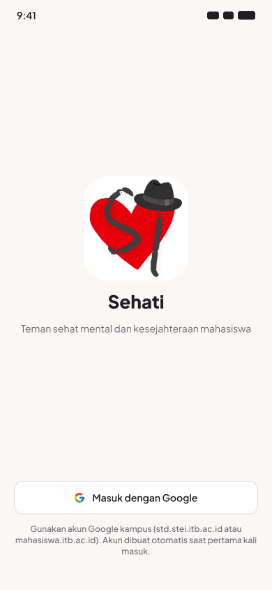
</p>
<p align="center">
<i>Gambar 58. Rancangan Antarmuka I-01 - Masuk</i>
</p>

Tabel 126. Spesifikasi Objek Antarmuka I-01

| Id_Objek | Jenis | Konten | Keterangan |
| -------- | ----- | ------ | ---------- |
| I-01-01 | Gambar | Logo Sehati | Identitas aplikasi. |
| I-01-02 | Label | "Sehati" | Nama aplikasi. |
| I-01-03 | Label | "Teman sehat mental dan kesejahteraan mahasiswa" | Slogan aplikasi. |
| I-01-04 | Button | "Masuk dengan Google" | Membuka halaman otorisasi Google. Kode otorisasi diteruskan lewat `LoginView.isiLoginPage(kodeOtorisasi)` ke `AuthController.kirimData(kodeOtorisasi)`, yang menjalankan Algo-001. Akun Mahasiswa baru dibuat otomatis pada login pertama. Setelah berhasil, `HomeView.tampilkanBeranda(peran)` membuka I-02 (Mahasiswa) atau I-03 (Administrator), lalu perangkat didaftarkan untuk notifikasi (Algo-003). |
| I-01-05 | Label | Keterangan akun kampus | Menjelaskan bahwa masuk memakai akun Google kampus dan akun dibuat otomatis. |
| I-01-06 | Banner galat (kondisional) | "Masuk dengan Google gagal. Silakan coba lagi." | Tampil bila validasi Google gagal (UC-11 skenario alternatif 1). Pengguna tetap di I-01. |

## Rancangan Antarmuka I-02 Beranda Mahasiswa

**Antarmuka:** I-02  
**Nama Layar:** Beranda Mahasiswa  
**Kelas View:** `HomeView`  
**Use Case:** UC-11

<p align="center">
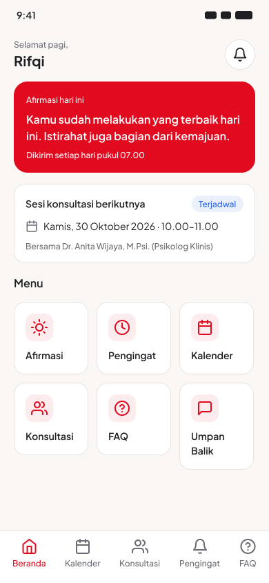
</p>
<p align="center">
<i>Gambar 59. Rancangan Antarmuka I-02 - Beranda Mahasiswa</i>
</p>

Tabel 127. Spesifikasi Objek Antarmuka I-02

| Id_Objek | Jenis | Konten | Keterangan |
| -------- | ----- | ------ | ---------- |
| I-02-01 | Label | "Selamat pagi," dan nama Mahasiswa | Sapaan sesuai waktu dan nama pengguna. |
| I-02-02 | Button ikon | Ikon lonceng | Menampilkan daftar notifikasi yang diterima (`Notifikasi.tampilkanNotifikasi()`). |
| I-02-03 | Kartu | "Afirmasi hari ini" dan isi afirmasi | Data dari `AffirmationController.ambilAfirmasiHariIni()` dan `DailyAffirmation.ambilAfirmasi()` (Algo-031, Q-041). Bila belum ada afirmasi, kartu berisi ajakan mengatur afirmasi. Menekan kartu membuka I-04. |
| I-02-04 | Kartu | "Sesi konsultasi berikutnya", tanggal, waktu, konsultan, lencana "Terjadwal" | Data dari `ConsultationController.ambilSesiBerikutnya()` dan `JadwalKonsultasi.ambilSesiBerikutnya()` (Algo-031, Q-042). Bila belum ada sesi, kartu berisi ajakan memesan sesi yang membuka I-07. Menekan kartu membuka I-06. |
| I-02-05 | MenuTile (6 buah) | Afirmasi, Pengingat, Kalender, Konsultasi, FAQ, Umpan Balik | `HomeView.bukaMenu(menu)` membuka I-04, I-05, I-06, I-07, I-09, atau I-11. |
| I-02-06 | TabBar | Bilah tab Mahasiswa: Beranda, Kalender, Konsultasi, Pengingat, FAQ | Navigasi utama Mahasiswa: Beranda ke I-02, Kalender ke I-06, Konsultasi ke I-07, Pengingat ke I-05, FAQ ke I-09. |

## Rancangan Antarmuka I-03 Beranda Administrator

**Antarmuka:** I-03  
**Nama Layar:** Beranda Administrator  
**Kelas View:** `HomeView`  
**Use Case:** UC-11

<p align="center">
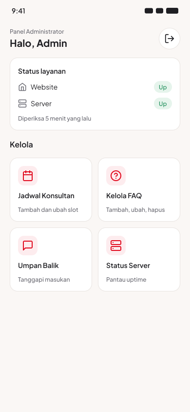
</p>
<p align="center">
<i>Gambar 60. Rancangan Antarmuka I-03 - Beranda Administrator</i>
</p>

Tabel 128. Spesifikasi Objek Antarmuka I-03

| Id_Objek | Jenis | Konten | Keterangan |
| -------- | ----- | ------ | ---------- |
| I-03-01 | Label | "Panel Administrator" dan "Halo, Admin" | Sapaan untuk Administrator. |
| I-03-02 | Button ikon | Ikon keluar | Menjalankan `SesiAutentikasi.logout()` lalu kembali ke I-01. |
| I-03-03 | Kartu | "Status layanan": Website dan Server dengan lencana Up/Down | Diisi oleh `HomeView.tampilkanBeranda` lewat `ServerStatusController.tampilkanStatusServer(jenis)` dan `StatusServer.ambilStatusServer(jenis)` (Algo-031, Algo-020). Menekan kartu membuka I-15. |
| I-03-04 | MenuTile (4 buah) | Jadwal Konsultan, Kelola FAQ, Umpan Balik, Status Server | `HomeView.bukaMenu(menu)` membuka I-12, I-13, I-14, atau I-15. |

## Rancangan Antarmuka I-04 Daily Affirmations

**Antarmuka:** I-04  
**Nama Layar:** Daily Affirmations  
**Kelas View:** `AffirmationView`  
**Use Case:** UC-01

<p align="center">
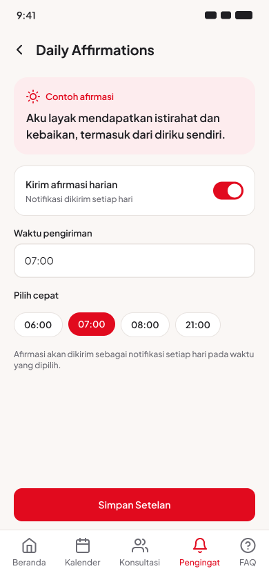
</p>
<p align="center">
<i>Gambar 61. Rancangan Antarmuka I-04 - Daily Affirmations</i>
</p>

Tabel 129. Spesifikasi Objek Antarmuka I-04

| Id_Objek | Jenis | Konten | Keterangan |
| -------- | ----- | ------ | ---------- |
| I-04-01 | AppBar | Tombol kembali dan judul "Daily Affirmations" | Tombol kembali menutup layar dan kembali ke layar sebelumnya. |
| I-04-02 | Kartu | "Contoh afirmasi" dan isi afirmasi | Pratinjau isi afirmasi yang akan dikirim. |
| I-04-03 | Toggle | "Kirim afirmasi harian" | Mengaktifkan atau menonaktifkan pengiriman afirmasi harian. |
| I-04-04 | Text field | Label "Waktu pengiriman", isi "07:00" | Menekan kolom membuka pemilih waktu. Waktu dikirim lewat `AffirmationView.pilihWaktuPengiriman(waktu)`. |
| I-04-05 | Chip (4 buah) | "06:00", "07:00", "08:00", "21:00" | Mengisi I-04-04 dengan waktu yang dipilih. Chip aktif berwarna merah. |
| I-04-06 | Label | Keterangan pengiriman | Menjelaskan bahwa afirmasi dikirim setiap hari pada waktu terpilih. |
| I-04-07 | Button | "Simpan Setelan" | `AffirmationController.submitWaktuPengiriman(waktu)`: `Validasi.validasiWaktu` (Algo-023), lalu `DailyAffirmation.aturWaktuKirim` (Algo-004). Bila berhasil, `AffirmationView.tampilkanSetelanTersimpan()` menampilkan konfirmasi. |
| I-04-08 | Banner galat (kondisional) | "Setelan gagal disimpan. Silakan coba lagi." | Tampil bila penyimpanan gagal (UC-01 skenario alternatif 1). |
| I-04-09 | TabBar | Bilah tab Mahasiswa: Beranda, Kalender, Konsultasi, Pengingat, FAQ (Pengingat aktif) | Navigasi utama Mahasiswa: Beranda ke I-02, Kalender ke I-06, Konsultasi ke I-07, Pengingat ke I-05, FAQ ke I-09. |

## Rancangan Antarmuka I-05 Pengingat Kesehatan

**Antarmuka:** I-05  
**Nama Layar:** Pengingat Kesehatan  
**Kelas View:** `ReminderView`  
**Use Case:** UC-02

<p align="center">
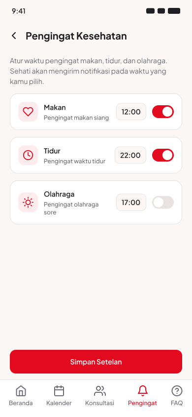
</p>
<p align="center">
<i>Gambar 62. Rancangan Antarmuka I-05 - Pengingat Kesehatan</i>
</p>

Tabel 130. Spesifikasi Objek Antarmuka I-05

| Id_Objek | Jenis | Konten | Keterangan |
| -------- | ----- | ------ | ---------- |
| I-05-01 | AppBar | Tombol kembali dan judul "Pengingat Kesehatan" | Tombol kembali menutup layar dan kembali ke layar sebelumnya. |
| I-05-02 | Label | Penjelasan pengingat | Menjelaskan fungsi layar. |
| I-05-03 | Kartu (3 buah) | Makan, Tidur, Olahraga, masing-masing dengan ikon, keterangan, waktu, dan sakelar | Satu kartu untuk setiap jenis pengingat. |
| I-05-04 | Text field waktu | "12:00", "22:00", "17:00" | Menekan waktu membuka pemilih waktu. Waktu dikirim lewat `ReminderView.pilihWaktuPengiriman(waktu)`. |
| I-05-05 | Toggle (3 buah) | Aktif atau nonaktif | Mengaktifkan atau menonaktifkan pengingat jenis tersebut. |
| I-05-06 | Button | "Simpan Setelan" | `ReminderController.submitWaktuPengiriman(waktu)`: `Validasi.validasiWaktu` (Algo-023), lalu `Reminder.aturWaktuKirim` (Algo-006). Bila berhasil, menampilkan konfirmasi setelan tersimpan. |
| I-05-07 | Banner galat (kondisional) | "Setelan gagal disimpan. Silakan coba lagi." | Tampil bila penyimpanan gagal (UC-02 skenario alternatif 1). |
| I-05-08 | TabBar | Bilah tab Mahasiswa: Beranda, Kalender, Konsultasi, Pengingat, FAQ (Pengingat aktif) | Navigasi utama Mahasiswa: Beranda ke I-02, Kalender ke I-06, Konsultasi ke I-07, Pengingat ke I-05, FAQ ke I-09. |

## Rancangan Antarmuka I-06 Kalender Terintegrasi

**Antarmuka:** I-06  
**Nama Layar:** Kalender Terintegrasi  
**Kelas View:** `CalendarView`  
**Use Case:** UC-03

<p align="center">
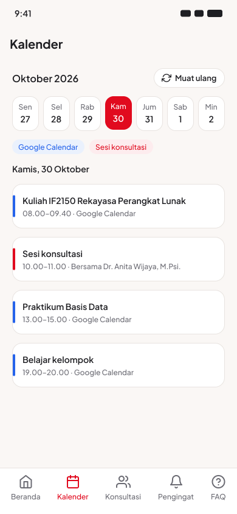
</p>
<p align="center">
<i>Gambar 63. Rancangan Antarmuka I-06 - Kalender Terintegrasi</i>
</p>

Tabel 131. Spesifikasi Objek Antarmuka I-06

| Id_Objek | Jenis | Konten | Keterangan |
| -------- | ----- | ------ | ---------- |
| I-06-01 | AppBar | Judul "Kalender" | Judul layar utama tab Kalender. |
| I-06-02 | Label | "Oktober 2026" | Bulan yang sedang ditampilkan. |
| I-06-03 | Button | "Muat ulang" | Menjalankan ulang `CalendarView.bukaPageCalendar()` dan `CalendarController.tampilkanCalendar()`: event Google (Algo-009), jadwal konsultasi (Algo-015), lalu digabung (Algo-011). |
| I-06-04 | Pemilih hari (7 tombol) | "Sen 27" sampai "Min 2" | Memilih hari. Daftar acara di bawahnya mengikuti hari terpilih. |
| I-06-05 | Lencana (2 buah) | "Google Calendar", "Sesi konsultasi" | Keterangan warna penanda acara. |
| I-06-06 | Kartu acara (daftar) | Judul acara, jam, dan sumber | Hasil `KalenderGabungan.gabungkanJadwal` (Algo-011) yang ditampilkan lewat `CalendarView.tampilkanKalender(kalender)`. Penanda biru untuk event Google, merah untuk sesi konsultasi. |
| I-06-07 | Banner galat (kondisional) | "Gagal mengambil data event. Tekan Muat ulang untuk mencoba lagi." | Tampil lewat `CalendarView.showErrorMessage(pesan)` bila event gagal diambil (UC-03 skenario alternatif 1). Tombol I-06-03 dipakai untuk mencoba lagi. |
| I-06-08 | TabBar | Bilah tab Mahasiswa: Beranda, Kalender, Konsultasi, Pengingat, FAQ (Kalender aktif) | Navigasi utama Mahasiswa: Beranda ke I-02, Kalender ke I-06, Konsultasi ke I-07, Pengingat ke I-05, FAQ ke I-09. |

## Rancangan Antarmuka I-07 Pilih Konsultan

**Antarmuka:** I-07  
**Nama Layar:** Pilih Konsultan  
**Kelas View:** `ConsultationBookingView`  
**Use Case:** UC-04

<p align="center">
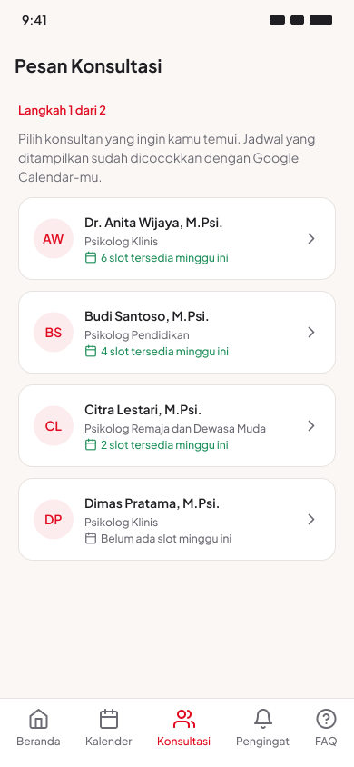
</p>
<p align="center">
<i>Gambar 64. Rancangan Antarmuka I-07 - Pilih Konsultan</i>
</p>

Tabel 132. Spesifikasi Objek Antarmuka I-07

| Id_Objek | Jenis | Konten | Keterangan |
| -------- | ----- | ------ | ---------- |
| I-07-01 | AppBar | Judul "Pesan Konsultasi" | Judul layar utama tab Konsultasi. |
| I-07-02 | Label | "Langkah 1 dari 2" | Penanda langkah pemesanan. |
| I-07-03 | Label | Penjelasan pemilihan konsultan | Menjelaskan bahwa jadwal sudah dicocokkan dengan Google Calendar. |
| I-07-04 | Kartu konsultan (daftar) | Inisial, nama, spesialisasi, dan jumlah slot tersedia | Data dari `Konsultan.ambilDaftarKonsultan()` (Algo-014). Menekan kartu menjalankan `ConsultationBookingView.pilihKonsultan(konsultan)` dan `ConsultationController.submitKonsultan(konsultan)`: `Validasi.validasiKonsultan` (Algo-024) dan `JadwalKonsultasi.ambilKalender(konsultan)` (Algo-015), lalu membuka I-08. |
| I-07-05 | Banner galat (kondisional) | "Gagal mengambil data jadwal konsultasi. Tekan Muat ulang untuk mencoba lagi." | Tampil bila data jadwal gagal diambil (UC-04 skenario alternatif 1). |
| I-07-06 | TabBar | Bilah tab Mahasiswa: Beranda, Kalender, Konsultasi, Pengingat, FAQ (Konsultasi aktif) | Navigasi utama Mahasiswa: Beranda ke I-02, Kalender ke I-06, Konsultasi ke I-07, Pengingat ke I-05, FAQ ke I-09. |

## Rancangan Antarmuka I-08 Pilih Sesi dan Konfirmasi

**Antarmuka:** I-08  
**Nama Layar:** Pilih Sesi dan Konfirmasi  
**Kelas View:** `ConsultationBookingView`  
**Use Case:** UC-04

<p align="center">
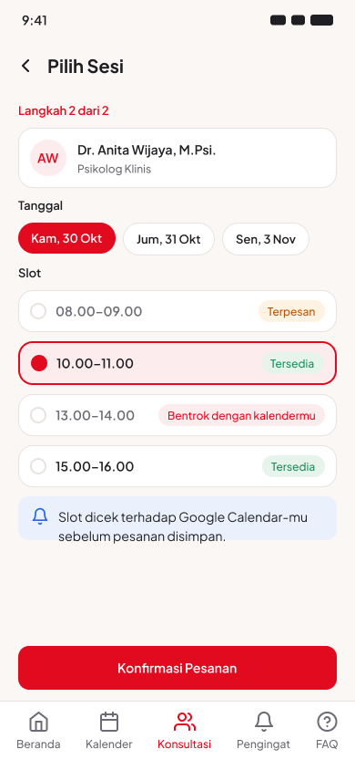
</p>
<p align="center">
<i>Gambar 65. Rancangan Antarmuka I-08 - Pilih Sesi dan Konfirmasi</i>
</p>

Tabel 133. Spesifikasi Objek Antarmuka I-08

| Id_Objek | Jenis | Konten | Keterangan |
| -------- | ----- | ------ | ---------- |
| I-08-01 | AppBar | Tombol kembali dan judul "Pilih Sesi" | Tombol kembali menutup layar dan kembali ke layar sebelumnya. |
| I-08-02 | Label | "Langkah 2 dari 2" | Penanda langkah pemesanan. |
| I-08-03 | Kartu | Konsultan terpilih | Menampilkan konsultan yang dipilih pada I-07. |
| I-08-04 | Chip tanggal (3 buah) | "Kam, 30 Okt", "Jum, 31 Okt", "Sen, 3 Nov" | Memilih tanggal. Daftar slot mengikuti tanggal terpilih. |
| I-08-05 | Pilihan slot (daftar) | Jam dan lencana "Tersedia", "Terpesan", atau "Bentrok dengan kalendermu" | Menekan slot tersedia menjalankan `ConsultationBookingView.pilihSesi(jadwal)`. Slot terpesan dan slot yang bentrok dengan event Google Calendar tidak dapat dipilih. |
| I-08-06 | Banner info | "Slot dicek terhadap Google Calendar-mu sebelum pesanan disimpan." | Informasi pemeriksaan bentrok. |
| I-08-07 | Button | "Konfirmasi Pesanan" | `ConsultationController.updateStatusKonsultasi(jadwal)` (Algo-022): `KalenderGabungan.jadwalBentrok` (Algo-012), `KalenderGabungan.ubahKalender` (Algo-013), lalu `JadwalKonsultasi.pesanSesi` (Algo-016). Bila berhasil, menampilkan konfirmasi dan sesi muncul pada I-02 dan I-06. |
| I-08-08 | Banner galat (kondisional) | "Sesi gagal dipesan. Silakan tekan Konfirmasi sekali lagi." | Tampil bila pesanan gagal disimpan (UC-04 skenario alternatif 2). |
| I-08-09 | TabBar | Bilah tab Mahasiswa: Beranda, Kalender, Konsultasi, Pengingat, FAQ (Konsultasi aktif) | Navigasi utama Mahasiswa: Beranda ke I-02, Kalender ke I-06, Konsultasi ke I-07, Pengingat ke I-05, FAQ ke I-09. |

## Rancangan Antarmuka I-09 FAQ dan Pencarian

**Antarmuka:** I-09  
**Nama Layar:** FAQ dan Pencarian  
**Kelas View:** `FAQView`  
**Use Case:** UC-06

<p align="center">
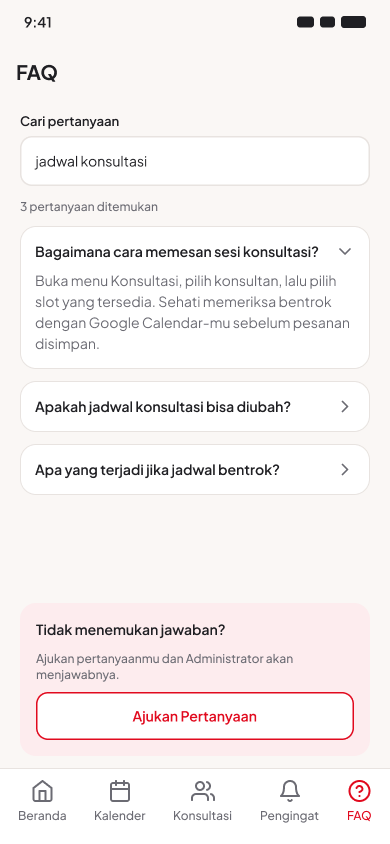
</p>
<p align="center">
<i>Gambar 66. Rancangan Antarmuka I-09 - FAQ dan Pencarian</i>
</p>

Tabel 134. Spesifikasi Objek Antarmuka I-09

| Id_Objek | Jenis | Konten | Keterangan |
| -------- | ----- | ------ | ---------- |
| I-09-01 | AppBar | Judul "FAQ" | Judul layar utama tab FAQ. |
| I-09-02 | Text field | Label "Cari pertanyaan" | `FAQView.cariFAQ(kataKunci)` diteruskan ke `FAQController.cariFAQ` dan `FAQ.cariFAQ` (Algo-017). Hasil ditampilkan lewat `FAQView.tampilkanFAQ(daftar)`. |
| I-09-03 | Label | "3 pertanyaan ditemukan" | Jumlah hasil pencarian. |
| I-09-04 | Accordion (daftar) | Pertanyaan, dan jawaban saat dibuka | Menekan pertanyaan membuka atau menutup jawabannya. |
| I-09-05 | Kartu | "Tidak menemukan jawaban?" | Tawaran mengajukan pertanyaan (`FAQView.tampilkanTawaranPengajuan()`). Disorot saat pencarian tidak menemukan hasil (UC-06 skenario alternatif 1). |
| I-09-06 | Button | "Ajukan Pertanyaan" | `FAQView.bukaFormPertanyaan()` membuka I-10. |
| I-09-07 | TabBar | Bilah tab Mahasiswa: Beranda, Kalender, Konsultasi, Pengingat, FAQ (FAQ aktif) | Navigasi utama Mahasiswa: Beranda ke I-02, Kalender ke I-06, Konsultasi ke I-07, Pengingat ke I-05, FAQ ke I-09. |

## Rancangan Antarmuka I-10 Form Pengajuan Pertanyaan

**Antarmuka:** I-10  
**Nama Layar:** Form Pengajuan Pertanyaan  
**Kelas View:** `FAQView`  
**Use Case:** UC-12

<p align="center">
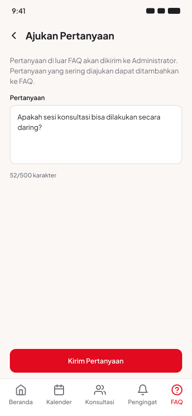
</p>
<p align="center">
<i>Gambar 67. Rancangan Antarmuka I-10 - Form Pengajuan Pertanyaan</i>
</p>

Tabel 135. Spesifikasi Objek Antarmuka I-10

| Id_Objek | Jenis | Konten | Keterangan |
| -------- | ----- | ------ | ---------- |
| I-10-01 | AppBar | Tombol kembali dan judul "Ajukan Pertanyaan" | Tombol kembali menutup layar dan kembali ke layar sebelumnya. |
| I-10-02 | Label | Penjelasan pengajuan | Menjelaskan bahwa pertanyaan dikirim ke Administrator. |
| I-10-03 | Text area | Label "Pertanyaan" | Isi pertanyaan dikirim lewat `FAQView.isiFormPertanyaan(isi)`. |
| I-10-04 | Label | "52/500 karakter" | Penghitung karakter, maksimal 500. |
| I-10-05 | Button | "Kirim Pertanyaan" | `FAQController.kirimPertanyaan(isi)`: `Validasi.validasiInput` (Algo-026), lalu `PengajuanPertanyaan.ajukanPertanyaan` yang disimpan lewat `CloudflareD1Database.simpanPerubahan` (Algo-030). |
| I-10-06 | Banner sukses (kondisional) | "Pertanyaan berhasil dikirim. Terima kasih!" | Tampil bila pertanyaan tersimpan. |
| I-10-07 | Banner galat (kondisional) | "Pertanyaan gagal disimpan. Silakan coba lagi." | Tampil bila penyimpanan gagal (UC-12 skenario alternatif 1). |
| I-10-08 | TabBar | Bilah tab Mahasiswa: Beranda, Kalender, Konsultasi, Pengingat, FAQ (FAQ aktif) | Navigasi utama Mahasiswa: Beranda ke I-02, Kalender ke I-06, Konsultasi ke I-07, Pengingat ke I-05, FAQ ke I-09. |

## Rancangan Antarmuka I-11 Umpan Balik

**Antarmuka:** I-11  
**Nama Layar:** Umpan Balik  
**Kelas View:** `FeedbackView`  
**Use Case:** UC-08

<p align="center">
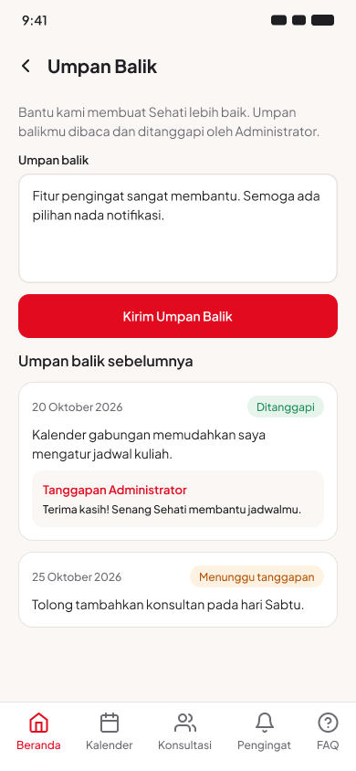
</p>
<p align="center">
<i>Gambar 68. Rancangan Antarmuka I-11 - Umpan Balik</i>
</p>

Tabel 136. Spesifikasi Objek Antarmuka I-11

| Id_Objek | Jenis | Konten | Keterangan |
| -------- | ----- | ------ | ---------- |
| I-11-01 | AppBar | Tombol kembali dan judul "Umpan Balik" | Tombol kembali menutup layar dan kembali ke layar sebelumnya. |
| I-11-02 | Label | Penjelasan umpan balik | Menjelaskan bahwa umpan balik dibaca dan ditanggapi Administrator. |
| I-11-03 | Text area | Label "Umpan balik" | Isi umpan balik dikirim lewat `FeedbackView.isiFormFeedback(isi)`. |
| I-11-04 | Button | "Kirim Umpan Balik" | `FeedbackController.kirimFeedback(isi)`: `Validasi.validasiInput` (Algo-026), lalu `UmpanBalik.kirimUmpanBalik` yang disimpan lewat `CloudflareD1Database.simpanPerubahan` (Algo-030). Bila berhasil, `FeedbackView.tampilkanFeedbackTersimpan()` menampilkan konfirmasi. |
| I-11-05 | Banner galat (kondisional) | "Umpan balik gagal disimpan. Silakan coba lagi." | Tampil bila penyimpanan gagal (UC-08 skenario alternatif 1). |
| I-11-06 | Kartu (daftar) | Umpan balik sebelumnya: tanggal, isi, lencana status, dan tanggapan Administrator | Data dari `UmpanBalik.ambilListUmpanBalik()` (Algo-018). Tanggapan tampil setelah Administrator menanggapi pada I-14. Bila tanggapan gagal dimuat (UC-09 skenario alternatif 1), kartu tampil tanpa tanggapan. |
| I-11-07 | TabBar | Bilah tab Mahasiswa: Beranda, Kalender, Konsultasi, Pengingat, FAQ (Beranda aktif) | Navigasi utama Mahasiswa: Beranda ke I-02, Kalender ke I-06, Konsultasi ke I-07, Pengingat ke I-05, FAQ ke I-09. |

## Rancangan Antarmuka I-12 Kelola Jadwal Konsultan

**Antarmuka:** I-12  
**Nama Layar:** Kelola Jadwal Konsultan  
**Kelas View:** `ConsultationManagementView`  
**Use Case:** UC-05

<p align="center">
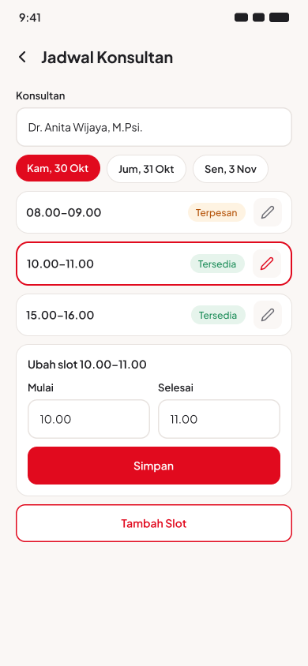
</p>
<p align="center">
<i>Gambar 69. Rancangan Antarmuka I-12 - Kelola Jadwal Konsultan</i>
</p>

Tabel 137. Spesifikasi Objek Antarmuka I-12

| Id_Objek | Jenis | Konten | Keterangan |
| -------- | ----- | ------ | ---------- |
| I-12-01 | AppBar | Tombol kembali dan judul "Jadwal Konsultan" | Tombol kembali menutup layar dan kembali ke layar sebelumnya. |
| I-12-02 | Text field (pilihan) | Label "Konsultan", isi nama konsultan | Memilih konsultan lewat `ConsultationManagementView.pilihKonsultan(konsultan)` dan `ConsultationController.submitKonsultan(konsultan)` (Algo-024, Algo-015). |
| I-12-03 | Chip tanggal (3 buah) | "Kam, 30 Okt", "Jum, 31 Okt", "Sen, 3 Nov" | Memilih tanggal. Daftar slot mengikuti tanggal terpilih. |
| I-12-04 | Kartu slot (daftar) | Jam, lencana "Terpesan" atau "Tersedia", dan tombol ubah | Menekan tombol ubah membuka panel I-12-05 untuk slot tersebut. |
| I-12-05 | Panel | "Ubah slot" dengan kolom "Mulai" dan "Selesai" | Perubahan dikirim lewat `ConsultationManagementView.perbaruiJadwal(jadwal)`. |
| I-12-06 | Button | "Simpan" | `ConsultationController.updateStatusKonsultasi(jadwal)` (Algo-022): `Validasi.validasiJadwal` (Algo-025), lalu `KalenderGabungan.ubahKalender` (Algo-013) dan `CloudflareD1Database.simpanKalender` (Algo-029). |
| I-12-07 | Banner galat (kondisional) | "Perubahan jadwal gagal disimpan. Tekan Simpan sekali lagi." | Tampil di panel bila perubahan gagal disimpan (UC-05 skenario alternatif 2). |
| I-12-08 | Banner galat (kondisional) | "Gagal mengambil data jadwal konsultasi. Tekan Muat ulang untuk mencoba lagi." | Tampil bila data jadwal gagal diambil (UC-05 skenario alternatif 1). |
| I-12-09 | Button | "Tambah Slot" | Membuka panel I-12-05 kosong untuk slot baru, yang disimpan lewat `JadwalKonsultasi.simpanJadwal()`. |

## Rancangan Antarmuka I-13 Kelola FAQ

**Antarmuka:** I-13  
**Nama Layar:** Kelola FAQ  
**Kelas View:** `FAQView`  
**Use Case:** UC-07

<p align="center">
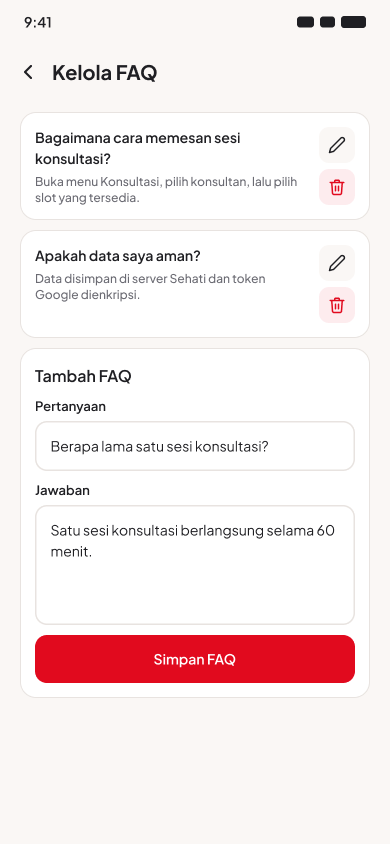
</p>
<p align="center">
<i>Gambar 70. Rancangan Antarmuka I-13 - Kelola FAQ</i>
</p>

Tabel 138. Spesifikasi Objek Antarmuka I-13

| Id_Objek | Jenis | Konten | Keterangan |
| -------- | ----- | ------ | ---------- |
| I-13-01 | AppBar | Tombol kembali dan judul "Kelola FAQ" | Tombol kembali menutup layar dan kembali ke layar sebelumnya. |
| I-13-02 | Kartu FAQ (daftar) | Pertanyaan dan jawaban singkat | Data dari `FAQ.ambilDaftarPertanyaan()`. |
| I-13-03 | Button ikon (per kartu) | Ikon ubah | Mengisi formulir I-13-05 dengan FAQ terpilih. Perubahan disimpan lewat `FAQView.ubahFAQ` dan `FAQController.ubahFAQ` (Algo-026, Algo-030). |
| I-13-04 | Button ikon (per kartu) | Ikon hapus | Setelah konfirmasi, `FAQView.hapusFAQ(idFAQ)` diteruskan ke `FAQController.hapusFAQ` dan `FAQ.hapusFAQ` (Algo-030). |
| I-13-05 | Formulir | "Tambah FAQ" dengan kolom "Pertanyaan" dan area teks "Jawaban" | Isian FAQ baru atau FAQ yang sedang diubah. |
| I-13-06 | Button | "Simpan FAQ" | `FAQController.tambahFAQ(pertanyaan, jawaban)`: `Validasi.validasiInput` (Algo-026), lalu `FAQ.tambahFAQ` yang disimpan lewat `CloudflareD1Database.simpanPerubahan` (Algo-030). |
| I-13-07 | Banner galat (kondisional) | "FAQ gagal disimpan. Silakan coba lagi." | Tampil bila penambahan, perubahan, atau penghapusan gagal (UC-07 skenario alternatif 1). |

## Rancangan Antarmuka I-14 Tanggapi Umpan Balik

**Antarmuka:** I-14  
**Nama Layar:** Tanggapi Umpan Balik  
**Kelas View:** `FeedbackView`  
**Use Case:** UC-09

<p align="center">
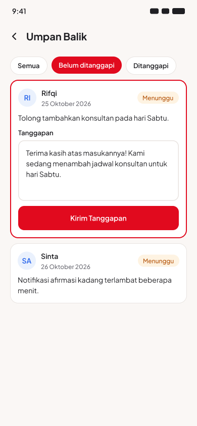
</p>
<p align="center">
<i>Gambar 71. Rancangan Antarmuka I-14 - Tanggapi Umpan Balik</i>
</p>

Tabel 139. Spesifikasi Objek Antarmuka I-14

| Id_Objek | Jenis | Konten | Keterangan |
| -------- | ----- | ------ | ---------- |
| I-14-01 | AppBar | Tombol kembali dan judul "Umpan Balik" | Tombol kembali menutup layar dan kembali ke layar sebelumnya. |
| I-14-02 | Chip filter (3 buah) | "Semua", "Belum ditanggapi", "Ditanggapi" | Menyaring daftar umpan balik. |
| I-14-03 | Kartu umpan balik (daftar) | Inisial dan nama pengirim, tanggal, lencana status, isi umpan balik | Data dari `UmpanBalik.ambilListUmpanBalik()` (Algo-018). Menekan kartu membuka kolom tanggapan. |
| I-14-04 | Text area | Label "Tanggapan" | Isi tanggapan dikirim lewat `FeedbackView.tanggapiFeedback(tanggapan)`. |
| I-14-05 | Button | "Kirim Tanggapan" | `FeedbackController.kirimTanggapan(tanggapan)`: `Validasi.validasiInput` (Algo-026), lalu `UmpanBalik.berikanTanggapan` (Algo-019). Tanggapan tampil pada I-11 milik pengirim. |
| I-14-06 | Banner galat (kondisional) | "Tanggapan gagal disimpan. Silakan coba lagi." | Tampil bila tanggapan gagal disimpan. |

## Rancangan Antarmuka I-15 Status Server

**Antarmuka:** I-15  
**Nama Layar:** Status Server  
**Kelas View:** `ServerStatusView`  
**Use Case:** UC-10

<p align="center">
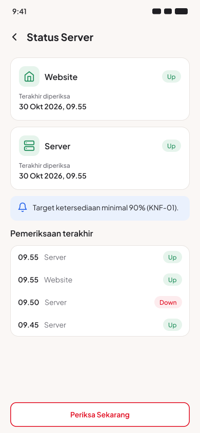
</p>
<p align="center">
<i>Gambar 72. Rancangan Antarmuka I-15 - Status Server</i>
</p>

Tabel 140. Spesifikasi Objek Antarmuka I-15

| Id_Objek | Jenis | Konten | Keterangan |
| -------- | ----- | ------ | ---------- |
| I-15-01 | AppBar | Tombol kembali dan judul "Status Server" | Tombol kembali menutup layar dan kembali ke layar sebelumnya. |
| I-15-02 | Kartu | Website: lencana Up/Down dan waktu pemeriksaan terakhir | `ServerStatusView.cekStatusServer("website")` diteruskan ke `ServerStatusController.tampilkanStatusServer` dan `StatusServer.ambilStatusServer` (Algo-020). |
| I-15-03 | Kartu | Server: lencana Up/Down dan waktu pemeriksaan terakhir | Sama seperti I-15-02 dengan jenis "server". |
| I-15-04 | Banner info | "Target ketersediaan minimal 90% (KNF-01)." | Informasi target ketersediaan. |
| I-15-05 | Daftar | Riwayat pemeriksaan: waktu, jenis, lencana Up/Down | Riwayat pemeriksaan terbaru dari tabel `status_server`. |
| I-15-06 | Button | "Periksa Sekarang" | Menjalankan `StatusServer.cekStatusServer()` (Algo-021) untuk kedua jenis, lalu memperbarui I-15-02 dan I-15-03. |

## Rancangan Antarmuka Keseluruhan

Daftar seluruh layar beserta ID-nya. ID yang sama dipakai pada subbab perancangan antarmuka masing-masing.

Tabel 141. Rancangan Antarmuka Keseluruhan

| No | Tampilan Antarmuka |
| -- | ------------------ |
| I-01<br>Masuk |  |
| I-02<br>Beranda Mahasiswa |  |
| I-03<br>Beranda Administrator |  |
| I-04<br>Daily Affirmations |  |
| I-05<br>Pengingat Kesehatan |  |
| I-06<br>Kalender Terintegrasi |  |
| I-07<br>Pilih Konsultan |  |
| I-08<br>Pilih Sesi dan Konfirmasi |  |
| I-09<br>FAQ dan Pencarian |  |
| I-10<br>Form Pengajuan Pertanyaan |  |
| I-11<br>Umpan Balik |  |
| I-12<br>Kelola Jadwal Konsultan |  |
| I-13<br>Kelola FAQ |  |
| I-14<br>Tanggapi Umpan Balik |  |
| I-15<br>Status Server |  |

# Matriks Kerunutan

Matriks ini memetakan setiap kelas perancangan terhadap _use case_ yang direalisasikannya, mengacu pada _Traceability_ Struktur Kelas dan disesuaikan dengan bagian Realisasi Use Case.

Tabel 142. Matriks Kerunutan Kelas terhadap Use Case

| Kelas                               | Use Case Terkait                                                                                                                                                                                                                                                                                             |
| ----------------------------------- | ------------------------------------------------------------------------------------------------------------------------------------------------------------------------------------------------------------------------------------------------------------------------------------------------------------ |
| C-01 - `Pengguna`                   | UC-11 - Masuk Melalui Akun Google                                                                                                                                                                                                                                                                            |
| C-02 - `Mahasiswa`                  | UC-01 - Menyetel Daily Affirmations, UC-02 - Menyetel Pengingat Kesehatan, UC-03 - Melihat Kalender Terintegrasi, UC-04 - Memesan Sesi Konsultasi, UC-06 - Melihat FAQ, UC-08 - Memberikan Umpan Balik, UC-09 - Menanggapi Umpan Balik, UC-11 - Masuk Melalui Akun Google, UC-12 - Form Pengajuan Pertanyaan |
| C-03 - `Administrator`              | UC-05 - Mengelola Jadwal Konsultan, UC-07 - Mengelola FAQ, UC-09 - Menanggapi Umpan Balik, UC-10 - Memantau Status Server, UC-11 - Masuk Melalui Akun Google                                                                                                                                                 |
| C-04 - `SesiAutentikasi`            | UC-11 - Masuk Melalui Akun Google                                                                                                                                                                                                                                                                            |
| C-05 - `DailyAffirmation`           | UC-01 - Menyetel Daily Affirmations                                                                                                                                                                                                                                                                          |
| C-06 - `Reminder`                   | UC-02 - Menyetel Pengingat Kesehatan                                                                                                                                                                                                                                                                         |
| C-07 - `Notifikasi`                 | UC-01 - Menyetel Daily Affirmations, UC-02 - Menyetel Pengingat Kesehatan                                                                                                                                                                                                                                    |
| C-08 - `GoogleCalendarService`      | UC-03 - Melihat Kalender Terintegrasi, UC-04 - Memesan Sesi Konsultasi                                                                                                                                                                                                                                       |
| C-09 - `KalenderGabungan`           | UC-03 - Melihat Kalender Terintegrasi, UC-04 - Memesan Sesi Konsultasi, UC-05 - Mengelola Jadwal Konsultan                                                                                                                                                                                                   |
| C-10 - `Konsultan`                  | UC-04 - Memesan Sesi Konsultasi, UC-05 - Mengelola Jadwal Konsultan                                                                                                                                                                                                                                          |
| C-11 - `JadwalKonsultasi`           | UC-03 - Melihat Kalender Terintegrasi, UC-04 - Memesan Sesi Konsultasi, UC-05 - Mengelola Jadwal Konsultan                                                                                                                                                                                                   |
| C-12 - `FAQ`                        | UC-06 - Melihat FAQ, UC-07 - Mengelola FAQ                                                                                                                                                                                                                                                                   |
| C-13 - `PengajuanPertanyaan`        | UC-12 - Form Pengajuan Pertanyaan                                                                                                                                                                                                                                                                            |
| C-14 - `UmpanBalik`                 | UC-08 - Memberikan Umpan Balik, UC-09 - Menanggapi Umpan Balik                                                                                                                                                                                                                                               |
| C-15 - `StatusServer`               | UC-10 - Memantau Status Server                                                                                                                                                                                                                                                                               |
| C-16 - `LoginView`                  | UC-11 - Masuk Melalui Akun Google                                                                                                                                                                                                                                                                            |
| C-17 - `AffirmationView`            | UC-01 - Menyetel Daily Affirmations                                                                                                                                                                                                                                                                          |
| C-18 - `ReminderView`               | UC-02 - Menyetel Pengingat Kesehatan                                                                                                                                                                                                                                                                         |
| C-19 - `CalendarView`               | UC-03 - Melihat Kalender Terintegrasi                                                                                                                                                                                                                                                                        |
| C-20 - `ConsultationBookingView`    | UC-04 - Memesan Sesi Konsultasi                                                                                                                                                                                                                                                                              |
| C-21 - `ConsultationManagementView` | UC-05 - Mengelola Jadwal Konsultan                                                                                                                                                                                                                                                                           |
| C-22 - `FAQView`                    | UC-06 - Melihat FAQ, UC-07 - Mengelola FAQ, UC-12 - Form Pengajuan Pertanyaan                                                                                                                                                                                                                                |
| C-23 - `FeedbackView`               | UC-08 - Memberikan Umpan Balik, UC-09 - Menanggapi Umpan Balik                                                                                                                                                                                                                                               |
| C-24 - `ServerStatusView`           | UC-10 - Memantau Status Server                                                                                                                                                                                                                                                                               |
| C-25 - `AuthController`             | UC-11 - Masuk Melalui Akun Google                                                                                                                                                                                                                                                                            |
| C-26 - `AffirmationController`      | UC-01 - Menyetel Daily Affirmations                                                                                                                                                                                                                                                                          |
| C-27 - `ReminderController`         | UC-02 - Menyetel Pengingat Kesehatan                                                                                                                                                                                                                                                                         |
| C-28 - `CalendarController`         | UC-03 - Melihat Kalender Terintegrasi                                                                                                                                                                                                                                                                        |
| C-29 - `ConsultationController`     | UC-04 - Memesan Sesi Konsultasi, UC-05 - Mengelola Jadwal Konsultan                                                                                                                                                                                                                                          |
| C-30 - `FAQController`              | UC-06 - Melihat FAQ, UC-07 - Mengelola FAQ, UC-12 - Form Pengajuan Pertanyaan                                                                                                                                                                                                                                |
| C-31 - `FeedbackController`         | UC-08 - Memberikan Umpan Balik, UC-09 - Menanggapi Umpan Balik                                                                                                                                                                                                                                               |
| C-32 - `ServerStatusController`     | UC-10 - Memantau Status Server                                                                                                                                                                                                                                                                               |
| C-33 - `Validasi`                   | UC-01 - Menyetel Daily Affirmations, UC-02 - Menyetel Pengingat Kesehatan, UC-04 - Memesan Sesi Konsultasi, UC-05 - Mengelola Jadwal Konsultan, UC-07 - Mengelola FAQ, UC-08 - Memberikan Umpan Balik, UC-09 - Menanggapi Umpan Balik, UC-12 - Form Pengajuan Pertanyaan                                     |
| C-34 - `GoogleAuthService`          | UC-11 - Masuk Melalui Akun Google                                                                                                                                                                                                                                                                            |
| C-35 - `CloudflareD1Database`       | UC-01 - Menyetel Daily Affirmations, UC-02 - Menyetel Pengingat Kesehatan, UC-04 - Memesan Sesi Konsultasi, UC-05 - Mengelola Jadwal Konsultan, UC-07 - Mengelola FAQ, UC-08 - Memberikan Umpan Balik, UC-09 - Menanggapi Umpan Balik, UC-11 - Masuk Melalui Akun Google, UC-12 - Form Pengajuan Pertanyaan                                     |
| C-36 - `HomeView`                   | UC-11 - Masuk Melalui Akun Google |

# References

1. Kelompok G04 K01, dokumen *Topic Brainstorming*, *Requirement Gathering*, *Use Case & Scenario Use Case*, dan *Class Diagram* untuk Sehati, IF2150 Rekayasa Perangkat Lunak.
2. Google, *Google Calendar API Documentation*. https://developers.google.com/calendar
3. Google, *Google Identity: OAuth 2.0*. https://developers.google.com/identity/protocols/oauth2
4. Garuda Kemdiktisaintek, konflik/ulasan Riliv. https://garuda.kemdiktisaintek.go.id/documents/detail/4396353
5. Ulasan Bicarakan.id. https://play.google.com/store/apps/details?id=id.bicarakan.client_app
6. Ulasan Sahabatku. https://play.google.com/store/apps/details?id=com.icreativelabs.sahabatku
7. Ulasan BetterHelp. https://play.google.com/store/apps/details?id=com.betterhelp&hl=id
8. De Oliveira, Claire, et al. "The Role of Mental Health on Workplace Productivity: A Critical Review of the Literature." *Applied health economics and health policy* 21.2 (2023): 167-193.
9. Sayce, Liz. "Social inclusion and mental health." *Psychiatric Bulletin* 25.4 (2001): 121-123.
10. Our World in Data, *Suicide death rates*. https://ourworldindata.org/grapher/suicide-death-rates
11. Databoks Katadata, *Berapa Angka Bunuh Diri di Indonesia*. https://databoks.katadata.co.id/demografi/statistik/636e76fcf8dc70d/berapa-angka-bunuh-diri-di-indonesia
12. UNDP, *Sustainable Development Goals: Good Health and Well-being*. https://www.undp.org/sustainable-development-goals/good-health
13. Alat pembuatan diagram UML: draw.io (https://www.drawio.com/) dan StarUML (https://staruml.io/).
14. Cloudflare, *Cloudflare Workers Documentation*. https://developers.cloudflare.com/workers/
15. Cloudflare, *Cloudflare D1 Documentation*. https://developers.cloudflare.com/d1/
16. Hono, *Hono Documentation*. https://hono.dev/
17. Expo, *React Native Documentation*. https://docs.expo.dev/
